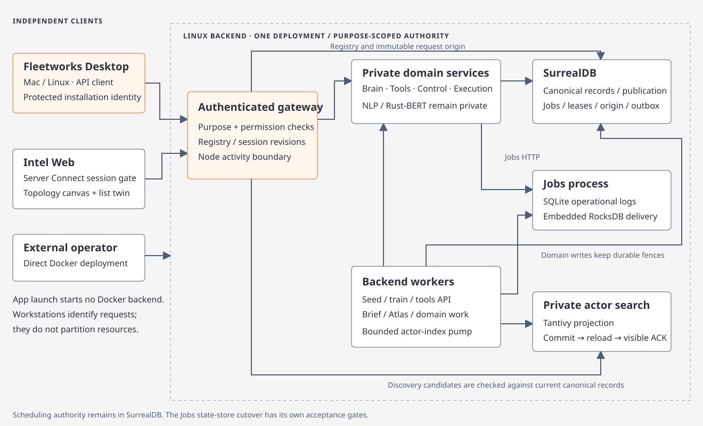

# Fleetworks

<p align="center">
  
</p>

Fleetworks collects public-source intelligence, connects evidence to actors and articles, and prepares cited Focus Briefs. Fleetworks Desktop is a native Rune control hub for macOS and Linux x86_64. It can start an Embedded companion or connect to a Distributed gateway. Intel Web provides the browser desktop. Distributed services are deployed directly with Docker Compose.

[Native app](apps/fleetworks-desktop/README.md) · [Connections](docs/wiki/code/native-connections.md) · [Setup and usage](docs/wiki/code/fleetworks.md) · [Deployment](deploy/README.md) · [Wiki](docs/index.md) · [Releases](docs/wiki/code/versioning.md)

## Approved visual direction

The [matte canvas design reference](docs/design/matte-canvas/README.md) defines the approved native/shared-web target, exact reproduction recipes, symbol-only branding, continuous-scroll and stable-loading behavior. It includes four reviewed concept mockups and the [selected Quiet Orbit animation](assets/brand/reference/fleetworks-quiet-orbit.gif). The docs and source assets are available; native/web runtime adoption and verification remain implementation work.

## Quick start

### Native app

Install the pinned Rust **1.95.0** toolchain and the [host build prerequisites](apps/fleetworks-desktop/README.md#build-and-provision). Build a debug app for the physical macOS or Linux x86_64 host from the repository root:

```sh
python3 scripts/fleetworks_candidate.py build-native --target host --profile debug
```

[](docs/diagrams/native-connections.html)

The helper prints the app and manifest paths. Add `--open` to launch it. The startup choice opens **Setup Gateway** for the selected backend type.

**Embedded:** Choose **Embedded** and click **Start Embedded Backend** to start the bundled companion.

**Distributed:** Enter the gateway URL and obtain operator approval. macOS Keychain or Linux Secret Service retains the scoped credential for reconnect, with explicit Linux session-only mode also available. [Pairing and recovery](docs/wiki/code/native-connections.md#pairing-and-keychain-agreed-target) · [Verification status](.planning/2026-11-12-native-pairing-implementation/acceptance.md)

1. Start the backend with the [Docker Compose quick start below](#backend-for-the-native-app). Backend deployment requires Docker and Docker Compose **v2.20 or newer**.
2. Open **Setup Gateway**, select **Distributed**, enter the gateway URL and choose **Connect**. Give its pairing request ID and approval code to the gateway operator for [approval](docs/wiki/code/native-connections.md#operator-approval-and-revocation).
3. The app authenticates the approved access, retains it using the selected credential storage mode and registers the installation. Workstation Status shows its stable opaque Connect ID; later connections reuse saved access.

Normal startup initializes protected settings in `~/.fleetworks` without creating a default child. IP is optional metadata; folders do not select identity or partition shared actors, model defaults and provider accounts. Existing folders and historical receipts remain preserved. See [workstation identity](docs/wiki/code/native-workspaces.md).

Enter the selectable Connect ID from **Workstation Status** into Intel Web's existing Connect form. The browser uses its separately provisioned WebRelay credential and session; the Connect ID alone grants no authority. See [connection and browser handoff](docs/wiki/code/native-connections.md#browser-handoff).

### Distributed backend for the native app

<a id="backend-for-the-native-app"></a>

Start Docker Desktop or your local Docker engine, then run these commands from the repository root. The backend includes the gateway, private services, workers, SurrealDB, Jobs storage and actor search.

**Single-command build, redeploy, and native launch:** run `native_review.py up` from the repository root. On first run it auto-detects your host Docker platform, initializes `native-local` on port `18091`, and links a private `compose.env` at the repository root (when none exists); on every run it builds the backend service images, redeploys the Docker containers, and builds/opens the native app on supported macOS hosts (`x86_64-apple-darwin` or `aarch64-apple-darwin`):

```sh
python3 deploy/native_review.py up
```

Pass `--name <name>` (defaults to `native-local`) or `--api-port <port>` (defaults to `18091`) on a fresh review, or add `--backend-only` to skip the native build/open (non-macOS hosts skip it automatically). `native_review.py up` checks the active local Docker context/architecture against `PLATFORM`, builds the `backend` Bake group (`runtime`, `surrealdb`, `search-index`), stops and recreates the Compose containers with `--force-recreate --detach --wait`, and—on supported macOS hosts—runs `python3 scripts/fleetworks_candidate.py build-native --target host --profile debug --open`. Existing credentials, scope/epochs and data remain preserved across reruns.

Edit `compose.env` at the repository root to update local Compose settings. It is private and ignored by Git. The deployment's generated env path points to this same file, so both locations use the same settings. Keep its generated access scope, epochs and storage path with the existing credentials and data.

**Restart existing images without rebuilding:** use this command when you only edited `compose.env` or want to restart already-built images from a fresh terminal at the repository root:

```sh
docker compose --env-file compose.env \
  -f deploy/compose.native-review.yml --project-name fleetworks-native-review-native-local \
  up --no-build --pull never --detach --wait
```

Select **Distributed** in **Setup Gateway**, enter `http://127.0.0.1:18091` and have the operator approve the displayed pairing request. Existing stacks need an independently provisioned Operator credential; see [operator setup](deploy/README.md#credentials). This backend runs independently of the app. Atlas collection uses the [additional overlay below](#collect-articles-with-atlas); Intel Web is an optional separate deployment.

Rerun the start command to apply edited Compose settings. To inspect or stop the backend, use the same command prefix with `ps`, `logs --follow` or `down` in place of `up --no-build --pull never --detach --wait`. Stop preserves backend data. For concurrent deployments, run `up --name <other> --api-port <port>` (an existing repo-root `compose.env` stays untouched) and use that deployment's matching env file and project. [Full deployment guide](deploy/README.md#isolated-native-backend-review)

Venture, the six terminal clients and the legacy `argos` executable are retired. Their historical evidence remains available in the [retirement disposition](docs/archive/cli-retirement.md). Backend service executables and administrative support tools remain supported.

### Collect articles with Atlas

Provision provider credentials, the Atlas worker, private NLP and a Rust-BERT model for the container architecture. Enable the separately configured [Atlas Compose overlay](deploy/atlas-dispatch.md). Submit through native News Cycles after connecting and registering; submission requires an advertised durable worker and permission. A job receipt confirms acceptance, while Jobs reports progress and completion. The [Atlas deployment guide](deploy/atlas-dispatch.md) lists the files and settings.

## Applications and services

| Area | What you can do |
| --- | --- |
| DB Seed & Train | Trigger configured actor seed, search-index build and Natural candidate training; acceptance is distinct from completion. |
| News Cycles and Brain Search | Queue cycles, inspect workstation cycle history, discover actors and read dossiers. |
| OSINT Tools and Model Assignments | Read service/provider cards, provision keys and edit supported model routing with confirmed revisions. |
| Workstation Status and Setup Gateway | Inspect identity, readiness and backend resources. Start Embedded or pair and reconnect to Distributed. |
| Jobs & Logs | Read the bounded workstation queue and selected-job safe operational summaries. |
| Intel Web | Browse the Bulletin, Focus Briefs, Related articles, actor dossiers and topology behind the Connect/session gate. |

[](docs/diagrams/fleetworks.html)

The native app uses shared Rust contracts and an origin-pinned API client. Axum serves the gateway; Next.js runs the React Native Web desktop through a same-origin relay with a separate credential. Linux services own inference, indexing and storage: SurrealDB holds domain records and current scheduling state, Jobs owns SQLite operational logs and its embedded RocksDB delivery queue, and private Tantivy serves actor discovery. The Atlas overlay runs Compromise NLP and Rust-BERT behind private endpoints. [Architecture](docs/wiki/code/architecture.md) · [Persistence rollout](docs/wiki/code/jobs-persistence.md)

Source implementation, fixture checks and packaged builds are separate from installed-app, physical-Mac accessibility, real backend integration and both-architecture verification. Production scheduler migration retains its own acceptance gates. Executable retirement does not establish installed-app or dual-Mac parity. See [rollout status](docs/wiki/code/fleetworks.md#rollout-status), [native verification](docs/wiki/code/native-verification.md) and [CI](docs/wiki/code/ci.md) for the applicable checks.

## Development

Use the [contributor workflow](docs/wiki/code/contributing.md) to select checks for the code you changed. Preview the hosted checks for the current commit with the scope planner.

```sh
python3 scripts/fleetworks_verify.py plan --base "$(git rev-parse HEAD^)" --head "$(git rev-parse HEAD)"
```

### Iteration loops

Choose the shortest loop for the changed surface. The native app/fixture graph is engine-free; backend storage tests can link embedded SurrealDB/RocksDB as QA harnesses. Service edits require the affected Linux image. [Visual artifact/path map](docs/wiki/code/build-artifacts.md)

[](docs/diagrams/dev-loops.html)

| Change | Loop |
| --- | --- |
| Rune app, client contracts or workstation manager | Scoped host debug tests, selected same-view Runtime/PNG/tree fixtures, then `python3 scripts/fleetworks_candidate.py build-native --target host --profile debug`. |
| Service roles (`argos-api-host`) | `python3 deploy/native_review.py up` auto-initializes if missing, rebuilds the `backend` Bake images, recreates Docker containers, and builds/opens the native app on supported macOS (`--backend-only` skips native). BuildKit caches dependencies. |
| Web app and `packages/*/src` | Run the separately configured Next development server; use isolated repository Playwright output for browser checks. |
| Dependencies, Dockerfile, Compose or private search | Build the affected image with `docker buildx bake -f deploy/docker-bake.hcl <target>`, then use its isolated deployment checks. |
| Packaging or release | Push and read the hosted CI results for that revision. |

PRs targeting `dev`, `nightly` or `main` automatically run affected Linux x86_64 native and AMD64 backend checks when opened or updated. After Linux review, dispatch the remaining affected platforms and web checks for the same commit. [CI review passes](docs/wiki/code/ci.md#nightly-gsd-order) Trusted pushes publish selected verified unsigned Mac ZIPs and dual-architecture GHCR images: `nightly` → nightly, `dev`/`main` → stable. [Visual checks/publication flow](docs/diagrams/native-release.html) · [Artifact identities and limits](docs/wiki/code/build-artifacts.md#hosted-artifacts-and-publication)

Run host checks first, then the affected container loop, then hosted CI. [Full loop guide](docs/wiki/code/contributing.md#development-loops-local-cli-and-docker)

Agents use `python3 scripts/agent_cargo.py … --locked` and shared `target/agents/debug`; add `--agent` to native build/fixture helpers. Selected test targets can enable extra dependency features, so a smaller `-p` selection may rebuild large dependencies. Choose the loop and resource preflight from [contributing](docs/wiki/code/contributing.md#verification-ownership-and-host-resources); preserve reusable outputs using [cache hygiene](docs/wiki/code/contributing.md#build-cache-hygiene).

Web contributors can find setup and verification in the [Intel web guide](docs/wiki/code/intel-web.md) and the [React test guide](docs/wiki/code/react-ui-testing.md). The [CI guide](docs/wiki/code/ci.md) covers hosted platform and package verification. Agents start at [AGENTS.md](AGENTS.md).

For more, browse the [concepts](docs/wiki/concepts/index.md), [code map](docs/wiki/code/index.md), or [diagram catalog](docs/diagrams.md).
