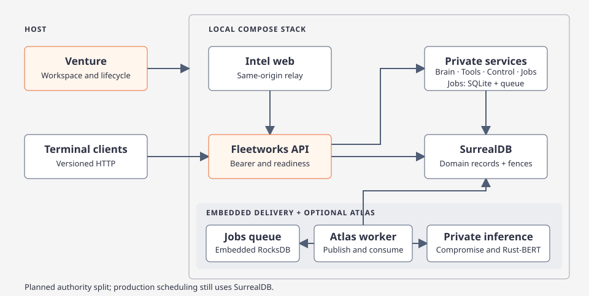

# Fleetworks

<p align="center">
  
</p>

Fleetworks collects public-source intelligence, connects evidence to actors and articles, and prepares cited Focus Briefs. Fleetworks Desktop is a native Rune macOS control hub connected to an independently operated Linux backend. Intel Web provides the browser desktop. Backend services are deployed directly with Docker Compose.

[Native app](apps/fleetworks-desktop/README.md) · [Connections](docs/wiki/code/native-connections.md) · [Setup and usage](docs/wiki/code/fleetworks.md) · [Deployment](deploy/README.md) · [Wiki](docs/index.md) · [Releases](docs/wiki/code/versioning.md)

## Quick start

### Native macOS app

Install the pinned Rust **1.95.0** toolchain and Xcode or its Command Line Tools. Run from the repository root to build and package a debug `.app` for the physical Mac:

```sh
python3 scripts/fleetworks_candidate.py build-native --target host --profile debug
```

The helper prints the app and manifest paths. Add `--open` to launch it. The app opens offline setup and connects to an existing gateway; backend and Intel Web startup are separate operator actions.

1. Provision a backend using the [isolated native-review recipe](deploy/README.md#isolated-native-backend-review), using the direct Docker commands below. Backend deployment requires Docker and Docker Compose **v2.20 or newer**.
2. In **Workstation**, add a named connection with the gateway origin and its private Native-purpose token file. **Test** checks compatibility; **Connect** establishes the connection. Saved profiles keep protected file references, and reconnect is explicit.
3. Select a current LAN/VPN interface and an owned workspace to register request context. Activity and mutations use that registration and the credential's permissions.

Native workspaces are protected children of `~/.fleetworks`, with a `default` child created on first use. Selecting a child changes request origin and activity scope; actors, model defaults and provider accounts remain shared backend resources. See [workspace ownership](docs/wiki/code/native-workspaces.md).

When the gateway advertises an Intel Web URL, **Open Intel Web** opens its Connect form and copies the registered Connect ID. The browser uses its own server credential and session; the Connect ID alone is not a credential. See [connection and browser handoff](docs/wiki/code/native-connections.md#browser-handoff).

### Independent Docker backend

Docker and Docker Compose **v2.20 or newer** run the Linux backend separately from the native app. Provision a new isolated deployment directory and build its backend images from the repository root:

```sh
export REVIEW_NAME=native-local
export PLATFORM="$(python3 scripts/fleetworks_verify.py platform --format docker)"
python3 deploy/native_review.py init --name "$REVIEW_NAME" --api-port 18091 --platform "$PLATFORM"
export REVIEW_WORKSPACE="$(python3 deploy/native_review.py value --name "$REVIEW_NAME" --field workspace)"
export REVIEW_PROJECT="$(python3 deploy/native_review.py value --name "$REVIEW_NAME" --field project)"
export IMAGE_TAG="$(python3 deploy/native_review.py value --name "$REVIEW_NAME" --field image_tag)"
export VERSION="$(tr -d '[:space:]' < version.txt)"
docker buildx bake -f deploy/docker-bake.hcl --load backend
docker compose --env-file "$REVIEW_WORKSPACE/compose.env" -f deploy/compose.native-review.yml \
  --project-name "$REVIEW_PROJECT" up --no-build --pull never --detach --wait
```

Use `http://127.0.0.1:18091` and the deployment's protected `secrets/native-token` file in the native connection editor. This backend-only recipe starts no browser frontend. Keep the same env file, Compose file and project for `ps`, `logs` and `down`; stopping preserves backend data. Concurrent deployments need distinct directories, project names and ports. The native protected container is separate from the deployment directory. [Deployment, credentials and optional Web](deploy/README.md)

Venture, the six terminal clients and the legacy `argos` executable are retired. Their historical evidence remains available in the [retirement disposition](docs/archive/cli-retirement.md). Backend service executables and administrative support tools remain supported.

### Collect articles with Atlas

Provision provider credentials, the Atlas worker, private NLP and a Rust-BERT model for the container architecture. Enable the separately configured [Atlas Compose overlay](deploy/atlas-dispatch.md). Submit through the native Atlas page after connecting and registering; submission requires an advertised durable worker and permission. A job receipt confirms acceptance, while Jobs reports progress and completion. The [Atlas deployment guide](deploy/atlas-dispatch.md) lists the files and settings.

## Applications and services

| Area | What you can do |
| --- | --- |
| Native Atlas and Brain | Submit collection cycles, browse articles, discover actors and read dossiers through the gateway. |
| Native Tools, Models and Profile | Submit permitted tools, inspect results, manage shared model defaults and provider configuration with confirmed revisions. |
| Workstation | Manage saved gateway connections, select a LAN/VPN address and inspect backend readiness. |
| Workspaces | Create, select and attach owned local children; track registration and guarded retirement/removal. |
| Jobs & Logs | Filter and page registered activity, inspect safe operational summaries and export bounded logs. Retry/cancel controls require explicit permission and a supported job state. |
| Intel Web | Browse the Bulletin, Focus Briefs, Related articles, actor dossiers and topology behind the Connect/session gate. |

[](docs/diagrams/fleetworks.html)

The native app uses shared Rust contracts and an origin-pinned API client. Axum serves the gateway; Next.js runs the React Native Web desktop through a same-origin relay with a separate credential. Linux services own inference, indexing and storage: SurrealDB holds domain records and current scheduling state, Jobs owns SQLite operational logs and its embedded RocksDB delivery queue, and private Tantivy serves actor discovery. The Atlas overlay runs Compromise NLP and Rust-BERT behind private endpoints. [Architecture](docs/wiki/code/architecture.md) · [Persistence rollout](docs/wiki/code/jobs-persistence.md)

Source implementation, fixture checks and packaged builds are separate from installed-app, physical-Mac accessibility, real backend integration and both-architecture verification. Production scheduler migration retains its own acceptance gates. Executable retirement does not establish installed-app or dual-Mac parity. See [rollout status](docs/wiki/code/fleetworks.md#rollout-status), [native verification](docs/wiki/code/native-verification.md) and [CI](docs/wiki/code/ci.md) for the applicable checks.

## Development

Use the [contributor workflow](docs/wiki/code/contributing.md) to select checks for the code you changed. Preview the hosted checks for the current commit with the scope planner.

```sh
python3 scripts/fleetworks_verify.py plan --base "$(git rev-parse HEAD^)" --head "$(git rev-parse HEAD)"
```

### Iteration loops

Choose the shortest loop for the changed surface. Native app builds connect to the separately operated backend; service edits require the affected Linux image.

[](docs/diagrams/dev-loops.html)

| Change | Loop |
| --- | --- |
| Rune app, client contracts or workspace manager | Scoped host debug tests, selected same-view Runtime/PNG/tree fixtures, then `python3 scripts/fleetworks_candidate.py build-native --target host --profile debug`. |
| Service roles (`argos-api-host`) | Rebuild the `runtime` image; the native-review `backend` Bake group builds backend-only images. BuildKit caches dependencies. |
| Web app and `packages/*/src` | Run the separately configured Next development server; use isolated repository Playwright output for browser checks. |
| Dependencies, Dockerfile, Compose or private search | Build the affected image with `docker buildx bake -f deploy/docker-bake.hcl <target>`, then use its isolated deployment checks. |
| Packaging or release | Push and read the hosted CI results for that revision. |

Run host checks first, then the affected container loop, then hosted CI. [Full loop guide](docs/wiki/code/contributing.md#development-loops-local-cli-and-docker)

Agents use `python3 scripts/agent_cargo.py … --locked` and the shared `target/agents` debug cache; add `--agent` to native build/fixture helpers. Reuse the matching host/feature graph and preserve the user's `target/debug`. [Cache hygiene](docs/wiki/code/contributing.md#build-cache-hygiene)

Web contributors can find setup and verification in the [Intel web guide](docs/wiki/code/intel-web.md) and the [React test guide](docs/wiki/code/react-ui-testing.md). The [CI guide](docs/wiki/code/ci.md) covers hosted platform and package verification. Agents start at [AGENTS.md](AGENTS.md).

For more, browse the [concepts](docs/wiki/concepts/index.md), [code map](docs/wiki/code/index.md), or [diagram catalog](docs/diagrams.md).
