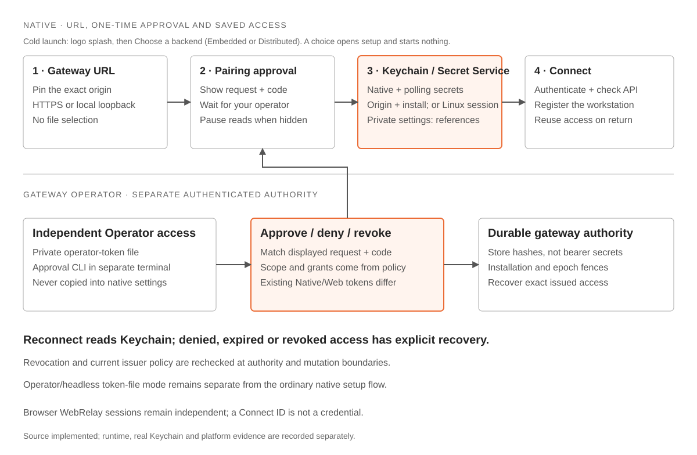

# Fleetworks

<p align="center">
  
</p>

Fleetworks collects public-source intelligence, connects evidence to actors and articles, and prepares cited Focus Briefs. Fleetworks Desktop is a native Rune control hub for **macOS (`x86_64` / `aarch64`)** and **Linux (`x86_64`)** that connects either to its bundled **Local Embedded** companion backend (typed stdio IPC, no Docker required) or to an independently operated **Remote Gateway** deployed with Docker Compose. Intel Web provides the browser desktop.

[Native app](apps/fleetworks-desktop/README.md) · [Connections](docs/wiki/code/native-connections.md) · [Setup and usage](docs/wiki/code/fleetworks.md) · [Deployment](deploy/README.md) · [Wiki](docs/index.md) · [Releases](docs/wiki/code/versioning.md)

## Quick start

**Prerequisites:** pinned Rust **1.95.0** toolchain, Python **3.9+**, and Xcode / Command Line Tools on macOS (or `pkg-config`, `libclang-dev`, D-Bus, X11/Wayland, and Vulkan drivers on Linux `x86_64`). Add Docker + Docker Compose **v2.20+** only for the remote container backend.

### 1. Run the native app (Local Embedded or Remote)

Build and launch the desktop app alongside its packaged local-IPC companion backend (`argos-api-host`):

```sh
python3 scripts/fleetworks_candidate.py build-native --target host --profile debug --open
```

[](docs/diagrams/native-connections.html)

- **Local Embedded (no Docker):** open **Setup Gateway** → **Local Embedded** → **Start Local Backend**. The companion runs over framed stdin/stdout IPC with zero network sockets; optional `nlp` and `classifier` capabilities report explicitly.
- **Remote Gateway:** open **Setup Gateway** → **Remote Gateway**, enter a gateway URL (e.g. `http://127.0.0.1:18091`) → **Connect**, and have the operator [approve](docs/wiki/code/native-connections.md#operator-approval-and-revocation) the displayed request/code. Access is saved in macOS Keychain or Linux D-Bus Secret Service (or explicit Linux session-only mode); no token file is required.
- Pass `--without-companion` to skip bundling `argos-api-host`, add `--diagnostic` with `--open` for foreground stderr crash capture, or see [Pairing and recovery](docs/wiki/code/native-connections.md#pairing-and-keychain-agreed-target), [Workstation identity](docs/wiki/code/native-workspaces.md), and [Browser handoff](docs/wiki/code/native-connections.md#browser-handoff).

<a id="backend-for-the-native-app"></a>

### 2. Run a local Docker backend (+ app)

Start Docker, then run one command from the repository root:

```sh
python3 deploy/native_review.py up
```

On first run this initializes `native-local` on `http://127.0.0.1:18091` with a private repo-root `compose.env`, builds and starts the `backend` services (`runtime`, `surrealdb`, `search-index`), and builds/opens the native app on macOS or Linux `x86_64` (`--backend-only` skips the app build; `--approval-handoff` enables one-click macOS pairing confirmation).

Edit `compose.env` for settings, then manage containers without rebuilding:

```sh
docker compose --env-file compose.env \
  -f deploy/compose.native-review.yml --project-name fleetworks-native-review-native-local \
  up --no-build --pull never --detach --wait
```

Use `ps`, `logs --follow`, or `down` (preserves data) with that same prefix. Full flags, concurrent stacks, credentials, and headless token mode live in [deploy/README.md](deploy/README.md#isolated-native-backend-review).

> Venture, the six terminal clients, and the legacy `argos` executable are retired ([disposition](docs/archive/cli-retirement.md)).

### Collect articles with Atlas

Provision provider keys, `atlas-worker`, private NLP, and an architecture-matching Linux Rust-BERT model via the [Atlas Compose overlay](deploy/atlas-dispatch.md), then submit cycles from **News Cycles** once connected.

## Applications and services

| Area | What you can do |
| --- | --- |
| DB Seed & Train | Stage schema-checked actor/classifier CSVs and trigger actor seed, search-index rebuild, and Natural candidate training. |
| News Cycles and Brain Search | Queue cycles, inspect workstation cycle history, discover canonical actors, and read dossiers. |
| OSINT Tools and Model Assignments | Read service/provider cards, provision keys, and edit supported model routing with confirmed revisions. |
| Workstation Status and Setup Gateway | Switch **Remote Gateway** vs **Local Embedded**, inspect **Actor search** readiness and resources, and manage pairing/reconnection. |
| Jobs & Logs | Read the bounded workstation queue and selected-job safe operational summaries. |
| Intel Web | Browse the Bulletin, Focus Briefs, Related articles, actor dossiers, and topology behind the Connect/session gate. |

[](docs/diagrams/fleetworks.html)

The UI binary (`fleetworks-desktop`) stays 100% engine-free using shared Rust contracts over origin-pinned HTTPS/HTTP or framed child stdin/stdout IPC (`argos-api-host --role local-ipc`). Axum serves the gateway; Next.js runs Intel Web via a same-origin relay. Embedded or Linux container services own SurrealDB, Jobs (SQLite operational logs + RocksDB delivery queue), and Tantivy actor search; the optional Atlas overlay runs Compromise NLP and Rust-BERT. [Architecture](docs/wiki/code/architecture.md) · [Persistence rollout](docs/wiki/code/jobs-persistence.md)

Source, fixture, and packaged-archive checks are tracked separately from installed-app GUI, hardware accessibility, and multi-platform release verification. See [rollout status](docs/wiki/code/fleetworks.md#rollout-status), [native verification](docs/wiki/code/native-verification.md), and [CI](docs/wiki/code/ci.md).

## Development

Use the [contributor workflow](docs/wiki/code/contributing.md) and preview hosted checks with the scope planner:

```sh
python3 scripts/fleetworks_verify.py plan --base "$(git rev-parse HEAD^)" --head "$(git rev-parse HEAD)"
```

### Iteration loops

Choose the shortest loop for the changed surface. The native UI/contracts graph is engine-free; backend storage tests link embedded SurrealDB/RocksDB as QA harnesses. Service edits require the affected Linux image. [Visual artifact/path map](docs/wiki/code/build-artifacts.md)

[](docs/diagrams/dev-loops.html)

| Change | Loop |
| --- | --- |
| Rune app, client contracts, or workstation manager | Scoped host debug tests, selected `native-ui` Runtime/PNG/tree fixtures, `fleetworks_local_backend_smoke.py` / `http_ipc_parity`, and `build-native --target host --profile debug`. |
| Service roles (`argos-api-host`) | `python3 deploy/native_review.py up` rebuilds the `backend` Bake images, recreates Compose containers, and opens the native app (`--backend-only` skips app). |
| Web app and `packages/*/src` | Run the Next dev server; set `ARGOS_WEB_TEST_DEV=1` for isolated repository Playwright output. |
| Dependencies, Dockerfile, Compose, or private search | Build the affected Bake target (`docker buildx bake -f deploy/docker-bake.hcl <target>`) and run isolated deployment checks. |
| Packaging or release | Push and read hosted CI results for that exact revision. |

PRs targeting `dev`, `nightly`, or `main` run scoped checks automatically, including debug app archives, extracted-bundle smoke, and `http_ipc_parity` on Intel Mac, Apple Silicon Mac, and Linux `x86_64`. Trusted pushes publish selected unsigned native ZIPs and dual-architecture GHCR images (`nightly` → nightly, `dev`/`main` → stable). [Release flow](docs/diagrams/native-release.html) · [Artifact map](docs/wiki/code/build-artifacts.md#hosted-artifacts-and-publication)

Run host checks first, then the affected container loop, then hosted CI. [Full loop guide](docs/wiki/code/contributing.md#development-loops-local-cli-and-docker)

Agents use `python3 scripts/agent_cargo.py … --locked` and shared `target/agents/debug`; add `--agent` to native build/fixture helpers. Selected test targets can enable extra dependency features, so a smaller `-p` selection may rebuild large dependencies. Choose the loop and resource preflight from [contributing](docs/wiki/code/contributing.md#verification-ownership-and-host-resources); preserve reusable outputs using [cache hygiene](docs/wiki/code/contributing.md#build-cache-hygiene).

Web contributors can find setup and verification in the [Intel web guide](docs/wiki/code/intel-web.md) and the [React test guide](docs/wiki/code/react-ui-testing.md). The [CI guide](docs/wiki/code/ci.md) covers hosted platform and package verification. Agents start at [AGENTS.md](AGENTS.md).

For more, browse the [concepts](docs/wiki/concepts/index.md), [code map](docs/wiki/code/index.md), or [diagram catalog](docs/diagrams.md).
