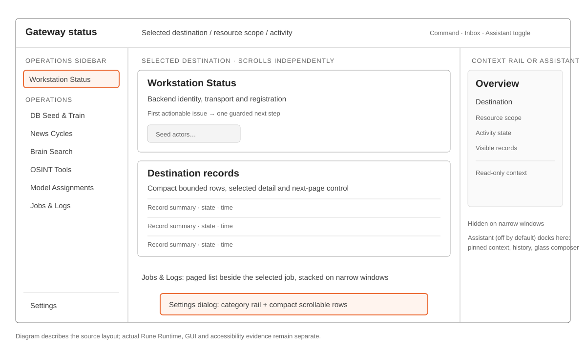
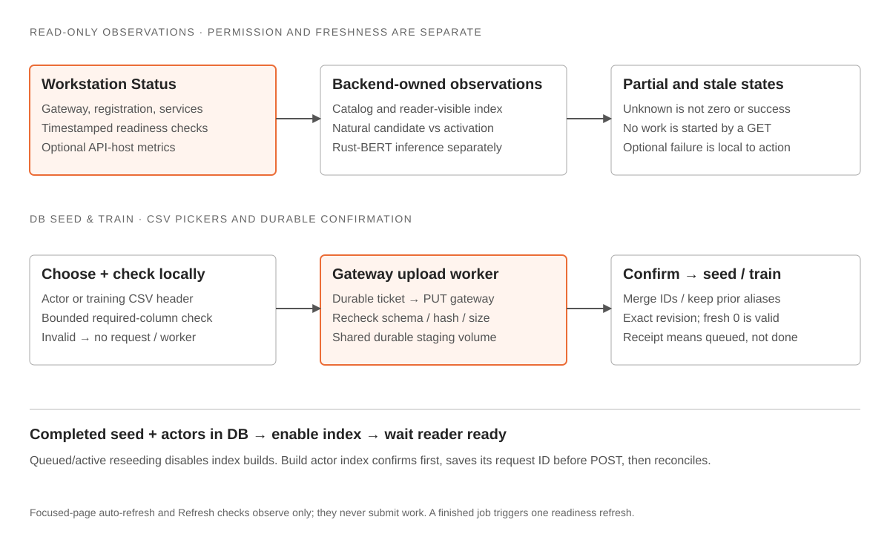

# Fleetworks native client

**Approved visual target:** [Glass Canvas design reference](../../docs/design/matte-canvas/README.md) (deep-space `#060709` backdrop, layered smoked/frosted glass across shell chrome, cards, controls and overlays, static liquid-metal rim highlights, warm molten-gold & cyan accents, and crescent-moon action textures, with opaque reduced-transparency fallbacks). The [native verification guide](../../docs/wiki/code/native-verification.md) describes how to review the production views and exact-head packages.

The Rune/rune-kit macOS and Linux x86_64 API client supports **Embedded** and **Distributed** backends. Embedded uses a bundled companion started explicitly by the user over a private Unix socket. Distributed connects to an operator-managed gateway. Backend engines run outside the desktop process. Its six sidebar destinations are Actor Maintenance, News Cycles, Brain Search, Tool Box, Model Assignments and Jobs & Logs. The brand avatar opens Workstation Status. It groups actor search and workstation activity under **Services**, followed by **Status checks** and **Diagnostics**. **Settings → Connection** walks through setup and selects the backend type after launch. **Settings → General** shows the app name and version. Distributed setup uses a gateway URL, operator approval and macOS Keychain or Linux D-Bus Secret Service, with explicit Linux session-only mode also available.

[Design and control allowlist](../../docs/wiki/code/native-design-system.md) · [Connection contracts](../../docs/wiki/code/native-connections.md) · [Protected identity](../../docs/wiki/code/native-workspaces.md) · [Implementation/verification status](../../.planning/2026-11-12-native-pairing-implementation/acceptance.md)

[](../../docs/diagrams/native-workstation-layout.html)

## Build and provision

### macOS quick start

You’ll need the pinned Rust **1.95.0** toolchain, Python 3, Xcode Command Line Tools, and the bundled actor catalog checked out through Git LFS. Quit Fleetworks before rebuilding an open app.

**RustRover.** Open the repository root, choose **Build and open Fleetworks (Embedded)** from the run configuration menu, and click **Run**. [Shared run configuration](../../.idea/runConfigurations/Build_and_open_Fleetworks_Embedded.xml)

**Terminal.** Run the same command from the repository root.

```sh
PATH="$HOME/.cargo/bin:$PATH" CARGO_BUILD_JOBS=1 \
  python3 -B scripts/fleetworks_quick_start.py --profile debug --start-embedded
```

The launcher builds and opens the app, then starts its bundled Embedded companion. Automatic startup uses macOS Accessibility. If macOS asks for permission, allow RustRover or Terminal under **System Settings → Privacy & Security → Accessibility**. To start the companion by hand, omit `--start-embedded`, then click **Start Embedded Backend** in Fleetworks.

The launcher reuses the repository's Cargo cache and prints the app path before building. The debug bundle is `target/native/aarch64-apple-darwin/debug/Fleetworks.app` on Apple Silicon and `target/native/x86_64-apple-darwin/debug/Fleetworks.app` on Intel. Use `--profile release` for the optimized bundle in the sibling `release` directory. Embedded data stays in `.agent-scratch/native-quick-start-profile/` across rebuilds. Use `--help` for custom paths and verified offline artifacts.

If an older copy of the launcher reports `Select the root of a Fleetworks checkout` from the repository root, run `git --version`. Older Git versions such as 2.30 can trigger this error on either Mac architecture. The current launcher resolves Git's checkout paths on both older and newer versions. To run an older copy, use Apple Git by prepending `/usr/bin` to `PATH` for that command.

### Build and backend options

Distributed setup uses [operator pairing and the system keyring](../../docs/wiki/code/native-connections.md#pairing-and-keychain-agreed-target). Embedded setup uses **Start Embedded Backend** and a private companion state directory. See the [backend type and parity contract](../../docs/wiki/code/native-connections.md#backend-types-and-parity).

Use the complete-app helper; agent builds add `--agent` and reuse the shared debug graph. Opening the app is an explicit action.

Build flow: live Cargo progress/diagnostics and stage markers on stderr → package/validate → artifact paths and result metadata. `--open` opens only after validation and preserves an already running app; add `--diagnostic` (`fleetworks-desktop --diagnostic`) for foreground stderr startup diagnostics and early-crash capture instead of silent GUI exit. [Build loop](../../docs/diagrams/dev-loop-native.html)

```sh
python3 scripts/fleetworks_candidate.py build-native --agent --target host --profile debug
```

For a fresh or existing Distributed review using a loopback gateway, run:

```sh
python3 deploy/native_review.py up
```

This command auto-detects host platform and initializes `native-local` on port `18091` if needed (without overwriting an existing root `compose.env`), preserves existing credentials/data, adds missing Operator provisioning, validates local Docker/configuration, builds the configured images with live output, then restarts only that review after a successful build and waits for readiness. On supported macOS and Linux x86_64 hosts it then builds/opens the app using `build-native --target host --profile debug --open`; native build failure leaves the healthy backend running. Add `--backend-only` to skip the app step; unsupported hosts (such as Linux ARM64) skip it automatically. It prints the actual gateway URL and approval command. Use `prepare --name native-local` for an offline provisioning/command preview or [`init`](../../deploy/README.md#initialize-a-fresh-review) for offline setup. [Backend review workflow](../../deploy/README.md#prepare-an-existing-review)

Open **Settings → Connection**, select **Distributed**, enter the helper's gateway URL and choose **Connect**. Share the displayed pairing request ID/code with the [gateway operator](../../docs/wiki/code/native-connections.md#operator-approval-and-revocation). The app authenticates approved access, saves it in macOS Keychain or Linux D-Bus Secret Service (or keeps it in process memory when explicit Linux session-only mode is selected) and registers the installation. Later connections use that exact origin/deployment; missing/denied access has no silent file fallback. Retry preserves an uncertain request; Pair again explicitly replaces it.

Protected settings create no default child and contain no polling/access secrets. The opaque workstation ID is the browser Connect ID, not a credential. Optional IP metadata never defines identity; WebRelay remains independent.

**Operator/headless option:** explicitly launch the executable with both file-mode flags:

```sh
/path/to/Fleetworks.app/Contents/MacOS/fleetworks-desktop \
  --api-origin https://gateway.example.test \
  --api-token-file /absolute/private/native-token
```

Add `--provision-gateway-credential` to save a protected exact-origin file reference and exit without GUI/network/service startup. This optional catalog operation does not configure normal GUI pairing. Files must remain private, bounded, single-link regular files; reprovision after replacement/rotation. Existing operator files remain untouched.

## Embedded desktop in Docker

Use the Linux x86_64 development image when you want the Rune app and its Embedded companion in one container. The desktop opens its usual backend chooser. Select **Embedded**, then choose **Start Embedded Backend**. The app starts its packaged companion over a private Unix socket, so the container needs no published backend port.

Download the `Fleetworks-Embedded-Desktop-Docker-Archive-*` artifact from an [opt-in image run](../../docs/wiki/code/ci.md#embedded-desktop-docker-image), verify its checksum, then load the image.

```sh
archive="$(find . -maxdepth 1 -type f -name 'fleetworks-native-embedded-linux-x86_64-*.tar.gz' -print -quit)"
test -n "$archive"
sha256sum -c "$archive.sha256"
docker load --input "$archive"
```

On a Linux x86_64 Wayland desktop, use the image tag reported by `docker load`. Forward just your compositor socket and use a dedicated private home for Fleetworks settings and Embedded data.

```sh
image_tag='fleetworks-native-embedded:dev-<run-id>.<attempt>'
state_home="$HOME/.local/share/fleetworks-container-home"
install -d -m 700 "$state_home"
docker run --rm --init \
  --user "$(id -u):$(id -g)" --cap-drop ALL --security-opt no-new-privileges \
  --tmpfs "/run/fleetworks:uid=$(id -u),gid=$(id -g),mode=0700" \
  --env XDG_RUNTIME_DIR=/run/fleetworks --env WAYLAND_DISPLAY=/tmp/fleetworks-wayland \
  --mount "type=bind,source=$XDG_RUNTIME_DIR/$WAYLAND_DISPLAY,target=/tmp/fleetworks-wayland" \
  --mount "type=bind,source=$state_home,target=/home/fleetworks" \
  "$image_tag"
```

This example assumes the host compositor uses a relative `WAYLAND_DISPLAY` socket name. The development image does not expose the host Secret Service socket. Use the packaged host application for system-keyring review.

To build from a verified Linux package on Linux x86_64, pass the package archive, adjacent checksum, exact source commit and artifact version to [the image helper](../../scripts/fleetworks_native_embedded_image.py). The helper builds locally by default and accepts `--builder depot --depot-project <id>` for remote execution.

## Selected views and durable actions

Backend resources stay shared within caller permissions. New registration/context/activity contracts have no workspace narrowing; existing folders and immutable historical receipts are preserved. There is no active folder/Trash workflow, saved-profile CRUD, account/base-URL administration or import/export screen.

[](../../docs/diagrams/workstation-readiness.html)

**Actor Maintenance:** the catalog CSV picker first checks required columns locally, before any network request or backend worker. The app streams a valid file to the selected backend for schema, hash and size validation and immutable staging. The operator then confirms the job. Progress and errors stay visible. An invalid header stops validation on the workstation. [Required columns, upload rules and sample files](../../deploy/README.md#configured-native-maintenance-inputs)

Actor CSVs merge by stable actor ID: add actors, update selected fields on matching actors and keep actors absent from the new CSV. Existing/manual aliases remain; new aliases are upserted without deletions, with full source metadata retained. Each job uses its exact selected dataset/hash/revision.

On Linux, use **Enter actor CSV path** to type an absolute path to a local `.csv` file. The path prompt also offers **Browse…**. If a file chooser cannot open on another desktop, the app offers the same path prompt. Both inputs use the same validation. The source path stays on the workstation.

**Seed Actors** must complete with actors in the database before **Build Search Index** enables. A queued or active reseed keeps it disabled. Confirm the index job, then wait for reader readiness. Setup reports Atlas BERT inference from the connected backend. Atlas model maintenance is an operator operation. Confirmation pins the actual configuration revision (fresh **0** is valid). Focused auto-refresh and **Refresh checks** reconcile readiness and the exact job accepted for each operation. The originating card shows its job progress and terminal result while **View job** opens the full Jobs detail. Start each seed or index job with explicit confirmation. Distributed HTTP uses authentication-bound, single-use upload tickets retained in the shared database until five-minute expiry. HTTP 429 leaves the URL unused. Embedded IPC transfers the same dataset bytes through bounded frames. Accepted jobs remain durable. [Capacity and shared-staging requirements](../../deploy/README.md#configured-native-maintenance-inputs)

After updating maintenance code, close an already running Fleetworks app, then run `python3 deploy/native_review.py up --name native-local` to coordinate schema 11 bootstrap/services and rebuild backend and native app. The helper's `--open` preserves an existing running instance, so leaving it open would retain the older app.

News Cycles uses authoritative history/counts and workstation history tombstones; shared evidence and audit remain. Brain is one search field, bounded results and a dossier. Tools are service/provider cards with a key modal; manual tool runs/results are outside the native surface. Models provides inline keys and supported role-routing controls while preserving hidden fields/secrets and revision conflicts. Jobs & Logs shows server-enforced workstation activity and safe selected-job summaries without filters, action toolbars or raw provider output.

Durable acceptance is queued, not completed. Uncertain requests retain the exact request/body/context and original registration for read-only reconciliation. Changing a gateway fences old responses, caches and confirmations. Missing optional services disable only affected actions. Unknown values remain unavailable; app navigation never submits backend work.

## Verification

Use the engine-free app/contracts/workstation loop for native changes; storage compatibility tests belong to the heavier backend loop. Choose commands and preflight from [contributing](../../docs/wiki/code/contributing.md#development-loops-local-cli-and-docker); the [artifact/path map](../../docs/wiki/code/build-artifacts.md) distinguishes app output, QA harnesses and persistent data.

Production and fixtures share State, Rune views and handlers. Fixtures inject synthetic effects and do not access user homes, gateways, browser or clipboard. Use selected actual Runtime scenes, wide/compact sizes, PNG/tree/script inspection and separate installed-app evidence:

```sh
python3 scripts/fleetworks_verify.py native-ui --agent --list-scenes
python3 scripts/fleetworks_verify.py native-ui --agent \
  --scene brain-search-ready --size 1180x780 --size 640x480 \
  --scale 2 --output .agent-scratch/native-ui/brain-review
```

Discover scene names from the current executable; generation alone is not visual approval. [Native verification](../../docs/wiki/code/native-verification.md) records build/cache isolation and inspection requirements. Hosted first-pass evidence covers Linux x86_64. The second pass retains both Mac architectures; minimum OS, installed GUI/input/accessibility, signing/notarization and real backend integration remain separate. Read the acceptance tracker for actual pass/fail/skip results rather than treating these command examples as executed checks.

Selected first-pass PR checks build the Linux x86_64 debug package and Rune evidence. After first-pass CI succeeds, dispatch the same head for the affected Intel and Apple Silicon builds and checks. Continue Linux visual review in parallel. [CI review passes](../../docs/wiki/code/ci.md#nightly-gsd-order) Trusted branch pushes package versioned release ZIPs, verify downloads by artifact ID/digest/checksum and publish after required checks: `nightly` → nightly prereleases, `dev`/`main` → stable. These automatically published apps remain unsigned; signing/notarization and installed-hardware acceptance are separate evidence. [Release flow](../../docs/diagrams/native-release.html) · [Artifact map](../../docs/wiki/code/build-artifacts.md#hosted-artifacts-and-publication)

Pairing tests use injected Keychain stores. Installed-app launch, real Keychain approval/reconnect and backend integration need separate evidence within the current task's authorized scope. Record actual results and remaining gaps in its acceptance tracker.

## Startup, utilities and materials

A cold launch opens **Choose a backend** with the animated Quiet Orbit mark and two interactive tiles. Select **Embedded** or **Distributed** to show setup, then explicitly start or connect. **Back** returns to the chooser with the settled mark. Launches with `--api-origin` or `--api-token-file` skip the chooser. The `backend-choice` fixture shows the production chooser with synthetic effects. The toolbar has a command button (Cmd/Ctrl+K), an inbox bell and an Assistant toggle. The Assistant is off by default and sends a turn to the backend's chat endpoint, which only answers ok; there are no replies yet.

Glass surfaces (the Assistant composer and the command panel) use a same-window blur. They draw opaque, with the same bounds, when macOS Reduce Transparency is on or when `FLEETWORKS_OPAQUE_MATERIALS` is `1`, `true`, `yes` or `on`. Linux no longer forces the opaque mode.
