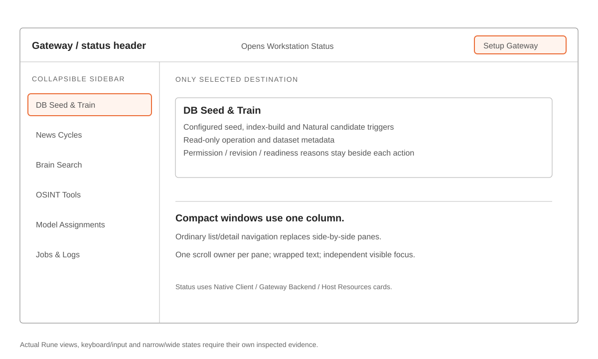

# Fleetworks native client

The Rune/rune-kit macOS API client connects to an independently running gateway. It never starts backend engines, Docker or Intel Web. Its six sidebar destinations are DB Seed & Train, News Cycles, Brain Search, OSINT Tools, Model Assignments and Jobs & Logs. The gateway header opens Workstation Status, with Native Client, Gateway Backend and Host Resources cards. Setup Gateway opens Gateway URL → Connectivity Check.

[Design and control allowlist](../../docs/wiki/code/native-design-system.md) · [Connection contracts](../../docs/wiki/code/native-connections.md) · [Protected identity](../../docs/wiki/code/native-workspaces.md) · [Implementation/verification status](../../.planning/2026-11-12-native-workstation-redesign/acceptance.md)

[](../../docs/diagrams/native-workstation-layout.html)

## Build and provision

Use the complete-app helper; agent builds add `--agent` and reuse the shared debug graph. Opening the app is an explicit action.

Build flow: live Cargo progress/diagnostics and stage markers on stderr → package/validate → artifact paths and result metadata. `--open` opens only after validation and preserves an already running app. [Build loop](../../docs/diagrams/dev-loop-native.html)

```sh
python3 scripts/fleetworks_candidate.py build-native --agent --target host --profile debug
```

Before the URL-only setup, provision a protected credential binding with the built app executable:

```sh
/path/to/Fleetworks.app/Contents/MacOS/fleetworks-desktop \
  --provision-gateway-credential \
  --api-origin https://gateway.example.test \
  --api-token-file /absolute/private/native-token
```

Provisioning requires both flags, verifies and stores an exact-origin protected file reference rather than token bytes, and exits without GUI/network/service startup. The token must be a private, bounded regular file with one link. Reprovision explicitly after file replacement or credential rotation. `deploy/native_review.py` prints the local review command using its existing private Native token path. Remote operators provide their own local protected token file.

The app opens protected installation settings without creating a default child. Setup normalizes the URL, resolves its binding, authenticates, checks compatibility and registers the installation. The gateway's stable opaque workstation ID is the Connect ID; optional IP metadata never defines identity. Intel Web's Connect form uses the same ID through separately provisioned WebRelay authority.

## Selected views and durable actions

Backend resources stay shared within caller permissions. New registration/context/activity contracts have no workspace narrowing; existing folders and immutable historical receipts are preserved. There is no active folder/Trash workflow, saved-profile CRUD, account/base-URL administration or import/export screen.

Seed/index/Natural training triggers use configured backend inputs and exact revisions, with no native upload/picker. Natural training returns a candidate without activation. News Cycles uses authoritative history/counts and workstation history tombstones; shared evidence and audit remain. Brain is one search field, bounded results and a dossier. Tools are service/provider cards with a key modal; manual tool runs/results are outside the native surface. Models provides inline keys and supported role-routing controls while preserving hidden fields/secrets and revision conflicts. Jobs & Logs shows server-enforced workstation activity and safe selected-job summaries without filters, action toolbars or raw provider output.

Durable acceptance is queued, not completed. Uncertain requests retain the exact request/body/context and original registration for read-only reconciliation. Changing a gateway fences old responses, caches and confirmations. Missing optional services disable only affected actions. Unknown values remain unavailable; app navigation never submits backend work.

## Verification

Production and fixtures share State, Rune views and handlers. Fixtures inject synthetic effects and do not access user homes, gateways, browser or clipboard. Use selected actual Runtime scenes, wide/compact sizes, PNG/tree/script inspection and separate installed-app evidence:

```sh
python3 scripts/fleetworks_verify.py native-ui --agent --list-scenes
python3 scripts/fleetworks_verify.py native-ui --agent \
  --scene brain-search-ready --size 1180x780 --size 640x480 \
  --scale 2 --output .agent-scratch/native-ui/brain-review
```

Discover scene names from the current executable; generation alone is not visual approval. [Native verification](../../docs/wiki/code/native-verification.md) records build/cache isolation and inspection requirements. Hosted evidence retains both Mac architectures; minimum OS, installed GUI/input/accessibility, signing/notarization and real backend integration remain separate. Read the acceptance tracker for actual pass/fail/skip results rather than treating these command examples as executed checks.
