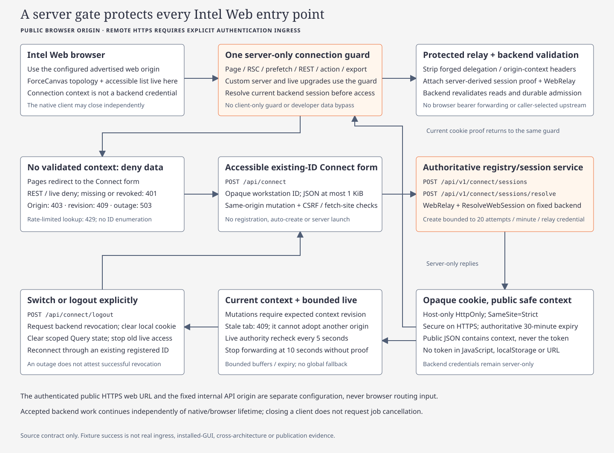

# Intel Web connection boundary

Intel Web runs independently of native. Enter an existing opaque workstation
Connect ID at `/connect`; the gateway resolves its registration. The ID selects
context and grants no authentication or administration rights.

| Boundary | Requirement |
| --- | --- |
| Session | Host-only HttpOnly SameSite=Strict `fleetworks_connect_v2`; Secure on remote HTTPS, local loopback HTTP exception |
| Authority | One gateway resolver gates rendering, REST and live upgrades; missing/revoked/stale sessions deny access |
| Relay | Server-only `FLEETWORKS_API_ORIGIN` and protected `FLEETWORKS_API_TOKEN_FILE`; WebRelay purpose + ResolveWebSession permission |
| Remote ingress | Exact HTTPS `FLEETWORKS_WEB_ORIGIN`, `FLEETWORKS_WEB_AUTHENTICATED_INGRESS=1`, private `FLEETWORKS_WEB_INGRESS_TOKEN_FILE` |
| Proxy | Authenticate first, strip incoming ingress-token header, then inject protected token. Forwarded headers alone grant no trust |
| Base path | Build/run with matching `FLEETWORKS_WEB_BASE_PATH`; affects assets, cookies, Connect/API/live paths and navigation |

Connect v2 rejects legacy IP:workspace IDs, workspace-bearing contexts/query
narrowing and old sessions/cursors. Connect ID equals the authority-returned
workstation ID; optional IP never merges installations. No browser bearer,
localStorage unlock, production bypass or native-maintenance API forwarding.

Switching revokes the previous session. Tabs discard Query/live state on change,
expiry or denial; expected-context revisions reject stale submissions with 409.
Live authority is revalidated every 5 seconds, denied after 10 seconds without
verification, and stopped at expiry. Closing clients does not cancel accepted jobs.

Development permits only exact `/_next/webpack-hmr` and `/_next/hmr` sockets through
the normal Host/Origin/ingress boundary; production retains denial. API live sockets
still require current sessions. [Complete web contract](../../docs/wiki/code/intel-web.md)

Use the external `__tests__/serve-connect-fixture.mjs --port <port> [--dev]` harness
for synthetic gateway credentials/cookies. Repository Playwright uses
`ARGOS_WEB_TEST_DEV=1` isolation. Fixtures do not prove datastore persistence,
Linux execution, public TLS/ingress or installed native behavior.

The [shared matte design](../../docs/wiki/code/native-design-system.md) changes
paint/logo within existing web layout and topology/list behavior.
[Verification status](../../.planning/2026-11-12-native-workstation-redesign/acceptance.md)
