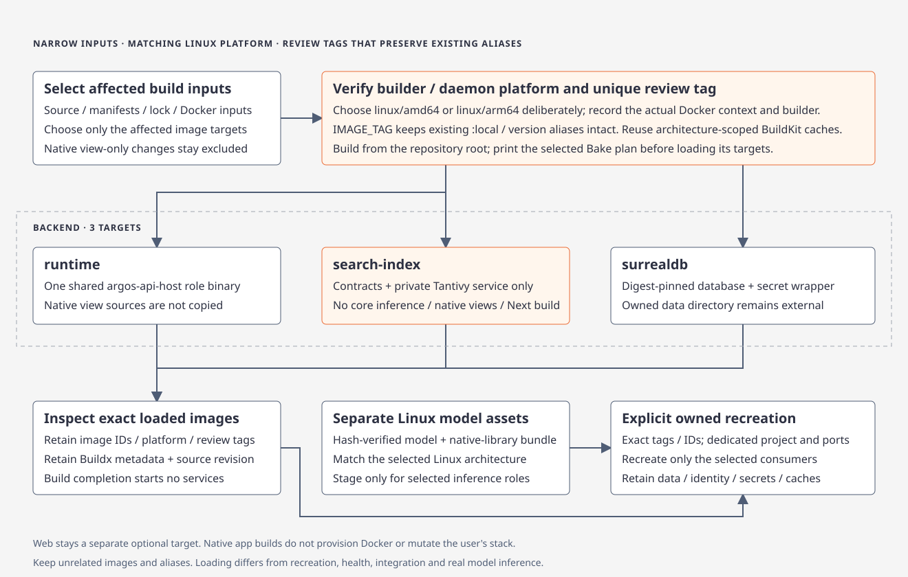

# Fleetworks service deployment

Docker Compose v2.20+ runs the authenticated API, private services, workers and database bootstrap. Provision an explicit loopback API port and, when selecting Intel Web, a separate Web port. The examples use `18091` and `18092`. The [Atlas overlay](atlas-dispatch.md) adds the Atlas dispatch worker, NLP and classifier.

Use the Docker CLI from the selected operator shell and inspect the active context before building or starting services.

Rust image builds use one Cargo job and 256 core code-generation units to limit memory use. The runtime Dockerfile defaults to core optimization level 3; pass `--build-arg FLEETWORKS_CORE_OPT_LEVEL=1` for a faster local runtime build as shown below. If memory is exhausted, increase Docker Desktop's memory under Settings → Resources → Memory and retry. BuildKit retains completed dependencies.

## Choose a development loop

The Rune app builds on macOS; Linux services, web and the database use the `runtime`, `web`, `surrealdb` and `search-index` Dockerfile targets. Rebuild only the affected image. Native view changes use the host app loop, and browser source changes use the separate Next development loop. See the [contributor loop guide](../docs/wiki/code/contributing.md#development-loops-local-cli-and-docker) for the full order of checks. Use a separate workspace, `COMPOSE_PROJECT_NAME` and ports for each concurrent stack.

[](../docs/diagrams/dev-loop-images.html)

## Isolated native backend review

Use the standalone [native review recipe](compose.native-review.yml) for the Rune app's independently running backend. Its `backend` Bake group builds only `runtime`, digest-pinned `surrealdb`, and `search-index`. The search image selects only `fleetworks-search-index` and shared contracts; it compiles no core inference, terminal, native view or Next.js bundle. Web deployment is an explicit separate selection. No launcher or terminal-client image is built.

Provision a **new** task-owned deployment directory, separate from every native workspace and existing stack. The helper creates private files and directories only; an existing review name fails without replacing credentials or data. Choose an unused API port. It creates no browser service or published database/search port.

```sh
export REVIEW_NAME=rune-search-review
export PLATFORM="$(python3 scripts/fleetworks_verify.py platform --format docker)"
python3 deploy/native_review.py init --name "$REVIEW_NAME" --api-port 18091 --platform "$PLATFORM"
export REVIEW_WORKSPACE="$(python3 deploy/native_review.py value --name "$REVIEW_NAME" --field workspace)"
export IMAGE_TAG="$(python3 deploy/native_review.py value --name "$REVIEW_NAME" --field image_tag)"
export REVIEW_PROJECT="$(python3 deploy/native_review.py value --name "$REVIEW_NAME" --field project)"
export VERSION="$(tr -d '[:space:]' < version.txt)"
```

The workspace lives under `.agent-scratch/native-review/<name>`. Its FORMAT 1 `secrets/gateway-credentials.json` references separate owner-only token files for Native, WebRelay and InternalService purposes. Native may register/maintain; WebRelay may resolve existing browser context and cannot register or maintain; the internal health credential has read permission only. Every private runtime role receives the same persisted `FLEETWORKS_ACCESS_SCOPE_ID` and `FLEETWORKS_ACCESS_EPOCH`. Search read/write tokens differ, and only search plus `native-worker` receive the writer token. Keep these files and the unique search source epoch across restarts. Startup never rotates an epoch or resets a volume. Tokens stay out of command arguments, output and build artifacts; do not print or source `compose.env`.

Inspect the selected Docker context, daemon and builder before building. A remote context or a Linux architecture different from `$PLATFORM` needs an explicit operator decision; do not silently emulate. Use a native AMD64/ARM64 builder for that platform. These single-platform builds load review tags and never overwrite `:local` or version aliases:

```sh
docker context show
docker info --format '{{.OSType}}/{{.Architecture}}'
docker buildx inspect
docker buildx bake -f deploy/docker-bake.hcl --print backend
docker buildx bake -f deploy/docker-bake.hcl --load \
  --metadata-file "$REVIEW_WORKSPACE/build-metadata.json" backend
docker image inspect "fleetworks-runtime:$IMAGE_TAG" "fleetworks-surrealdb:$IMAGE_TAG" \
  "fleetworks-search-index:$IMAGE_TAG" \
  --format '{{.Id}} {{.Os}}/{{.Architecture}} {{json .RepoTags}}' \
  > "$REVIEW_WORKSPACE/image-identities.txt"
```

Run a separate fresh review on `PLATFORM=linux/amd64` and `PLATFORM=linux/arm64` to collect both native Linux results. Preserve each platform's Buildx metadata and exact inspected IDs alongside its source revision and dirty status. Build completion is distinct from startup or integration evidence. A narrow runtime-only iteration can use `docker buildx build --platform "$PLATFORM" -f deploy/Dockerfile --target runtime --build-arg FLEETWORKS_CORE_OPT_LEVEL=1 --tag "fleetworks-runtime:$IMAGE_TAG" --load .`; it does not produce the other required images or start anything.

Validate and start the exact preloaded tags in a second operator action. Keep the same env file, standalone Compose file and project on every command. No native folder is mounted here.

```sh
docker compose --env-file "$REVIEW_WORKSPACE/compose.env" -f deploy/compose.native-review.yml \
  --project-name "$REVIEW_PROJECT" config --quiet
docker compose --env-file "$REVIEW_WORKSPACE/compose.env" -f deploy/compose.native-review.yml \
  --project-name "$REVIEW_PROJECT" up --no-build --pull never --detach --wait
docker compose --env-file "$REVIEW_WORKSPACE/compose.env" -f deploy/compose.native-review.yml \
  --project-name "$REVIEW_PROJECT" ps
```

Bootstrap provisions schema/runtime credentials and exports the retained database identity to `deployment/deployment-id`; search reads it from a read-only mount. SurrealDB, Jobs, and the search index use separate persistent owned directories. Jobs alone opens its SQLite/dispatch files. `native-worker` consumes durable seed/train/tools jobs through Jobs and pumps the database projection outbox into search. API and worker share `/workspace/staged-datasets` within this backend directory. Container CPU, memory and process limits are explicit; search uses one writer, one merge worker, 64 MiB writer memory and four query slots. These are bounded review defaults, not measured capacity guarantees.

Only the loopback gateway is published, at `http://127.0.0.1:18091` for the example. In the native connection editor choose that gateway, the protected `secrets/native-token` file, and a different app-owned local review folder. Register it through the app's workspace action. The generated web-relay token is reserved for a separately configured browser relay; this stack starts no web frontend. Remote access needs an independently configured HTTPS ingress and allowed-host policy.

Search process health authenticates `/internal/v1/actors/status`; an empty generation can be healthy while discovery remains `not_built`/`indexing`. Seed completion and reader-visible index completion are separate. Search failure does not gate gateway or seed admission startup. Source/generation mismatch, corruption and writer conflicts stay visible and preserve data; there is no automatic delete/rebuild. Explicit maintenance reports rebuild/pressure state; retain the old serving generation and diagnose before changing any directory or source epoch.

Atlas/NLP/Rust-BERT and optional web deployment remain separate operator flows; see [Atlas dispatch](atlas-dispatch.md). Stage a hash-verified, architecture-matching **Linux** model/native-library bundle in the backend's `models/atlas-bert/` before explicitly selecting those services; never copy host macOS libraries or treat Natural training as Rust-BERT inference evidence. This core review stack makes no real-checkpoint inference claim.

Rebuilding a tag does not replace a running consumer. Explicitly recreate the selected services after a successful build. Inspect logs and stop this review with the same project; retain credentials, source identity and data:

```sh
docker compose --env-file "$REVIEW_WORKSPACE/compose.env" -f deploy/compose.native-review.yml \
  --project-name "$REVIEW_PROJECT" logs --tail 100 api native-worker search-index
docker compose --env-file "$REVIEW_WORKSPACE/compose.env" -f deploy/compose.native-review.yml \
  --project-name "$REVIEW_PROJECT" down
```

Do not use `down -v` or global image/cache cleanup as routine review cleanup. Docker build/start, both Linux architectures, real dataset operations, recovery and inference evidence must be recorded when actually exercised; source/config checks alone do not satisfy those gates.

## Credentials

The provisioning helper creates a FORMAT 1 gateway manifest and distinct Native, WebRelay and internal health token files. Private-service, storage and search credentials are independently provisioned. Keep the generated access scope/epoch, token files and source identity together across restarts. Mounted token files are protected secrets; changing a file does not prove a running process reloaded its policy.

Native uses `secrets/native-token` for registration and permitted operations. A separately configured Next server uses `secrets/web-relay-token`; token bytes never enter browser JavaScript. WebRelay resolves existing registered IDs and cannot create a workstation. Read-only health credentials and old shared bearer bytes confer no registration or mutation rights. An independently provisioned Operator credential is required for administrative reset; the review helper does not claim to provision or complete that cutover.

## Operational storage

Jobs alone opens `storage/jobs/`: SQLite operational logs and its embedded RocksDB dispatch queue. Other services use authenticated private Jobs HTTP. Preserve the entire directory across restarts. SurrealDB retains domain records and current scheduler state; the separate [SQLite scheduler cutover](../docs/wiki/code/jobs-persistence.md) remains incomplete. Search has its own owned index directory and database/source identity.

No ordinary build/startup command imports old credentials, resets configuration, deletes data or rotates epochs. Historical RabbitMQ deployments require a drain and shutdown using the previous installation before a new deployment; pending old deliveries are not silently reconstructed. Retired launchers are not current recovery tools. Keep old data and receipts for explicit operator recovery.

## Web and development

Intel Web is separately deployed with the `web` Docker target or its Next development server. Provision its fixed internal gateway origin, separate WebRelay token-file reference, public advertised origin and Origin/Host policy. Remote browser access requires HTTPS at the public ingress; internal upstream addresses remain private. The browser starts at `/connect` and needs an existing registered Connect ID. Native may close while the browser and accepted backend work continue.

For a new browser-enabled deployment, add `--web-port 18092` to the provisioning command above before creating the directory. The helper rejects an existing name and records the distinct explicit Web origin; do not rerun initialization to mutate an existing deployment. Build the Web image under the same isolated tag and select both base and overlay:

```sh
docker buildx bake -f deploy/docker-bake.hcl --load backend web
docker compose --env-file "$REVIEW_WORKSPACE/compose.env" \
  -f deploy/compose.native-review.yml -f deploy/compose.yml \
  --project-name "$REVIEW_PROJECT" up --no-build --pull never --detach --wait
```

For Web development, additionally select `-f deploy/compose.dev.yml` and build its development image before starting:

```sh
docker compose --env-file "$REVIEW_WORKSPACE/compose.env" \
  -f deploy/compose.native-review.yml -f deploy/compose.yml -f deploy/compose.dev.yml \
  --project-name "$REVIEW_PROJECT" build web
docker compose --env-file "$REVIEW_WORKSPACE/compose.env" \
  -f deploy/compose.native-review.yml -f deploy/compose.yml -f deploy/compose.dev.yml \
  --project-name "$REVIEW_PROJECT" up --no-build --pull never --detach --wait
```

Use those exact files and project for stop/restart. Use the [Intel Web guide](../docs/wiki/code/intel-web.md) and [browser test guide](../docs/wiki/code/react-ui-testing.md) for isolated Next and Playwright. The backend-only recipe starts no browser frontend.

### Isolated deployment verification

When a real Docker run is explicitly authorized, the direct smoke owns a fresh review name, images and project:

```sh
python3 deploy/verify.py --name fresh-review --platform linux/amd64 --web --atlas --source-journey
```

`--dev` requires `--web` and a build. `--no-build --image-ids <file>` checks exact preloaded image identities. The helper retains its owned files and stops only its project; it never uses a retired launcher. The separate `python3 deploy/native_cutover_smoke.py --name <running-review>` exercises a synthetic API journey against an already started owned backend. Neither path proves installed native GUI behavior or real Rust-BERT inference. Repeat on a native ARM64 builder for separate Linux ARM64 evidence; do not silently emulate.

## Optional maintenance and inference

Workstation readiness is a bounded read. Seed, index rebuild, Natural training and candidate activation are explicit durable operations with separate permissions, confirmed context/configuration revisions and Jobs receipts. Natural activation requires the exact candidate hashes, expected prior model revision and explicit synthetic-baseline consent where applicable. It never installs Rust-BERT. [Classifier contract](../docs/wiki/code/classifier.md)

A live Atlas deployment requires separately staged, hash-verified architecture-matching Linux inference assets and configured provider accounts. [Atlas dispatch](atlas-dispatch.md) describes that boundary. Backend service executables such as `argos-api-host` and administrative support scripts remain available; Venture, the six terminal clients and legacy `argos` are [retired](../docs/archive/cli-retirement.md).
