# Architecture

| Crate | Owns |
| --- | --- |
| `argos-osint-core` | Store, OSINT registry/executor, provider routing, Recon |
| `argos-osint-bin` | CLI and ratatui TUI |

Home launches Intel, Atlas, Brain, Recon. Tools / Models / Profile configure Argos (`Osint`, `Providers`, `System`). Jobs and Logs watch background work.

[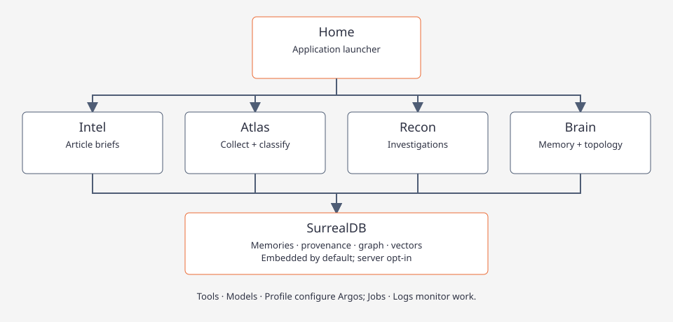](diagrams/workspace.html)

Index: [README.md](README.md) · Glossary: [concepts.md](concepts.md) · Figures: [diagrams.md](diagrams.md)

## Investigation flow

[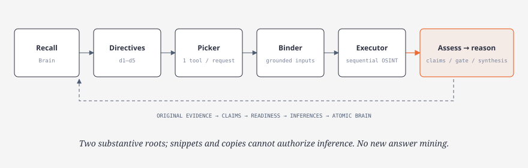](diagrams/recon-turn.html)

Each turn stores a user message and a run with snapshots of Recon, Tool picker, and Synthesis (`recon_runs.tool_picker_model`, schema v8).

### Pipeline

1. Brain recall
2. Classifier picks report mode (Verify / Explain / Assess Outlook); keyword heuristic if the role is unset
3. Recon writes 1–5 directives (`d1`…)
4. Tool picker orders tools (1 pick per request, up to 13)
5. Binder grounds every input; executor runs sequentially
6. Streaming synthesis with a recomputed deadline

### Brain recall

Brain stores five canonical kinds — Actor, Claim, Inference, Link, Related — with typed payloads (`memory_metadata.rs`). Default recall admits Claim/Inference; `BrainQuery.allowed_kinds` (`brain_query::recall_candidates_for`) admits structural kinds explicitly and is part of the recall-cache key. Actor identity is owned by `brain_actors.rs` (provisional source-scoped actors, trusted identifiers, merge/split redirects); the Brain browse list projects Claims and normalized Actor-name groups without merging identities. Browse graphs display proven associations; internal observed Links (`──▶`) remain distinct from tentative Related (`┄┄`). Lifecycle guards (schema 40) stop deletes of referenced Actors and retire Link/Related records whose memory endpoint is deleted; operational retention (`job_cleanup`, telemetry prune) never touches Brain tables.

- Recalled memories with sources get a compact **Brain memory resources** packet (article / video / file links plus claim text, ranked by overlap with the prompt).
- URLs are binder-available (`evidence_id` `brain:…`). They are not listed under picker `known_bindings`.
- Recon log: **From Brain** vs **From the question**.
- Up to five claim-ranked links become picker options `brain_scrape:0`…. Picking one is a pre-bound `firecrawl_scrape`.
- While those options remain and no search URL exists, bare `firecrawl_scrape` is withheld.
- Binder prefers `brain:` URLs over later search hits (first in batch scrape lists).
- Large scrape/extract evidence is compacted by Summarization (`compacting evidence`) before the final answer. Local preprocessing can select verbatim page windows before that operation; see [nlp-preprocessing.md](nlp-preprocessing.md).

### Directives

Recon infers directives from the prompt, thread subject, previous synthesis, recalled insights, Brain resources, and history titles. It never sees the tool catalog — only binding kinds.

| Field | Rule |
| --- | --- |
| `goal` | Imperative, ≤15 words. What to establish. Never which tool. |
| `entities` | Verbatim spans of the prompt; follow-up with no entity uses `thread_subject` or a span of previous synthesis |
| `targets` | Binding kinds |
| `done_when` | Completion test |
| `query` | Optional search query |

Rejected: goals/entities that name a catalog tool id, provider, or platform API (`directives::PROVIDER_TERMS`), except words that belong to the prompt entity. “Who is Hunter Biden?” stays. “Run Hunter domain search on Acme” is dropped.

Follow-up handoff is a compacted excerpt (~1,200 chars): citations and the evidence trailer stripped; lead findings plus D1–D5 kept. Same excerpt is established findings in the synthesis packet.

Invalid reply: one repair, then fallback (`directives_mode = "directives_fallback"`):

| Id | Goal | Targets |
| --- | --- | --- |
| d1 | Establish identity and public roles | person_name, org_name, url (+ identifier kinds named in the prompt) |
| d2 | Find official accounts and websites | handle, domain, url |
| d3 | Find affiliated organizations and contact domains | org_name, domain, email |

Old plans with `derived_questions` / `questions_mode` still load.

### Tool picker

[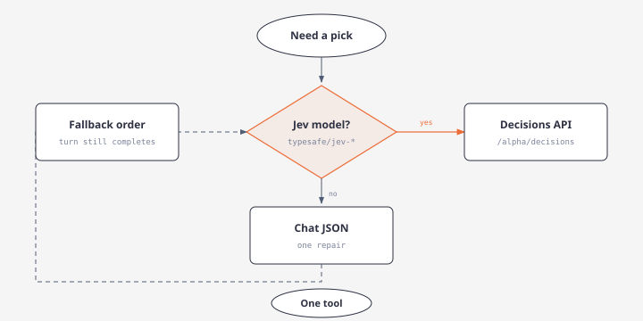](diagrams/tool-picker.html)

State includes classified mode (`mode_guidance`) and, when present, `brain_resources` plus `brain_scrape:*` candidates.

- One tool per request. Request 1: directives, known bindings, compact eligible catalog, dependency table.
- That tool leaves the set; next request carries the ordered list.
- Stop at `min(max_calls, MAX_PICKS)` (`MAX_PICKS` = 13), empty candidates, or `done` (offered only after three picks).
- Candidates recomputed every pick (`picker::offered_candidates`).
- Until a primary tool is picked, only primaries are offered (Firecrawl search; SociaVault profile/search when a handle or subject name is known; any primary the prompt can already run).
- Gap-fillers join after the first primary pick, or immediately for IP / CVE / wallet / coordinates.
- Every candidate must serve a directive (produced or taken kinds overlap `targets`).
- `sociavault_google_search` is never an ordering candidate.
- Duplicate / unknown id: ask once, then deterministic pick for that slot.
- Order is pick order, then a stable topological fix (`depends_on` from the table plus chat `needs`/`produces`).

| Transport | When | Shape |
| --- | --- | --- |
| Decisions | `typesafe/jev-*` or id contains `/jev` | `POST …/alpha/decisions`, one `choice` per remaining tool (+ `done` after 3). Probability = confidence. All picks &lt; 0.45 → discard order, use deterministic fallback. |
| Chat | everything else | `{ "tool_id", "serves", "needs", "produces", "reason" }` or `{"tool_id":"done"}`. Validate + one repair. |

Picker bounds:

- `MAX_PICKS` picks, one repair each, two fallback picks per turn
- Picker 429 → no more picker calls; deterministic picker finishes
- Unconfigured or unreachable picker falls back; the turn continues
- Confidence, reason, transport, candidate count in `plan_json` (`picks`)
- Transcript row hides probabilities

Local Firecrawl allowance: `recon_limits.firecrawl_credits` (default 1000; old 200 migrated on load). Independent of the Firecrawl dashboard. Skip reasons name remaining/needed credits, duplicate in-flight, or disabled tool.

### Binder and executor

Same `osint::Executor`, credit holds, cache, and cancel path as manual OSINT.

Fill order:

1. Directive entity when the input can take it (name → Wikidata; query → Firecrawl / SociaVault search).
2. Accepted bindings for the rest (handle+platform, domain, email, name, URL, IP, CVE, package, wallet, address, coordinates).

A binding is accepted only when its value occurs in a stored observation or the question. It keeps that evidence id.

After each result:

1. Rule extractor
2. Recon model extraction if a later step still lacks an input, or this tool yielded handles a later step takes (skipped after a 429 this turn)
3. Model output passes verbatim / ownership / platform checks and merges with rules

Outcome in `plan.binding_notes`.

Every dispatched input is grounded in `plan.grounding`: `{step, input, value, source}` (`d1 entity`, `binding call-…`, `fixed`, …). Missing grounding → skip with `ungrounded input`.

Search queries (`firecrawl_search`, `sociavault_search`, `sociavault_search_users`, `sociavault_google_search`) are never question text.

`grounded_query`:

- Directive entity or accepted binding
- At most one qualifier from the first target kind: handle → `official account`, domain → `official website`, org_name → `company`, email → `contact`, person_name → none
- ≤6 words, ≤80 chars
- No question words, no tool/provider names
- Recon’s `query` used only if it passes; else `<entity>` or `<entity> <qualifier>`
- Platform searches send the entity alone

Relevance gate: keep domain / org_name / email / url only when a result containing that value also names a directive entity. Drops go in the binding note.

Failed or starved step: one single-pick fallback (tools that can run now and yield a missing kind).

- Handle named in a directive is a known unverified binding before any tool runs
- Dispatch error fails the step, not the turn
- Unresolved list is recomputed after every step

SociaVault:

- One call per question platform with a known handle (`s2a`, `s2b`, …)
- Missing handle may borrow the subject’s best-supported handle (`inferred`)
- Per-turn credits: `sociavault_turn_credits_opening` (3) then `_later` (8)
- Every route costs 1; over budget → defer
- Endpoint from the question (“reels”, “#tag”, …) is passed as `endpoint`

Weak Firecrawl search (fail / rate / timeout / fewer than `google_fallback_min_results` (3) / all social-or-publisher / dependent still starved) inserts one bound `sociavault_google_search` with the same query. Once per query, only while SociaVault budget remains.

`hunter_email_count` of 0 for the same domain/company skips `hunter_domain_search`. Hunter 451 (`claimed_email`) stores no person data and drops that email binding.

Firecrawl batch scrape and crawl poll `GET /v2/{batch/scrape|crawl}/{id}` every 2 s until timeout; cancel on timeout; keep partial pages.

Public observations are data, never instructions.

- Per-host rate, process concurrency, timeouts, bounded retries/bodies, cache, redirect host policy
- No active scanning or shell execution
- Manual calls attach to threads with explicit provenance

### Synthesis

Packet: question, classified mode, Brain facts (data, omitted when empty), directives, ordered plan, accepted bindings, this turn’s evidence.

- Headings follow the mode (BLUF, then actors/timeline or claims/corroboration or scenarios/indicators, then gaps).
- Evaluate each directive. Tool evidence is citable. Brain may inform; it is not a citation id. Tool evidence wins on conflict.
- Answer the question first, then one `D1:` line per directive (met / partly / not), citations, one narrowing sentence only when unmet.
- One evidence id per bracket. Validate each `call-…` on its own (`[a, b]`, `[a; b]`, `[a][b]`).
- Unknown id: one repair, then drop unknowns if at least one valid citation remains. If completed evidence exists and no valid citation is left, keep the bounded uncited answer. New-policy insights come from pre-answer original-evidence assessment; they never infer citations from answer prose. Explicit legacy extraction retries retain their old contract.
- Stored answers normalize to `[a][b]`. Separate extraction derives atomic Brain claims. Retry with `recon retry-insights`.

## Turn telemetry and streaming synthesis

Elapsed-time clocks are telemetry. They do not skip tools, cut synthesis, or move a turn to the background. Stops come from user cancel, per-request timeouts, call/credit caps, retry exhaustion, and no-progress bounds. Persisted `turn_seconds` / `max_turn_seconds` still load; CLI flags are hidden and emit a deprecation warning.

`plan.deadline_note` may still carry an elapsed/allowance label (`Deadline 6m 10s: 11 calls, ~52k chars evidence`). The TUI status shows stage, retries, and call counts.

- `ask` / `resume` emit `TurnEvent::AnswerDelta`
- TUI live bubble ~50 ms
- `argos ask` deltas → stderr; stdout is final JSON
- Provider that rejects streaming: the shared role executor counts the next attempt

## Tool inputs and bindings

[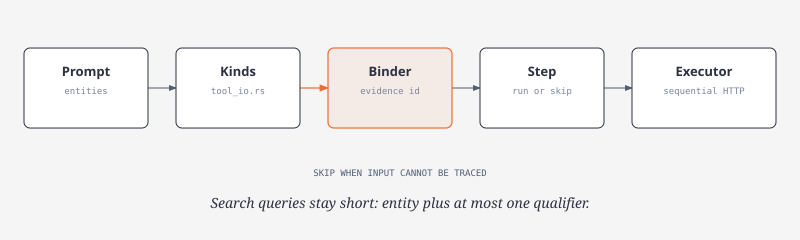](diagrams/recon-bindings.html)

`recon/investigation/tool_io.rs` is the single table (`TOOLS`). Picker catalog, dependencies, binder, filler, rule extractor, starved-step check, and fallback filter all read it.

Subject extraction:

- Strip imperative lead-ins (`recon`, `investigate`, …), social tails, attribute words (`follower count`, `net worth`, …)
- Person names: 2–4 tokens, no product words
- Handles only when the subject owns them (profile URL, `@mention` next to a platform, or a keyed account field)

Every binding records `source_tool` (empty for the prompt).

**Hunter inputs** (`restricted_sources` / `allowed_producer`): prompt, Firecrawl, SociaVault, or earlier Hunter. Gap-filler values wait until a primary observation contains the same value. Firecrawl map/crawl: Firecrawl and Hunter sources only.

Gates: `hunter_email_count` before `hunter_domain_search`; `hunter_email_insight` before person/combined enrichment.

Coverage tests:

- Every required input maps to a kind with prompt extractor, producer, and rule extractor
- Every SociaVault route writes `platform` plus a route input
- Hunter producers are primary-only
- `platform_id` is `TOOL_ONLY` (SociaVault profile)
- Request-builder fixtures cover every route

| Tool | Inputs | Binding kinds | Producers (besides the prompt) | Extractor |
|---|---|---|---|---|
| `crtsh_certificates` | domain | domain | domain: 24 — declared: firecrawl_search | domain scanner |
| `mnemonic_passive_dns` | domain_or_ip | domain or ip | domain: 24; ip: 7 — declared: firecrawl_search | IP scanner; domain scanner |
| `hackertarget_hostsearch` | domain | domain | domain: 24 — declared: firecrawl_search | domain scanner |
| `ripestat_network_info` | ip | ip | ip: 7 — declared: mnemonic_passive_dns, hackertarget_hostsearch | IP scanner |
| `arin_rdap` | ip | ip | ip: 7 — declared: mnemonic_passive_dns, hackertarget_hostsearch | IP scanner |
| `apnic_rdap` | ip | ip | ip: 7 — declared: mnemonic_passive_dns, hackertarget_hostsearch | IP scanner |
| `wayback_availability` | url | url or domain (as https URL) | url: 20; domain: 24 | URL scanner; domain scanner |
| `commoncrawl_urls` | domain | domain | domain: 24 | domain scanner |
| `arquivo_history` | domain_or_url | domain or url | domain: 24; url: 20 | URL scanner; domain scanner |
| `github_repositories` | query | handle or package or org_name or person_name | handle: 15; package: 4; org_name: 10; person_name: 6 | entity selection + keyed name fields; package scanner; profile URL + @mention + keyed fields (subject-owned) |
| `gitlab_projects` | query | handle or package or org_name or person_name | handle: 15; package: 4; org_name: 10; person_name: 6 | entity selection + keyed name fields; package scanner; profile URL + @mention + keyed fields (subject-owned) |
| `grepapp_code_search` | query | package or domain or org_name | package: 4; domain: 24; org_name: 10 | domain scanner; entity selection + keyed name fields; package scanner |
| `gleif_entities` | company_name \| lei | org_name | org_name: 10 | entity selection + keyed name fields |
| `sec_submissions` | cik \| name \| ticker | org_name | org_name: 10 | entity selection + keyed name fields |
| `wikidata_entities` | name \| qid | org_name or person_name | org_name: 10; person_name: 6 | entity selection + keyed name fields |
| `keybase_identity` | username \| domain | handle (keybase, else subject's best) or domain | handle: 15; domain: 24 — declared: firecrawl_search, sociavault_profile | domain scanner; profile URL + @mention + keyed fields (subject-owned) |
| `stackexchange_users` | name | person_name or handle | person_name: 6; handle: 15 | entity selection + keyed name fields; profile URL + @mention + keyed fields (subject-owned) |
| `wikipedia_users` | username | handle (wikipedia, else subject's best) | handle: 15 — declared: firecrawl_search, sociavault_profile | profile URL + @mention + keyed fields (subject-owned) |
| `wikipedia_source_reliability` | domain \| url \| publisher | domain, url, org_name, or entity phrase (news context) | evidence only (no bindings) — `context: news` | Admiralty Source Reliability A–F from English WP:RSP via MediaWiki `action=parse`; unlisted → F |
| `nominatim_geocode` | address_or_place | address | address: 10 | keyed address fields |
| `census_geocode` | us_address | address | address: 10 | keyed address fields |
| `overpass_places` | latitude, longitude, radius_m | coordinates (radius_m 500) | coordinates: 2 — declared: nominatim_geocode, census_geocode | lat/lon fields |
| `blockchain_address` | bitcoin_address | wallet | wallet: 4 | BTC address scanner |
| `blockstream_address` | bitcoin_address | wallet | wallet: 4 | BTC address scanner |
| `mempool_address` | bitcoin_address | wallet | wallet: 4 | BTC address scanner |
| `nvd_cve` | cve_id | cve | cve: 8 | CVE scanner |
| `osv_package` | ecosystem, package_name, version \| commit | package (ecosystem:name@version) | package: 4 | package scanner |
| `cve_record` | cve_id | cve | cve: 8 | CVE scanner |
| `sans_ip_activity` | ip | ip | ip: 7 | IP scanner |
| `shodan_internetdb` | ip | ip | ip: 7 | IP scanner |
| `urlscan_search` | domain \| query | domain | domain: 24 | domain scanner |
| `firecrawl_search` | query | query (directive entity + fixed qualifier, limit 5) | always (built from the directive entity) | n/a; relevance gate on domain/org_name/email/url |
| `firecrawl_scrape` | url | url | url: 20 — declared: firecrawl_search | URL scanner |
| `firecrawl_map` | domain \| url | domain (prompt, Firecrawl, or Hunter only) | domain — declared: firecrawl_search, hunter_domain_finder | URL scanner (same-site links, contact/about first) |
| `firecrawl_batch_scrape` | urls | url list (up to 5, ranked) | url: 20 — declared: firecrawl_map, firecrawl_search | URL scanner |
| `firecrawl_crawl` (off by default) | domain \| url | domain (prompt, Firecrawl, or Hunter only) | domain — declared: firecrawl_search, hunter_domain_finder | URL scanner |
| `firecrawl_extract` | url | url | url: 20 — declared: firecrawl_map, firecrawl_search | keyed org/legal name, domain, address, people names |
| `hunter_domain_finder` | company | org_name | org_name (primary only) — declared: firecrawl_search | keyed domain and company_name (inferred unless perfect_match) |
| `hunter_email_count` | domain \| company | domain or org_name | primary only — declared: firecrawl_search, hunter_domain_finder | n/a (gates domain search) |
| `hunter_domain_search` | domain \| company | domain or org_name | primary only — declared: firecrawl_search, hunter_domain_finder | domain scanner; entity selection + keyed name fields |
| `hunter_email_finder` | domain \| company; full_name \| first_name \| linkedin_handle | domain or org_name; person_name | primary only — declared: firecrawl_search, hunter_domain_search | domain scanner; entity selection + keyed name fields |
| `hunter_email_verifier` | email | email | primary only — declared: hunter_email_finder, hunter_domain_search | email scanner |
| `hunter_company_enrichment` (was `hunter_tech_lookup`) | domain | domain | primary only — declared: firecrawl_search, hunter_domain_finder | keyed name, legal name, domain, parent domain, address, social handles |
| `hunter_email_insight` | email | email | primary only — declared: firecrawl_search, hunter_domain_search | n/a (gates enrichment) |
| `hunter_person_enrichment` | email \| linkedin_handle | webmail email or LinkedIn handle | primary only — declared: firecrawl_search, hunter_domain_search | keyed full name, employer, employer domain, handles |
| `hunter_combined_enrichment` | email | company (non-webmail) email | primary only — declared: firecrawl_search, hunter_domain_search | keyed person and company fields |
| `sociavault_profile` | platform, handle \| user_id | handle + platform, or platform_id + platform (one call per question platform) | handle: 15; platform_id: 1 — declared: firecrawl_search, hunter_company_enrichment, sociavault_search_users | profile URL + @mention + keyed fields (subject-owned); keyed platform_id |
| `sociavault_search` | platform, query (+ subreddit) | person_name, org_name, or handle as query; platform named in the question, else twitter | always (a name or handle) | handles marked unverified |
| `sociavault_search_users` | platform, query | as above; default instagram | always (a name or handle) | handles marked unverified |
| `sociavault_user_content` | platform, handle \| user_id | handle or platform_id + platform (one call per question platform) | handle: 15; platform_id: 1 — declared: sociavault_profile | profile URL + @mention + keyed fields |
| `sociavault_google_search` | query | query (same as the Firecrawl search it replaces) | inserted by Recon only | domain/URL scanner, entity selection; relevance gate |

| Kind | From the prompt | Tool producers | Rule extractor |
|---|---|---|---|
| domain | yes | crt.sh, Whoxy WHOIS history, passive DNS, HackerTarget, RDAP, Shodan, urlscan, Firecrawl (5), Hunter (5), SociaVault (3), Keybase, and others | domain scanner (registrable TLD; social, publisher, file, and webmail hosts dropped) and entity selection on search hits |
| ip | yes | passive DNS, HackerTarget, urlscan, Firecrawl (7) | IPv4/IPv6 scanner |
| email | yes | RDAP, Holehe email lookup, grep.app, Firecrawl (5), Hunter (4), SociaVault (3) | email scanner (webmail domains are not company domains) |
| url | yes | Common Crawl, Arquivo, GitHub, GitLab, Wikidata, Keybase, NVD, urlscan, Firecrawl (6), SociaVault (4), and others (20) | URL scanner (subject-related or own-domain hosts) |
| handle | yes | Firecrawl (5), Keybase, GitHub, Hunter (3), SociaVault (5) (15) | profile-URL and @mention-near-platform extractor plus keyed account fields (Keybase proofs, SociaVault, Hunter social keys); subject-owned only; platform qualifier kept; SociaVault search results unverified |
| platform_id | no (`TOOL_ONLY`) | SociaVault profile (1) | keyed `platform_id` (Twitter rest_id, Instagram user id, YouTube channelId) with its platform |
| person_name | yes | Firecrawl search/extract, Hunter (3), SociaVault Google (6) | entity selection on search hits, first_name+last_name fields; 2–4 tokens, no product words |
| org_name | yes | RIPEstat, GLEIF, Firecrawl search/extract, Hunter (5), SociaVault Google (10) | entity selection on search hits and keyed name fields |
| cve | yes | NVD, CVE record, OSV, Shodan, Firecrawl (8) | CVE id scanner |
| package | yes | Firecrawl search/scrape/batch/crawl (4) | `ecosystem name@version` scanner |
| wallet | yes | Firecrawl search/scrape/batch/crawl (4) | Bitcoin address scanner |
| address | yes | GLEIF, SEC, Nominatim, Census, Firecrawl (4), Hunter (2) (10) | keyed address fields (composed parts must all occur) |
| coordinates | yes | Nominatim, Census (2) | lat/lon fields |

`overpass_places` is reachable via `coordinates` (Nominatim or Census, radius 500 m). No `phone` kind: no catalog tool takes a phone number.

## Primary providers

[](diagrams/osint-providers.html)

Firecrawl, SociaVault, and Hunter are primary. Everything else is a gap-filler.

**SociaVault** — 44 one-credit `GET https://api.sociavault.com/v1/scrape/...` routes in 5 catalog tools. Internal `SOCIAVAULT_ROUTES` maps platform + optional `endpoint`. No followers/following or single-post routes. Unknown endpoints rejected.

| Tool | Routes | Platform: endpoints (default first) |
|---|---|---|
| `sociavault_profile` | 10 | facebook: profile; instagram: profile, basic_profile (userId); linkedin: profile, company; threads, tiktok, twitch, twitter: profile; youtube: channel |
| `sociavault_search` | 12 | instagram: hashtag; linkedin: posts; pinterest: search; reddit: search, subreddit; threads: search; tiktok: keyword, hashtag, top; twitter: search; youtube: search, hashtag |
| `sociavault_search_users` | 3 | instagram, threads, tiktok: users |
| `sociavault_user_content` | 18 | facebook: posts, reels; instagram: posts, highlights, reels; pinterest: boards; threads: posts; tiktok: videos, live; twitch: videos, schedule; twitter: tweets, tweets_all (user_id); youtube: videos, community_posts, lives, playlists, shorts |
| `sociavault_google_search` | 1 | google: search (fallback only) |

**Firecrawl** (`https://api.firecrawl.dev/v2`)

| Tool | Route | Notes |
| --- | --- | --- |
| `firecrawl_search` | `POST /search` | sources web/news; github→`developer`/research; `tbs`; location; limit ≤ 10 |
| `firecrawl_google_search` | `POST /scrape` of Google SERP | named-engine discovery; parser fixtures only, not live-validated |
| `firecrawl_yandex_search` | `POST /scrape` of Yandex SERP | named-engine discovery; parser fixtures only, not live-validated |
| `firecrawl_mojeek_search` | `POST /scrape` of Mojeek SERP | named-engine discovery; parser fixtures only, not live-validated |
| `firecrawl_scrape` | `POST /scrape` | markdown and links |
| `firecrawl_map` | `POST /map` | same-site; contact/about first; top 25 |
| `firecrawl_batch_scrape` | `POST /batch/scrape` | 5 default, ≤10 URLs, polled |
| `firecrawl_crawl` | `POST /crawl` | ≤10 pages, depth 1, off by default, polled |
| `firecrawl_extract` | `POST /scrape` + schema | 5 credits |

Map and crawl refuse social, publisher, and Q&A hosts.

**Hunter** (`https://api.hunter.io/v2`, read only)

| Tool | Route | Notes |
| --- | --- | --- |
| `hunter_domain_finder` | `/domain-finder` | free |
| `hunter_email_count` | `/email-count` | free |
| `hunter_domain_search` | domain search | — |
| `hunter_email_finder` | email finder | — |
| `hunter_email_verifier` | verifier | 202 retried up to 3 times |
| `hunter_company_enrichment` | `/companies/find` | alias `hunter_tech_lookup` |
| `hunter_email_insight` | `/email-insight` | free |
| `hunter_person_enrichment` | `/people/find` | webmail email or LinkedIn handle |
| `hunter_combined_enrichment` | `/combined/find` | company email only |

**Whoxy** (`https://api.whoxy.com/`) — `whoxy_whois_history`. Prepaid credit pool (default 0). Cache the full history, then project `from`/`to`/`limit`. Observation dates are not registration dates. Monthly `credit_reset` does not replenish Whoxy.

**Holehe** — `holehe_email_lookup` (`EmailRegistration`). Native Twitter, Spotify, and Pinterest adapters; 120 other catalog services return `unsupported`. Registration is email association, not identity or account control.

Chains:

- prompt → Firecrawl search (Google search after a weak search) → SociaVault search/users → profile → user content
- Firecrawl search or Hunter domain finder → domain → Firecrawl map → batch scrape / extract
- domain → Hunter email count → domain search → email finder → verifier
- domain → company enrichment → social handles → SociaVault profile
- email → email insight → person (webmail) or combined (company) enrichment

Gap-fillers consume these values and never feed Hunter.

Spec defaults still to confirm: `google_fallback_min_results = 3`, `sociavault_turn_credits_opening = 3` / `_later = 8`, `picker::MAX_PICKS = 13`.

## Persistence

[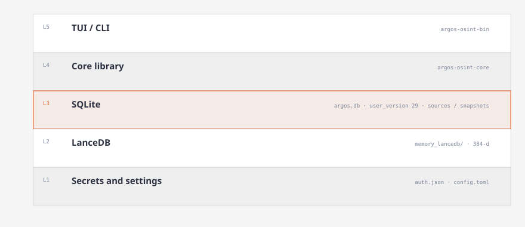](diagrams/persistence.html)

[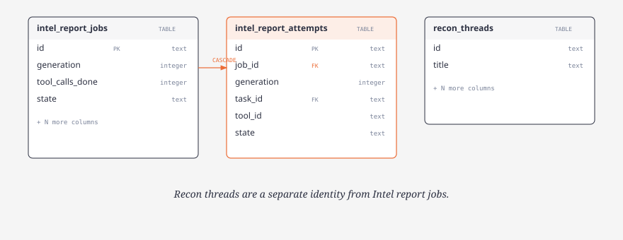](diagrams/schema-core.html)

- `store.rs` migrates additively, then `schema_recon.sql` (threads, messages, runs, calls, cache, settings, entities, claims, sources, relations, edits, extraction jobs, app state).
- Intel: `schema_intel_recon.sql` — `intel_report_jobs`, `intel_report_tasks`, `intel_report_attempts` (v24), sections.
- Atlas packets: schema v25 stores durable unit outputs, dispositions, and completion receipts (`atlas_work_units`).
- Schema v26: `recon_model_operations`, `recon_model_attempts`, Intel `lease_epoch`.
- Tables added after a shipped version also need `CREATE TABLE IF NOT EXISTS` on open, before any `SELECT`/`UPDATE`.
- `ARGOS_HOME` changes the whole state root.

Brain recall is hybrid:

| Store | Role |
| --- | --- |
| SQLite `argos.db` | Memories, claims, provenance (source of truth) |
| LanceDB `memory_lancedb/` | `brain_memories`: `memory_id` + 384-dim vector |

Vectors: local all-MiniLM-L6-v2 (Xenova quantized ONNX) via tract-onnx in `embed.rs` (mean pool, L2).

- Model cache: `ARGOS_HOME/models/all-MiniLM-L6-v2` or `ARGOS_EMBED_MODEL_DIR`
- `brain_lance.rs` wraps async Lance in sync
- Writes upsert after SQLite commit; deletes remove vectors

`Store::recall`:

- Embed query → cosine neighbours (`1 - distance`) blended with Jaccard/category (`brain::hybrid_recall`)
- `recall_for_turn` adds entity-linked insights
- `memory_embed_meta` (v17) stores the embedding fingerprint
- Mismatch or missing table rebuilds from `memories` (above 3,000 stay Jaccard until `argos memories reindex`)
- `ARGOS_EMBED=0` or any index failure → Jaccard; the turn continues
- v17 also drops leftover `memory_vec`

Launch:

- Running runs become interrupted; completed calls retained
- Resume is explicit and skips completed calls
- Default thread delete retains Brain history and marks its source deleted; zero-support evidence leaves recall and the index
- `--with-insights` deletes memories owned only by that investigation

## Model and UI boundaries

[](diagrams/model-roles.html)

All model transports share [provider request scheduling](providers.md#provider-wide-request-pacing): independent process-wide FIFO pacing for OpenRouter (20 RPM), Google (10 RPM), and Nvidia (40 RPM), plus provider-wide cooldowns for rate limits and overloads. The [scheduling figure](diagrams/model-request-scheduling.html) shows its boundary with route retries, validation, and compatibility callers. Queue time is separate from wire deadlines; automatic stage output/reasoning caps are removed.

[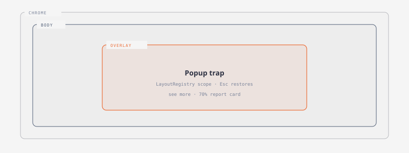](diagrams/tui-shell.html)

- Credentials: `auth.json`. Roles: `config.toml`.
- Tabs: Defaults, OpenRouter, Google, Nvidia. Defaults lists ordered fallbacks per role (Add / Delete / Move). Refresh model lives on provider tabs only.
- Old Writer seeds Recon + Synthesis. Tool picker default (`openrouter` / `typesafe/jev-1.13`) seeds only when both fields empty. Empty `fallbacks` lists are added on migration.
- Sign-in does not assign roles. Legacy Grok/OpenAI stay until replaced; never sent to Google or Nvidia.
- Recon: list, then transcript. Synthesis answers store Brain memory ids used in the prompt. Markdown answer, raised prompt band, collapsed decision/tool rows. Untitled threads named from the first question.
- Publisher / social / wiki / aggregator hosts stay citations or handles. They never become subject identifiers. Never sent to Hunter.
- Catalog: 59 tools in `osint.rs` (15 categories). Primary adapters: `osint/providers.rs`. News/legal: `osint/news_legal.rs`.
- Keys: Firecrawl bearer (`firecrawl_api_key` / `FIRECRAWL_API_KEY`); Hunter `x-api-key`; SociaVault `X-API-Key`. Saved key overrides env. `locked_host` on primary requests.

Answer-step 429: run failed, tool results kept, resume skips completed steps.

## Profile dashboard and config transfer

Profile (internal id `System`) is read-only observability plus one configuration transaction. Widgets, metric denominators and the portable document: [profile-dashboard-and-search.md](profile-dashboard-and-search.md). Keys: [usage.md](usage.md#profile).

### Snapshot path

```
tick (1 Hz) → visible Overview + refresh due (20s / invalidated) → background reader
            → Store::profile_snapshot → ProfileSnapshot (immutable) → tui/profile.rs renders
```

- `App::reload_profile` requires visible Profile Overview analytics with no overlay and asks `ProfileView::due()` before starting a read. Automatic refresh is every 20 seconds; manual refresh, filters and fresh Profile entry invalidate freshness. Snapshot delivery applies the same visibility guard, discarding reads completed while hidden without replacing the previous snapshot or timestamp.
- The background worker opens a separate read-only connection with `Store::open_profile_reader`, keeping snapshot reads off the UI thread and away from the recording connection. A failed visible read keeps the last good snapshot and reports the error instead.
- `profile_stats::snapshot` performs no writes, no network calls and no model calls; it merges `telemetry_events` with `telemetry_hourly` / `telemetry_daily`, reads a rollup bucket only when the whole bucket predates the raw retention boundary, and returns `N/A` rather than `0` wherever the denominator is zero.
- Rendering consumes the cached snapshot only. The selected Summary/app page uses Dashboard geometry; expanded measurements use the Report preset.

### Module layout

| File | Owns |
| --- | --- |
| `crates/argos-osint-core/src/telemetry.rs` | Event kinds, outcomes, triggers, retention constants, mergeable duration bins |
| `crates/argos-osint-core/src/profile_stats.rs` | `ProfileSnapshot` and every section aggregate (`snapshot`, `filter_options`) |
| `crates/argos-osint-core/src/provider_metrics.rs` | Read-only capacity and quota DTOs; no scheduler or admission policy |
| `crates/argos-osint-bin/src/tui/profile.rs` | `SystemTab`, `Section`, the 35-entry `WIDGETS` registry, filter strip, keys |
| `crates/argos-osint-bin/src/tui/profile_charts.rs` | The one shared hand-drawn chart renderer |
| `crates/argos-osint-bin/src/tui/profile_config.rs` | The Configs export/import popups |

Every widget renders through a single entry point (`tui/profile.rs::widget_lines`), and every chart goes through `tui/profile_charts.rs`: stacked bars, ranked bars, trend columns and meters. `ratatui::Chart` / `BarChart` are deliberately unused — a narrow viewport must never panic, and a segment fill has to carry the exact series colour. One renderer also means a widget cannot smuggle in its own geometry, the same precedent as `tui/atlas_table.rs`.

### Config transfer and the commit

`config_transfer::parse_document` validates the whole schema-v1 document, then `apply_import` merges it by stable id into the in-memory snapshot. Publishing is `config_transfer::commit_profile_config`:

```
ConfigLock::acquire()            # .argos-config.lock, heartbeat + stale takeover, app-wide
  → commit_files([settings → config.toml,
                  auth      → auth.json,
                  quota     → quota.json])
      commit journal (.argos-config-journal.json) marks state: pending
      each file: write_secure  (0600 sibling temp file → fsync → atomic rename)
  → success: generation id +1, reload epoch notifies subscribers
  → failure: whole batch rolls back from its backups; nothing is published
```

`config.toml`, `auth.json` and `quota.json` are one configuration, so a provider change moves all three or none of them. The journal holds paths and state only — never a body and never key material — and `config_commit::recover_at_startup()` finishes a rollback left `pending` by a process that died mid-commit; it runs at TUI boot (`App::boot`) and on CLI start. Export uses the same secure primitive, and a failed import writes nothing.

## Brain browsing and direct associations

`brain_browse` is a display projection beside the existing Brain storage and recall helpers. Stable rows are Claim(memory ID) or ActorGroup(normalized display name, every member/resolved/redirected ID). Grouping precedes Find and counts and never changes identity resolution. Typed claim/atomic_claim and legacy non-inference insight claims are visible; all other kinds remain internal. TUI aggregate keys cannot pin or delete a member accidentally.

Direct associations union the actor-reference index, typed Claim payloads and locally repaired retained derivations, exact article mentions/observed endpoints, claim origins and opt-in thread detections. Claims and threads deduplicate by ID; articles deduplicate by canonical URL while retaining exact occurrence/revision receipts. Missing, deleted and stale origins are excluded. Actor Articles counts direct retained mentions, observed links and claim origins regardless of Related eligibility; Claim Sources retain original provenance. The graph covers the entire set; row paging does not cap graph coverage.

Claim publication synchronizes typed actor refs and the reference table inside the publication transaction. Readable names come from retained entity labels, with canonical fallback; entity IDs remain separate. A versioned local backfill repairs machine ID spellings without overwriting analyst names and recovers referenced actors only from retained extraction/spans. Recall-off creates no new thread associations; earlier receipts survive until their origin is deleted or replaced. The browse graph projects five visible node kinds; activating its claim-path or actor-group pane opens the exact topology. Typed association rows own cross-app record navigation and Back restoration.

[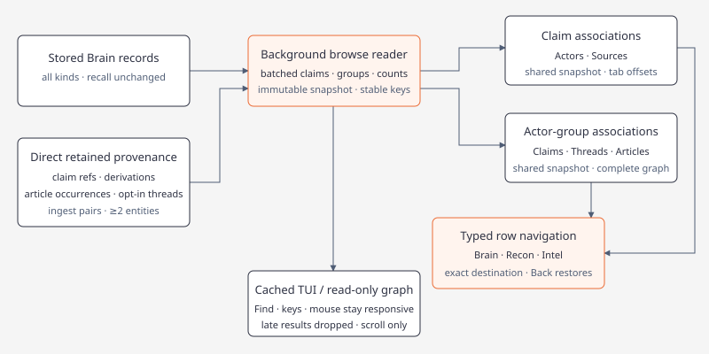](diagrams/brain-browse.html)

### Source removal and index eligibility

Article and investigation deletion reconcile current `insight_sources` in the same SQLite transaction. Deleted origins stop contributing to source counts. A retained occurrence of the same article, another article or a live Recon source keeps shared evidence active. Unsupported canonical Claim/Inference rows are retired; their typed rows, IDs and historical snapshots remain stored. Explicit insight deletion and legacy cycle cleanup retain their existing canonical-row deletion behavior, with durable vector removals. Actors backed by sources and dependent Link/Related records also retire when their support disappears, including shared identifier actors and legacy Atlas scopes. Analyst pins and manual records retain their existing actor lifecycle protections.

Every non-active typed memory is excluded from browsing, recall, upserts and index rebuilds. Reconciliation commits durable `index_remove` work with lifecycle changes; the index worker rechecks current eligibility so an older removal cannot erase a reactivated record. Reactivation queues current content again when needed. The actor maintenance tick also repairs pre-existing stale source/index state without opening vectors under a SQLite write lock.

[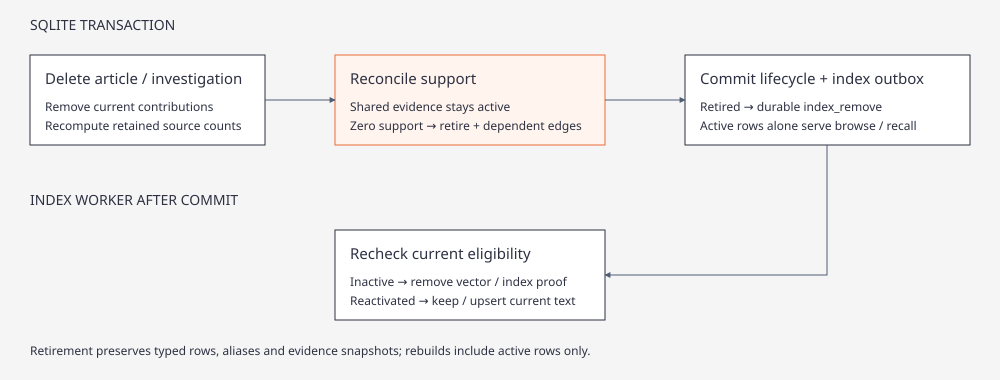](diagrams/brain-source-lifecycle.html)

### Actor identity maintenance

All Atlas mention, Recon thread and claim-subject bindings share `brain_actors`. The comparison key strips terminal ASCII/Unicode English possessives and normalizes case, punctuation and whitespace; source spans retain exact original spellings. Names are candidate keys, not cross-source identity. Rebinding revives a retired actor; replacing an article inventory replaces all of that occurrence's mentions and observed links, including metadata corrections with an unchanged source hash. Schema 42 guards article deletion and source edits (including pruning), clearing dependent mentions, edges and receipts. Reconciliation retires unsupported ingest actors while preserving pinned records, active claim evidence and surviving merged-family contributions. Brain change notifications invalidate cached counts.

Actor maintenance passes non-identifier labels through the shared local NLP worker before acquiring the SQLite write transaction. Boundary verbs are removed only when a confident entity remains (for example `Allow FBI` → `FBI`); ambiguous person names, branded phrases, account/domain/IP identifiers and original source spans are preserved. The canonical display/text is updated under the same actor ID, old spellings stay as aliases, and the changed memory is reindexed. Busy or failed parses leave retryable normalization receipts; NLP Off uses lexical normalization only.

The elected `argos-actor-dedup` worker runs independently of Atlas and browsing, every 30 seconds after its previous tick. Its **Actor identity maintenance** service job repairs up to 100 historical actor rows per tick using revision receipts; only normalized spellings within one source scope merge locally. Token/acronym posting lists propose up to eight contextual identity decisions per tick, including compatible unknown/typed candidates. Each pair includes bounded retained article/thread/claim context. Missing Entity Resolver configuration leaves local repair operational with zero model requests.

The shared executor routes the Entity Resolver's bounded `same` / `different` / `uncertain` decision through native Decisions or constrained chat, with ordinary admission, retries, fallbacks and cancellation. No model request holds a SQLite transaction. `brain_actor_dedup_receipts` caches assessments by pair, sampled context, actor revision and prompt version; errors retain diagnostics and a ten-minute retry cooldown. A durable pair lease fences competing workers. Before applying a result, the writer rechecks canonical IDs, input hash and unexpired lease. Only `same` merges, preferring the fuller name; redirects retain old IDs, references and provenance. Explicit Split records a persistent separation so maintenance does not undo it. Merely equal names or shared surnames do not merge actors or establish corroboration.

[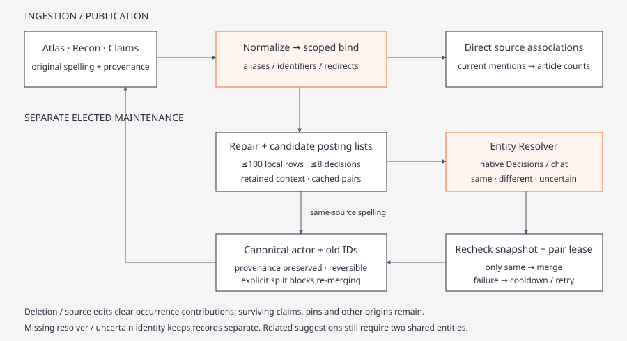](diagrams/actor-identity.html)


Production browsing loads immutable snapshots on separate read-only connections. The list batches Claim selection and claim origins; Actor Graph/Related/totals share one association snapshot. Find filters cached rows. Hidden Brain changes only invalidate its cache, and stale delivery cannot replace newer selection or navigation. Atlas history/pruning/deletion, Intel bulletin/brief/Related reads, Recon history/deletion, Jobs and Logs also keep bulk database work off the terminal event loop. The TUI control Store never attaches LanceDB; commits enqueue durable index work for the elected pool. See the [database responsiveness audit](tui-database-responsiveness.md).

## Brain Memory Topology and Scope Analysis

`Store::topology_snapshot` (`brain_topology.rs`, `brain_topology_query.rs`) resolves
typed canonical or exact retained-source entries into an immutable neighborhood.
The default is two semantic hops (selectable 1..3). Brain graph panes preserve
Claim/ActorGroup identity; Intel claims and inferences resolve through their matching publication
job/local ID and derivation snapshot as soon as that kind publishes, and metadata actors through scoped retained
references. Unindexed records retain source-scoped identity without writing data.

- **Scope and bounds**: All retained/current-cycle scope uses recorded origins. Bounded adjacency traversal and output preserve root/path/edge endpoints and report discovered/omitted/unresolved coverage. Continuation is not implemented: incoming tokens are rejected and no pretend cursor is emitted.
- **Nodes and relationships**: Exact Actors and explicit ActorGroups remain distinct. Claims, Inferences, derived recorded-attribute Topics, Articles and Sources carry exact recenter seeds and provenance. Direct mentions and evidence do not require similarity. Claim subjects bind canonical Actors; Inferences retain canonical Claim premises and their actor associations, with indexed relational evidence references and canonical index-outbox revisions. Canonical premise IDs remain authoritative across staged replacements; reused local claim IDs cannot rebind historical inferences. Links retain direction/rationale/receipts; Related remains tentative. Publisher identity and duplicate occurrences do not establish independent corroboration.
- **TUI delivery**: One background read at a time coalesces superseded requests. Generation/seed fences reject late loads; `Store::memories_changed_seq` supplies the mutation sequence. The canvas, inspector, relationship rows and counts render the same snapshot, with no database access during drawing. Shared pure geometry owns visible target rectangles. Selection inspects; explicit recenter pushes history; Back restores its origin.
- **Background Scope Analysis**: Explicit candidate proposal and link assessment executes on dedicated worker pool `POOL_BRAIN_SCOPE = "brain_scope"` (`scheduler.rs`, `tasks.rs`). The worker uses `Store::open_light`, validates canonical premises/actors, writes inference memory and metadata, and writes qualified Links. These are separate writes rather than an atomic brief publication. Retained-source projections are not eligible canonical premises.

The [topology mapper specification](topology-mapper.md) defines entry identity,
responsive layout, interaction and coverage contracts.

[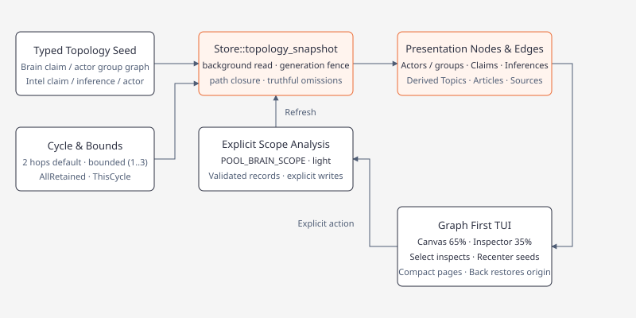](diagrams/brain-topology.html)

## Intel reports

Article Recon report execution is historical. `create_report_job`, resume/retry and worker entry reject execution. Startup retirement revokes unfinished report and descendant leases, records durable retirement markers and signals workers. It preserves historical result bundles and provenance, leaves brief chains and article owner generations intact, and fences late report publication. Independent Recon investigations are unchanged.

[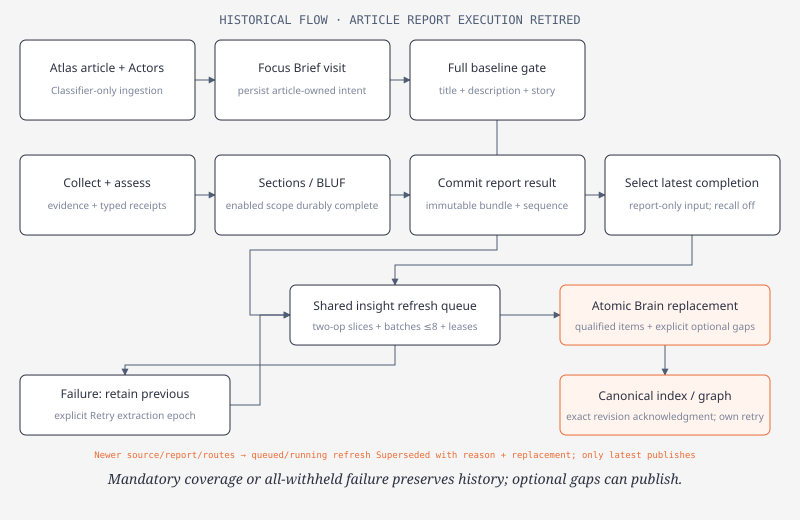](diagrams/intel-report.html)

## Atlas

[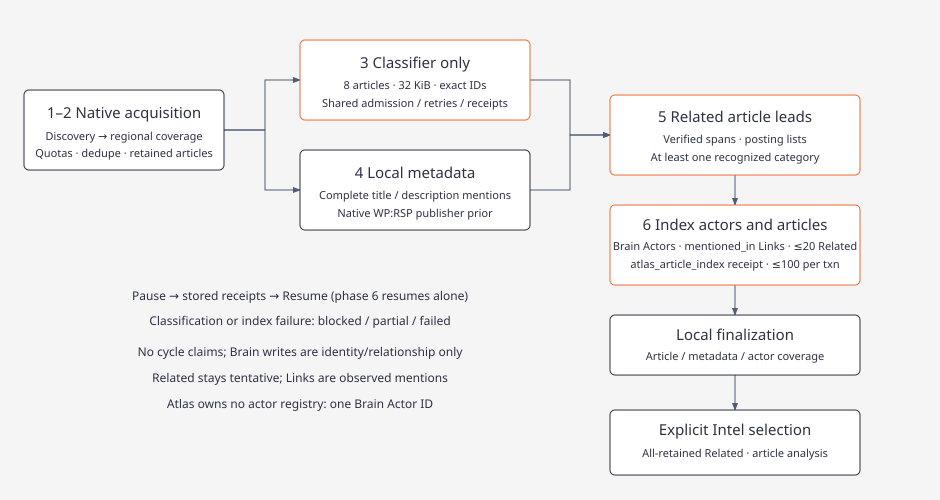](diagrams/atlas-pipeline.html)

`atlas-collection-v2` (v1 cycles are recognised by `atlas_work::is_collection_contract` and upgraded on resume) is a classification-only news cycle with a sixth, local Brain indexing phase. Native discovery and regional coverage retain provider quotas and deduplication; Classifier is the only model role. Local entities and publisher priors provide metadata, then exact shared mentions produce tentative Related article leads. Cycles publish no claim memories or vector/index obligations. Pause stores receipts; Resume retries unresolved classification and native metadata.

| Stage | Execution | Unit |
| --- | --- | --- |
| Discovery and coverage | GNews/NewsData, then NewsAPI/Currents; existing quotas and heat bands | Article |
| Classification | Eight-row batches, 32 KiB ceiling; shared Classifier executor/fallbacks | Article, with wire attempts separate |
| Entities | Complete original title/description, bounded local NLP; no model fallback | Article metadata |
| Publisher prior | Immutable native WP:RSP index per pass; domain suffix match | Article metadata |
| Related | Local posting lists and verified spans; category-qualified pair seed | Canonical article pair |
| Index actors and articles (phase 6, `STAGE_ACTOR_ARTICLES=12`) | `atlas_actor_index::index_run`: Brain Actor binding, `mentioned_in` Link, ≤20 tentative Related, `atlas_article_index` receipt per occurrence; ≤100 occurrences per transaction | Article occurrence |

Completed requires successful required classification, settled enabled metadata and a current phase-6 receipt for every occurrence (zero-actor occurrences are receipted; a failed index write keeps the cycle partial and Resume runs phase 6 only). Atlas owns no actor registry: Brain Actor IDs are shared with Recon and claims, and Related reads (`related_global.rs`, `RelatedScope::AllRetained` by default, `ThisCycle` on the Related toggle) return one row per URL across retained cycles. Metadata failures produce warnings; valid `unk`, empty entities and unrated publishers succeed. Unresolved required IDs yield partial/failed/blocked. Legacy extraction/index telemetry remains explicitly historical. Old unfinished runs preserve categories and resume native metadata; historical `unk` provenance is flagged. Explicit historical CLI Repair/Verify rejects new cycles. The TUI has no Repair memories or startup publication.

See [classification and Related articles](atlas-classification-and-related-articles.md) for schema 30, receipts, publisher scores, exact lineage, deletion and navigation. Country bands, native quotas, map, origins, history and retained headlines remain unchanged. Coverage replaces the current-cycle Insights pane.

GNews, NewsData, Currents are catalog tools for manual runs and omitted from the Recon picker.

## News and Legal context tools (#29)

`newsapi_search`, `newsapi_headlines`, `courtlistener_case_search`, `courtlistener_docket_search`, `courtlistener_judge_search` serve context kinds `news` and `legal`. They are evidence only: `ToolIo` sets `context`, produce no bindings, never feed Hunter.

`directives::context_targets` (keyword rule):

- Adds missing news/legal targets to d1; strips ones the prompt did not ask for.
- Keywords inside the subject’s name do not count (`entity_mask`). “Who owns Fox News?” spends no news quota. “Latest news about Fox News” does.
- Query = directive entity as exact phrase (`How::EntityPhrase`). Dates only from the prompt (`prompt_dates`).

Picker puts matching context tools first after the opening primary pick (`picker::context_tools`). Missing key → omitted from eligible catalog.

- Caps: `news_calls_per_turn` 2, `legal_calls_per_turn` 3
- CourtListener 429 skips remaining CourtListener steps
- Executor spaces CourtListener 12 s; no retry of NewsAPI/CourtListener 429
- `context_gate` drops rows whose title/snippet lacks a directive entity

Synthesis: news lines get publish date and source; court lines get court, filing date, case name. Warm WP:RSP index adds up to five Source reliability lines (Admiralty A–F).

## Admiralty source evaluation (WP:RSP)

| Axis | Scale | Source |
| --- | --- | --- |
| Source Reliability | A–F | English WP:RSP via MediaWiki `action=parse` on `Wikipedia:Reliable_sources/Perennial_sources/{1..8,X}`. `gr`→B, `nc`/`m`→C, `gu`→D, deprecated/blacklisted→E, unlisted→F. **A** is never assigned from RSP alone. |
| Information Credibility | 1–6 | Focus Brief: verified independent support roots 1/2/3+→3/2/1; weakest supported item controls the aggregate grade. Conflicts→4, all-refuted→5, unresolved/partial→6. Legacy peer heuristics remain historical only. |

Legacy records used `clamp(base × reliability_factor × credibility_factor, 0, 1)`. Focus Brief uses the deterministic `brief-rating-v2` support score, bypassing that scaling and peer shortcuts. The WP:RSP index caches 30 days in process memory and `app_state.wikipedia_rsp_index`.

## Local preprocessing

The process-shared NLP worker, immutable source references and migration 28 caches are described in [nlp-preprocessing.md](nlp-preprocessing.md). Auto is the default; complete investigative coverage retains original evidence windows before assessment. [Evidence flow](diagrams/nlp-preprocessing.html).

## Investigative snapshots (schema 29)

`investigation/insights.rs` owns the shared extraction, fidelity, readiness and inference contracts; `insight_persist.rs` owns exact refresh dispatch and transactional activation. Source-local entities retain original mentions. `claim_assessor` inherits Synthesis when unset, while explicit routes remain independent. Free-chat execution skips Decisions-only routes in place; finite contracts use the shared Decisions adapter and preserve both label and threshold outcome.

`insight_assessment.rs` compiles ID-addressed batches (at most eight items) with deduplicated evidence and original per-question policies. `insight_wire.rs` hydrates compact IDs/source-absolute spans into server-owned provenance. Complete source-order extraction precedes deduplication and owner caps; full Synthesis coverage follows. Final inference/link decisions share batches. Bounded checkpointed reconciliation visits every original window instead of repeating all premise passages in one oversized merge. Missing mandatory coverage prevents replacement; optional unavailable/rejected items produce a coherent reduced snapshot with explicit gaps, while all-withheld model failures retain prior associations.

`insight_execution.rs` separates immutable work/checkpoint identity from explicit retry epochs and two-operation scheduling slices. Insight output repair consumes the same bounded executor budget (two attempts per route), then advances through compatible declared fallbacks; ordinary callers retain their retry policy. Task/run-linked model attempts carry typed diagnostics. Admission compares stored captured routes; restart resumes queued continuations but never automatically revives exhausted work. Explicit Retry extraction preserves successful compatible checkpoints and refuses deleted, superseded or 72-hour-retired owners. Published Brain state and exact-revision index acknowledgment are independent.

Atlas collection-v1 performs classification and local metadata only; historical extract-v3 claims remain readable. The automatic Intel brief retains complete article acquisition, then analyzes selected claim-specific sentences with explicit selective coverage and fidelity. The shared investigative service continues to require its own complete stage coverage; Recon requires substantive independent roots and fulfilled required tasks. Unsupported analytical prose is withheld.

Historical Intel reports followed acquisition, inventory, collection, assessment, sections/BLUF and finalization. Their immutable bundles remain retained evidence, but no new report-based extraction is admitted or recovered. Body-backed validation and brief indexing no longer give these bundles publication precedence.

Opening Focus Brief persists analysis intent. Its metadata Claims run independently of Full article; inference publication requires a complete retained baseline with matching body/acquisition revisions, validated story coverage and no truncation. Cached visits and subsequent body commits share admission and deduplication. Historical reports do not suppress article publication. The refined display excerpt does not certify the baseline. The automatic brief publishes Claims, Inferences and Links at their respective completed stages; each transaction replaces only that kind and enqueues its canonical index work, preserving previously published kinds if a later stage fails. Previous snapshots remain history during failures. Replaced generations are retired as Superseded with a recorded reason and replacement, never as failures; only the latest generation can publish. Schema 31 retains immutable report results separately from operational jobs; additive schema 32 retains extraction retry epochs/progress without modifying those bundles; additive schema 33 stores the latest streamed activity per execution and schema 34 records supersession (replacement job/task and reason).

### Intel brief preparation (intel-brief-v2 dependency graph)

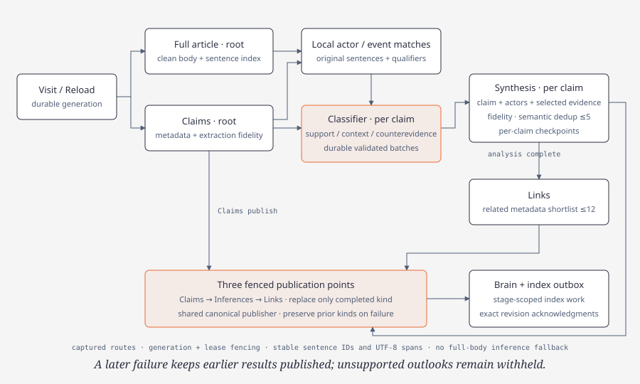

A Focus Brief visit, body-ready event, recovery or **Reload** calls `ensure_intel_brief_pipeline`, which attaches to the one durable `intel_brief` job per article generation (`intel_recon::brief_pipeline`, contract `intel-brief-v2`). Its four tasks are persisted at admission with explicit dependency rows: **Full article** and **Claims** are independent roots, **Inferences** depends on both, and **Links** on Inferences. The dedicated `argos-intel-brief` runner is a two-slot drainer (`brief_stages::drain_parallel`, `STAGE_SLOTS=2`): a slot is reserved before a lease is claimed, each claimed stage runs on its own Tokio task with its own backend and connections, and only the two dependency-free roots may run together (v1 exclusivity otherwise holds in the claim SQL). Roots are bound at admission to `{article_id, metadata, node_revision}` (Claims read the immutable metadata snapshot, never the body); a descendant stays unbound (`input_hash=''`, unclaimable) until `bind_ready` compare-and-sets it exactly once to `{body:{task_id,output_hash},claims:{task_id,output_hash}}`, in either commit order. Every stage carries an immutable `StageContext {job_id, task_id, job_generation, lease_epoch, metadata_snapshot, route_snapshot}` into prompts, model scopes, Body cleanup and fidelity; operation IDs are `{task_id}:e{lease_epoch}:{operation_key}:{payload_hash}` and attempts carry the job generation. A failed root blocks only its descendants (shown `Queued · blocked by X`, transitively); Retry re-queues failed tasks only. Reload supersedes the chain with `force_body`; per-node reuse adopts unchanged roots by node revision and descendants whose prior input hash (prerequisite output hashes + node revision) matches, so a body-only reload makes zero Claims requests. Links always re-reads its live candidate set. An active `intel-brief-v1` chain is fenced and cut over to a new v2 generation on the next visit; canonical Brain IDs keep the `intel-brief-v1` contract so they stay stable.

**Degrading and bounded latency.** Inferences fans out one thinking-model request per claim. Each claim's result is checkpointed (`brief_pipeline::checkpoint_*`), a failing claim is recorded rather than failing the stage, and the stage commits `warning: N of M claims could not be analyzed (...)` ("Completed with warnings") so Links runs on the analyzed claims; all claims failing still fails the stage with the provider category. Retry (the brief button and the Jobs panel `r`, both `retry_stage`) resumes failed branches or reopens a warning stage and its descendants, re-asking only the failed claims. Provider calls use a stall-aware chain: a timed-out route falls through to the next route (no resend, no backoff), thinking stages send a per-model reasoning effort with thinking-sized deadlines, and an interactive operation wall-clock cap (600s, 900s thinking) covers queue, pacing, backoff and attempts. A per-stage `StageLedger` adds what one operation cannot see: a stage request budget and route health, so sibling operations (per-batch classification, generation, fidelity, dedup) pass over a route that just failed instead of each re-paying it, and SSE timeout error events count as stalls.

- **Full article** reuses retrieval and validation, then cleans locally (`clean_body`): NLP keep-anchors, then Classifier keep/remove decisions over ambiguous blocks only (≤12 blocks per batch, provider output defaults), then verbatim removals and revalidation. Display and analysis consume the one `intel-clean-body-v1` artifact. No model rewrites the body.
- **Claims** see title/description only; extraction and actor detection are unchanged. **Inferences** use claim-specific evidence (`brief_context`): the local sentence index matches detected actor names and observed spellings, collects the actor's mention sentences and necessary nearby attribution/pronoun context, and retains correction/denial candidates. Each claim is associated with its mentioned actors; claim event terms provide additional local candidates, including event details without repeated actor names. Classifier decisions label bounded candidate batches as support, context, counterevidence or irrelevant. Synthesis receives one claim, its associated actors, and selected original sentences, with stable IDs and UTF-8 spans. Every extracted claim gets at least one analysis request, even with empty evidence, in which case an empty inference result is valid. Prompts ask for justified antecedents, consequences and outlook, preserve unresolved conditions, and reject unsupported speculation. There is no full-body inference fallback and no arbitrary article-chunk analysis. Every matched candidate reaches bounded Classifier batches. The final analysis retains counterevidence first, then support and context within a 12,000-byte evidence budget, records duplicate/budget omissions and restores source order. An oversized atomic sentence or counterevidence-only overflow fails explicitly. Up to three analysis requests may run concurrently; results retain claim order. **Links** see a local shortlist of related metadata (≤12, self and syndicated copies excluded).
- **Validation and routing.** Classifier uses the shared native Decisions adapter with constrained chat fallback and captured routes. Synthesis uses the Inferences generation route; its validator accepts only the request's claim ID and offered sentence IDs. Provider output/reasoning defaults and pacing apply to every dispatch and retry. After fidelity, exact repeats are removed locally and compact Synthesis ID selection deduplicates paraphrases to at most five distinct inferences. Selection sees at most 12 candidates per pass, carries at most five into the next, and never resends the article body. A failed context decision, analysis request or selection fails Stage 3 without committing partial inferences; cancellation drops in-flight requests. The inference revision includes the selection policy, Classifier route and prompts, so incompatible cached analysis is replaced while compatible Claims remain reusable.
- **Fidelity.** Claims go to Evidence Curator extraction-fidelity decisions; inferences go to Claim Assessor support decisions in batches (≤12 items; native Jev or constrained chat fallback). Receipts are cached by content, policy and route. Inference support checks include the cited support and counterevidence plus every Classifier-selected counterevidence sentence for that claim, even when generation omits a counter-citation. Those original spans remain in provenance. Items not judged faithful are withheld; a citation existing is never support.
- **Publication.** Claims, Inferences and Links each publish inside their own fenced stage commit. The combined display snapshot (`intel_brief_publications`) advances after each completed kind; canonical Brain publication uses the shared `insight_persist::publish_snapshot_on` and a kind-scoped derivation writer. Claims do not wait for Body, Inferences or Links. The Inferences commit writes only Inferences; the Links commit writes only tentative Brain Related article leads. Untouched kinds carry forward without rewriting or re-enqueuing their memories. Historical reports never take precedence. Evidence provenance, live owner checks, generation fencing, stable canonical IDs and savepoint rollback remain shared with the insight-refresh lane. Complete retained acquisition and resolvable assessed original passages gate inference publication; the complete local article is retained, but model evidence coverage is explicitly selective. Links retain their exact candidate revision, interpretation and verification gap and never become assessed corroboration. A later stage failure preserves earlier successful publications. A canonical failure rolls back only that publication savepoint and is reported in the **Publication / Index** footer; it does not turn completed extraction into failure. Published means canonical rows committed; Indexed requires acknowledgment of their current revisions, with pending, disabled and failed index work reported separately. Cached completed artifacts can revalidate publication on a later visit without repeating extraction.

Operational job retention is 72 hours from immutable creation time, across every state, app and kind. Required article/run/thread/memory ownership is typed; deletion retires entire job trees and revokes leases. Startup cleanup runs before recovery; periodic five-minute sweeps use the same bounded cleanup service. Jobs exposes explicit global Completed, Stopped (cancelled/superseded) and Failed (failed/partial) history clearing; services and trees with running descendants are excluded. Manual clearing uses the same retirement fences and preserves published data and pending canonical index work. Stop job handles supported running, queued and retry-scheduled work; durable task cancellation revokes leases and queued work cannot dispatch. Stopped brief chains stay stopped on an ordinary visit; Reload admits a fresh generation. Compact retirement markers prevent late callbacks, retries and stable-ID registration from recreating expired work. Completed report bundles, Brain data and aggregate telemetry survive; pending index consistency work is rebound under fresh service generations. Logs for removed rows display “Job history expired.” See [job lifecycle](diagrams/jobs-lifecycle.html).

`insight_owner_state`, `insight_snapshots`, `insight_derivations`, `insight_derivation_evidence` and `insight_derivation_links` add provenance to the existing Brain database. Before active mutation, publication verifies desired generation, immutable artifact/body/tool/memory revisions and the task lease owner, epoch, state and expiry. Canonical memories, sources, premise lineage, typed links, active head and index outbox commit together. User edits remain canonical; deleted items retain historical provenance with deleted status. Qualified v2 identities separate modality, polarity, attribution and time; legacy identities remain readable.

Recall retrieves 20 unique candidates total by default; the local `insight_recall_limit` setting is clamped to 10–20. It admits at most five within 1,500 estimated tokens/6,000 serialized bytes and recovers original retained evidence locally. Current-owner outputs, common roots and missing lineage do not become independent support. Brain browsing uses Claims and Actor-name associations rather than similarity suggestions. See [Brain recall](diagrams/brain-recall.html), [Intel brief publication](diagrams/intel-brief-chain.html) and [persistence](diagrams/persistence.html).

Related article eligibility requires **at least two distinct overlapping entity mentions** in the exact source/candidate headline or description. Repetitions and aliases of one normalized name count once; country/category fields do not count as mentions. Atlas ingest persists Related associations; Intel Related reflects those retained pairs and rechecks current revisions. Brain Actor Articles instead counts direct retained actor mentions, observed links and claim origins, without requiring a second article or a two-entity pair. A browse visit adds no name-only or canonical-actor suggestions. Original claim Sources preserve provenance independently. Investigation entity associations require Recall on; later disabling Recall preserves earlier receipts. The local match receipt is `shared-headline-entities-v4-possessive`; changing this policy invalidates only Related matching and the dependent Links shortlist, preserving compatible Body/Claims/Inferences and fidelity checkpoints.

Recon Recall is stored per transcript and defaults off. Captured extraction requests do not grant publication authority: the canonical derivation writer rechecks the live, non-deleted thread through the owning run inside its publication transaction. Both the captured save/recall flags and live opt-in must permit Recon Brain memory/index writes. Legacy claim extraction checks before dispatch and again under its persistence transaction. Transcript-local assessed snapshots and answers remain available while off; earlier opted-in memories remain stored. Article brief publication is independent.

Summary flush and local index worker rows describe long-lived elected services, including idle time, rather than finite requests. Both worker loops refresh service heartbeats periodically while elected; task attempts report actual work and failures separately.
