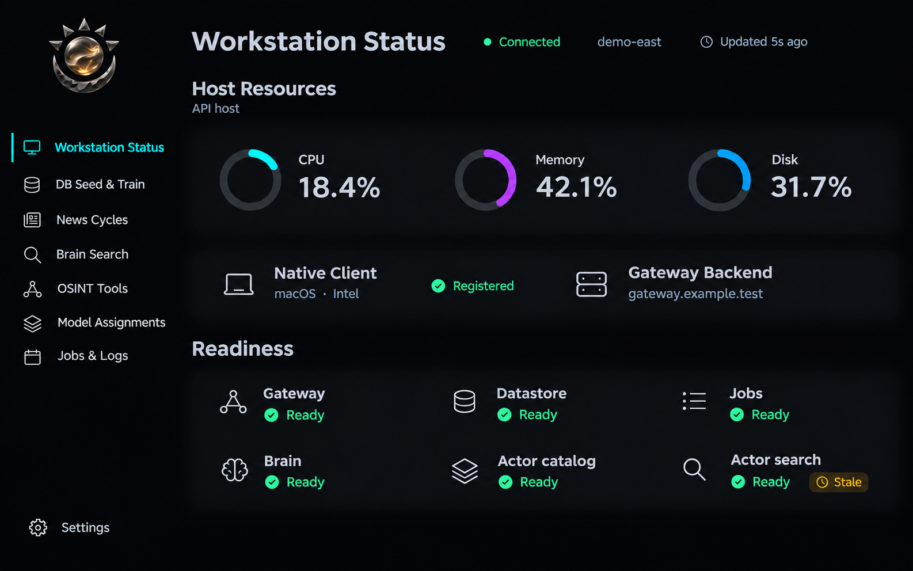
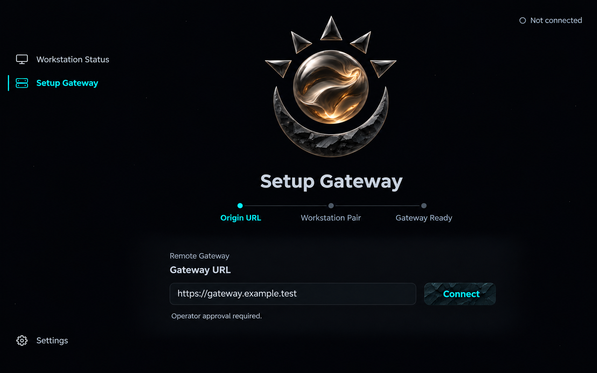
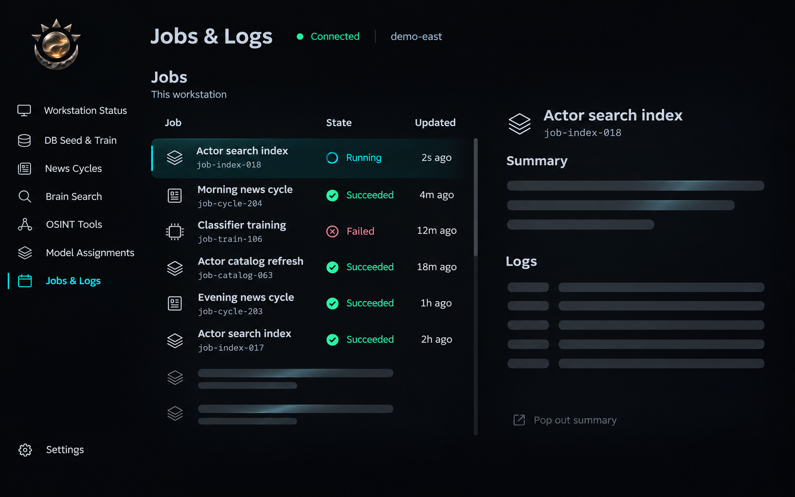
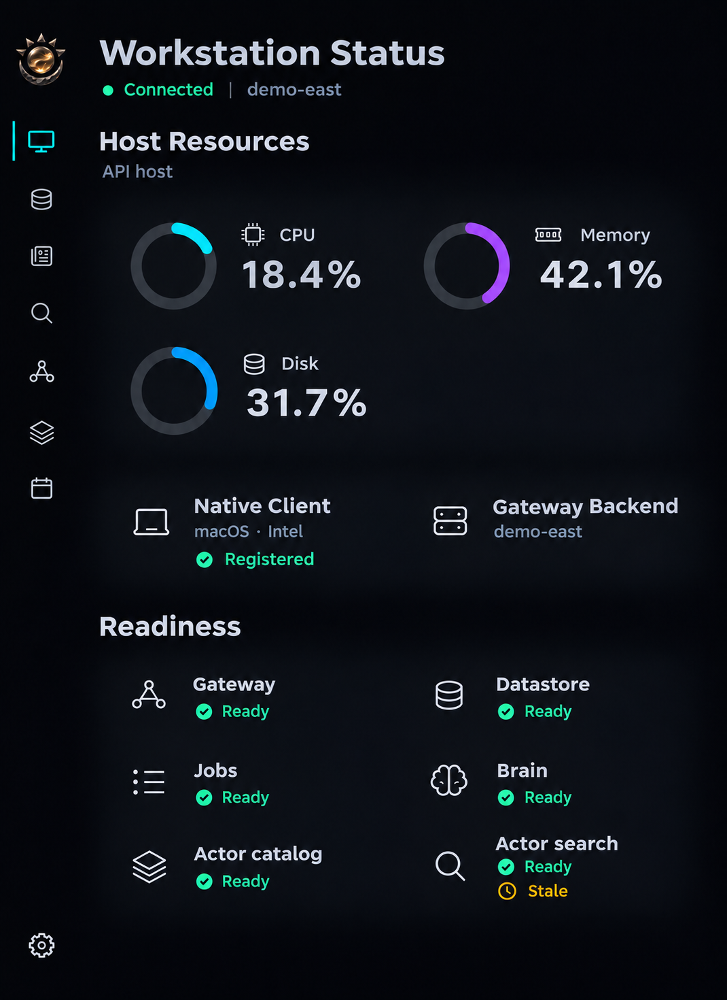

# Matte canvas design reference

Approved visual target for the native client and shared web paint. The four generated design references below use illustrative data. See the [native verification guide](../../wiki/code/native-verification.md) for production-view captures.

## Read and reproduce

1. [Theme recipe](theme.md): exact palette, matte compositing, softly blended group edges, action-role texture rules, component states and responsive geometry.
2. [Live state and continuous scrolling](interaction-state.md): snapshot retention, local skeletons, opaque cursors, bounded rendering and stable scroll position.
3. [Logo and Quiet Orbit](motion.md): source assets, startup timing, proportional sizing, alpha handling and the settled mark.
4. [Implementation handoff](../../../.planning/2026-11-16-matte-canvas/handoff.md): verified code edit map, dependency order and future validation.
5. [Reference manifest](reference-manifest.json): exact approved image identities, dimensions and provenance.

## Final material rules

| Surface | Required treatment |
| --- | --- |
| Brand display | One symbol, no visible wordmark; the logo retains its molten/glass finish |
| Submit, Confirm, Create, Delete | Matte coarse obsidian texture from the crescent interior, with semantic action tint |
| Navigation, Settings, Cancel, filters, refresh, pop-out and read retry | Smooth matte; no crescent texture or metallic sheen |
| Metrics, readiness, cards, tables and selectable rows | Smooth matte tonal groups; spacing and alignment establish hierarchy |
| Initial unresolved content or pending list tail | Steady skeleton base with a restrained translated cool sheen |
| Long record lists | Continuous scrolling over bounded, opaque cursor requests; no routine page-number or Previous/Next chrome |

The canvas is `#060709`. Cool gray replaces ivory text. Cyan/blue/violet/mint/amber/rose communicate context; gold and ivory remain inside the logo artwork. Remove pointer-driven lighting, reflective rims, ornamental panel strokes and hard grid divisions. Preserve accessible focus and essential input boundaries.

## Approved screens

### Workstation Status

One resources group, a compact client/gateway band and a readiness grid. The last verified health and freshness are separate. The context rail is omitted when it would duplicate visible information.

### Setup Gateway

The logo remains the main reflective object. Connect receives rock texture because it submits the form. Navigation and Settings do not. The stepper is informational; operator approval and credential boundaries are unchanged.

### Jobs & Logs

Resolved rows and selection remain visible. The list tail and unresolved selected detail have independent loading regions. No Previous/Next or numbered page controls appear. State labels and icons reinforce color.

### Compact desktop

The same groups reflow into measured columns, with a compact navigation rail. This is a desktop layout concept, not an additional mobile app. Keep Ready and Stale distinct when both apply.

## Precedence and scope

This approved direction supersedes earlier gold/ivory primary accents, satin/reflective control recipes, persistent pointer-lighting, blanket rock-textured buttons/cards, hard panel rims and pager-style presentation in prior mockups or design plans. The [native control contract](../../wiki/code/native-design-system.md), [connection authority](../../wiki/code/native-connections.md) and [web product semantics](../../wiki/code/intel-web.md) still govern capabilities and data access. The new scroll/state contract changes presentation without broadening authorization or server page bounds.

Earlier supplied references and dated implementation evidence remain historical. Do not reinterpret their screenshots or PASS records as evidence that this target has shipped. Future implementation must compare actual production-view captures with these references and report interaction, accessibility, performance and platform evidence separately.
