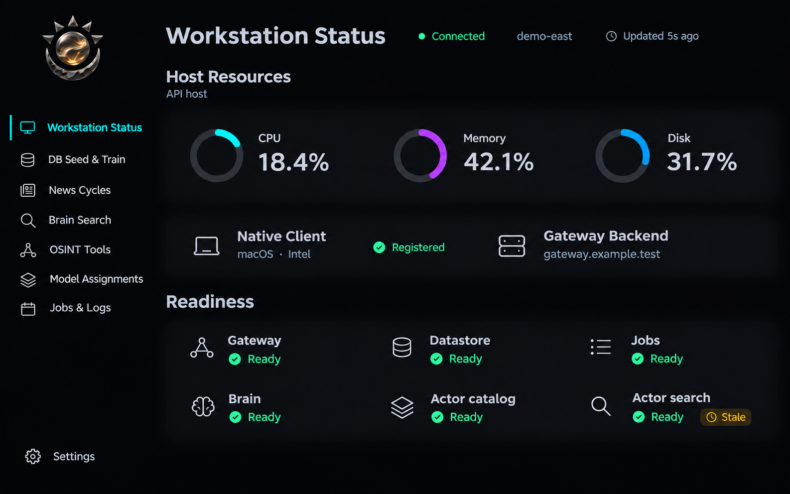
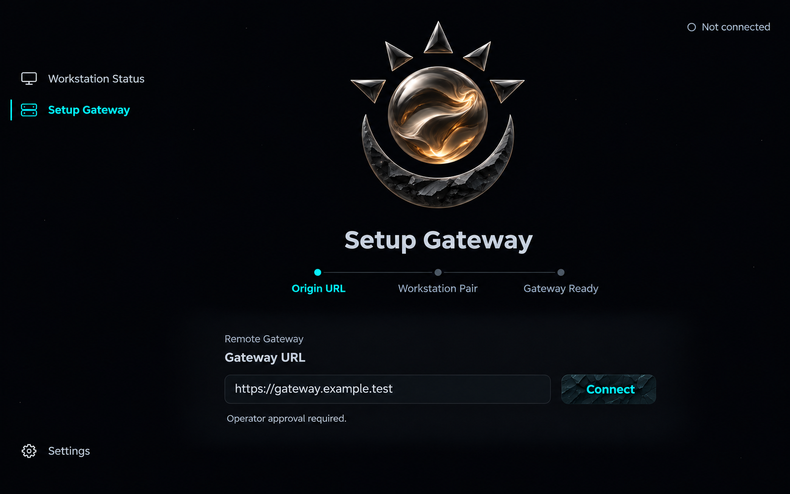
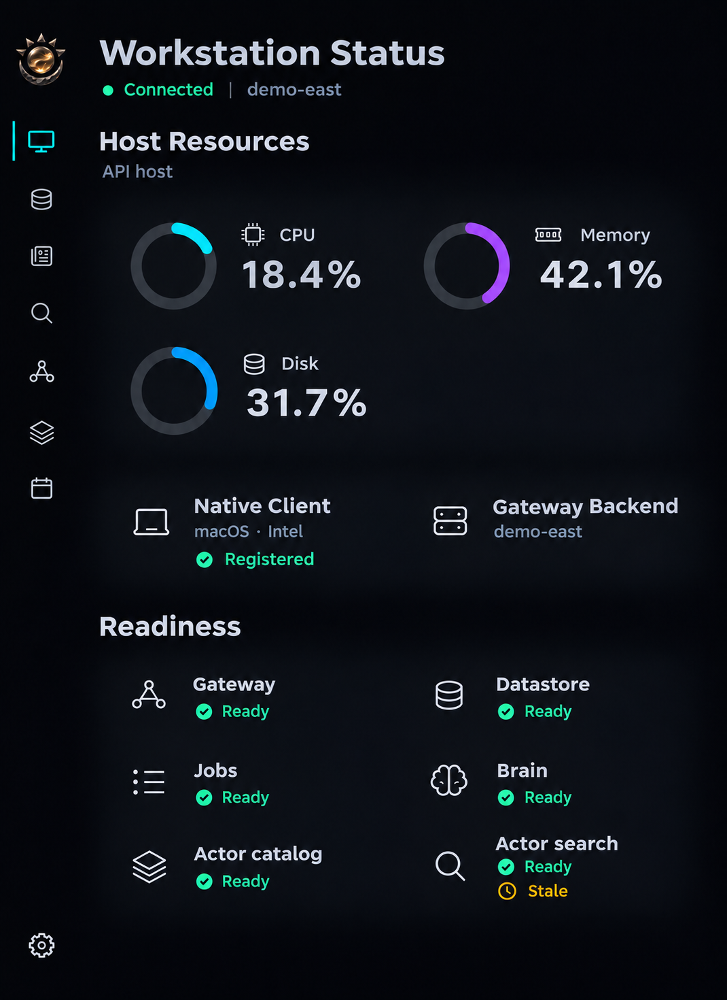

# Matte canvas theme

[Native control contract](../../wiki/code/native-design-system.md) · [Interaction and state](interaction-state.md) · [React guidance](../../wiki/code/react-ui.md)

@tag:look-and-feel @tag:react-ui

## Status and authority

This is the approved visual target for Fleetworks native and Intel Web, recorded **2026-11-16 (America/New_York)**. It supersedes earlier gold/ivory interface palettes, satin or liquid-metal control finishes, persistent sheen and pointer lighting. The material emblem retains its own appearance. This change is **documentation only**: source integration, renderer measurements, accessibility checks and production-view verification remain pending.

The audited source baseline is `nightly` at `00b700afd77ddac6cba2e2bd7ae91ab3802b7197` (tree `5051474185a8eb14b38e607480bb24c65352fff0`). Existing helper names below identify integration points, not already-implemented target behavior. The [native allowlist](../../wiki/code/native-design-system.md#complete-native-control-allowlist), connection contracts and web information architecture remain authoritative for controls and effects. This theme creates no new operation, authority, API call, chat surface or settings mode.

## Approved composition references

| Wide overview | Gateway setup |
| --- | --- |
| [](mockups/01-workstation-status.png) | [](mockups/02-setup-gateway.png) |
| Activity and localized loading | Compact overview |
| [](mockups/03-jobs-logs.png) | [](mockups/04-compact-workstation.png) |

These generated mockups establish composition and material direction. Numbers, hosts, identities, timestamps and platform labels are illustrative. They are not Rune/browser captures or evidence of backend state. The rules below resolve incidental image artifacts: the canvas is uniform, text is crisp, ordinary surfaces have no reflection, and only genuinely pending regions receive loading motion. A displayed historical Ready result plus Stale describes an older observation, not current readiness.

## 1. Canvas, color and branding

Use an opaque **`#060709`** canvas for the window, web page, backend chooser and inset reading beds. Avoid stars, grain, vignettes or a wallpaper across working screens. The logo can contain its approved stars, molten core and reflective glass; its prepared asset edges must blend into this canvas or be transparent. Never stretch a poster to fill a logo slot.

Brand with the **symbol only**. Do not place a visible “Fleetworks” wordmark beside the mark or repeat it in page headings, cards or toolbars. Retain the product name in application metadata, OS identity, accessible naming where needed and documentation. Keep existing slot/API responsibilities, including `FleetworksMark` and native `BRAND_MARK`; replacing their artwork is implementation work. At small sizes use the documented silhouette fallback, preserving one crescent, one sphere and five triangles. Large backend chooser art may retain material detail. Do not repeat reflective logo treatments on controls.

### Exact target tokens

The role names are the design contract. Native/shared-web mappings reuse existing exports where shown; extra roles require explicit new tokens. Values are sRGB hex. Keep text fully opaque rather than fading a whole content subtree.

| Role | Value | Existing integration point / use |
| --- | --- | --- |
| Canvas / inset | `#060709` | `BACKGROUND`, `SURFACE_INSET`; `colors.bg`, `colors.inset` |
| Group body | `#0B0F14` | `SURFACE`; `colors.panel`; masked group fill |
| Raised control | `#121820` | `SURFACE_RAISED`; `colors.raised` |
| Elevated surface | `#19212B` | `SURFACE_ELEVATED`; dialogs/menus, still opaque |
| Primary text | `#D5DCE5` | `TEXT_PRIMARY`; `colors.text` |
| Supporting text | `#A8B6C5` | `TEXT_SECONDARY`; `colors.dim` |
| Muted text | `#8192A4` | `TEXT_MUTED`; `colors.muted` |
| Disabled text | `#7F8D9D` | New role; retain a readable reason |
| Functional boundary | `#647587` | `BORDER_CONTROL`; `colors.border` |
| Decorative divider | `#2B343F` | `BORDER_SUBTLE`; `colors.borderSubtle`; never sole control boundary |
| Interactive accent | `#24DCE3` | `ACCENT`; `colors.accent`; selected icon/label and action ink |
| Accent hover / pressed | `#68E7EB` / `#1BB8C2` | Existing accent-state exports |
| Focus | `#72E9FF` | `ACCENT_HIGHLIGHT`; dedicated web focus role |
| Selection fill | `#10272D` | `SELECTION_SURFACE`; `colors.selectionSurface` |

No ivory or gold primary UI accents remain. Warmth inside the emblem does not define the interface palette. Amber is permitted only for a meaningful warning or chart category, never as generic primary-action decoration.

### Flat semantic and chart palette

| Meaning | Color | Application |
| --- | --- | --- |
| Success / ready | `#23DFA0` | Check plus state text |
| Warning / stale | `#F1C84B` | Warning/clock plus explicit qualification |
| Failure / destructive | `#F280A0` | Error mark, diagnostic or destructive intent |
| Information | `#53BAF5` | Informational state, not success |
| Pending / selected | `#24DCE3` | Truthful pending label or selected affordance |
| Unavailable / neutral | `#95A4B5` | Unavailable label, never invented zero |
| CPU / memory / disk / network | `#24DCE3` / `#BA77F2` / `#35AFFF` / `#F28C65` | Distinct flat metric series |
| Additional categorical series | `#63D2BD`, `#B599EA`, `#F28BA8`, `#A0BBC9` | Stable category mapping with labels/legend |

Retain existing evidence, entity, severity and metric meanings when mapping `StatusTone`, `intelStatus`, metric/kind colors and topology tokens. Do not assign colors by row position on each refresh. Charts use solid strokes/fills, with no glow, sheen, textured arcs or decorative gradients. Threshold warnings remain explicit through their existing state cues; a measured category color alone is not a health claim.

## 2. Diffuse grouped surfaces

Group related content into broad, quiet tonal regions. Their perimeter dissolves into the canvas; avoid a repeated grid of bright rounded boxes. This is a **background alpha mask**, not a blur over the card and its children.

Use this reproducible recipe in logical pixels:

1. Define the group outer bounds and a rounded rectangle with **20px radius**. Use **16px** radius on compact groups under 160px high. Draw no decorative stroke or outside halo.
2. Let `d` be distance inward from that rounded boundary. Let `w = 16px` for standard groups and `12px` for compact groups. Set `t = clamp(d / w, 0, 1)` and `alpha = t*t*(3 - 2*t)`. Outside the boundary alpha is zero; at least `w` inward it is one. Include normal one-device-pixel coverage antialiasing.
3. Composite the flat group color over the canvas using this alpha. For a reproducible reference raster, composite sRGB channel values as `out = alpha*group + (1-alpha)*canvas`, round once at final 8-bit output, and export tagged sRGB. Match that reference when a renderer uses a different internal color space.
4. Draw text, charts, icons and interactive controls **after** the masked background, at full opacity. Use **24px content inset** on standard groups and **20px** on compact groups so content does not sit in the fading perimeter. The mask must never attenuate glyphs, hit targets, focus or meaningful chart marks.

**Implemented fit.** Native `GroupEdge` (`material.rs`) and web `groupEdge` (`packages/ui/src/index.tsx`) draw the ramp as an inset box shadow of the canvas color `#060709`: standard spread 8px / blur 7.5px, compact spread 6px / blur 5.6px (`blur = 2σ`). Its coverage is `Φ((d − spread)/σ)`, a Gaussian that stays within 0.03 alpha of the smoothstep for every depth `d` (under one 8-bit level between `#060709` and `#0B0F14`); both test suites pin that bound. Native callers use `luminous_card` for standard groups and `interactive_tile` for compact ones; web uses `Panel`. Selected items keep their functional boundary and have no ramp. In a compact window (under 520–540 px of page content) the two setup cards, Backend type and Embedded Backend, use the compact edge so every control stays reachable at the 640×480 floor; a card taller than 160 px otherwise keeps the standard edge.

Use one mask per meaningful group; adjacent metrics can share it. Avoid nested diffuse panels and per-cell shadows. Reading/log/table interiors remain solid canvas. Menus and dialogs may have a flat raised fill and a functional boundary; do not fade a modal boundary required to distinguish it from the retained page.

Implement the recipe inside existing material/primitives. Suggested `group_surface` or an equivalent shared mask helper would be **new**, not a verified Rune API. If the pinned renderer lacks a suitable mask, a small cached nine-slice alpha asset can express the same geometry; no new renderer, full-window blur or per-frame image generation is warranted.

### Functional exceptions

Fields, controls and independent selected items retain a **1px `#647587`** boundary where needed for identification. Keyboard focus uses a **2px `#72E9FF`** outline, a **2px canvas-colored gap**, and an unclipped outer allowance. A selected navigation item may use a **3px** cyan leading rule plus text/icon and existing selection semantics. These boundaries stay crisp and independent of the decorative group fade. Never weaken them to make the background softer.

## 3. Matte rock texture on semantic actions only

The only textured interface controls are actions with a **submit, confirm, create or delete** intent. **Connect qualifies.** Eligible examples include an actual create submission, a saved configuration confirmation and a destructive confirmation. A button's size, prominence, old `GoldCta` finish or location does not make it eligible.

Cancel, Settings, navigation, filters, tabs, selectors, pop-out/inspect controls, read retries, metric tiles and readiness displays remain flat. An action that merely opens a preview is not its final confirmation; distinguish the preview from the committing control. For example, a read Retry is flat, while Confirm retry can use the submit treatment when it really queues the authorized job. Existing permission/preflight/confirmation rules still apply.

### Deterministic asset and tint recipe

Derive one grayscale texture from the **coarse rock interior of the approved crescent**. Exclude its polished rim, glowing inclusions, molten sphere and highlights. Preserve angular fragments and dark crevices, with no gloss or normal-map lighting. Record source hash, crop, normalization and export settings in the asset manifest; do not synthesize new noise at runtime.

- Prepare one **512×512** source, displayed on a **256×256 logical-pixel** tile. Keep dominant rock fragments approximately **12–28 logical pixels** wide. Use the same scale on every button; repeat/crop rather than stretch to each button's aspect ratio.
- Anchor texture coordinates to the button's top-left content-independent bounds. Preserve that origin while its label, busy state or width changes. No drifting, parallax or random phase on rerender.
- Normalize the grayscale sample to `T` in `[-1,1]`, with mean zero. Modulate each base sRGB channel by `round(50 * opacity * T)`, clamped to the valid channel range. Rest opacity **0.12** gives at most ±6 channel levels; this is matte relief, not a reflective gradient.
- Use **10px corner radius**, **44px preferred control height**, at least **16px horizontal padding**, and an unchanged hit rectangle through all states. Text and icon sit above the texture at full opacity.

| Intent | Base fill | Ink/context tint |
| --- | --- | --- |
| Submit / create, including Connect | `#10262C` | `#24DCE3` |
| Confirm | `#10281F` | `#23DFA0` |
| Delete / destructive confirmation | `#2B1823` | `#F280A0` |

Context tint affects only the eligible action and its existing semantic indication. Do not wash a whole page red/green/cyan. Preserve readable labels and the functional border; tint is supplementary to the action name and confirmation.

| State | Deterministic treatment |
| --- | --- |
| Rest | Base above, texture opacity `0.12`, no animation or sheen |
| Hover | Add 2 to each base channel, texture opacity `0.14`; 120ms color transition only |
| Pressed | Subtract 2 from each base channel, texture opacity `0.10`; no scale/bounce or moving texture |
| Focus | Same material plus independent focus outline |
| Disabled | Raised-control base, disabled ink, texture opacity `0.04`; retain reason and semantic disabled state |
| Pending | Keep the same material/label geometry; only the allowed loading layer below may move |

### The committed crescent tile (implemented)

The tile is derived from the approved crescent source by [`derive_rock_tile.py`](../../../assets/brand/source/derive_rock_tile.py) and committed under [`assets/brand/rock/`](../../../assets/brand/rock/): `fleetworks-rock-tile.png` (web), `fleetworks-rock-tile.rgba` (native, the same pixels) and `fleetworks-rock-tile.manifest.json` (source hash, crop, normalization, export settings and output hashes). Native loads the raw RGBA into a Rune `Pixels` once per UI thread; web embeds the PNG as a data URI (`packages/ui/src/rockTileData.ts`, generated by the same script). Nothing is generated at runtime.

How it is derived, so another maintainer can repeat it:

1. **Source and crop.** The source is `assets/brand/source/fleetworks-liquid-metal-glass.png` (SHA-256 `1ae55378…70112`, checked by the script). The crop box is **x 655, y 715, 256 × 96 source pixels**, inside the crescent's dark rock, clear of the polished rim, the molten sphere and the large lit facets near its edges.
2. **Exclusions.** Luminance uses `0.2126 R + 0.7152 G + 0.0722 B` on the sRGB bytes. Glowing inclusions (the warm star glints, luminance above 150) are replaced by the median of the dark rock around them within 10 px, and the rest is capped at the crop's 97th percentile so highlights stay out.
3. **Tile.** The crop is stacked with its vertical mirror to fill a 256 × 256 block, then mirrored on both axes to **512 × 512**. Mirror quilting makes the tile repeat without a seam. It is shown at a fixed **256 × 256 logical pixels** (2 source pixels per logical pixel), anchored at the control's top-left, and repeated on both axes, never stretched. Known limit: the mirror symmetry is visible in the tile itself, but at rest opacity 0.12 (at most about ±6 channel levels) it reads as rock; replace the crop box with a larger approved rock plate when one exists.
4. **Normalization.** `T = (Y − mean) / p99(|Y − mean|)`, clipped to [−1, 1], re-centered, then quantized to steps of 1/16. The manifest records mean luma, scale and a residual mean of T near 0.0001.
5. **Export.** One RGBA overlay at opacity 1: `T > 0` is `#D5DCE5` at alpha `0.22 T`; `T < 0` is `#020304` at alpha `min(1, 1.25 |T|)`. At opacity `o` a button base channel changes by about `round(50 · o · T)` levels. State opacities: rest 0.12, hover 0.14, pressed 0.10, disabled 0.04 (native draws pressed as the rest texture over a 2-level darker fill).

Reproduce or verify it (Python 3, standard library only):

```sh
python3 assets/brand/source/derive_rock_tile.py          # rewrite the tile, manifest and web module
python3 assets/brand/source/derive_rock_tile.py --check  # fail if the committed .rgba differs
```

Native lays one image per 256 px of the control's measured width (`texture_tiles`), each with its opacity bound to the control's hover group, inside one hidden, rounded-clipped layer over the button fill. Web draws the same PNG as the background of an overlay layer inside the button, with the state opacity on the layer. Native hover raises the texture to 0.14 and adds 2 levels to the fill; pressed subtracts 2 levels from the fill, computed on the encoded sRGB bytes (`#10262C` becomes `#0E242A`) and converted back to Rune's linear channels, and keeps the rest texture, because Rune has no pressed style for descendants. A control taller than one 256 px tile, or wider than 64 tiles, is flat beyond it.

Normal text must reach **4.5:1**, large text **3:1**, and essential boundaries/focus **3:1** against adjacent colors after compositing. Reference calculations on the opaque tokens give primary/supporting/muted text **11.75/7.85/5.09:1** against the elevated surface, functional boundary **3.43:1**, and destructive ink **6.66:1** against its untextured base. These calculations are design checks, not rendered accessibility approval; verify the brightest texture samples, antialiasing and every state in production views.

## 4. Motion: loading-only translated sheen

There is **zero persistent sheen** on interface surfaces. No resting/hovered reflection bands, pointer lights, ambient glow, specular card layers or cursor-reactive shadows. The material emblem is the sole persistent reflective artwork exception; its approved startup animation remains governed by the [Quiet Orbit motion contract](motion.md).

A genuinely pending, unresolved region may use a restrained translated loading band over a **steady base**:

- Skeleton base **`#27313B`**, constant opacity 1. Band color **`#A9C8D9`**, peak alpha **0.06**, transparent at both edges; band width **20% of the local region width**, softly feathered across its full width.
- Use a **1.6s total cycle**: translate linearly across the clipped region for **1.2s**, then remain outside the bounds for **0.4s** before repeating. The base and text never pulse, fade or blink. Use a shared phase per region, not an independently flashing loop on every row.
- Clip to placeholder geometry or the pending button's background; never sweep across labels, resolved values or retained rows. Do not add a fake percentage. Stop on resolution, failure, unmount, hidden/unfocused view or reduced motion.
- Reserve geometry and keep one local status owner. A read refresh retaining valid data does not become a full-screen loading effect. See the [state contract](interaction-state.md) for initial loads, generation-stage exceptions, retained refresh and continuation.

The source currently has native `LoopSpec::slide` effects and a web `Skeleton` opacity loop. Reusing the native mechanism does not preserve its old amplitude; replace the web pulsing behavior rather than masking it with CSS alone. Use no pointer-normalization reference such as `1180×780`: there is no pointer lighting to normalize.

## 5. Grids, typography and responsive composition

Use grids for dense overview, option and status groups; preserve tables when aligned columns support comparison. Retain native destinations, web navigation, Bulletin's record list, Brief reading order and topology's accessible list. A grid changes arrangement, not authority or interaction meaning.

Measure **available content width**, after sidebar/rail/insets. With gap `g=16px`, choose `n = clamp(floor((width+g)/(minimum+g)), 1, maximum)` and card width `(width-(n-1)*g)/n`. Use these initial targets:

| Group | Minimum cell width | Maximum columns |
| --- | --- | --- |
| Resource metrics | 240px | 3 |
| Native Client / Gateway Backend | 280px | 2 |
| Readiness / compact options | 200px | 3 |

Allow taller cells for wrapping; never shrink labels to preserve a column count. Preserve source/keyboard order as columns collapse. Below the minimum required width, use one column; hide only the existing optional context rail, not required actions. Native retains **640×480** support; web checks remain **1440/768/390/320px**. At large text scaling, reduce columns before clipping. Do not force every short status into its own bordered card.

Use the existing native Kit and web font families. Target native logical sizes: page heading **26/32px**, section **18/24px**, body/control **15/22px**, supporting **13/18px**, metric value **28/32px**; weights 600 for headings/metrics and 400–500 for prose. Use existing web density/type mappings rather than adding global zoom or replacing its navigation/prose font roles. Machine IDs/logs use the current mono family; changing metrics use tabular numerals and reserved width. No text glow, blur, letter animation or rolling digits on live refresh. Keep labels short, diagnostics local and necessary details available without permanent explanatory paragraphs.

## 6. Integration, preferences and evidence

| Verified source authority | Target integration |
| --- | --- |
| [`theme.rs`](../../../apps/fleetworks-desktop/src/theme.rs), [`material.rs`](../../../apps/fleetworks-desktop/src/material.rs) | Map tokens; adapt `configure_kit`, `luminous_card`, `interactive_tile`, `apply_liquid_metal`, `skeleton_block` and `compact_toolbar`. Legacy names do not authorize old lighting. |
| [`ui_components.rs`](../../../apps/fleetworks-desktop/src/ui_components.rs), [`app.rs`](../../../apps/fleetworks-desktop/src/app.rs) | Keep `ActionButton`, status/metric/skeleton primitives and event responsibilities; remove decorative pointer-lighting work in the future implementation. Explicit semantic-action metadata would be **new**; `MetalFinish` alone is insufficient. |
| [`accessibility.rs`](../../../apps/fleetworks-desktop/src/accessibility.rs) | Reuse `Accessibility::for_view` and `ViewPreferences::matte()`; retain platform fallbacks and identical hit bounds. |
| [`packages/ui/src/index.tsx`](../../../packages/ui/src/index.tsx) | Extend `colors`, `Frame`, `Panel`, `Button` and shared recipes. Existing `glass`, `glow`, `mutedGoldPrimary` are compatibility/baseline names, not target materials. No existing named `Grid` was verified; a shared wrapper would be **new**. |
| [`intel-theme.ts`](../../../packages/intel/src/shell/intel-theme.ts), [`style.css`](../../../apps/web-desktop/app/style.css), [`Skeleton.tsx`](../../../packages/ui/src/Skeleton.tsx) | Coordinate semantic tokens, focus, quiet global canvas and steady-base loading without changing state ownership. |

Reduced motion uses static placeholders and immediate state changes. Reduced transparency retains the opaque canvas/materials; diffuse edges only composite over that known canvas, never sample content behind the window. High-contrast needs take precedence: use solid group boundaries if needed, remove rock modulation, retain text and focus. Do not add a preference toggle just for this theme.

Cache the one rock texture and reusable mask resources. A 512² RGBA upload is about **1 MiB**; share it instead of one copy per tint/button. Generate neither textures nor full-size masks during each render. Resting screens must have no decorative animation wake loop. Animate only visible unresolved regions; stop resources with their owner. Profile the actual native/browser implementation before claiming performance.

Acceptance requires inspected production views: canvas-matched logo, symbol-only branding, diffuse backgrounds with sharp text, no persistent sheen, texture only on eligible actions, clear flat semantic colors, responsive grouping, retained-data stability and keyboard focus in all preferences. Inspect 1×/2×, compact/wide, hover/press/focus/disabled/pending/error and long text. Record implementation, static checks, runtime captures and installed-app/browser review separately. The mockups and this documentation do not establish any of those runtime passes.
