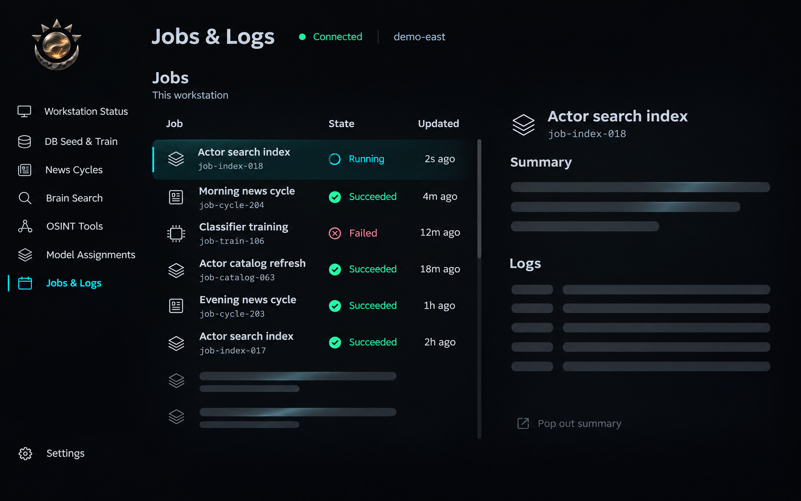

# Glass canvas theme

[Native control contract](../../wiki/code/native-design-system.md) · [Interaction and state](interaction-state.md) · [React guidance](../../wiki/code/react-ui.md)

@tag:look-and-feel @tag:react-ui

## Status and authority

This is the approved **Glass Canvas** visual target for Fleetworks native and Intel Web, updated **2026-11-20 (America/New_York)**. It supersedes the earlier 2026-11-16 matte-canvas restriction: instead of flat matte panels, primary chrome, grouped cards, settings containers, controls, and floating overlays all use **deep-space smoked/frosted glass with static liquid-metal specular rim highlights**, paired with **warm molten-core (`#E5B869`) & cool cyan (`#24DCE3`) accents** and **fractured crescent-moon textures** derived from the Quiet Orbit logo (crescent + warm molten core, no orbit triangles). The directory path `docs/design/matte-canvas/` is retained temporarily for link stability; the visual system is **Glass Canvas**. Record source integration, accessibility measurements, and production-view verification separately.

The audited source baseline is `nightly` at `00b700afd77ddac6cba2e2bd7ae91ab3802b7197` (tree `5051474185a8eb14b38e607480bb24c65352fff0`). Existing helper names below identify integration points, not already-implemented target behavior. The [native allowlist](../../wiki/code/native-design-system.md#complete-native-control-allowlist), connection contracts and web information architecture remain authoritative for controls and effects. This theme creates no new operation, authority, API call, chat surface or settings mode.

## Approved composition references

| Wide overview | Gateway setup |
| --- | --- |
| [](mockups/01-workstation-status.png) | [](mockups/02-setup-gateway.png) |
| Activity and localized loading | Compact overview |
| [](mockups/03-jobs-logs.png) | [](mockups/04-compact-workstation.png) |

These generated mockups establish baseline information hierarchy, now superseded in material finish and shell rhythm by the **2026-11-20 Glass Canvas desktop direction** (slim smoked-glass left rail with soft molten-gold/metallic active pill, an empty native toolbar title area, compact top-right host-telemetry & bell-badge strip, spacious hairline-grouped glass Settings/content panes, floating frosted-glass notification/inbox card stack with crisp liquid-metal specular rims and stacked depth lips, and floating frosted-glass context menus). Numbers, hosts, identities, timestamps and platform labels are illustrative. They are not Rune/browser captures or evidence of backend state. Text remains crisp, glass surfaces stay legible with static rim highlights, and only genuinely pending regions receive loading motion. A displayed historical Ready result plus Stale describes an older observation, not current readiness.

## 1. Glass canvas, color and branding

Anchor the window, web page, backend chooser and inset reading beds on a deep-space **`#060709`** void backdrop beneath **layered smoked/frosted glass surfaces**. Avoid noisy wallpaper or distracting grain across working reading areas. The logo retains its fractured obsidian crescent and warm molten-amber glass sphere; its prepared asset edges must blend into `#060709` or be transparent. Never stretch a poster to fill a logo slot.

Brand with the **symbol only**. Do not place a visible “Fleetworks” wordmark beside the mark or repeat it in page headings, cards or toolbars. Retain the product name in application metadata, OS identity, accessible naming where needed and documentation. Keep existing slot/API responsibilities, including `FleetworksMark` and native `BRAND_MARK`. Preserve the simplified crescent + molten-core silhouette (no orbit triangles) across splash, transition, reduced motion, rail, launcher and Intel Web exports.

### Exact target tokens

The role names are the design contract. Native/shared-web mappings reuse existing exports where shown; extra roles require explicit new tokens. Values are sRGB hex. Keep text fully opaque rather than fading a whole content subtree.

| Role | Value | Existing integration point / use |
| --- | --- | --- |
| Deep-space backdrop / inset | `#060709` | `BACKGROUND`, `SURFACE_INSET`; `colors.bg`, `colors.inset` |
| Glass surface (primary cards & rail) | `#0B0F14` (`74–86%` alpha + `8–14px` blur) | `SURFACE`; `colors.panel`, `colors.glass`; opaque `#0B0F14` under reduced transparency |
| Raised glass control | `#121820` (`76–86%` alpha + `10–14px` blur) | `SURFACE_RAISED`; `colors.raised`; buttons, pills, inputs, option cards |
| Elevated floating glass | `#19212B` / `#121820` (`80–88%` alpha + `14–18px` blur) | `SURFACE_ELEVATED`; `colors.glassStrong`; popovers, Inbox stack, dialogs, menus |
| Primary text | `#D5DCE5` | `TEXT_PRIMARY`; `colors.text` |
| Supporting text | `#A8B6C5` | `TEXT_SECONDARY`; `colors.dim` |
| Muted text | `#8192A4` | `TEXT_MUTED`; `colors.muted` |
| Disabled text | `#7F8D9D` | New role; retain a readable reason |
| Functional boundary | `#647587` | `BORDER_CONTROL`; `colors.border` |
| Glass hairline / divider | `#2B343F` | `BORDER_SUBTLE`; `colors.borderSubtle`; crisp glass borders and internal row dividers |
| Liquid-metal rim highlight | `#D5DCE5` (`10–24%` alpha) / `#4A5262` | `LIGHT_SURFACE_GLOW`, `METAL_EDGE_TOP`; crisp static 1px top/bevel highlight on glass panels, overlays, cards and committing actions |
| Molten brand highlight | `#E5B869` / `#F1C84B` (warm tint `#241D12`) | Active navigation pill, unread bell badge, selected links and key highlights |
| Interactive accent | `#24DCE3` | `ACCENT`; `colors.accent`; cool-cyan interactive and selection affordances |
| Accent hover / pressed | `#68E7EB` / `#1BB8C2` | Existing accent-state exports |
| Focus | `#72E9FF` | `ACCENT_HIGHLIGHT`; dedicated web focus role |
| Selection fill | `#10272D` | `SELECTION_SURFACE`; `colors.selectionSurface` |

Use `#E5B869` molten-gold ink and `#241D12` warm tint on active navigation, unread counts, and selected links. Pair static liquid-metal specular top-rims with cool cyan (`#24DCE3`) for general interactive affordances and keep warning/chart colors recognizable. Keep text contrast ≥ 4.5:1 and never wash whole screens in glare.

### Flat semantic and chart palette

| Meaning | Color | Application |
| --- | --- | --- |
| Success / ready | `#23DFA0` | Check plus state text |
| Warning / stale | `#F1C84B` | Warning/clock plus explicit qualification |
| Failure / destructive | `#F280A0` | Error mark, diagnostic or destructive intent |
| Information | `#53BAF5` | Informational state, not success |
| Pending / selected | `#24DCE3` | Truthful pending label or selected affordance |
| Unavailable / neutral | `#95A4B5` | Unavailable label, never invented zero |
| CPU / memory / disk / network | `#24DCE3` / `#BA77F2` / `#35AFFF` / `#F28C65` | Distinct flat metric series |
| Additional categorical series | `#63D2BD`, `#B599EA`, `#F28BA8`, `#A0BBC9` | Stable category mapping with labels/legend |

Retain existing evidence, entity, severity and metric meanings when mapping `StatusTone`, `intelStatus`, metric/kind colors and topology tokens. Do not assign colors by row position on each refresh. Charts use solid strokes/fills, with no glow, sheen, textured arcs or decorative gradients. Threshold warnings remain explicit through their existing state cues; a measured category color alone is not a health claim.

## 2. Glass canvas surfaces, layered blur and liquid-metal rims

Build every primary layer as **dark smoked/frosted glass** over the `#060709` deep-space canvas rather than flat matte blocks or blurred-edge blobs:

- **Shell chrome (left navigation rail & top bar):** Render the slim left rail and top header bar as smoked glass (`#0B0F14` at `78–86%` alpha + `8–12px` same-window backdrop blur where supported) with a `1px` `#2B343F` hairline edge and subtle liquid-metal top highlight. Anchor the symbol-only brand mark at top, use a soft rounded warm molten-gold (`#241D12` / `#E5B869`) or metallic active pill and place a compact host-telemetry (`CPU / MEM / DSK`) & bell-badge strip on the top right. Leave the native toolbar title area empty.
- **Primary content groups, cards & settings containers:** Render cards, grouped panels, and Settings blocks as **frosted dark glass** (`#0B0F14`–`#121820` at `74–84%` alpha + `10–14px` blur where supported) with crisp `1px` `#2B343F` outer hairlines, subtle internal horizontal row dividers, and a **static `1px` liquid-metal specular top rim** (`#D5DCE5` at `10–18%` alpha). Keep open canvas grids calm and uncluttered at rest, lifting into a brighter frosted-glass card with a sharper metallic rim on hover or selection. Avoid replacing crisp glass edges with matte canvas-colored edge fades (`GroupEdge`).
- **Floating glass overlays (Inbox/Notifications popover stack, Command palette, Context menus, Modals):** Render as **elevated frosted glass** (`#121820`–`#19212B` at `80–88%` alpha + `14–18px` backdrop blur) with a stronger **static `1px` liquid-metal specular top/outer rim** (`#D5DCE5` at `16–24%` alpha fading into `#2B343F`). Anchor the Inbox popover beneath the top-right bell badge as floating rounded glass cards with subtle peeking stacked-card lips underneath grouped items instead of an opaque full-height side slab.
- **Reduced transparency fallback:** Under `ViewPreferences::matte()`, `FLEETWORKS_OPAQUE_MATERIALS`, macOS Reduce Transparency, or CSS `prefers-reduced-transparency: reduce`, every glass tier deterministically switches to opaque `#0B0F14` / `#121820` / `#19212B` with identical bounds and crisp `#647587` borders. Reading/log/table text stays full opacity at all times.

### Functional exceptions

Fields, controls and independent selected items retain a **1px `#647587`** boundary (or illuminated active glass/metallic border on selected option cards) where needed for identification. Keyboard focus uses a **2px `#72E9FF`** outline, a **2px canvas-colored gap**, and an unclipped outer allowance. These boundaries stay crisp and independent of glass blur or rim highlights. Never weaken them to make the background softer.

## 3. Crescent moon textures and liquid-metal action highlights

Carry the **fractured-obsidian crescent texture** (`assets/brand/rock/fleetworks-rock-tile.*`) and **static liquid-metal edge highlights** through the Glass Canvas in harmony with the logo:

- **Committing semantic actions (Submit, Confirm, Create, Delete, Connect):** Carry the coarse crescent-rock texture inside a tinted dark-glass/obsidian button face with a crisp 1px liquid-metal upper rim highlight (`#D5DCE5` at `14–22%` alpha) so primary commitments feel tangible and distinct from utility controls.
- **Brand/hero accents:** Featured brand headers, backend-choice tiles, and selected high-emphasis glass cards may pair subtle low-opacity crescent-rock texture with a brushed liquid-metal top bevel and crisp opaque typography above it, provided text contrast stays ≥ 4.5:1.
- **Routine utility controls:** Cancel, filters, tabs, search inputs, inline dropdowns, segmented pills, read retries, and compact list rows use clean translucent smoked glass (`#121820` alpha) with crisp hairline/metallic borders rather than heavy texture noise.

### Deterministic asset and tint recipe

Derive one grayscale texture from the **coarse rock interior of the approved crescent**. Preserve angular fragments and dark crevices while keeping luminance controlled so foreground labels always exceed contrast requirements. Record source hash, crop, normalization and export settings in the asset manifest; do not synthesize new noise at runtime.

- Prepare one **512×512** source, displayed on a **256×256 logical-pixel** tile. Keep dominant rock fragments approximately **12–28 logical pixels** wide. Use the same scale on every textured surface; repeat/crop rather than stretch to each control's aspect ratio.
- Anchor texture coordinates to the control's top-left content-independent bounds. Preserve that origin while its label, busy state or width changes. No drifting, parallax or random phase on rerender.
- Normalize the grayscale sample to `T` in `[-1,1]`, with mean zero. Modulate each base sRGB channel by `round(50 * opacity * T)`, clamped to the valid channel range. Rest opacity **0.12–0.16** gives tactile obsidian relief without hurting legibility.
- Use **10px corner radius**, **44px preferred control height**, at least **16px horizontal padding**, and an unchanged hit rectangle through all states. Text and icon sit above the texture at full opacity.

| Intent | Base fill | Ink/context tint |
| --- | --- | --- |
| Submit / create, including Connect | `#10262C` (or molten highlight `#241D12` where primary brand CTA applies) | `#24DCE3` / `#E5B869` |
| Confirm | `#10281F` | `#23DFA0` |
| Delete / destructive confirmation | `#2B1823` | `#F280A0` |

Context tint affects only the eligible action and its existing semantic indication. Do not wash a whole page red/green/cyan/amber. Preserve readable labels and the functional border; tint is supplementary to the action name and confirmation.

| State | Deterministic treatment |
| --- | --- |
| Rest | Base above, texture opacity `0.12`, crisp hairline / subtle liquid-metal top edge, no continuous wake loop |
| Hover | Lift fill +2–4 levels, texture opacity `0.14–0.16`, brighten top rim slightly; 120ms transition only |
| Pressed | Darken fill -2 levels, texture opacity `0.10`; no scale/bounce or moving texture |
| Focus | Same material plus independent 2px `#72E9FF` focus outline |
| Disabled | Raised-control base, disabled ink, texture opacity `0.04`; retain reason and semantic disabled state |
| Pending | Keep the same material/label geometry; only the allowed loading layer below may move |

### The committed crescent tile (implemented)

The tile is derived from the approved crescent source by [`derive_rock_tile.py`](../../../assets/brand/source/derive_rock_tile.py) and committed under [`assets/brand/rock/`](../../../assets/brand/rock/): `fleetworks-rock-tile.png` (web), `fleetworks-rock-tile.rgba` (native, the same pixels) and `fleetworks-rock-tile.manifest.json` (source hash, crop, normalization, export settings and output hashes). Native loads the raw RGBA into a Rune `Pixels` once per UI thread; web embeds the PNG as a data URI (`packages/ui/src/rockTileData.ts`, generated by the same script). Nothing is generated at runtime.

How it is derived, so another maintainer can repeat it:

1. **Source and crop.** The source is `assets/brand/source/fleetworks-liquid-metal-glass.png` (SHA-256 `1ae55378…70112`, checked by the script). The crop box is **x 655, y 715, 256 × 96 source pixels**, inside the crescent's dark rock, clear of the polished rim, the molten sphere and the large lit facets near its edges.
2. **Exclusions.** Luminance uses `0.2126 R + 0.7152 G + 0.0722 B` on the sRGB bytes. Glowing inclusions (the warm star glints, luminance above 150) are replaced by the median of the dark rock around them within 10 px, and the rest is capped at the crop's 97th percentile so highlights stay out.
3. **Tile.** The crop is stacked with its vertical mirror to fill a 256 × 256 block, then mirrored on both axes to **512 × 512**. Mirror quilting makes the tile repeat without a seam. It is shown at a fixed **256 × 256 logical pixels** (2 source pixels per logical pixel), anchored at the control's top-left, and repeated on both axes, never stretched. Known limit: the mirror symmetry is visible in the tile itself, but at rest opacity 0.12–0.16 it reads as rock; replace the crop box with a larger approved rock plate when one exists.
4. **Normalization.** `T = (Y − mean) / p99(|Y − mean|)`, clipped to [−1, 1], re-centered, then quantized to steps of 1/16. The manifest records mean luma, scale and a residual mean of T near 0.0001.
5. **Export.** One RGBA overlay at opacity 1: `T > 0` is `#D5DCE5` at alpha `0.22 T`; `T < 0` is `#020304` at alpha `min(1, 1.25 |T|)`. At opacity `o` a button base channel changes by about `round(50 · o · T)` levels. State opacities: rest 0.12, hover 0.14, pressed 0.10, disabled 0.04 (native draws pressed as the rest texture over a 2-level darker fill).

Reproduce or verify it (Python 3, standard library only):

```sh
python3 assets/brand/source/derive_rock_tile.py          # rewrite the tile, manifest and web module
python3 assets/brand/source/derive_rock_tile.py --check  # fail if the committed .rgba differs
```

Native lays one image per 256 px of the control's measured width (`texture_tiles`), each with its opacity bound to the control's hover group, inside one hidden, rounded-clipped layer over the button fill. Web draws the same PNG as the background of an overlay layer inside the button, with the state opacity on the layer. Native hover raises the texture to 0.14 and adds 2 levels to the fill; pressed subtracts 2 levels from the fill, computed on the encoded sRGB bytes (`#10262C` becomes `#0E242A`) and converted back to Rune's linear channels, and keeps the rest texture, because Rune has no pressed style for descendants. A control taller than one 256 px tile, or wider than 64 tiles, is flat beyond it.

Normal text must reach **4.5:1**, large text **3:1**, and essential boundaries/focus **3:1** against adjacent colors after compositing. Reference calculations on the opaque tokens give primary/supporting/muted text **11.75/7.85/5.09:1** against the elevated surface, functional boundary **3.43:1**, and destructive ink **6.66:1** against its untextured base. These calculations are design checks, not rendered accessibility approval; verify the brightest texture samples, glass/rim highlights, antialiasing and every state in production views.

## 4. Motion: loading-only translated sheen and static liquid-metal edges

Liquid-metal rim highlights and glass bevels are **static at rest** (no continuous resting animation wake loop, no blinking glare, and no fixed-pixel pointer-lighting loop). The Quiet Orbit emblem remains the sole continuous ambient motion subject, governed by the [Quiet Orbit motion contract](motion.md).

A genuinely pending, unresolved region may use a restrained translated loading band over a **steady base**:

- Skeleton base **`#27313B`**, constant opacity 1. Band color **`#A9C8D9`**, peak alpha **0.06**, transparent at both edges; band width **20% of the local region width**, softly feathered across its full width.
- Use a **1.6s total cycle**: translate linearly across the clipped region for **1.2s**, then remain outside the bounds for **0.4s** before repeating. The base and text never pulse, fade or blink. Use a shared phase per region, not an independently flashing loop on every row.
- Clip to placeholder geometry or the pending button's background; never sweep across labels, resolved values or retained rows. Do not add a fake percentage. Stop on resolution, failure, unmount, hidden/unfocused view or reduced motion.
- Reserve geometry and keep one local status owner. A read refresh retaining valid data does not become a full-screen loading effect. See the [state contract](interaction-state.md) for initial loads, generation-stage exceptions, retained refresh and continuation.

The source currently has native `LoopSpec::slide` effects and a web `Skeleton` opacity loop. Reusing the native mechanism does not preserve its old amplitude; replace the web pulsing behavior rather than masking it with CSS alone. Use no fixed-pixel pointer-normalization reference such as `1180×780`.

## 5. Grids, typography and responsive composition

Use grids for dense overview, option and status groups; preserve tables when aligned columns support comparison. Retain native destinations, web navigation, Bulletin's record list, Brief reading order and topology's accessible list. A grid changes arrangement, not authority or interaction meaning.

Measure **available content width**, after sidebar/rail/insets. With gap `g=16px`, choose `n = clamp(floor((width+g)/(minimum+g)), 1, maximum)` and card width `(width-(n-1)*g)/n`. Use these initial targets:

| Group | Minimum cell width | Maximum columns |
| --- | --- | --- |
| Resource metrics | 240px | 3 |
| Native Client / Gateway Backend | 280px | 2 |
| Readiness / compact options | 200px | 3 |

Allow taller cells for wrapping; never shrink labels to preserve a column count. Preserve source/keyboard order as columns collapse. Below the minimum required width, use one column; hide only the existing optional context rail, not required actions. Native retains **640×480** support; web checks remain **1440/768/390/320px**. At large text scaling, reduce columns before clipping. Do not force every short status into its own bordered card.

Use the existing native Kit and web font families. Target native logical sizes: page heading **26/32px**, section **18/24px**, body/control **15/22px**, supporting **13/18px**, metric value **28/32px**; weights 600 for headings/metrics and 400–500 for prose. Use existing web density/type mappings rather than adding global zoom or replacing its navigation/prose font roles. Machine IDs/logs use the current mono family; changing metrics use tabular numerals and reserved width. No text glow, blur, letter animation or rolling digits on live refresh. Keep labels short, diagnostics local and necessary details available without permanent explanatory paragraphs.

## 6. Integration, preferences and evidence

| Verified source authority | Target integration |
| --- | --- |
| [`theme.rs`](../../../apps/fleetworks-desktop/src/theme.rs), [`material.rs`](../../../apps/fleetworks-desktop/src/material.rs) | Implement the **Glass Canvas** tokens and layered smoked/frosted glass surfaces (`GlassSurface` across rail, header, primary cards, controls and overlays + static liquid-metal top rims, opaque `matte()` fallback), crescent `rock_texture`, and `skeleton_block`. |
| [`ui_components.rs`](../../../apps/fleetworks-desktop/src/ui_components.rs), [`inbox.rs`](../../../apps/fleetworks-desktop/src/inbox.rs), [`app.rs`](../../../apps/fleetworks-desktop/src/app.rs) | Keep `ActionButton`, status/metric/skeleton primitives, smoked-glass chrome, floating frosted-glass Inbox popover & context menus, top command/telemetry bar, and hairline-grouped glass Settings/content rows. |
| [`accessibility.rs`](../../../apps/fleetworks-desktop/src/accessibility.rs) | Reuse `Accessibility::for_view` and `ViewPreferences::matte()`; retain opaque fallbacks for reduced transparency and identical hit bounds. |
| [`packages/ui/src/index.tsx`](../../../packages/ui/src/index.tsx) | Extend `colors`, `Frame`, `Panel`, `Button`, `glass` (layered smoked/frosted `backdrop-filter` + static liquid-metal rim across primary panels and overlays, with reduced-transparency opaque fallback), `RockTexture`, and shared recipes. |
| [`intel-theme.ts`](../../../packages/intel/src/shell/intel-theme.ts), [`style.css`](../../../apps/web-desktop/app/style.css), [`Skeleton.tsx`](../../../packages/ui/src/Skeleton.tsx) | Coordinate Glass Canvas deep-space tokens, molten/cyan highlights, focus ring, translucent glass surfaces and steady-base loading without changing state ownership. |

Reduced motion uses static placeholders and immediate state changes. Reduced transparency (`ViewPreferences::matte()`, `FLEETWORKS_OPAQUE_MATERIALS`, CSS `prefers-reduced-transparency: reduce`) replaces translucent backdrop blur with opaque `#0B0F14`/`#121820`/`#19212B` fills while preserving bounds and crisp borders. High-contrast needs take precedence: use solid group boundaries if needed, remove rock modulation, retain text and focus. Do not add a preference toggle just for this theme.

Cache the one rock texture and reusable mask resources. A 512² RGBA upload is about **1 MiB**; share it instead of one copy per tint/button. Generate neither textures nor full-size masks during each render. Resting screens must have no decorative animation wake loop. Animate only visible unresolved regions; stop resources with their owner. Profile the actual native/browser implementation before claiming performance.

Acceptance requires inspected production views: canvas-matched symbol-only crescent + molten-core logo, layered **Glass Canvas** surfaces across primary cards/chrome/overlays with crisp static liquid-metal rim highlights (and opaque reduced-transparency fallbacks), crescent-rock texture on committing/brand surfaces, clean reference desktop layout rhythm (rail, top command/telemetry bar, hairline-grouped settings, floating inbox stack), clear semantic colors, retained-data stability and keyboard focus in all preferences. Inspect 1×/2×, compact/wide, hover/press/focus/disabled/pending/error and long text. Record implementation, static checks, runtime captures and installed-app/browser review separately. The mockups and this documentation do not establish any of those runtime passes.
