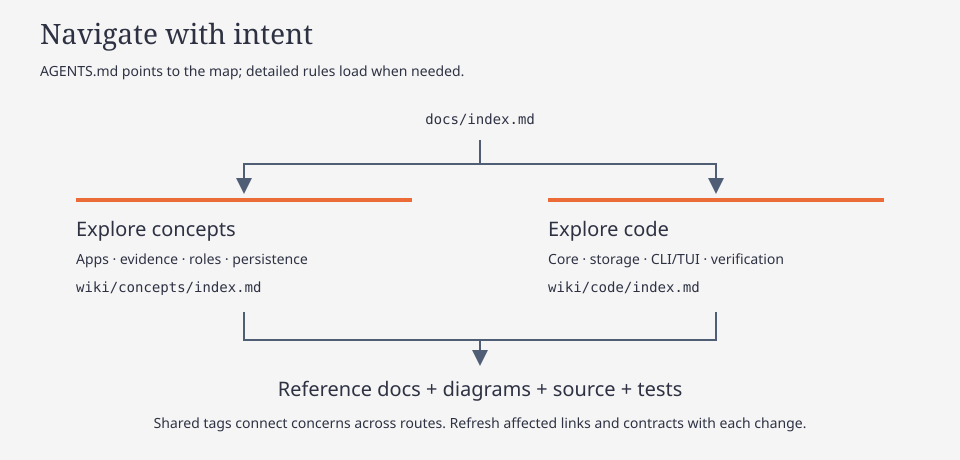

# Argos OSINT wiki

Understand the product, then follow its implementation. This is the maintained entry point for humans and agents; canonical concepts, implementation contracts and workflow guides live under `docs/wiki/`.

| Route | Start here | Follow it to |
| --- | --- | --- |
| Explore concepts | [Concepts](wiki/concepts/index.md) | Apps, evidence, model roles, persistence and their diagrams |
| Explore code | [Code](wiki/code/index.md) | Crates, module entry points, contracts and verification |

## Directory map

| Location | Purpose / next stop |
| --- | --- |
| [README.md](../README.md) | Product overview and quick start |
| [docs/archive/](archive/index.md) | Historical checklists, investigations and verification reports |
| [docs/wiki/](wiki/index.md) | Two routes, searchable tags and wiki maintenance |
| [docs/diagrams/](diagrams.md) | Diagram catalog; HTML pages and matching SVG figures |
| [Core crate](../crates/argos-osint-core) | Domain pipelines and storage; [module map](wiki/code/core.md) |
| [Binary crate](../crates/argos-osint-bin) | CLI/TUI; [interface map](wiki/code/interfaces.md) |
| [scripts/](../scripts) | Builds, storage tests, releases and TUI captures; [workflow](wiki/code/contributing.md) |
| [.opencode/](../.opencode) | Role/command/skill configuration; [guide](wiki/code/opencode-v2.md) |
| [.agents/skills/](../.agents/skills) | Repository skills for other agent hosts |
| [.github/workflows/](../.github/workflows) | CI and release automation; [CI guide](wiki/code/ci.md) |
| [.planning/](../.planning) | Named task work; [format and retention](wiki/code/planning-artifacts.md) |

Search by [tag](wiki/tags.md) when a concern crosses directories. Follow source links, search symbols/callers in the relevant directories, and verify against tests. Navigation requires no generated code graph.

Before changing code, read [contributor workflow](wiki/code/contributing.md) and [conventions](wiki/code/conventions.md). Maintain this hierarchy through [setup / refresh wiki](wiki/maintenance.md).
