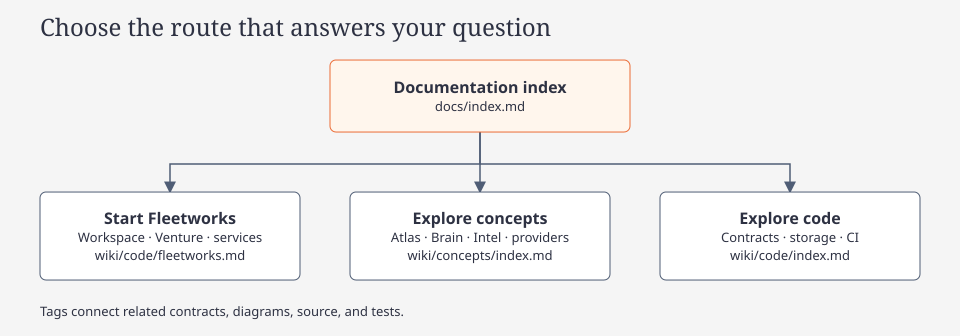

# Fleetworks wiki

Understand the product, then follow its implementation. This is the maintained entry point for humans and agents; canonical concepts, implementation contracts and workflow guides live under `docs/wiki/`.

| Route | Start here | Follow it to |
| --- | --- | --- |
| Start Fleetworks | [Fleetworks guide](wiki/code/fleetworks.md) | Native app, registered context and independently operated backend |
| Explore concepts | [Concepts](wiki/concepts/index.md) | Apps, evidence, model roles, persistence and their diagrams |
| Explore code | [Code](wiki/code/index.md) | Crates, module entry points, contracts and verification |

## Directory map

| Location | Purpose / next stop |
| --- | --- |
| [Walkthrough](wiki/walkthrough.md) | Reading order for the product, checkout, and checks |
| [README.md](../README.md) | Product overview and quick start |
| [docs/archive/](archive/index.md) | Historical checklists, investigations and verification reports |
| [docs/wiki/](wiki/index.md) | Two routes, searchable tags and wiki maintenance |
| [docs/diagrams/](diagrams.md) | Diagram catalog; HTML pages and matching SVG figures |
| [Core crate](../crates/argos-osint-core) | Domain pipelines and storage; [module map](wiki/code/core.md) |
| [Native app](../apps/fleetworks-desktop) | [Visual control guide](wiki/code/native-design-system.md) · [Pairing setup](diagrams/native-connections.html) · [Keychain/recovery](wiki/code/native-connections.md#pairing-and-keychain-agreed-target) · [Verification](../.planning/2026-11-12-native-pairing-implementation/acceptance.md) · [Identity](wiki/code/native-workspaces.md) |
| [Native workstation redesign](design/native-workstation-handoff/README.md) | Supplied references, [design system](wiki/code/native-design-system.md) and [execution tracking](../.planning/2026-11-12-native-workstation-redesign/handoff.md); verification status is tracked separately |
| [Direct Docker backend](../deploy/README.md) | Independent Linux services, purpose credentials and persistent backend data; [retired terminal disposition](archive/cli-retirement.md) |
| [Actor search](wiki/code/actor-search.md) | Private Tantivy projection, canonical discovery, visible acknowledgements and verification boundaries |
| [Jobs persistence](wiki/code/jobs-persistence.md) | Planned SQLite state, embedded RocksDB delivery, migration scopes and acceptance |
| [Deployment](../deploy/README.md) | Local Compose, database profiles and the [Atlas overlay](../deploy/atlas-dispatch.md) |
| [API adapter](../crates/argos-osint-api) / [host](../services/api-host) | Versioned HTTP contracts and authenticated service roles. [API contract](wiki/code/intel-web.md) |
| [Web app](../apps/web-desktop) / [shared packages](../packages) | Next server/stateless API relay, React Native primitives and typed Query client |
| [Build artifact map](wiki/code/build-artifacts.md) | Tools, compiler caches, QA evidence, app/web/image outputs and data ownership |
| [scripts/](../scripts) | Builds, storage tests, releases and verification; [workflow](wiki/code/contributing.md) |
| [.opencode/](../.opencode) | Role/command/skill configuration; [guide](wiki/code/opencode-v2.md) |
| [.agents/skills/](../.agents/skills) | Repository skills for other agent hosts |
| [.github/workflows/](../.github/workflows) | CI and release automation; [CI guide](wiki/code/ci.md) |
| [.planning/](../.planning) | Named task work; [format and retention](wiki/code/planning-artifacts.md) |

Search by [tag](wiki/tags.md) when a concern crosses directories. Follow source links, search symbols/callers in the relevant directories, and verify against tests. Navigation requires no generated code graph.

Before changing code, read [contributor workflow](wiki/code/contributing.md) and [conventions](wiki/code/conventions.md). Maintain this hierarchy through [setup / refresh wiki](wiki/maintenance.md).
