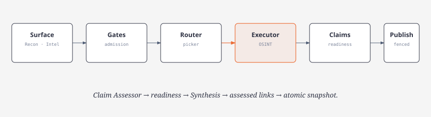

# Unified Investigation Harness

Shared evidence-driven pipeline for:

- **Recon Chat** — interactive multi-turn investigations
- **Home Composer** — launcher that allocates a session immediately
- **Intel Briefing & Jobs** — multi-section background reports

Surfaces keep their own UI, permissions, and stored ids. Admission, picker, executor, evidence curation, and synthesis are shared. Recon turn details: [architecture.md](architecture.md).

## Model roles

Defaults live under **Models → Defaults**. Empty derived roles inherit. Explicit config wins. Cycles are rejected. In-flight tasks keep snapshotted assignments.

| Logical Role | Purpose | Default inheritance |
|--------------|---------|---------------------|
| `recon` | Directives, task dependencies | Root default |
| `tool_picker` | Next eligible tool | OpenRouter Jev (`typesafe/jev-1.13`) |
| `synthesis` | Assessments and answers | Root default |
| `classifier` | Taxonomy and tags | OpenRouter Jev (`typesafe/jev-1.13`) |
| `summarization` | Compress evidence | Inherits `synthesis` |
| `evidence_curator` | Source-linked passages | Inherits `recon` |
| `entity_resolver` | Identity conflicts | Inherits `classifier` |
| `claim_assessor` | Verdicts and citations | Inherits `synthesis` |
| `investigation_controller` | Checkpoints and dispatch | Inherits `recon` |

## Catalog projection

59 tools in 14 intelligence categories. `hunter_tech_lookup` aliases `hunter_technologies`.

1. Web Discovery
2. News & Events
3. Publisher Context
4. Legal & Litigation
5. Corporate & Organizations
6. Professional Identity
7. Social Content
8. Public Account Corroboration
9. Domain & Infrastructure
10. Historical Web
11. Software & Code
12. Geography & Places
13. Bitcoin & Blockchain
14. Vulnerabilities & Cyber

| Level | Audience | Contents |
| --- | --- | --- |
| 1 Compact | Planner / Controller | Cost, prerequisites, limits |
| 2 Candidates | Picker | Binding status, expected contribution |
| 3 Contract | Executor | JSON schema, route, retry guidance |

## Validation gates

1. **Task admission** — surface eligibility, no duplicate tasks, valid dependencies
2. **Tool preflight**
   - Atlas-only news tools (`atlas_gnews`, `atlas_newsdata`, `atlas_currents`, `atlas_newsapi`) forbidden in Recon and Intel
   - `sociavault_google_search` needs **both** weak Firecrawl **and** an unmet evidence need
   - Platform-native tools need an unmet platform-native need
3. **Evidence admission** — URL/domain, retrieval timestamp, quote/facts
4. **Claim assessment** — claim-specific isolation; contradictions kept
5. **Publication** — every assertion grounded in admitted passages

## Reasoning channels

- Reasoning is never promoted to answer text or evidence. Reasoning-only completion = empty, bounded repair.
- Stream answer (`on_delta`) and reasoning (`on_reasoning`) separately.
- TUI thinking rows: `▶ Thinking… · {role} · {model} · {timestamp}`. Expand with Enter/click.
- `/thinking` toggles disclosure. `/details` toggles directive/tool payloads.

## Persistence

SQLite (current schema version 30; harness tables from v20+):

| Table | Contents |
| --- | --- |
| `investigation_tasks` | `pending`, `executing`, `completed`, `failed`, `blocked`, `cancelled` |
| `investigation_task_dependencies` | Prerequisite edges |
| `investigation_evidence_passages` | Deduped quotes, entity bindings, stance |
| `investigation_claim_assessments` | `verified`, `refuted`, `inconclusive`, `insufficient_evidence` |
| `investigation_events` | Gate/tool/transition trace, secrets redacted |
| `investigation_stream_parts` | Durable streams for resume |

## Shared claims and derivations

`investigation::insights` owns candidate packets, qualified source claims, evidence readiness, Synthesis inferences and assessed typed links. Preparation remains separate from assessment. A source allegation, denial or speculation remains an attributed claim. Kind, fidelity, evidence relation and lifecycle are independent. Mentions are candidates, never support.

Recon stages insights from retained tools before the analytical answer. Its new `insights-v1` extraction receipt prevents answer mining and citation retrofit; legacy queued jobs retain `legacy-v1` dispatch. Article reports delegate to one durable `insight_refresh` task after asynchronous inventory, collection and assessment. Section and BLUF prose consume its readiness result; insufficient evidence produces observations and gaps.

See [NLP coverage](nlp-preprocessing.md) and the [shared harness](diagrams/investigation-harness.html). Schema 29 stores generation, lease-fenced activation, immutable original evidence and stage receipts alongside canonical Brain records.

Atlas uses [classification-only collection and Related articles](atlas-classification-and-related-articles.md). Its local shared mentions are tentative browsing leads, separate from investigative claims, assessed Links and evidence confidence. Current Atlas stages count article metadata; historical memory units retain legacy labels.
