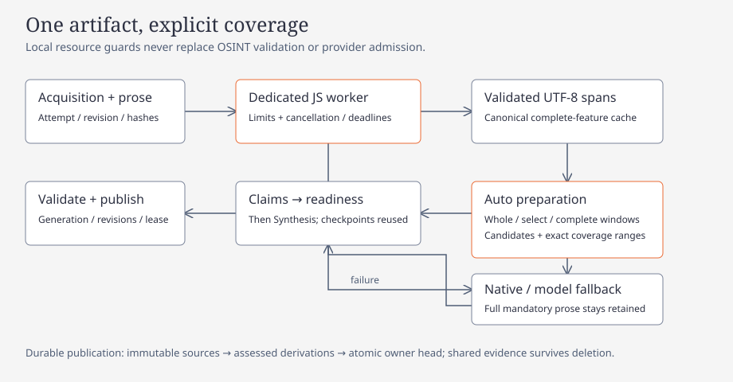

# Local NLP preprocessing

Argos embeds pinned Compromise 14.18.0 and dates 3.9.0 through rquickjs 0.14.0. No Node, browser, loader, network or subprocess is used at runtime. Candidate tags rank source passages; existing identifier, ownership, claim and publication gates remain authoritative.

[](diagrams/nlp-preprocessing.html)

## Configuration and build

The local `config.toml` setting is independent of portable Profile schema v1; importing a Profile preserves it:

```toml
[nlp]
mode = "annotate" # off | annotate | select
```

`annotate` is the default. It caches complete annotations while preserving legacy prose selection. `off` bypasses parsing. `select` chooses verbatim passages and enables strict block decisions for article cleanup. Both crates default to `lancedb` and `nlp`; CI verifies NLP enabled and disabled with LanceDB disabled. The feature-disabled API reports `Disabled` and retains bounded legacy text. Debug builds optimize only the QuickJS C dependency to make interrupt deadlines practical.

## Evidence and ownership

`Source` separates acquisition and derived prose hashes, retrieval attempts and revisions. UTF-16 offsets from the bridge are converted against the exact immutable chunk into half-open UTF-8 ranges; surrogate-interior, reversed and out-of-bounds spans fail closed. Scalar converters remain explicit for the existing body-filter API.

Article acquisition is saved before validation. Refinement retains its exact attempt and acquisition hash; generic historical body/Brain rows have derived provenance and no manufactured acquisition hash. Firecrawl bounded observations carry an artifact reference; Recon reads complete page text from the retained raw result before preparing compaction and synthesis inputs.

Migration 28 adds `nlp_artifacts`, `nlp_source_refs` and `nlp_features`, and stores complete summary-result envelopes. Owner deletion/pruning removes references and garbage-collects artifacts/features only after their last reference disappears. Feature keys cover canonical JSON, prose hash, pinned bundle/bridge hashes, schema, lexicon/chunk/span policy and date context. Selection keys additionally cover purpose, focus, byte budget and policy. Only complete validated annotations enter the cache: memory is bounded to 64 MiB and disk features to 256 MiB by LRU.

## Runtime and fallback

One process-shared dedicated thread owns the JS runtime/context. Tokio channels carry owned Rust DTOs and a response oneshot; no JS values or database connections cross threads. Admission allows 32 queued jobs and 16 MiB of queued/active input, with a 2 MiB source ceiling, 4 MiB output ceiling, 128 MiB JS heap and 1 MiB stack. Chunks target 4 KiB, never exceed 8 KiB and overlap a bounded adjacent sentence. UTF-8 splits of oversized sentences are flagged. Guards interrupt at one second per chunk and ten seconds per document and observe cancellation. Engine faults trigger recreation; a worker panic fails pending jobs. Incomplete/unsupported/busy/oversized/cancelled/failed parses never authorize selection.

The bridge obtains one sentence/term tree, then returns only compact candidate spans. Money spans include adjoining scale/unit terms. Date phrases are deduplicated and limited to 32 per job and 256 characters each; overflow is retained as unparsed evidence. Relative dates use publication date, otherwise retrieval date, UTC by default. Unknown numeric date order and invalid explicit calendars have no normalized event. No document mutates the global lexicon.

## Passage and model contracts

Selection keeps complete original paragraphs in source order with explicit separators. Paragraph units preserve sentence attribution, quotation closure and adjacent context. Literal focus, candidate-entity, correction/uncertainty and numeric/date/quote signals rank passages; opening context and correction units are protected. If a protected unit exceeds the budget, selection returns `BudgetExceeded` and the caller uses its legacy bounded fallback. No extra extraction window or model operation is introduced.

Budgets are serialized UTF-8 bytes, including JSON escaping and message overhead, rather than token counts. Existing smaller field/output budgets remain. Selected and omitted sentence IDs make partial coverage explicit. Body claims are accepted against only the transmitted windows of that exact article artifact, plus title/description evidence; the maximum remains eight accepted body claims. Cleanup requests in select mode demand exactly one Boolean decision per reviewed block ID. Missing, duplicate, unknown or malformed IDs preserve the baseline; unreviewed blocks always remain. Rust assembles retained source characters verbatim and revalidates the body.

Summary identity covers all ordered sources, supplied/computed hashes, metadata, focus, budget, required fields, prompt version, preprocessing and resolved provider/model. Lookup and insertion use the same `sum-<key>` ID. Deterministic fallback identity is local and separate from the durable upgrade route; an upgrade cannot be overwritten by a deterministic result. Flush requests retain original sources and immediate fallback separately. New contracts use v2; queued v1 envelopes remain readable and explicitly execute as legacy derived sources. All-source hashes and actual result route/model are stored. Summary execution has two total outbound attempts, including transport fallback, with unchanged admission. GraphExplanation keeps its existing separate four-attempt gate and cache.

## Integration inventory

| Path | Preparation and evidence behavior |
| --- | --- |
| Article acquisition/refinement | Persist raw acquisition; cache whole prose; strict block decisions in select mode; retain unreviewed blocks and baseline on failures |
| Atlas body claims | Select before the 12,000-character fallback; carry artifact/ranges into validation; retain title/description evidence and atomic replacement |
| Firecrawl / Recon pages | Reference full acquisitions separately from bounded observations; prepare before compaction, then reuse for synthesis and claim mining |
| Recon bindings | Run native extraction first; focus existing model requests; retain occurrence, ownership, platform and format gates |
| Directives / prior / Brain | Preserve mandatory question/directive/state fields; prepare optional prose without adding requests |
| Intel sections / BLUF | Read full body/upstream sections before focused body input; preserve evidence, elements, stances and objectives |
| Summaries | Original source envelopes; canonical all-source/route identity; durable fallback and coverage manifests |

V1 bypasses Atlas category/title-description classification and eligibility, peer/report-mode classifiers, actor review, picker/catalog state, opening query generation, short titles/link explanations, graph explanations/structures, remote Firecrawl URL extraction, audio transcription and MiniLM embeddings. These inputs are short, typed, remote or already scoped. NLP candidates never create bindings, identities, truth scores, graph edges or credibility categories.

## Verification

Offline unit fixtures cover the actual JS runtime/plugin, exact Unicode spans, repeated mentions, scaled amounts, relative/ambiguous/invalid dates, interrupts, admission bytes, disconnected channels, immutable provenance/shared-owner GC, canonical keys, tail corrections after 48,000 bytes, quoted context, invalid cleanup IDs and summary upgrade protection. The gold selection fixture reports source/selected bytes and omitted IDs; runtime fixtures report parsing and memory-cache latency without document text. Scripted provider tests retain native gates, mandatory searches, admission and retry/transaction checks. Actual provider token usage and live workload latency require a separate workload run; synthetic fixture numbers are not throughput SLOs.

The structured JSON gold input produces invalid offsets in the pinned parser. Its acceptance path explicitly checks `Failed`, rejects selection and retains the original bounded source with a diagnostic. The multilingual fixture similarly checks `Unsupported` and safe fallback. English entity misses remain valid data; they do not remove material evidence. The quotation fixture covers an opening attribution before the focused paragraph and a closing delimiter after it.

### Recorded fixture measurements (2026-10-11)

| Fixture | Observed result |
| --- | --- |
| Compressible article, correction after 48,000 bytes | 55,404 source bytes → 322 serialized selected bytes; 799 omitted sentence IDs; partial coverage; all marked material spans and attribution retained |
| Scripted summary, 53,711 source bytes | Off and annotate: 12,878 serialized request-body bytes each; select: 709 bytes (94.5% less); one outbound request per mode; late denial and attribution retained |
| Actual runtime, 88-byte date/money fixture | Cold engine initialization: 1,393 ms; uncached parse in initialized engine: 551 ms; queue wait: 0 ms; memory-cache response: 21 ms; serialized annotation: 864 bytes |

These are single observations from a concurrent offline test suite on the local host. They establish byte/count and evidence acceptance, not throughput or latency targets. No live provider token usage was available. The small gold set exercises clean/noisy English, missing entities, numerical disputes, multilingual prose, code and structured extracts; it does not establish broad entity accuracy or production workload savings.

Local validation passed `cargo fmt --all --check`, both locked no-default-features Clippy lanes with `-D warnings`, and both workspace test lanes with `ARGOS_EMBED` unset. NLP enabled: 187 binary, 724 core and 3 fixture checks passed. NLP disabled: 187 binary, 719 core and 3 fixture checks passed. Each lane retained eight ignored tests. CI includes both lanes on the existing macOS Intel/ARM and Linux x86/ARM matrix; those remote runs are separate from this local validation.
