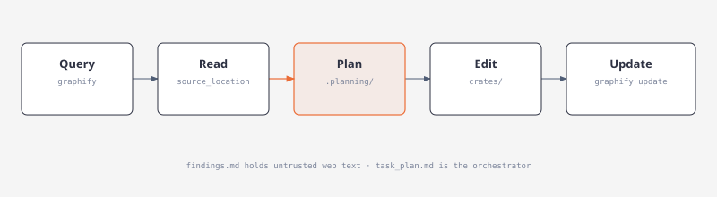

# OpenCode V2 workflow

`argos-plan` keeps multi-step task state in named `.planning/` directories. The project graphify plugin adds graph-first navigation and a short session handoff. ECC commands handle planning, review, verification and commit tasks without a separate milestone framework.

## Primary tools

OpenCode V2 ignores `experimental.primary_tools`. `build` and `plan` in `.opencode/opencode.json` deny Code Mode (`execute`), the browser catalog, unlisted subagents, and every skill except the list below. Call the provider schema for these tools. Do not invent `tools.<namespace>[...]()` calls.

| Tool | Use |
| --- | --- |
| `shell` | `graphify query "<question>"` before a repo-wide search |
| `read`, `grep`, `glob` | Paths the query returns, or a path-scoped search |
| `edit`, `write` | `build` only. `plan` cannot edit project files |
| `skill` | `{ "id": "<id>" }` |
| `webfetch`, `websearch`, `question` | One URL, one query, or one user choice |
| `subagent` | `agent`, `description`, `prompt`. `build` may launch `explore`, `ecc-planner`, `ecc-reviewer`, and `ecc-edit`. `plan` may launch the first three |

Skill ids: `graphify`, `argos-plan`, `argos-implement`, `ecc-plan`, `ecc-review`, `ecc-verify`, `ecc-checkpoint`, `ecc-learn`, `argos-tui-verify`, `argos-commit`.

`argos-plan` writes `.planning/<YYYY-MM-DD-slug>/` and keeps that text out of the chat. Load `graphify` only when the shell command above is unclear. Keep simple tasks lightweight; task phases are useful for multi-step work and do not require project onboarding.

## Builds

Every agent compiles and tests without LanceDB. `build`, `plan`, `explore`, `ecc-edit`, `ecc-planner`, and `ecc-reviewer` use:

```sh
python3 scripts/agent_cargo.py build --locked --no-default-features
python3 scripts/agent_cargo.py test --workspace --locked --no-default-features
python3 scripts/agent_cargo.py clippy --workspace --all-targets --locked --no-default-features -- -D warnings
```

Leave `ARGOS_EMBED` unset. Do not pass `--features lancedb`. `ecc-edit` only formats its Rust files with `cargo fmt -- <paths>`. The parent runs fmt check, clippy, and test.

All compilation and test commands use the wrapper, which reserves `target/agents` for agents and leaves the user’s default `target/debug` free. `cargo fmt` needs no artifact lock. Screenshot capture follows this policy automatically. See [agent Cargo isolation](../AGENTS.md#agent-cargo-isolation).

## Phase edits

On `build`, load `argos-implement`. Split the in-progress phase into disjoint file sets and call `subagent` once per set. Use `ecc-edit`. Set `background` to true and send every call in the same turn when there are two or more sets. The prompt carries the phase, the file list, and the change. Do not set `model`, and do not poll.

`ecc-edit` changes only those files, then runs `cargo fmt -- <paths>` for the Rust files it changed. Its instructions leave builds and tests to the parent. `ecc-edit`, `ecc-planner`, and `ecc-reviewer` allow shell commands without approval, as does the built-in `explore` agent. Planner and reviewer instructions remain read-only; shell access is not a filesystem sandbox.

When the children finish, the parent runs `cargo fmt --all --check`, `python3 scripts/agent_cargo.py clippy --workspace --all-targets --locked --no-default-features -- -D warnings`, and `python3 scripts/agent_cargo.py test --workspace --locked --no-default-features`, with shell `timeout` `600000` and `ARGOS_EMBED` unset. Failures go back to `ecc-edit`, using `sessionID` to continue the editor that owns the file. The parent re-runs the failed command, then the full trio, then `graphify update .`. `plan` does not launch `ecc-edit`.

## Graph first

[](diagrams/agent-graphify.html)

Tracked graph: `graphify-out/graph.json`.

| Command | Use |
| --- | --- |
| `graphify query "<question>"` | Shell tool, before the first broad search |
| `graphify explain "<concept>"` | One symbol |
| `graphify path "<A>" "<B>"` | Relationship |
| `graphify update .` | After code edits (AST only) |

Track only `graph.json`, `manifest.json`, `GRAPH_REPORT.md`. The graphify plugin reads this graph directly; no planning configuration mirror is required.

Skip graphify only if the graph is the thing being fixed, or the user says so.

## ECC commands

| Command | Purpose |
| --- | --- |
| `/ecc-plan` | Read-only plan from graph + source |
| `/ecc-review` | Read-only diff review |
| `/ecc-verify` | fmt, clippy, tests, graph refresh |
| `/ecc-checkpoint` | Short manual handoff |
| `/ecc-learn` | Reusable practice (needs approval) |
| `/tui-verify` | Actual fixture capture, screenshot review, action/metric evidence |

Planner and reviewer inherit the active model and cannot edit files. Automatic handoff: ≤500 characters each for latest request and outcome, plus up to 12 paths. Loads once in a later session for the same project. Named task plans hold the detailed working state; durable decisions/results follow the planning retention policy.

## Verify setup

With OpenCode V2 in this project:

- `/api/plugin` — `argos.graphify`
- `/api/command` — six `ecc-*` commands and `tui-verify`
- `/api/skill` — matching skills

No GSD plugin, MCP server, command catalog or agent installation is required. Avoid installing a second planning framework for this workflow.

```sh
node --test .opencode/tests/*.test.mjs
```

TUI phases follow the [design contract](tui-design-spec.md) and [component catalog](tui-components.md). Planner/editor prompts name components, preset, owned files, read-only references and viewport/data/interaction acceptance checks; reviewers verify shared geometry and reachability.

## TUI verification setup

All agents follow [tui-verification.md](tui-verification.md); the [session record](tui-verification-session-2026-10-10.md) includes actual screenshots and defects. Load skill id `argos-tui-verify` or `/tui-verify`. The canonical file is `.opencode/skills/argos-tui-verify/SKILL.md`; `.agents/skills/argos-tui-verify` links to it for other hosts. No new browser/execute capability, MCP server or model selection is required.

Install Pillow in task scratch using `uv venv .agent-scratch/tui-review-env` then `uv pip install --python .agent-scratch/tui-review-env/bin/python Pillow`. After the parent gate, capture with a real selected plan name:

```sh
.agent-scratch/tui-review-env/bin/python scripts/tui_review.py capture --output .planning/<PLAN_ID>/tui/run-01 --test dump_overhaul_screens --include 'tools-page-*' --size 160x50 --size 80x24 --reason "Tools page change"
```

Choose the affected app/pages explicitly with `--test` and `--include`, select affected thresholds with `--size`, and record `--reason`. There is no implicit Profile capture. `--all` is reserved for intentional full sweeps; `--ignored` is only for ignored fixture tests. Selection precedes PNG rendering; fixture assertions still run. The guide covers manifest/review/cleanup. If OpenCode cannot view images, hand off PNG links and leave visual review pending; do not invent an image tool or claim generation is review.

The installed V2 format uses top-level `agents` and per-agent `request.body` for reasoning settings. The legacy `agent`/`options` form was observed putting permission rules inside provider request options rather than enforcing the documented tool policy. This repo uses supported fields and preserves model IDs/reasoning settings. Plan denies source edits, Code Mode and edit/build subagents; build keeps scoped editing. Both primary agents allow the named skills, including `argos-tui-verify`. Arbitrary shell access is not a security sandbox; read-only planning remains an agent responsibility.

After config changes run `node --test .opencode/tests/*.test.mjs`, `opencode debug config` and `opencode debug agents`. Inspect resolved **permissions**, not fields inside `request.body`. Confirm the skill/command through `/api/skill` and `/api/command` using the installed provider API. Diagnostics may require local log access; no live model call is needed. Avoid copying unrelated global setup into artifacts.

Catalog loading is asynchronous in the installed runtime: an immediate standalone request returned an empty list before initialization. Use a running local server and recheck after startup; do not treat the first empty response as successful discovery. The CLI also truncates large catalog/debug output, sometimes producing incomplete JSON. Filter or decode the bounded entries needed for the check instead of archiving entire global catalogs. This session confirmed the new skill ID/path, command and effective primary-agent permissions on the initialized server.

## Commit and release tasks

Planning retention follows [planning-artifacts.md](planning-artifacts.md).
`argos-plan` records local working memory; `argos-commit` selects shared plans and
curated durable deliverables for exact staging. Agent instructions and skills
carry this policy; automatic session handoffs remain in plugin storage.
No new model, permission or unsupported config key is needed.

The registered `argos-commit` skill and `/ecc-commit` command follow [versioning.md](versioning.md). `plan` prepares messages and release-impact assessments without staging; `build` completes authorized commits with exact staging, message/version checks and the appropriate implementation gate. Child editors report compatibility impact and leave commits to the parent. Models and other permission defaults are unchanged.

`node scripts/release_check.mjs versions` checks the workspace, both local lockfile versions and release mirrors. `message --file <path>` validates a prepared Conventional Commit and reports impact. Release Please owns synchronized bumps, changelog entries and reviewed `vX.Y.Z` releases. PR titles and breaking-change footers survive squash merging; do not invent `Release-As` or bump versions per code commit. GitHub token/merge/required-check setup is documented in the guide.

## Workflow simplification

The 2026-10-11 audit removed the GSD integration. The repository had no active
GSD phase directories, while roadmap/state still described the October 6
onboarding and duplicated maintained product docs. Primary agents already used
`argos-plan`/ECC and denied GSD tools. The bridge nevertheless launched synchronous
external hooks on ordinary tools, including up to five pre-write hooks plus a
post-tool monitor, each with a 25-second timeout. This is structural overhead;
no wall-clock benchmark or complete session-usage audit was performed.

The global OpenCode install also registered an enabled MCP server, 72 command
files and 64 agent files. With explicit user authorization it was disabled using
a backup outside OpenCode's discovery directories. The repo bridge/test, stale
onboarding scaffolding and active workflow references were removed. Historical
screenshot provenance remains unchanged. No Rust/TUI behavior changed; existing
graph navigation, named task plans, ECC checks, scoped screenshot verification,
commit policy and bounded session handoff remain the supported workflow.
