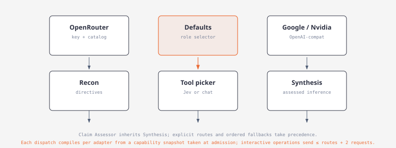
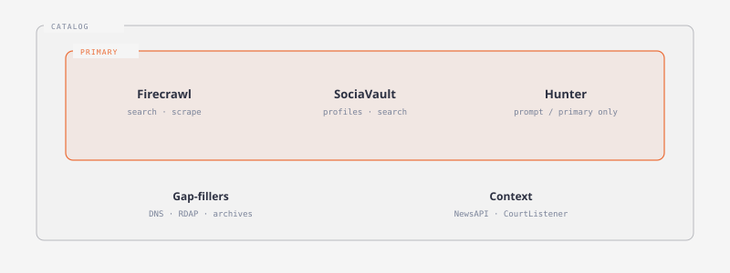

# Providers

[](diagrams/model-roles.html)

Models (internal id `Providers`) has four tabs: Defaults, OpenRouter, Google, Nvidia.

| Concern | Where |
| --- | --- |
| Credentials | `~/.argos/auth.json` (owner-only on Unix) |
| Role → provider + model | `config.toml` |

Saving or verifying a connection does not change a role. Old Writer config seeds Recon and Synthesis. Tool picker seeds OpenRouter `typesafe/jev-1.13` only when both fields are empty.

| Provider | Key env | Endpoint |
| --- | --- | --- |
| OpenRouter | `OPENROUTER_API_KEY` | optional HTTPS base |
| Google | `GEMINI_API_KEY`, then `GOOGLE_API_KEY` | `https://generativelanguage.googleapis.com/v1beta/openai` |
| Nvidia | `NVIDIA_API_KEY` | `https://integrate.api.nvidia.com/v1` |

Verification checks the current draft without saving. Legacy Grok/OpenAI in `auth.json` keep working until replaced. They have no new-setup tabs. Their keys are never sent to Google or Nvidia.

```sh
argos login
argos defaults show
argos defaults set recon --provider openrouter --model <model-id>
argos defaults set tool-picker --provider openrouter --model typesafe/jev-1.13
argos defaults set synthesis --provider openrouter --model <model-id>
argos models --role tool-picker
argos logout
```

| Role | Job |
| --- | --- |
| Recon | Directives and bindings |
| Tool picker | One next tool per request |
| Synthesis | Cited answers and claims |
| Classifier | Report mode from the prompt |
| Summarization | Graph/path summaries |
| Investigation harness | curator / resolver / assessor / controller |

Saving a role writes `config.toml` only. System log records `defaults.<role>: … -> …`. Provider list = accounts on this machine. Model list = what that account may call. A saved model id is kept if the live catalog is down.

Each role has an ordered `fallbacks` list of provider/account/model routes. Migration adds empty lists without changing the primary. Exact duplicates of the primary or of another fallback are rejected; the same model through another provider or account is distinct. Defaults shows priority, provider, and model; Add fallback opens a Google | Nvidia | OpenRouter catalog popup. Catalog browsing never issues inference. Help: `Tried top to bottom after primary retries`.

`argos osint user-agent` sets the public HTTP contact string. Blank → built-in `Argos OSINT/0.1 (…)`. Never send an empty User-Agent.

### Tool picker transport

`defaults show` reports `tool_picker: { provider, model, transport }` (`decisions` or `chat`). Role names: `tool-picker` and `tool_picker`. Pin `typesafe/jev-1.13`; do not pin `~typesafe/jev-latest`. On OpenRouter, the model list always offers `Jev 1.13 (decisions)` first.

| Transport | Models | Request |
| --- | --- | --- |
| Decisions | `typesafe/jev-*` or id contains `/jev` | `POST https://openrouter.ai/api/alpha/decisions`, one choice per remaining tool. Confidence &lt; 0.45 → deterministic fallback. |
| Chat | everything else | `{ "tool_id", "serves", "needs", "produces", "reason" }`. Validate + one repair. Same budget of 2 requests per turn. |

## OSINT data providers

[](diagrams/osint-providers.html)

Primary: Firecrawl, SociaVault, Hunter. Saved key overrides env.

- Fallback field on the same row (`*_API_KEY_FALLBACK`) retries once after rate/quota, then is used first for later calls
- Atlas keeps a separate daily counter for the fallback account
- Keys go only to that provider’s host (Firecrawl bearer; SociaVault / Hunter `X-API-Key`)
- Hunter keys never go in the URL

Cache for the credit-reset interval: daily → 1 day; weekly → 1 week; monthly → 30 days.

- Firecrawl and Hunter reset monthly
- SociaVault and Whoxy prepaid never reset; public tools have no plan → 30 days
- NewsAPI, CourtListener, HackerTarget reset daily
- Failed results are never cached
- Live smoke tests are `#[ignore]`

| Provider | Tools | Notes |
|---|---|---|
| Firecrawl | search, scrape, map, batch scrape, crawl (off by default), extract, plus Google/Yandex/Mojeek SERP scrape adapters | Batch scrape and crawl are polled jobs, charged per page. Extract uses a fixed schema (5 credits). Named-engine tools POST `/v2/scrape` at engine SERP URLs; `firecrawl_search` does not satisfy named-engine coverage. |
| SociaVault | profile, search, search users, user content, Google search | 44 one-credit routes. No followers/following or single-post routes. Google search only after a weak Firecrawl search. |
| Hunter | domain finder, email count, domain search, email finder, email verifier, company enrichment, email insight, person enrichment, combined enrichment | Read endpoints only. Inputs from prompt, Firecrawl, SociaVault, or earlier Hunter. `hunter_tech_lookup` aliases company enrichment. |
| Whoxy | `whoxy_whois_history` | Prepaid WHOIS history. Env `WHOXY_API_KEY` / `WHOXY_API_KEY_FALLBACK`. Header `x-api-key` then query `key`. 1 credit for nonempty history, 0 for recognized empty. Cache full history, project `from`/`to`/`limit`. Default pool 0. |
| Holehe | `holehe_email_lookup` | No key. Native Twitter, Spotify, Pinterest adapters (experimental, fixture-validated, not live-validated). 123 upstream catalog ids; others return `unsupported`. |

## Typed provider diagnostics

Failed outbound requests are structured.

**Stages:** `configuration`, `admission`, `connect`, `first_response`, `response`, `stream`, `parse`, `validation`, `persistence`

**Categories:** `auth`, `permission`, `invalid_model`, `configuration`, `malformed_request`, `unsupported_transport`, `rate_limited`, `server`, `timeout`, `network`, `stream_interrupted`, `premature_eof`, `sse_error`, `malformed_payload`, `token_limit`, `refused`, `empty`, `invalid_result`, `persistence`, `cancelled`

Surfaces: Brain summary failure card, Jobs dashboard, `provider_verify` CLI. Events redact secrets.

## Budgeted executor

Shared chain (`provider_chain`): primary **4** attempts (waits 10s, 20s, 30s before retries); each fallback **3** (waits 10s, 20s). Maximum requests `4 + 3F`; all-failure base waits `60 + 30F` seconds. Exhaust the primary before fallback 1, then each fallback top to bottom. Snapshot routes at admission; persist attempt history.

- Every dispatched inference failure follows this policy, including 400/401/403/404, 429, 5xx, network/TLS, timeout, stream, and invalid output
- Missing credentials, invalid route, or definite capability incompatibility is a recorded skip (Blocked if nothing can dispatch)
- Admission wait does not consume an attempt
- Honor provider Retry-After / account cooldowns in addition to base waits
- `complete()` is one streaming request; `complete_one()` is one non-stream request. Hidden stream-to-nonstream retries were removed so the chain owns the budget
- Summarization uses the same primary budget of 4; a transport switch inside that budget still counts as a request
- Successful fallback is informational and does not mark a cycle Partial
- Provider 429 / 503 defer picker calls; deterministic order when no primaries remain

## Graph explanation jobs

- One job per memory per provider/model
- Cache key: memory text revision + graph brief + focus + provider + model + prompt version
- Failures persist with diagnostics. Memories stay. Atlas indexing continues.
- Stages: compact, evidence, synthesis

## News and legal keys

NewsAPI and CourtListener are keyed context providers, not primaries. Keys never appear in URL, tool input, cache key, plan, or stored body (echoed keys redacted). 0 credits; budgets are per-turn call caps. Fallback after rate/quota only. 401/403 do not switch accounts.

| Provider | Tools | Notes |
|---|---|---|
| NewsAPI | `/v2/everything`, `/v2/top-headlines` | Exact-phrase `q`, `pageSize` 10, no pagination. Key `NEWSAPI_API_KEY` as `X-Api-Key` to `newsapi.org`. Developer: 100/day, 24 h late, one month back. Cache 86400 s. |
| CourtListener | case law (`type=o`), dockets (`type=r`), judges (`type=p`) on `GET /api/rest/v4/search/` | Exact-phrase `q`, first page, ≤20, no highlight. Token `COURTLISTENER_API_TOKEN`. Space 12 s. Never retry 429. Cache 86400 s. |
| GNews | `gnews_search` `GET /api/v4/search` | `q` ≤200 chars, `max` 10. `GNEWS_API_KEY` as `X-Api-Key`. Atlas Search (needs `source.country`). Recon does not pick it. |
| NewsData.io | `newsdata_latest` `GET /api/1/latest` | Past 48 h. Do not send `timeframe` on free plan (HTTP 422). `NEWSDATA_API_KEY` as `apikey`. Atlas only. |
| Currents | `currents_latest` `GET /v1/latest-news` | `CURRENTS_API_KEY` as `Authorization: Bearer`. Atlas regional headlines. |
| Wikipedia (public) | `wikipedia_source_reliability` | MediaWiki `action=parse` on WP:RSP. No key. `gr`→B, `nc`→C, `gu`→D, deprecated/blacklist→E, unlisted→F. Uses `osint_user_agent` when set, else the built-in default. Index cached 30 days. |

Recon limits: `news_calls_per_turn` 2, `legal_calls_per_turn` 3. Spec defaults still to confirm: `sociavault_turn_credits_opening` 3, `sociavault_turn_credits_later` 8, `google_fallback_min_results` 3. `opening_sociavault_calls` in old files is unused.

## Verification and testing

- Unit tests for every failure category and stage
- Summary executor budget is 2 total requests, including transport fallback; admission wait consumes no attempt
- Cache invalidation when inputs change
- Graph explanation provider integration

## Investigative assessment routes

Claim Assessor (`claim_assessor`) inherits the Synthesis assignment when unset. An explicit assignment and its ordered fallbacks take precedence. Extraction and inference use `model_exec::execute_chat`, which skips Decisions-only models without changing route order. Fidelity, corroboration and identity contracts use `DecisionService::evaluate_shared` through the same admission, cancellation and fallback executor; native Jev decisions and chat adapters compile and parse the same finite contract. Cached stage receipts record the actual successful route. Changing captured route contracts invalidates refresh reuse.

## Capability-based route selection

Each operation declares an output contract (`OperationFormat`: bounded decision, generated JSON or prose) next to its scope. A role's resolved chain (primary, inherited defaults, fallbacks) is walked in order and the first route whose actual model and connection support that contract is used. The exact TypeSafe Jev family (`typesafe/jev`, `typesafe/jev-<version>`, `~typesafe/jev-latest`; `provider::is_jev_family`) serves only native OpenRouter Decisions; a Jev route on another provider or without a key is an explicit zero-request capability skip, never a chat request. Generative work with a Jev primary picks the first chat-capable fallback; a chain with no compatible route fails before dispatch with a role-specific error (e.g. "Claim Assessor extraction requires a non-Jev chat fallback"). Roles never borrow another role's routes. Payloads are recompiled per route (native decisions ↔ chat JSON) with one bounded chat repair before the declared fallback. Figure: [investigation-harness](diagrams/investigation-harness.html).

## Streaming and deadlines

Insight stages stream. Typed `AttemptProgress` events (dispatched, headers received, first model output, receiving ~1/s, heartbeat, stream complete) reach the UI; hidden reasoning counts as activity but its text is never surfaced. SSE is byte-buffered (split UTF-8 safe), `[DONE]` ends promptly, and length/interrupted/EOF outcomes are never accepted. Policies: ordinary calls keep connect 10s / headers 60s / inactivity 30s / total 120s; insight streams use connect 10s / headers 60s / first output 180s / model inactivity 90s / total 600s. Transport heartbeats never extend model deadlines. Native decisions and decision chat fallbacks keep the ordinary policy.

## Brief operation overrides and the focused path

`defaults.operation_overrides` routes one Intel brief operation (`intel_brief_claims.generate`, `…inferences.generate`, `…inferences.assess`, `…links.generate`, …) to a specific provider/model without changing its logical role; empty entries inherit. Models → Defaults shows the effective Brief operation routes. `defaults.focused_oversized_brief` (default false) enables the measured focused oversized-story Inferences path; changing it reruns Inferences and Links only.

## Provider adapters and resolved capabilities

Model IDs are data. Three provider adapters in `provider_adapters/` own the wire details: `openrouter`, `google` and `nvidia`. Any other OpenAI-compatible endpoint uses the generic compatible adapter. Each adapter owns its endpoint and auth, model ID normalization, parameter names, schema/tool compilation, stream and usage parsing, and its error dialect. `compile(contract, route, capabilities)` is pure. It returns the endpoint, dialect, JSON body, response channel and effective policy. `normalize_final` and `StreamDecoder` turn a response back into one `Completion`: the answer text or output-tool arguments, finish/refusal status, and usage, which stays null when the provider does not report it. Only the shared executor (`provider_attempt`, `provider_chain`) makes HTTP calls. The compatibility wrappers `provider::{complete, complete_one, decide}` compile through the same adapters.

`provider_capabilities::resolve` builds `ResolvedCapabilities` from these sources, each overriding the one before:

1. Conservative defaults: every optional feature is unknown.
2. Documented profiles in `provider_profiles.json`, matched on the exact provider and model ID.
3. Cached catalog evidence: OpenRouter endpoint `supported_parameters`, intersected over eligible free endpoints, and Google `supportedGenerationMethods` and limits.
4. Scoped rejections observed on the wire, keyed by field **and** value.

An unknown optional feature is never sent, and the answer is validated locally. A decision-only target such as Jev, or a non-text model, fails at compile time with zero requests sent (`capability skip`). `ResolvedCapabilities::digest` hashes only semantic support states, values and limits. Catalog entries are stored in `app_state` under `provider_caps:<hash>`, a hash of provider, base URL, dialect, model and upstream. They have a 24-hour freshness policy, background refreshes for the same key are coalesced into one, and a brief never waits for a refresh.

Structured output follows the contract (BoundedDecision, GeneratedJson or Prose). For GeneratedJson the adapter tries these modes in order and uses the first the model supports:

1. A confirmed strict schema.
2. A forced inert `submit_result` output tool. Its arguments are the answer: there is no execution and no second round trip.
3. JSON mode.
4. Validated text.

OpenRouter adds `provider.require_parameters=true` whenever it uses an optional capability. Google's own host uses native `models/{id}:generateContent` (`streamGenerateContent?alt=sse` when streaming) with `x-goog-api-key`. A custom base ending in `/openai` keeps compatibility chat with the bare model ID. Agent tool loops also use compatibility chat.

Ceilings: `RequestPolicy.max_output_tokens` is the total ceiling when thinking is off. `thinking_ceiling` is the total ceiling when the model thinks; thinking and visible output share it, and no hidden reserve is added. `reasoning_budget` is sent only where a profile documents a budget field, and it is labelled advisory unless the endpoint enforces it. Reasoning intents (`off`, `efficient`, `low`, `medium`, `high`) map onto each model's own vocabulary:

- Nemotron Super: `none`/`low`/`high`.
- Nemotron Ultra: `none`/`medium`/`high` (`low` is invalid).
- Lightning: `chat_template_kwargs.enable_thinking`.
- Gemini Flash: `low`/`medium`/`high`; thinking cannot be turned off.
- Gemma native: `minimal`/`high`.
- DeepSeek: no reasoning field.

Native Nvidia or Google fields are never sent through OpenRouter, and no temperature is sent unless a profile documents one.

| Route | Initial adapter policy (profile) |
| --- | --- |
| `typesafe/jev-1.13` | Native decisions only |
| `nvidia/nemotron-3-super-120b-a12b:free` | Strict JSON schema |
| `nvidia/nemotron-3-ultra-550b-a55b:free`, `cohere/north-mini-code:free` | Forced output tool; never `response_format` |
| `google/gemma-4-{26b-a4b,31b}-it:free` | JSON mode; schema only once confirmed |
| `apodex/apodex-1.1-mini:free` | Validated JSON until endpoint metadata confirms more |
| `models/gemini-3.8-flash` | Google native schema; thinking `low` minimum |
| `models/gemma-4-26b-a4b-it` | Google native; local JSON validation; `minimal`/`high` thinking |
| Nvidia Super / Ultra / Lightning / DeepSeek | Hosted chat; effort data as above; locally validated JSON |
