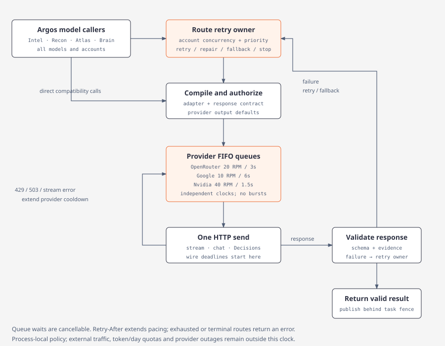

# Providers

[](diagrams/model-roles.html)

Models (internal id `Providers`) has four tabs: Defaults, OpenRouter, Google, Nvidia.

| Concern | Where |
| --- | --- |
| Credentials | `~/.argos/auth.json` (owner-only on Unix) |
| Role → provider + model | `config.toml` |

Saving or verifying a connection does not change a role. Old Writer config seeds Recon and Synthesis. Tool picker seeds OpenRouter `typesafe/jev-1.13` only when both fields are empty.

| Provider | Key env | Endpoint |
| --- | --- | --- |
| OpenRouter | `OPENROUTER_API_KEY` | optional HTTPS base |
| Google | `GEMINI_API_KEY`, then `GOOGLE_API_KEY` | `https://generativelanguage.googleapis.com/v1beta/openai` |
| Nvidia | `NVIDIA_API_KEY` | `https://integrate.api.nvidia.com/v1` |

Verification checks the current draft without saving. Legacy Grok/OpenAI in `auth.json` keep working until replaced. They have no new-setup tabs. Their keys are never sent to Google or Nvidia.

```sh
argos login
argos defaults show
argos defaults set recon --provider openrouter --model <model-id>
argos defaults set tool-picker --provider openrouter --model typesafe/jev-1.13
argos defaults set synthesis --provider openrouter --model <model-id>
argos models --role tool-picker
argos logout
```

| Role | Job |
| --- | --- |
| Recon | Directives and bindings |
| Tool picker | One next tool per request |
| Synthesis | Cited answers and claims |
| Classifier | Atlas article categories and bounded article-cleanup decisions |
| Summarization | Graph/path summaries |
| Investigation harness | curator / resolver / assessor / controller |

Saving a role writes `config.toml` only. System log records `defaults.<role>: … -> …`. Provider list = accounts on this machine. Model list = what that account may call. A saved model id is kept if the live catalog is down.

Each role has an ordered `fallbacks` list of provider/account/model routes. Migration adds empty lists without changing the primary. Exact duplicates of the primary or of another fallback are rejected; the same model through another provider or account is distinct. Defaults shows priority, provider, and model; Add fallback opens a Google | Nvidia | OpenRouter catalog popup. Catalog browsing never issues inference. Help: `Tried top to bottom after primary retries`.

`argos osint user-agent` sets the public HTTP contact string. Blank → built-in `Argos OSINT/0.1 (…)`. Never send an empty User-Agent.

### Tool picker transport

`defaults show` reports `tool_picker: { provider, model, transport }` (`decisions` or `chat`). Role names: `tool-picker` and `tool_picker`. Pin `typesafe/jev-1.13`; do not pin `~typesafe/jev-latest`. On OpenRouter, the model list always offers `Jev 1.13 (decisions)` first.

| Transport | Models | Request |
| --- | --- | --- |
| Decisions | `typesafe/jev-*` or id contains `/jev` | `POST https://openrouter.ai/api/alpha/decisions`, one choice per remaining tool. Confidence &lt; 0.45 → deterministic fallback. |
| Chat | everything else | `{ "tool_id", "serves", "needs", "produces", "reason" }`. Validate + one repair. Same budget of 2 requests per turn. |

## OSINT data providers

[](diagrams/osint-providers.html)

Primary: Firecrawl, SociaVault, Hunter. Saved key overrides env.

- Fallback field on the same row (`*_API_KEY_FALLBACK`) retries once after rate/quota, then is used first for later calls
- Atlas keeps a separate daily counter for the fallback account
- Keys go only to that provider’s host (Firecrawl bearer; SociaVault / Hunter `X-API-Key`)
- Hunter keys never go in the URL

Cache for the credit-reset interval: daily → 1 day; weekly → 1 week; monthly → 30 days.

- Firecrawl and Hunter reset monthly
- SociaVault and Whoxy prepaid never reset; public tools have no plan → 30 days
- NewsAPI, CourtListener, HackerTarget reset daily
- Failed results are never cached
- Live smoke tests are `#[ignore]`

| Provider | Tools | Notes |
|---|---|---|
| Firecrawl | search, scrape, map, batch scrape, crawl (off by default), extract, plus Google/Yandex/Mojeek SERP scrape adapters | Batch scrape and crawl are polled jobs, charged per page. Extract uses a fixed schema (5 credits). Named-engine tools POST `/v2/scrape` at engine SERP URLs; `firecrawl_search` does not satisfy named-engine coverage. |
| SociaVault | profile, search, search users, user content, Google search | 44 one-credit routes. No followers/following or single-post routes. Google search only after a weak Firecrawl search. |
| Hunter | domain finder, email count, domain search, email finder, email verifier, company enrichment, email insight, person enrichment, combined enrichment | Read endpoints only. Inputs from prompt, Firecrawl, SociaVault, or earlier Hunter. `hunter_tech_lookup` aliases company enrichment. |
| Whoxy | `whoxy_whois_history` | Prepaid WHOIS history. Env `WHOXY_API_KEY` / `WHOXY_API_KEY_FALLBACK`. Header `x-api-key` then query `key`. 1 credit for nonempty history, 0 for recognized empty. Cache full history, project `from`/`to`/`limit`. Default pool 0. |
| Holehe | `holehe_email_lookup` | No key. Native Twitter, Spotify, Pinterest adapters (experimental, fixture-validated, not live-validated). 123 upstream catalog ids; others return `unsupported`. |

## Typed provider diagnostics

Failed outbound requests are structured.

**Stages:** `configuration`, `admission`, `connect`, `first_response`, `response`, `stream`, `parse`, `validation`, `persistence`

**Categories:** `auth`, `permission`, `invalid_model`, `configuration`, `malformed_request`, `unsupported_transport`, `rate_limited`, `server`, `timeout`, `network`, `stream_interrupted`, `premature_eof`, `sse_error`, `malformed_payload`, `token_limit`, `refused`, `empty`, `invalid_result`, `persistence`, `cancelled`

Surfaces: Brain summary failure card, Jobs dashboard, `provider_verify` CLI. Events redact secrets.

## Budgeted executor

Shared chain (`provider_chain`): primary **4** attempts (waits 10s, 20s, 30s before retries); each fallback **3** (waits 10s, 20s). Maximum requests `4 + 3F`; all-failure base waits `60 + 30F` seconds. Exhaust the primary before fallback 1, then each fallback top to bottom. Snapshot routes at admission; persist attempt history.

- Every dispatched inference failure follows this policy, including 400/401/403/404, 429, 5xx, network/TLS, timeout, stream, and invalid output
- Missing credentials, invalid route, or definite capability incompatibility is a recorded skip (Blocked if nothing can dispatch)
- Admission wait does not consume an attempt
- Honor provider Retry-After / account cooldowns in addition to base waits
- `complete()` is one streaming request; `complete_one()` is one non-stream request. Hidden stream-to-nonstream retries were removed so the chain owns the budget
- Summarization uses the same primary budget of 4; a transport switch inside that budget still counts as a request
- Successful fallback is informational and does not mark a cycle Partial
- Provider 429 / 503 defer picker calls; deterministic order when no primaries remain

## Graph explanation jobs

- One job per memory per provider/model
- Cache key: memory text revision + graph brief + focus + provider + model + prompt version
- Failures persist with diagnostics. Memories stay. Atlas indexing continues.
- Stages: compact, evidence, synthesis

## News and legal keys

NewsAPI and CourtListener are keyed context providers, not primaries. Keys never appear in URL, tool input, cache key, plan, or stored body (echoed keys redacted). 0 credits; budgets are per-turn call caps. Fallback after rate/quota only. 401/403 do not switch accounts.

| Provider | Tools | Notes |
|---|---|---|
| NewsAPI | `/v2/everything`, `/v2/top-headlines` | Exact-phrase `q`, `pageSize` 10, no pagination. Key `NEWSAPI_API_KEY` as `X-Api-Key` to `newsapi.org`. Developer: 100/day, 24 h late, one month back. Cache 86400 s. |
| CourtListener | case law (`type=o`), dockets (`type=r`), judges (`type=p`) on `GET /api/rest/v4/search/` | Exact-phrase `q`, first page, ≤20, no highlight. Token `COURTLISTENER_API_TOKEN`. Space 12 s. Never retry 429. Cache 86400 s. |
| GNews | `gnews_search` `GET /api/v4/search` | `q` ≤200 chars, `max` 10. `GNEWS_API_KEY` as `X-Api-Key`. Atlas Search (needs `source.country`). Recon does not pick it. |
| NewsData.io | `newsdata_latest` `GET /api/1/latest` | Past 48 h. Do not send `timeframe` on free plan (HTTP 422). `NEWSDATA_API_KEY` as `apikey`. Atlas only. |
| Currents | `currents_latest` `GET /v1/latest-news` | `CURRENTS_API_KEY` as `Authorization: Bearer`. Atlas regional headlines. |
| Wikipedia (public) | `wikipedia_source_reliability` | MediaWiki `action=parse` on WP:RSP. No key. `gr`→B, `nc`→C, `gu`→D, deprecated/blacklist→E, unlisted→F. Uses `osint_user_agent` when set, else the built-in default. Index cached 30 days. |

Recon limits: `news_calls_per_turn` 2, `legal_calls_per_turn` 3. Spec defaults still to confirm: `sociavault_turn_credits_opening` 3, `sociavault_turn_credits_later` 8, `google_fallback_min_results` 3. `opening_sociavault_calls` in old files is unused.

## Verification and testing

- Unit tests for every failure category and stage
- Summary executor budget is 2 total requests, including transport fallback; admission wait consumes no attempt
- Cache invalidation when inputs change
- Graph explanation provider integration

## Investigative assessment routes

Claim Assessor (`claim_assessor`) inherits the Synthesis assignment when unset. An explicit assignment and its ordered fallbacks take precedence. Extraction and inference use `model_exec::execute_chat`, which skips Decisions-only models without changing route order. Fidelity, corroboration and identity contracts use `DecisionService::evaluate_shared` through the same admission, cancellation and fallback executor; native Jev decisions and chat adapters compile and parse the same finite contract. Cached stage receipts record the actual successful route. Changing captured route contracts invalidates refresh reuse.

## Capability-based route selection

Each operation declares an output contract (`OperationFormat`: bounded decision, generated JSON or prose) next to its scope. A role's resolved chain (primary, inherited defaults, fallbacks) is walked in order and the first route whose actual model and connection support that contract is used. The exact TypeSafe Jev family (`typesafe/jev`, `typesafe/jev-<version>`, `~typesafe/jev-latest`; `provider::is_jev_family`) serves only native OpenRouter Decisions; a Jev route on another provider or without a key is an explicit zero-request capability skip, never a chat request. Generative work with a Jev primary picks the first chat-capable fallback; a chain with no compatible route fails before dispatch with a role-specific error (e.g. "Claim Assessor extraction requires a non-Jev chat fallback"). Roles never borrow another role's routes. Payloads are recompiled per route (native decisions ↔ chat JSON) with one bounded chat repair before the declared fallback. Figure: [investigation-harness](diagrams/investigation-harness.html).

## Streaming and deadlines

Insight stages stream. Typed `AttemptProgress` events (dispatched, headers received, first model output, receiving ~1/s, heartbeat, stream complete) reach the UI; hidden reasoning counts as activity but its text is never surfaced. SSE is byte-buffered (split UTF-8 safe), `[DONE]` ends promptly, and length/interrupted/EOF outcomes are never accepted. Policies: ordinary calls keep connect 10s / headers 60s / inactivity 30s / total 120s; insight streams use connect 10s / headers 60s / first output 180s / model inactivity 90s / total 600s. Transport heartbeats never extend model deadlines. Native decisions and decision chat fallbacks keep the ordinary policy.

**Thinking stages (Brief Inferences).** Inferences always uses thinking models. Its stage budget sends a reasoning *effort* (never a token ceiling), which each adapter resolves per model: Gemini Flash `low` (thinking is mandatory), Nemotron Super `low`, Ultra `medium`, Gemma `high` (binary on), Nemotron lightning `enable_thinking=true`, and OpenRouter `reasoning.effort=low` once the catalog confirms the `reasoning` parameter. A model with no confirmed control (for example DeepSeek) omits the field and records `unsupported-policy:reasoning=efficient`. Non-thinking stages (Claims, Links, cleanup, fidelity) keep the provider default and are never forced off. Thinking stages stream with headers 60s / first output 300s / model inactivity 120s / total 600s (non-streamed: headers 540s / total 600s) because a model that hides its reasoning may emit nothing until the answer; a stall moves to the next route rather than waiting longer, and the operation wall-clock cap bounds total time.

## Brief operation overrides and the focused path

`defaults.operation_overrides` routes one Intel brief operation (`intel_brief_claims.generate`, `…inferences.generate`, `…inferences.assess`, `…links.generate`, …) to a specific provider/model without changing its logical role; empty entries inherit. Models → Defaults shows the effective Brief operation routes. `defaults.focused_oversized_brief` (default false) enables the measured focused oversized-story Inferences path; changing it reruns Inferences and Links only.

## Provider adapters and resolved capabilities

Model IDs are data. Three provider adapters in `provider_adapters/` own the wire details: `openrouter`, `google` and `nvidia`. Any other OpenAI-compatible endpoint uses the generic compatible adapter. Each adapter owns its endpoint and auth, model ID normalization, parameter names, schema/tool compilation, stream and usage parsing, and its error dialect. `compile(contract, route, capabilities)` is pure. It returns the endpoint, dialect, JSON body, response channel and effective policy. `normalize_final` and `StreamDecoder` turn a response back into one `Completion`: the answer text or output-tool arguments, finish/refusal status, and usage, which stays null when the provider does not report it. Only the shared executor (`provider_attempt`, `provider_chain`) makes HTTP calls. The compatibility wrappers `provider::{complete, complete_one, decide}` compile through the same adapters.

`provider_capabilities::resolve` builds `ResolvedCapabilities` from these sources, each overriding the one before:

1. Conservative defaults: every optional feature is unknown.
2. Documented profiles in `provider_profiles.json`, matched on the exact provider and model ID.
3. Cached catalog evidence: OpenRouter endpoint `supported_parameters`, intersected over eligible free endpoints, and Google `supportedGenerationMethods` and limits.
4. Scoped rejections observed on the wire, keyed by field **and** value.

An unknown optional feature is never sent, and the answer is validated locally. A decision-only target such as Jev, or a non-text model, fails at compile time with zero requests sent (`capability skip`). `ResolvedCapabilities::digest` hashes only semantic support states, values and limits. Catalog entries are stored in `app_state` under `provider_caps:<hash>`, a hash of provider, base URL, dialect, model and upstream. They have a 24-hour freshness policy, background refreshes for the same key are coalesced into one, and a brief never waits for a refresh.

Structured output follows the contract (BoundedDecision, GeneratedJson or Prose). For GeneratedJson the adapter tries these modes in order and uses the first the model supports:

1. A confirmed strict schema.
2. A forced inert `submit_result` output tool. Its arguments are the answer: there is no execution and no second round trip.
3. JSON mode.
4. Validated text.

OpenRouter adds `provider.require_parameters=true` whenever it uses an optional capability. Google's own host uses native `models/{id}:generateContent` (`streamGenerateContent?alt=sse` when streaming) with `x-goog-api-key`. A custom base ending in `/openai` keeps compatibility chat with the bare model ID. Agent tool loops also use compatibility chat.

Automatic model operations use provider defaults for output length and reasoning. Intel brief stages no longer send application-imposed token ceilings, reasoning-token budgets, or forced low/off reasoning settings. Structured response contracts and local evidence validation remain required. The explicit low-level `RequestPolicy` API still supports opt-in ceilings: `max_output_tokens` is the total ceiling when thinking is off. `thinking_ceiling` is the total ceiling when the model thinks; thinking and visible output share it, and no hidden reserve is added. `reasoning_budget` is sent only where a profile documents a budget field, and it is labelled advisory unless the endpoint enforces it. Reasoning intents (`off`, `efficient`, `low`, `medium`, `high`) map onto each model's own vocabulary:

- Nemotron Super: `none`/`low`/`high`.
- Nemotron Ultra: `none`/`medium`/`high` (`low` is invalid).
- Lightning: `chat_template_kwargs.enable_thinking`.
- Gemini Flash: `low`/`medium`/`high`; thinking cannot be turned off.
- Gemma native: `minimal`/`high`.
- DeepSeek: no reasoning field.

Native Nvidia or Google fields are never sent through OpenRouter, and no temperature is sent unless a profile documents one.

| Route | Initial adapter policy (profile) |
| --- | --- |
| `typesafe/jev-1.13` | Native decisions only |
| `nvidia/nemotron-3-super-120b-a12b:free` | Strict JSON schema |
| `nvidia/nemotron-3-ultra-550b-a55b:free`, `cohere/north-mini-code:free` | Forced output tool; never `response_format` |
| `google/gemma-4-{26b-a4b,31b}-it:free` | JSON mode; schema only once confirmed |
| `apodex/apodex-1.1-mini:free` | Validated JSON until endpoint metadata confirms more |
| `models/gemini-3.8-flash` | Google native schema; thinking `low` minimum |
| `models/gemma-4-26b-a4b-it` | Google native; local JSON validation; `minimal`/`high` thinking |
| Nvidia Super / Ultra / Lightning / DeepSeek | Hosted chat; effort data as above; locally validated JSON |

## Operation wire budget and bounded recovery

Google native schema output uses `responseFormat.text.mimeType: "APPLICATION_JSON"`
(an enum), with the schema under `responseFormat.text.schema`. The separate
legacy JSON-mode `responseMimeType` field accepts the string `application/json`.
See the [Google TextResponseFormat contract](https://ai.google.dev/api/generate-content#TextResponseFormat).

One transport call sends exactly one HTTP request. When a provider rejects an optional `field=value` it names (for example `response_format=json_schema`), `provider_attempt` learns that value for the route and returns a typed recovery proposal. It never resends. The executor (`provider_chain::execute_with_context`) decides whether the operation's budget allows a recompiled dispatch. It applies no backoff, because the request itself changes. An unknown 400 gets no proposal and is not guessed to be transient.

Interactive operations (an open Intel brief, brief-owned cleanup and fidelity) run under `WireBudget::INTERACTIVE`:

- every eligible route keeps its reserved initial dispatch;
- at most two dispatches go to any one route, and only the primary gets a transient retry (one);
- output repair and unsupported-option recovery draw from a shared allowance of two extra dispatches.

A four-route chain therefore sends at most six requests. Other callers keep the ordinary 4/3 retry policy. Each dispatch receives a `DispatchContext` that carries its admission queue time, the backoff it actually waited (shorter when cancelled) and its wire index. Admission polling counts as queue time and is never recorded as retry backoff. Attempt rows record the real backoff in `wait_ms`, along with prompt and completion tokens whenever the adapter reports usage. Reasoning tokens, visible tokens and cost go into the attempt telemetry.

At stage admission, each route's capabilities are resolved once (`provider_capabilities::admit`). Admission also starts a coalesced 24-hour background catalog refresh when the cached entry is missing or stale. The snapshot's digest is stored in the attempt's `declaration_json` (`capability_digests`). A refresh that finishes mid-operation cannot change an in-flight request. Only observed rejections, which can only narrow what is sent, are merged in for a recovery recompile.

## Provider-wide request pacing

[](diagrams/model-request-scheduling.html)

Every model HTTP send passes through `provider_rate_limit`, including streamed and non-streamed completions, native Decisions, transcription when configured on a paced provider, chat fallbacks, output repairs and unsupported-option recovery. The scheduler shares one FIFO queue and monotonic clock per provider across all roles, models, endpoints and accounts in the running Argos process:

| Provider | Argos RPM ceiling | Minimum interval between sends |
| --- | --- | --- |
| OpenRouter | 20 | 3 seconds |
| Google | 10 | 6 seconds |
| Nvidia | 40 | 1.5 seconds |

These are Argos scheduling limits, rather than claims about every provider tier. OpenRouter documents 20 RPM for free variants; Google quotas vary by model and project, with separate token and daily limits. See [OpenRouter limits](https://openrouter.ai/docs/api_reference/limits) and [Google limits](https://ai.google.dev/gemini-api/docs/rate-limits). The Nvidia ceiling is the configured application policy. Other providers retain existing admission behavior.

The first request can start immediately. Idle time earns no burst, and a delayed waiter schedules the following send from its actual admission time. Compilation and authorization precede transport admission. Cancelled waiters release their queue position without reserving quota. Provider queues are independent; a Google cooldown does not stop OpenRouter or Nvidia. Existing two-active-requests-per-account admission and interactive priority remain in the retry executor; transport waiters enter their provider queue in FIFO order.

HTTP 429 and 503 responses delay all queued sends for that provider, including when the failed request was the route's last attempt. `Retry-After` (seconds or HTTP date) is honored without the diagnostic display cap; absent a header, 429 waits 60 seconds and 503 waits 10 seconds. Stream-delivered rate-limit/server errors feed the same clock. Cooldowns only extend existing waits. The retry executor remains the only retry owner: its retry budget and backoff still apply, and transport pacing may delay the next send further. See [OpenRouter retry guidance](https://openrouter.ai/docs/api_reference/errors-and-debugging).

Queue residence is recorded separately from retry backoff and starts no network/output deadline. The `Dispatched` wire mark is emitted only after transport admission, and native Decisions records its send time at the same boundary. Pacing is process-local: separate Argos processes and other applications do not share this clock. It cannot prevent token/day quotas or provider outages.

`StageBudget` rows are retained as legacy sizing metadata for core API compatibility; their `policy()` no longer transmits output or reasoning restrictions. Claims, Inferences and Links still send their `brief_contracts` schema: a strict schema where confirmed, otherwise the forced `submit_result` output tool, otherwise JSON mode or validated text. Compact item/field limits describe the brief's data contract rather than a provider token budget. Output-tool arguments are validated exactly like content.

## Canonical Jev decisions

`BlockDecisions` (cleanup) and `FidelityDecisions` (brief fidelity) build a canonical `DecisionContract` and `DecisionState` and compile through `investigation::decisions::compile_native`. State stays minimal: empty sections are omitted, and each item is addressed by field path, for example ``items.item_0``. Contracts are validated before any network access. A malformed contract fails with zero requests.

- Choice: an option map of 2–255 options. The winning probability is `probabilities[choice]` and confidence is kept separately. Confidence never stands in for probability.
- Noul: optional `{true,false}` descriptions. `noul` is P(yes); a "no" answer carries 1 − p.
- Score: an ordered array of 2–10 level descriptions, with no range or option object. The native probability-weighted level is zero-based. It maps linearly onto the application scale `min..=max` and is kept fractional (`score_value`). It is rounded only for the legacy display (`score`).
- Answer types, distribution keys, bounds and sums are all validated. Chat fallbacks return validated labels with no fabricated probabilities, and `ContractAdapter::parse_chat_as` reports the structured mode that actually ran.

## Operation overrides, the Brief fast preset and portable schema 2

`defaults.operation_overrides` values are an `OperationOverride` union: an ordinary `ModelAssignment`, or a deny-unknown-fields reference `{route_role = "summarization"}`. A reference resolves the named role's *current* chain in `RoleDefaults::resolve_operation`, so a later Summarization model swap is followed without copied IDs. Only the nine canonical role keys are valid targets. Operation keys, `decision_model`, unknown roles and mixed objects (a `route_role` beside assignment fields) are rejected when the TOML is parsed. `reset_operation` removes the key and never edits the referenced role.

The **Brief fast preset** (Defaults → *Apply fast preset* / *Reset fast preset*) points `intel_brief_claims.generate` and `intel_brief_links.generate` at Summarization. Their logical roles do not change, and Inference support and bounded gates keep their configured routes. The preset ships unset. It is not recommended until the held-out comparison in [benchmarks/brief-fast-preset-heldout.md](benchmarks/brief-fast-preset-heldout.md) has been measured with a valid key. Reset removes only the preset's own references and leaves any explicit assignment you set on those operations.

**Editing one operation.** On Defaults, *Op ▸* selects a Brief operation (Claims, Inferences, Inference support, Links). *Save for op* stores the current Provider/Model fields as that operation's explicit override; *Reset op* removes it so the operation inherits its logical role again. The details panel lists every operation with its source (inherited / explicit override / linked by the fast preset), its response contract (`generated_json` for the generation steps, `bounded_decision` for Inference support) and its adapter with capability evidence (strict schema, JSON mode, tools, and the provenance chain such as `conservative → profile`). A changed route moves only that operation's node revision; the next visit re-runs that node and whatever depends on its output.

Portable profile documents (`config_transfer`) gain **schema 2** (`docs/schemas/profile-config-v2.schema.json`). It adds two fields, both rejected under schema 1:
- override role references;
- an optional route `account_id`: the internal account-map key, validated against a `providers[]` entry of the same provider kind.

Export writes schema 1 unless either feature is used. Import keeps the document's account-map key instead of collapsing it onto the provider kind. No secret travels in routing fields.

`check_role_compatibility` is contract-based and makes no network request:
- Bounded-decision chains (Tool Picker, the decision roles, `*.assess`) accept native decisions models and chat models whose labels are validated locally, so Tool Picker J→N→F→NL is valid.
- Generation chains (Recon, Synthesis, Summarization, `*.generate`) are rejected only when every route, fallbacks included, is a decisions model.
- Unknown text models stay valid with conservative capabilities.
- The TUI fallback picker applies the same rule.

## Schema 41: per-attempt usage, wire timings and task epochs

`provider_execution_schema::migrate` runs inside `ensure_schema`'s transaction (`user_version` 41). Each column is added only if it is missing, so fresh and reopened databases go through the same path.

| Table | New columns |
| --- | --- |
| `recon_model_attempts` | `reasoning_tokens`, `visible_tokens`, `reported_cost_usd`, `response_headers_ms`, `first_reasoning_ms`, `first_output_ms`, `stream_completion_ms` (all nullable), `policy_diagnostics_json` (`'[]'`) |
| `recon_model_operations` | nullable `task_epoch`, index `(task_id, task_epoch)` |
| `intel_brief_stage_timings` | nullable `task_epoch` |

Rules for the new columns:
- Counters are written only when the provider reported them. Cost is recorded only when it is reported in USD. Rows from before migration 41 stay NULL (unknown), never zero.
- Timings are measured from `sent_at`, using `AttemptProgress` marks (headers, first reasoning, stream complete). The first answer delta comes from the stream observer.
- Brief stages bind each model operation to the task's lease epoch (`OperationScope::with_task_epoch`). The epoch is also the attempt generation, so a retried task writes new attempt rows and the previous epoch's rows stay immutable.
- The stage-timing row stays the latest execution per task. It records that execution's epoch and aggregates only that epoch's attempts.

Brain Actor identity maintenance uses the existing Entity Resolver role for bounded identity decisions through the shared executor (native Decisions or chat). It processes a local name/acronym shortlist independently of Atlas cycles; absent configuration leaves local spelling repair active and makes no identity model requests. See [actor identity maintenance](architecture.md#actor-identity-maintenance).
