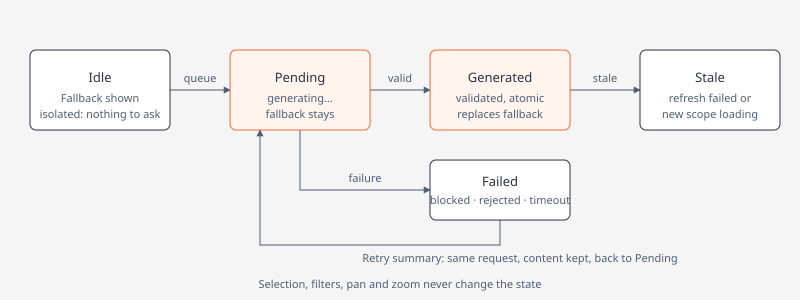

# Seeded topology mapper

The approved Graph first design opens a full relationship mapper from an exact
Brain or Intel record. Its default neighborhood contains two semantic hops of
persisted data. The canvas, inspector, relationship records, receipts and counts
consume one immutable snapshot. Production loading, empty and error states never
display a sample graph.

## Entry identity and return

| Entry | Seed |
| --- | --- |
| Brain memory (Enter) | The selected canonical memory ID, by its stored kind (Claim, Inference, Link, Related or Actor); opens at one hop. |
| Brain actor group (Enter) | Exact group name and retained member IDs; a display group does not merge canonical identities. |
| Intel Focus Brief claim | Exact article, run, revision, publication job and snapshot-local claim identity. Resolve through its matching publication/derivation. |
| Intel Focus Brief inference | Exact article, run, revision, publication job and snapshot-local inference identity; resolves to its current canonical Inference independently of Links completion. |
| Intel Focus Brief actor | Exact article metadata revision and scoped actor reference. Metadata-only actors remain actionable without extracted claims. |

Intel entries preserve typed records through formatting and measure the whole
visible wrapped record for focus and pointer targets. Display labels are never
parsed as IDs. Missing canonical publication retains an exact source projection
and reports its unresolved state, preserving Claim versus Inference type; opening topology creates no memories and runs
no models. Relational data remains usable while vector indexing is pending.

Selection changes the inspector. Recenter, including an edge endpoint action,
changes the seed and pushes topology history. Back first restores that history,
then the originating app, record, revision, page, scroll and focus. History retains
stable node/edge identity, filters, panel tabs, viewport transform and independent
inspector/relationship offsets. A changed or deleted origin gives a notice and
returns to a safe owner view. Esc dismisses an overlay before navigating back.

## Graph first components

Use `GraphCanvas`, `TopologyInspector`, `ListGeometry` / `ScrollPane`, `TabBar`
and measured action controls. `topology_layout::TopologyLayoutResult` owns pure
panel geometry; graph placement supplies the same clipped node/edge rectangles
to drawing, keyboard focus and pointer targets. Draw performs no database,
network or model work. Preserve the shared theme colors and semantic kind styles.

Dimensions below refer to the available body after the shared shell:

| Available body | Layout |
| --- | --- |
| At least 132 columns and 32 rows | Canvas left 65%, inspector/relationships right 35%. |
| 100–131 columns and at least 32 rows | Canvas left 70%, inspector/relationships right 30%, compact actions. |
| At least 60 columns and 18 rows, below the split threshold | Graph / Details / Controls pages with retained state. |
| Smaller | Reachable Back and a minimum-size notice. |

Back, title, origin, seed, depth 1/2/3, retained/current-cycle scope and snapshot
counts sit above the body. The graph uses deterministic hop columns, a seed
marker independent of selection, cell-measured labels, directed connectors and a
semantic legend. Crowded neighborhoods have a pannable extent. Zoom, pan, center
and Reset view change actual geometry. No decorative minimap is shown.

The inspector exposes full selected text, kind, hop, revision, provenance and
owner/recenter actions. Edge inspection exposes true source → predicate → target,
rationale, epistemic state, exact receipts and both endpoint actions. Related
similarity remains dashed and labelled potential context. Relationship records
retain the repository's normal blank-row separation and independent scrolling.
Keyboard and pointer navigation share visibility/filter rules; Tab focus remains
independent of activation.

## Snapshot and provenance contract

`Store::topology_snapshot` in `brain_topology.rs` delegates bounded query work to
`brain_topology_query.rs`. One SQLite read transaction supplies the snapshot and
authoritative `Store::memories_changed_seq`.

| Presentation | Recorded basis |
| --- | --- |
| Actor | Exact canonical actor and assessed redirects; no same-name union. |
| ActorGroup | Explicit members and recorded relationship binding receipts; grouping does not assess identity. |
| Claim | Canonical Claim or exact retained publication projection. Extraction support does not establish world truth. |
| Inference | Canonical Inference with retained derivation/premise receipts, reasoning and limitations. |
| Topic | Derived `insight_claims.topic` and Atlas category attributes, with normalized key and original receipts. There is no canonical Topic memory kind. |
| Article / Source | Exact occurrence/revision and provenance or evidence receipts. A publisher does not establish independent corroboration. |
| Link | A selectable directed edge retaining its memory identity, relation, rationale and receipts. |
| Related | Tentative adjacency with retained basis/revisions and verification gap; it is never required for direct mention/provenance edges. |

Discover neighbors in both endpoint directions while retaining each relationship's
stable direction. Traverse typed actor references, mentions, Links/Related,
inference premises, derivations and evidence. Canonical publication persists actor bindings on Claims and premise-derived actor associations on Inferences, retaining their kind and provenance. Each stage enqueues changed canonical records through the existing index outbox; new canonical premise writes use indexed relational evidence references for topology adjacency, which remains available while vector acknowledgments are pending. Historical rows without canonical relational receipts retain typed-JSON/local-ID fallback, resolved against the original carried snapshot and source revision. Resolve snapshot-local IDs only
inside their exact publication. Validate current artifact/URL/time identity
before attributing historical content to a current article. Group membership
retains member attribution and does not assert identity. Cycle scope follows
recorded origin joins.

Ranking is deterministic: traversal orders direct provenance/premise edges before
tentative leads. Final node admission protects the root and explanatory paths,
then orders by hop, predecessor, kind label and stable typed key. This bounded
selection does not guarantee every Source wins admission over other kinds.
Bound adjacency reads and candidate exploration as well as output. Every
edge endpoint and every retained predecessor path must exist in the snapshot.
Report visible/discovered counts, omitted nodes/edges, unresolved endpoints and
whether exploration is exhausted. Bounded discovered counts are not database
totals. Continuation is deferred: reject input tokens and emit no cursor.

One background read at a time coalesces newer requests. Generation and typed
seed/options fences reject obsolete completion, including same-seed option
changes. Accept snapshots atomically and preserve stable selection/focus on
reorder. Initial/new-query loading displays no old graph. A matching prior
snapshot can remain visible during refresh or after a read error with explicit
stale/error status. An isolated valid root has one node and zero edges; a missing
record is a separate state. Unknown coverage is unavailable rather than zero.

The [neighborhood summary](#neighborhood-summary) reads this snapshot but never writes canonical data. Scope analysis remains an explicit separate action. Verified canonical Claims
supply inference premises; canonical Actor references are revalidated. Links may
use canonical Claim/Actor/Inference or exact Article/Source endpoints. Retained
Claim/Inference/Actor projections are browse data, not canonical memory endpoints. This change does not modify Atlas
classification-only collection, independent Intel/Recon publication, provider
policy or schema.

## Neighborhood summary

Each seed shows a deterministic **neighborhood brief** at once, generates a
better explanation in the background with the Summarization role from a frozen
typed packet, and replaces the fallback only after the complete answer
validates. Failure keeps the fallback. Only summary cache, task and log rows are
written; there is no migration and no canonical write.

### Flow

1. **Fallback and frozen input.** Inside the topology read transaction
   (`brain_neighborhood_brief.rs`) bounded typed payloads (at most 160 reads)
   yield an immutable `NeighborhoodBrief` and `NeighborhoodInput` packet, owned
   by the snapshot. Nothing is parsed from labels or IDs.
2. **Queued generation.** `brain_neighborhood_brief_exec.rs` publishes the
   fallback and enqueues one deduplicated `topology_neighborhood` request
   (`POOL_SUMMARY`) in `argos_derived_summaries`. Request identity is the
   `basis_key` (seed, options, hydrated content and revisions, coverage, format
   version; node labels are part of it, so a rename produces a new request), the
   packet hash, prompt/output versions, budget and a secret-free route
   fingerprint. The worker renews its lease and runs the Summarization chain
   through `execute_chat`; the chain owns provider retries.
3. **Validate, then replace.** Output is buffered, then checked for schema,
   known typed references, kind/epistemic compatibility, relation direction,
   preserved qualifications and unsupported assertions. Only a valid result is
   cached and delivered by `TopologySummaryLoaded`, fenced by summary generation,
   seed, options and `basis_key`; it is assigned in one step and never moves
   focus. Every other outcome completes the task with a typed `topology_failed`
   tag.
4. **Bounded watching.** A background watcher polls every 750 ms (one read in
   flight, never a model request). It gives up on repeated poll errors or when
   the deadline (Summarization attempt timeout × attempt cap + 60 s) passes, and
   an unopenable database or an unqueued request is reported as a typed failure,
   so "generating" always ends. Auth, settings and the role runtime load on the
   worker thread, and the idle worker tick loads them only after claiming a task.

### States

Labels: `generating…`, `generated · <route>`, `blocked`, `rejected`, `failed`,
`timed out`, `stale · refresh failed` / `stale · loading the new scope`,
`limited coverage`, `isolated`, `seed not found`, `recorded brief`. Failures
offer **Retry summary** (same request, reset in place, content kept), **View
logs** and, when a model is missing or blocked, **Models**.

### Tabs and sizing

The inspector has **Summary** (default for a new seed) and **Record** tabs; the
Relationships panel keeps its own All/Articles tabs. Summary draws styled lines
built from the typed brief, cached per (basis, request generation, outcome,
width, loading/error), with independent scrolling and an `▲▼ rows a–b of n`
indicator. Activating a node, edge, related row or basis reference opens it in
Record without recentering; focus movement alone never switches tabs. History
restores the tab and scroll.

The details panel takes 75% of the inspector height (minimum 8; Relationships
keeps at least 5; Record keeps 55%): 1 tab row, 1–2 label rows, content, 1
indicator row on overflow and 1 button row on failure. Panel heights with
borders: 160×50 → 32, 120×40 → 24, 100×32 → 18, 80×24 → 12, 60×20 → 8 (two
content rows, cramped but scrollable). 60×18 and 40×20 show the size notice
with Back.

## Requested list density

Keep `LIST_ITEM_GAP_ROWS = 1` and existing `ListGeometry` constructors' defaults.
Explicit `with_gap` / `fixed_with_gap` / `capacity_with_gap` calls use zero gap
only for:

- Home application items;
- Ctrl+K commands, with nonselectable section headings preserved;
- Atlas headline feeds, cycle lists and retained article lists;
- Intel default category headlines, preserving all six category tabs.

Drawing, extent, capacity, reveal, offsets and pointer mapping use the same dense
geometry. Wrapped content remains contiguous. Brain, topology relationships,
Focus Brief Related, Recon, Tools, Models, Jobs, Logs and Profile retain their
existing spacing. The Profile Dashboard/Report layouts, 20 primary IDs, metric
semantics/history, Configs/System and portable configuration are unchanged.

## Rust API compatibility

Topology's public node/snapshot structs have new fields, and its seed/node-kind
enums have new variants. Rust callers using struct literals must initialize the
new fields; exhaustive matches must handle the new variants. Older serialized
snapshot fields remain readable through serde defaults, but readers must accept
the new presentation kinds.

Actor entries now preserve exact canonical identity; use an explicit ActorGroup
seed when aggregation is intended. Article keys include revision and ActorGroup
keys include membership: rebuild cached topology keys rather than parsing or
reusing old strings. Default depth is two; set `depth: 1` explicitly for the prior
scope. Continuation is unsupported and supplied tokens now return an error;
remove them and inspect bounded coverage fields instead. No database migration
is required.

## Verification and ownership

Core owns typed resolution/traversal and scope eligibility. The TUI app owns
request generations, typed entries, origin/history and actions. Layout owns pure
geometry; renderers consume immutable snapshots. Shared density helpers preserve
spaced defaults. See the [architecture figure](diagrams/brain-topology.html).

The offline gate is fmt → strict Clippy → workspace tests through the
[agent Cargo wrapper](../AGENTS.md#agent-cargo-isolation), with locked dependencies,
no default features and `ARGOS_EMBED` unset. Core fixtures cover disconnected
seeds, depth boundaries, local-ID collisions, revisions, namesakes, direct
provenance, inference/topic relations, source identity, budgets and path closure.
Interaction fixtures cover generation races, selection/recenter, stable focus,
origin restoration, filters, compact pages and keyboard/pointer parity.

Use fresh actual TestBackend captures per [TUI verification](tui-verification.md):
`dump_brain_topology_screens` / `topology-*` and `topology-summary-*` (committed in `screens/topology-summary/`),
`dump_topology_density_and_entries_screens` / `density-*` and `intel-topology-*`.
Review 160×50, 120×40, 100×32, 80×24, 60×20, 60×18 and 40×20,
plus 132/131-column and 100×34/100×33 height split boundaries. Include selected edges, controls, crowded,
isolated, loading, stale and error states. Record image observations separately
from interaction and data results; generation alone does not complete review.
