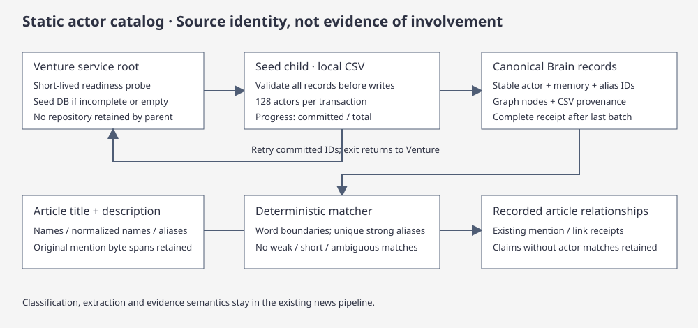

# Seeded actor catalog

[Core](core.md#brain) · [Storage](storage.md) · [Launcher](interfaces.md)

`@tag:brain-memory`

Brain actors come from the local `datasets/argos_actors.csv` catalog after its first seed. The CSV supplies stable `actor_id`, `actor_name`, `name_normalized`, JSON `aliases`, actor type and provenance columns. Catalog identity is a deterministic hash of the source actor ID; equal names never collapse different source IDs. All CSV columns remain in `brain_actor.provenance_json` and `catalog_json`. Actor memories and graph nodes use the same IDs. Source catalog membership is an identity reference, not evidence of involvement, current sanctions, recognition or wrongdoing.

## Catalog ingestion contract

The datastore importer validates the CSV before writing. The catalog is tracked through Git LFS and stored outside the executable. The current Venture client suite exposes actor reads. The [catalog source](../../../crates/argos-osint-core/src/actor_catalog.rs) and [storage contract](../../../crates/argos-osint-core/tests/storage_actor_catalog.rs) cover ingestion and retry.

The complete CSV is parsed and validated before writes. Empty inputs, missing columns, duplicate IDs, malformed CSV and malformed alias arrays fail rather than marking a partial import complete. Ingestion commits batches of 128 actors, aliases, typed memories, graph nodes and progress together. Stable record keys and insert-if-absent writes make a retry idempotent. A leased `brain_actor_seed:catalog` receipt prevents competing seed writers; interrupted processes become retryable after the five-minute lease. The receipt becomes `complete` only after all batches commit. This is an initial static catalog import; updating existing catalog identities requires an explicit reset/reseed, not a silent overwrite of analyst state.

## Article and claim association

A repository caches one deterministic multi-pattern matcher. Matcher initialization runs in an owning worker so an HTTP timeout cannot discard a partially loaded cache and restart it on the next request. Per-article reads check the catalog completion receipt directly; full actor counts remain part of explicit catalog status/setup, not every brief read. Title and description are matched first; the current retained cleaned article artifact is matched after cleanup. These texts are compared against canonical names, `name_normalized` and strong aliases with normalized Unicode letters/digits, collapsed punctuation/spacing and word boundaries. Matching retains byte spans into the original text. Short keys under three characters and `weak_aliases` are excluded. Aliases with multiple catalog owners stay ambiguous and do not pick a person or organization. Dataset-specific actor types map to Brain person/place/organization/unknown; their original values remain in provenance.

Phase 6 uses existing catalog matches even when metadata NLP is absent. An unseeded catalog leaves article/extraction names unbound; article processing never falls back to provisional actor creation. Mention receipts and `mentioned_in` links point to the seeded actor, so different articles reuse its identity. Intel API/TUI actor lists and brief context use the same matcher; extraction-only names do not add actors. Claim publication keeps claims whose subjects do not resolve, omitting those actor references rather than creating provisional identities. Existing classification, extraction, source revisions, claim/inference publication and relationship evidence rules remain in place. Catalog actors remain active without article support and are excluded from automatic identity normalization/deduplication. Explicit merge operations cannot merge catalog IDs.

Historical homes preserve their prior source-scoped behavior until the first seed activates catalog mode. An interrupted seed never falls back to creating source-scoped actors. A reset removes both catalog data and its receipt so an explicit import can start again. Default recall remains Claim/Inference; seeding does not schedule 95,000 model embedding requests.

## Verification

`actor_catalog` unit tests cover boundaries, Unicode spans, ambiguous aliases and invalid CSV. `storage_actor_catalog` verifies partial seed/retry, idempotency, completion/empty-table readiness, canonical matching without NLP and omission of unknown identities using the isolated storage harness. Run targeted commands through the [contributor workflow](contributing.md), with `ARGOS_SURREAL_MODE=embedded ARGOS_SURREAL_REQUIRED=1` for storage contracts.

## Read-only dossier

[Actor dossier reader](../../../crates/argos-osint-core/src/storage/actor_dossier.rs) reads only a selected canonical row, alias rows and its legacy Actor payload. It preserves source catalog ID and original `actor_type`; a missing catalog profile falls back to Brain subtype and neutral identity prose. Raw catalog JSON is never returned.

Supported `catalog_json.metadata` keys are `description`, `actor_type`, `country_of_origin`, `countries_operated_in`, `source_datasets`, `source_urls`, `origin_basis`, `operation_basis`, `operation_time_scope` and `license`. The country/dataset/URL fields are JSON-encoded string arrays in the checked-in CSV, decoded strictly; malformed values are unavailable and absent/empty fields are omitted. Attribution remains attached through catalog ID, source datasets/URLs and basis fields. URLs render as source text. Source dates and entity status are not activity or first-observed fields. Catalog ingestion remains unchanged. See the [HTTP and association contract](intel-web.md#actor-dossier).

## Article revision contract and repair

The native actor-index receipt binds the current derivative input revision, including admission, metadata and retained cleaned-body inputs. Its checksum binds that revision, actor coverage and the current index/identity contracts. Article mention rows and typed Article endpoints use `atlas_metadata::input_hash`, the source-content revision that topology validates. Index contract `atlas-actor-index-v7-publication-generation` invalidates older checksums. The index and native mentions bind the same publication batch and native input revision; public discovery, topology, provenance and dossier associations validate the current source/body/catalog generation before treating native output as current. Historical and independently curated evidence retains its own authority. A `Current` Actors derivative marker permits reuse only when the actual `atlas_article_index` receipt has the expected revision and a valid checksum. Claim and completion audits check this output under the same source fence, with at most 64 point reads; missing or stale output is reclaimed by the writer. See [actor indexing](../../../crates/argos-osint-core/src/atlas_actor_index.rs), [derivative storage](../../../crates/argos-osint-core/src/storage/classifier_admission.rs) and the [catalog repair contracts](../../../crates/argos-osint-core/tests/storage_actor_catalog.rs).

Actor inventory, index receipt, outbox effects and the remaining lifecycle cursor commit together. Deferred cleanup retains its original frontier after restaging or rejection and runs under a live cleanup capability; replacement publication waits for the prior batch to drain. Current actor discovery applies native-generation filters before its bounded page limit and carries the raw keyset cursor across any later audited exclusions.

The normal elected Brain backfill drainer reindexes retained occurrences in bounded batches. It uses the bundled local NLP engine on retained cleaned text and existing catalog aliases, without remote model calls. No dossier/topology read repairs or writes data. A genuinely revised article remains fenced out until indexing catches up.

Dossiers expose direct recorded Claim and Inference associations separately. Inference `premise` roles identify inherited premise association, never independent corroboration. Mentioned articles are linked by exact run/article occurrence. The topology can walk through those article nodes to their retained insights without manufacturing a direct actor–claim edge from a shared article.

## Retention and deletion

Single-occurrence deletion retires that occurrence’s native actor mentions and Link/Related endpoints in the same publisher transaction as the article removal. Automatic retention does the same for expired occurrences. If an investigated article protects part of an old run, retention preserves that article’s source contributions rather than deleting all insight sources for the run. Existing source/lifecycle reconciliation retires insights with no remaining source while preserving shared insights backed by another retained occurrence. Catalog actor identities remain present even when their last association disappears.

Active dossier and topology queries refresh once per minute, keeping the current snapshot during the read. This lets an open screen drop removed associations after background retention; it is not a new model job or an admission action.

## Cleaned-body enrichment

The Full article stage runs the local NLP engine only on a current `intel-clean-body-v1` artifact registered against the latest body version and its validated baseline acquisition (same attempt and raw hash). Raw page markdown, uncleaned baseline text and older cleanup artifacts are excluded. The engine returns normalized person and organization candidates with original byte spans. Only exact unique matches against existing catalog names and strong aliases become body actors; unknown names, places, weak aliases and ambiguous aliases are omitted. No article processing path creates catalog actors. NLP work runs off Tokio workers; incomplete annotations are retried and never cached as an empty success. Metadata actors retain their order and remain visible; body-only canonical IDs append once, with merged original spellings/spans for identities present in both sources.

Full article commit refreshes mention indexes for the article’s retained run occurrences; the normal backfill revision also includes clean source/version/artifact hash, so changed cleanup is rediscovered. Body mention receipts carry those three fields. Topology checks them in both directions and filters stale body spans while retaining still-current title/description spans. Retention uses the same occurrence cleanup for body and metadata mentions.

Canonical pipeline inputs include catalog candidates in source-specific namespaces (`body:<id>:actor:<canonical-id>` for body spans). Only entities inside the insight’s cited source ranges bind references; equal byte offsets in metadata and body cannot bind each other. Inferences record direct cited mentions separately from inherited premise roles. Canonical publication version 5 includes the entity roster in the snapshot key. No actor is assigned to a claim merely because the article mentions it.

If no actor is available while Full article cleanup is pending, the actor section shows its labeled skeleton and omits a verified-zero count. Existing actors, including retained ready cleaned-body matches, remain visible with a compact “checking cleaned article” indicator. A queued or running Body stage keeps `actors_body_pending` true even when those retained matches are available. Completion appends matches or shows verified empty; failed cleanup shows incomplete detection instead of an indefinite loader.

## Metadata-first recovery

The matcher includes canonical names and a curated short-form table keyed by catalog source ID (`Trump` → `os:Q22686`). Existing seeded homes use that table without reset/reseed. Shared aliases still remain ambiguous; arbitrary surnames never bind automatically.

Actor index contract v6 commits title/description mentions even when cleaned-body NLP is incomplete. Body annotation readiness participates in the receipt checksum, so later enrichment remains eligible. Catalog dossiers/topology also admit historical source-scoped actor IDs only through aliases that uniquely resolve to the selected catalog identity. This is a read projection, not a merge or a claim that co-occurring actors share every insight.
