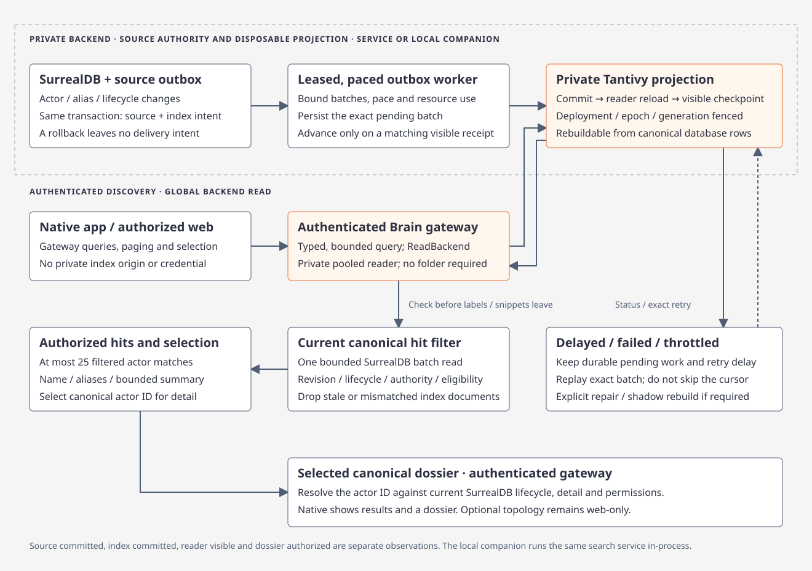

# Actor discovery search

[Code route](index.md) · [Actor catalog](actor-catalog.md) · [Storage](storage.md) · [Classifier](classifier.md)

`@tag:brain-memory` · `@tag:discovery-services`

Actor discovery uses a private Linux Tantivy service behind the authenticated
gateway. SurrealDB actor, alias, lifecycle and dossier records remain authoritative.
The shared backend corpus is independent of native workstation identity and preserved legacy folders. The
desktop receives canonical actor IDs and bounded gateway projections; it receives
no index origin, write token, filesystem path or engine document address.

Native Search checks actor names, aliases and article text from one field. The **Actors** avatar opens a browse view that reads shared, active canonical actors in ID order through `GET /api/v1/actors/browse`. Both HTTP and Embedded IPC use the backend read permission. Browse results do not require a serving search index. Each page contains up to 25 projections and includes a continuation when more eligible records exist. The native list loads as the reader approaches its end and retains up to 480 actors. Return to the search field to narrow a larger catalog.

## Ownership and entry points

| Source | Responsibility |
| --- | --- |
| [search-index](../../../services/search-index/README.md) | Exact Tantivy 0.27.0 dependency, private transport, owned directory lock, one writer/merge budget, readers, commit payload and generation recovery |
| [Private index protocol](../../../crates/fleetworks-contracts/src/actor_index.rs) | Source/generation/revision/checksum/lease DTOs, bounds and resource policy; no engine dependency |
| [Gateway discovery contract](../../../crates/fleetworks-contracts/src/search.rs) | Bounded query, canonical hit and explicit index-state DTOs; separate selected dossier route |
| [Transactional outbox](../../../crates/argos-osint-core/src/storage/actor_search_outbox.rs) | Source intent, projection revisions, coordinator lease, exact pending body, visible acknowledgement and causal indexing children |
| [Shadow rebuild](../../../crates/argos-osint-core/src/storage/actor_search_rebuild.rs) | Durable canonical keyset scan, delta catch-up, recovery, barrier and serving-generation receipt |
| [Index worker](../../../services/api-host/src/actor_index_worker.rs) | One pooled private client/coordinator, persisted retries, heartbeat and lifecycle commands |
| [Gateway filter](../../../crates/argos-osint-api/src/actor_search.rs) | Private search call and current canonical eligibility/revision/projection checks before labels are returned |
| [Workstation readiness](../../../crates/argos-osint-api/src/workstation.rs) | Actual source and service observations without seeding or repairing on read |

The public discovery request is
`GET /api/v1/actors/search?mode=discovery&query=…&limit=…`.
It has a nonempty plain-text query, at most 256 UTF-8 bytes, 16 query tokens and 25
results. Exact names, exact aliases, name/alias terms, bounded prefixes and
description are separate retrieval tiers. Unicode analysis preserves names
without English stemming/stopword deletion; canonical ID breaks ties. Scores rank
retrieval and do not establish identity confidence or evidence of involvement.

The gateway bulk-reads current canonical candidates and excludes missing,
ineligible, changed-revision or changed-projection hits before returning labels,
snippets or countries. A changed candidate marks the bounded response stale or
truncated. Selecting a result separately reads
`GET /api/v1/actors/detail?id=…` from authoritative storage. Deterministic name,
alias-ambiguity and ingestion binding functions retain their own domain contracts.
Discovery failure has an explicit index state and reason; it does not switch to
another search engine or present an unbuilt index as a successful no-match.

## Source transaction to visible acknowledgement

Seed chunks commit actors, aliases, memory/graph records, progress and projection
intent in the same source transaction. Rollback leaves no projection event.
Canonical writer hooks cover alias/name updates, redirects and actor visibility,
including direct typed Actor memory writes. Reconciliation also arranges missing
work when an existing pinned seed is retried. Discovery projections come from
bounded canonical database snapshots, never directly from uploaded CSV bytes.

The search projection retains the canonical actor ID and name. Optional aliases
are selected from the first 64 indexed rows in stable name order
within the index's 256-byte value, 32-alias, word and prefix budgets;
oversized or excess aliases remain in SurrealDB and
are available through canonical actor details. Optional descriptions whose
tokens exceed the search analyzer bound are omitted from the index. Optional
country facets retain the first 32 distinct values in stable sorted order;
all countries remain in canonical actor metadata. These
projection limits keep one unusual catalog record from blocking later actors
during a durable rebuild.

Each actor head has a monotonic revision. Events have contiguous source sequence
numbers; ineligible or missing canonical actors produce revisioned tombstones.
The service rejects an older projection revision and an equal revision with a
different checksum. Tombstone fences are retained; automatic reclamation is
unavailable.

One deployment/index-resource lease elects the coordinator across replicas. It
persists the exact pending batch before HTTP delivery. Retries preserve its body,
batch ID and content checksum; a newer legitimate lease can change only the
coordinator epoch without changing that content identity. Source changes during an
uncertain delivery become later work, not a replacement for its saved body.

The receiving service validates the entire batch, applies it with the owned
writer, commits documents and checkpoint/revision/replay metadata together, then
explicitly reloads and publishes the matching immutable reader. Only a receipt
whose checksum, generation, epoch and committed/visible checkpoint match the
persisted pending batch advances the database serving cursor. Lost replies replay
the same work. This is at-least-once delivery across two stores; there is no
cross-service atomic or exactly-once claim. The service retains 64 recent batch
identities and rejects an expired replay rather than guessing progress.

Actual attributed setup creates a durable causal indexing child under its real
parent Job. Its committed source range remains pending until serving visibility
covers it; a partial source import stays labeled partial. System calls without a
genuine parent remain unattributed. Native maintenance additionally carries an
opaque [SeedExecution](../../../crates/argos-osint-core/src/storage/actor_seed_execution.rs)
from the actual task claim. Initial ownership, pressure renewals, chunks and
completion recheck current owner/epoch/live lease/cancellation under the parent
job guard alongside the existing source seed lease. Client origin fields do not
construct this execution identity.

## Rebuild and recovery

An authorized registered maintenance request to
`POST /api/v1/search/actors/reindex` creates or associates with a durable shared
Reindex Job. Its consumer is enabled only with the configured real index pump.
Status, query and readiness reads do not start work. Workstation Status, Inbox,
and the shared **Status checks** table label automatic catch-up as background
indexing. The Jobs & Logs rail badge follows the registered workstation’s active
tracked jobs, including a
queued, running or retrying actor reindex, while another destination is open.
In Workstation Status, the **Actor search** row’s **Build actor index** icon
opens a confirmation dialog when the backend admits the action. `Escape` cancels
and restores focus to the icon. Before issuing the HTTP POST, the native client
persists the pending `reindex_actors` request ID and `original_registration_id`
so uncertain delivery or network drops reconcile read-only via
`GET /api/v1/workstation/requests/detail`, clearing the durable journal on
terminal HTTP 4xx errors (`BadRequest`/`Unauthorized`/`Forbidden`/`NotFound`/
`Conflict`/`UnprocessableEntity`). When the correlated Jobs row transitions into
a terminal state (`Completed`, `Failed`, or `Canceled`), the native client
automatically refreshes `/api/v1/workstation/readiness` without polling timers.
The failed job's **Retry job** control has its own permission, ownership and state
checks; a new readiness action can resume the retained shadow rebuild without
weakening those checks.

The coordinator keeps a separate scan cursor, exact pending shadow batch and
visible delta checkpoint. It scans canonical keys in bounded pages and gives
delta catch-up a turn after three scan pages. Ongoing source writes remain in the
outbox. The active writer closes before the shadow writer opens, sharing the
same writer/merge budget; queries continue against the last verified reader.

After scan and delta catch-up, an explicit complete barrier must be committed and
visible in the replacement. Promotion atomically publishes a synced manifest
switch; the database serving cursor and causal completion advance only after its
matching receipt. Source changes after that barrier become ordinary live work.
An explicit rebuild may supersede a permanently rejected live body, retaining
that exact body and source events until promotion. If the old reader is ahead
after an uncertain commit, that checkpoint must match the saved body's exact
through-checkpoint; unknown remote work is rejected.

Corruption, incompatible metadata, wrong source identity and writer contention
remain visible. An explicit repair requires intact owned manifest evidence,
physical checksum and current source/epoch fencing. It preserves failed bytes,
resets the shadow scan, and permits at most three repair restarts per rebuild
before correction is required. Active-storage failure can require service restart
before explicit recovery. An empty repaired baseline reports not-built until a
verified replacement is serving.

The service retains up to 64 inactive generations plus one active and at most one
shadow. Separate private explicit retirement names the inactive generation and
expected serving generation/checksum/epoch. It refuses active/pending generations,
unsafe file layouts and stale evidence; its journal reconciles interrupted
cleanup. There is no arbitrary path endpoint, recursive blind deletion or
automatic generation/tombstone GC. Configuration reset and retained legacy workspace
retirement paths preserve this shared corpus and index.

## Shared bounds and pressure

The validated [ActorIndexLimits](../../../crates/fleetworks-contracts/src/actor_index.rs)
policy applies to one backend resource, not once per native workstation.

| Control | Current starting policy |
| --- | --- |
| Batch payload | At most 500 mutations / 2 MiB, whichever first; canonical source pages additionally cap at 128 actors |
| Delivery | One write in flight; at most two persisted batch bodies, including retained live recovery evidence during a rebuild |
| Start rate | At least 500 ms spacing, persisted across replicas/restarts; no catch-up burst |
| Partial tail | Default one-second flush or source scan end when capacity permits |
| Query capacity | Separate four-search default; blocking work and permits survive uncertain HTTP timeouts |
| Writer | Default 64 MiB budget, one writer thread and one merge thread shared with shadow work |
| Index RSS | Pause/resume at 384/320 MiB by default |
| Free disk | Pause/resume at 256/512 MiB free by default |
| Source backlog | Pause/resume bulk production at 500,000/250,000 unacknowledged events |

Linux RSS and free disk are actual OS observations. Query/commit EWMA, high/low
hysteresis and cooldown probes protect the serving reader. Unknown measurements
fail closed; stale service observations pause bulk source work. Retry-After is
persisted without shortening a valid server delay to the local backoff cap.
Transient failures back off and cool down; authentication, identity, schema or
oversize conflicts preserve intent for correction.

[NativeWorker local pressure](../../../services/api-host/src/native_bulk_pressure.rs)
also gates bulk admission using its own RSS and workspace free disk. Its
[bounded actor parser](../../../crates/argos-osint-core/src/actor_catalog_bounded.rs)
limits raw records to 64 KiB, headers to 64 fields, rows to 100,000, retained
actors/IDs/metadata to at most 32 MiB (less with limited memory headroom), and
name/alias expansion before transaction construction. Cancellation/resource probes
run during parsing. A validated upload can still fail an explicit worker budget;
the retained input is dropped before source writes. Later pressure cancels and
awaits owned work, retaining honest committed partial source/index intent.

Tools has an independent bounded execution lane. Seed and Natural training share
one process bulk slot; the relay continues while an operation waits. Database
resource fences remain authoritative across replicas. These controls describe
implemented limits, not measured production capacity or latency guarantees.

## Readiness and verification boundaries

`Database seeded` requires the authoritative seed receipt. `Actor search ready`
also requires matching deployment/source/generation, complete scan/source state,
zero observed lag and reader-visible acknowledgement with no pause/recovery
condition. A successful status health probe can coexist with not-built, indexing,
stale or degraded search. Service failure preserves successful source import and
the last verified reader where available.

Neither state establishes NLP/model readiness. Optional Natural training does
not install or validate the Linux Rust-BERT worker/checkpoint used by fresh Atlas
cycles. Model availability, pinned inference and artifact activation have their
own [classifier contracts](classifier.md).

The recorded pre-parser checkpoint passed 13 search cases on the host Mac: nine
real temporary-disk/generation/recovery cases, two HTTP/pacing cases and two
controlled pressure cases. Eight focused required-server Core fixtures passed:
four [outbox](../../../crates/argos-osint-core/tests/storage_actor_search_outbox.rs)
and four [rebuild](../../../crates/argos-osint-core/tests/storage_actor_search_rebuild.rs)
cases. Core fixtures exercise actual isolated registration/admission/storage and
model the authenticated service receipt boundary separately from real Tantivy
disk tests. These counts do not establish a Linux source-to-visible journey.

The later bounded-parser/local-worker-pressure/exact-task-fence increment has
separate tests, including
[seed execution](../../../crates/argos-osint-core/tests/storage_actor_seed_execution.rs);
its evidence must be recorded after actual execution. The
[acceptance tracker](https://github.com/xxxcess/argos-osint/blob/15577471cf1e6d0472e918b96ff6868f4834fccf/.planning/2026-11-11-rune-macos-cutover/acceptance.md)
owns current pass/fail/skip results. Use the existing required storage harness,
matching shared debug graph and one build owner through
[testing/cache guidance](contributing.md#build-cache-hygiene).

Pending system evidence includes actual isolated Linux database → outbox → index
→ gateway/dossier delivery and restart/rebuild recovery, injected reload/disk-full
failures, concurrent queries under ingestion, measured idle/loaded latency,
throughput, RSS/disk/lag, and native AMD64 plus ARM64 runs. Proposed commands,
source review, fixture policies and native screenshots do not satisfy those
gates. Deployment starts from the
[isolated backend recipe](../../../deploy/README.md#isolated-native-backend-review);
the desktop never starts or stops those services.
