# Architecture

[Code route](index.md) · [Wiki](../../index.md)

## Fleetworks service boundaries

[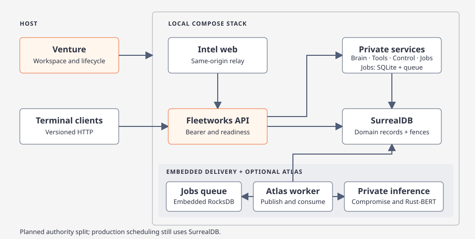](../../diagrams/fleetworks.html)

| Component | Owns |
| --- | --- |
| [Rune macOS desktop](../../../apps/fleetworks-desktop) | Native pages, input and accessibility; protected installation identity and origin-bound Keychain references through the [workstation library](../../../crates/fleetworks-workstation); bounded gateway requests through shared [contracts](../../../crates/fleetworks-contracts). Connects to independently running services. |
| [Intel Web](../../../apps/web-desktop) | React Native Web presentation, topology and its accessible list, Connect/session gate, and a same-origin server relay using its separately provisioned gateway credential. |
| Linux backend: [API](../../../crates/argos-osint-api), [service host](../../../services/api-host) and [Core](../../../crates/argos-osint-core) | Authenticated gateway/live streams, private services, durable workers, shared configuration and domain storage. Linux owns [classifier/NLP execution](classifier.md), [Tantivy discovery](actor-search.md), SurrealDB and [Jobs persistence](../../../crates/fleetworks-jobs). |

External operator tooling owns deployment origins, service processes, images and volumes. The Compose recipes publish their selected gateway/web ports on loopback; the isolated backend-only review recipe omits the web app. The gateway reaches private Brain, Tools, Control, Jobs and execution roles, plus configured Linux NLP, classifier and search services. Actor discovery uses private Tantivy behind the gateway's current canonical eligibility checks; selected dossiers come from authoritative SurrealDB. The Mac app receives bounded gateway projections and keeps engine, index and deployment ownership on Linux. [Actor discovery ownership](actor-search.md)

Direct [Docker Compose](../../../deploy/README.md) operates backend services and optional Intel Web. Venture, the six terminal clients and legacy `argos` are retired. The Rune app connects to the gateway and never starts a backend, web server or container. [Service startup and roles](fleetworks.md)

Native [pairing and Keychain](native-connections.md#pairing-and-keychain-agreed-target) separates public challenge start/poll from Operator approval and authenticated APIs. Settings contain non-secret recovery references; macOS Keychain holds polling/access secrets. Explicit operator/headless token-file mode is independent. [Verification](../../../.planning/2026-11-12-native-pairing-implementation/acceptance.md) remains separately recorded.

The brief worker runs stages and publication. Atlas uses a Jobs-owned embedded delivery queue with a collection worker and private NLP and classifier services. SurrealDB owns job execution state and domain records. Jobs exclusively owns disk-backed SQLite operational logs; scheduler cutover is pending the domain handoff and fencing migration.

## Persistence

`@tag:surreal-storage`

Service processes share the explicitly configured private SurrealDB endpoint. The standalone Compose recipe provisions a persistent authenticated database; independently managed deployments supply their own endpoint and credentials. [Storage map](storage.md) · [Planned Jobs ownership and rollout scopes](jobs-persistence.md)

[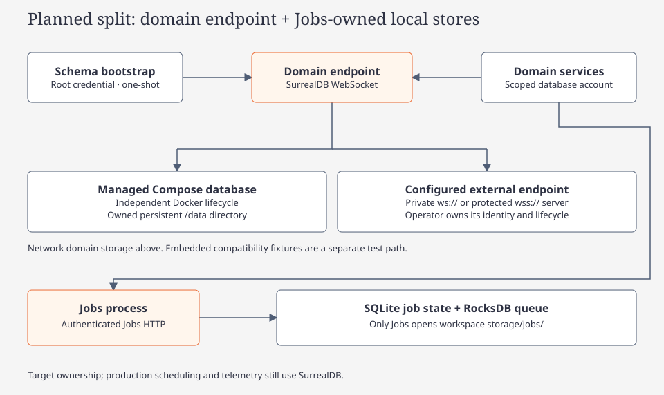](../../diagrams/persistence.html)

[storage/bootstrap.rs](../../../crates/argos-osint-core/src/storage/bootstrap.rs) applies module schemas in dependency order and guards the stored schema version. [storage/tx.rs](../../../crates/argos-osint-core/src/storage/tx.rs) owns bounded transaction retries. Publication, provenance and graph projection are implemented under `storage/`; [recall.rs](../../../crates/argos-osint-core/src/storage/recall.rs) serves fenced vector recall with lexical fallback.

## Model and UI boundaries

[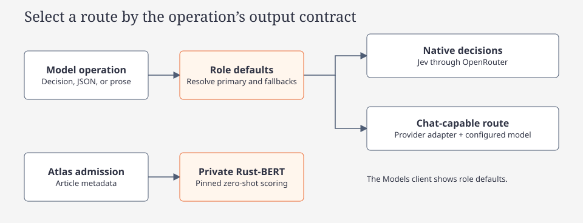](../../diagrams/model-roles.html)

The native Models page reads and saves the selected backend's configured role defaults. The [shared provider executor](../concepts/providers.md) resolves primary and fallback routes, tracks attempts and keeps provider credentials server-side. Network model scheduling uses database-clock pacing and cooldowns for OpenRouter, Google and Nvidia, plus shared account tickets with interactive priority and lease expiry. Retained API-key model attempts cross an authenticated private execution boundary. The caller owns retries, validation and the shared account lease. The execution service resolves provider credentials and pacing for those attempts. Local model endpoints and the ChatGPT subscription stay in the calling process. Atlas's daily news provider admission uses shared datastore reservations. [Model scheduling](../../diagrams/model-request-scheduling.html)

| Boundary | Owner and rule |
| --- | --- |
| Native controls | Model Assignments edits configured keys/routes; Tools is cards/key modal; no Profile, manual execution or portable configuration screen. [Control allowlist](native-design-system.md) |
| Workstation identity | Contract 2 uses authenticated scope + installation marker; opaque workstation ID is Connect ID, IP is optional metadata. New requests have no workspace narrowing. [Registry](../../diagrams/connect-registry.html) |
| Historical authority | Atomic migration keeps IDs/mappings/origins, fences legacy admission and revokes old sessions. Original request/context is recovered read-only; no replacement submission. [Connections](native-connections.md) |
| Local settings | Origin-bound Keychain references and durable pairing recovery, not token bytes. URL-only setup creates no default child; preserved folders/journals are historical. [Identity](native-workspaces.md) |
| Backend activity | Membership/private eligibility before projections; accepted creators remain immutable. Missing context never falls back globally. [Origin and activity](../../diagrams/brief-job-context.html) |

[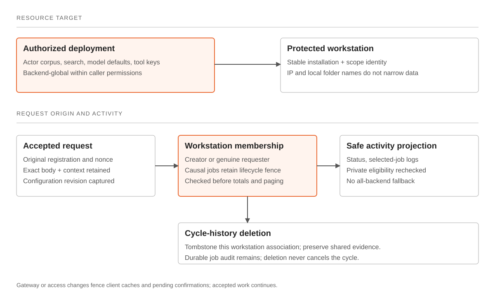](../../diagrams/workspace-scope.html)

## Brain browsing and direct associations

The private Brain role serves retained reads through the gateway. The internal `brain_browse` projection uses the same Brain storage and recall helpers. Stable rows are Claim(memory ID) or ActorGroup(normalized display name, every member/resolved/redirected ID). Grouping precedes Find and counts and never changes identity resolution. Typed claim and atomic-claim records can appear in the browse projection alongside supported historical claim records.

Direct associations union the actor-reference index, typed Claim payloads and locally repaired retained derivations, exact article mentions/observed endpoints, claim origins and opt-in thread detections. Claims and threads deduplicate by ID; articles deduplicate by canonical URL while retaining exact occurrence/revision receipts. Missing, deleted and stale origins are excluded. Actor Articles counts direct retained mentions, observed links and claim origins regardless of Related eligibility; Claim Sources retain original provenance. The graph covers the entire set; row paging does not cap graph coverage.

Claim publication synchronizes typed actor refs and the reference table inside the publication transaction. Readable names come from retained entity labels, with canonical fallback; entity IDs remain separate. A versioned local backfill repairs machine ID spellings without overwriting analyst names and recovers referenced actors only from retained extraction/spans. Recall-off creates no new thread associations; earlier receipts survive until their origin is deleted or replaced. Exact actor and claim identities resolve to their typed topology seeds.

[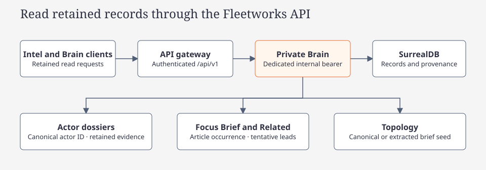](../../diagrams/brain-browse.html)

### Source removal and index eligibility

Article and investigation deletion reconcile current `insight_source` in the same SurrealDB transaction. Deleted origins stop contributing to source counts. A retained occurrence of the same article, another article or a live Recon source keeps shared evidence active. Unsupported canonical Claim/Inference rows are retired; their typed rows, IDs and historical snapshots remain stored. Explicit insight deletion and legacy cycle cleanup retain their existing canonical-row deletion behavior, with durable vector removals. Actors backed by sources and dependent Link/Related records also retire when their support disappears, including shared identifier actors and legacy Atlas scopes. Analyst pins and manual records retain their existing actor lifecycle protections.

Every non-active typed memory is excluded from browsing, recall, upserts and index rebuilds. Reconciliation commits durable `index_remove` work with lifecycle changes; the index worker rechecks current eligibility so an older removal cannot erase a reactivated record. Reactivation queues current content again when needed. The actor maintenance tick also repairs pre-existing stale source/index state without opening vectors under a database transaction.

[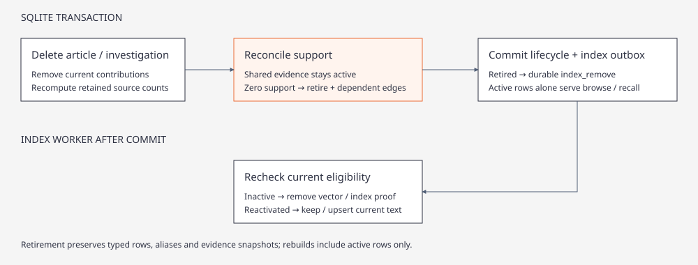](../../diagrams/brain-source-lifecycle.html)

### Actor identity maintenance

All Atlas mention, Recon thread and claim-subject bindings share `brain_actors`. The comparison key strips terminal ASCII/Unicode English possessives and normalizes case, punctuation and whitespace; source spans retain exact original spellings. Names are candidate keys, not cross-source identity. Rebinding revives a retired actor; replacing an article inventory replaces all of that occurrence's mentions and observed links, including metadata corrections with an unchanged source hash. Article deletion and source-edit repository paths (including pruning) clear dependent mentions, edges and receipts through `storage/atlas_delete.rs`, `storage/atlas_metadata.rs` and lifecycle reconciliation. Reconciliation retires unsupported ingest actors while preserving pinned records, active claim evidence and surviving merged-family contributions. Brain change notifications invalidate cached counts.

Actor maintenance passes non-identifier labels through the shared local NLP worker before acquiring the SurrealDB write transaction. Boundary verbs are removed only when a confident entity remains (for example `Allow FBI` → `FBI`); ambiguous person names, branded phrases, account/domain/IP identifiers and original source spans are preserved. The canonical display/text is updated under the same actor ID, old spellings stay as aliases, and the changed memory is reindexed. Busy or failed parses leave retryable normalization receipts; NLP Off uses lexical normalization only.

The elected `argos-actor-dedup` worker runs independently of Atlas and browsing, every 30 seconds after its previous tick. Its **Actor identity maintenance** service job repairs up to 100 historical actor rows per tick using revision receipts; only normalized spellings within one source scope merge locally. Token/acronym posting lists propose up to eight contextual identity decisions per tick, including compatible unknown/typed candidates. Each pair includes bounded retained article/thread/claim context. Missing Entity Resolver configuration leaves local repair operational with zero model requests.

The shared executor routes the Entity Resolver's bounded `same` / `different` / `uncertain` decision through native Decisions or constrained chat, with ordinary admission, retries, fallbacks and cancellation. No model request holds a SurrealDB transaction. `brain_actor_dedup_receipt` caches assessments by pair, sampled context, actor revision and prompt version; errors retain diagnostics and a ten-minute retry cooldown. A durable pair lease fences competing workers. Before applying a result, the writer rechecks canonical IDs, input hash and unexpired lease. Only `same` merges, preferring the fuller name; redirects retain old IDs, references and provenance. Explicit Split records a persistent separation so maintenance does not undo it. Merely equal names or shared surnames do not merge actors or establish corroboration.

[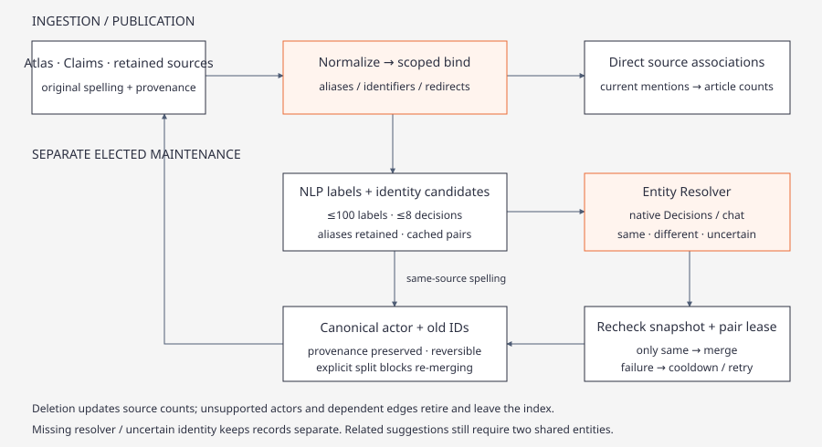](../../diagrams/actor-identity.html)

## Brain Memory Topology and Scope Analysis

`Store::topology_snapshot` (`brain_topology.rs`, `brain_topology_query.rs`) resolves
typed canonical or exact retained-source entries into an immutable neighborhood.
The default is two semantic hops (selectable 1..3). Brain graph panes preserve
Claim/ActorGroup identity; Intel claims and inferences resolve through their matching publication
job/local ID and derivation snapshot as soon as that kind publishes, and metadata actors through scoped retained
references. Unindexed records retain source-scoped identity without writing data.

- **Scope and bounds**: All retained/current-cycle scope uses recorded origins. Bounded adjacency traversal and output preserve root/path/edge endpoints and report discovered/omitted/unresolved coverage. Continuation is not implemented: incoming tokens are rejected and no pretend cursor is emitted.
- **Nodes and relationships**: Exact Actors and explicit ActorGroups remain distinct. Claims, Inferences, derived recorded-attribute Topics, Articles and Sources carry exact recenter seeds and provenance. Direct mentions and evidence do not require similarity. Claim subjects bind canonical Actors; Inferences retain canonical Claim premises and their actor associations, with indexed relational evidence references and canonical index-outbox revisions. Canonical premise IDs remain authoritative across staged replacements; reused local claim IDs cannot rebind historical inferences. Links retain direction/rationale/receipts; Related remains tentative. Publisher identity and duplicate occurrences do not establish independent corroboration.
- **Background Scope Analysis**: Explicit candidate proposal and link assessment executes on background worker pool `POOL_BRAIN_SCOPE = "brain_scope"` (`scheduler.rs`, `tasks.rs`). The worker uses `Store::open_light`, validates canonical premises/actors, writes inference memory and metadata, and writes qualified Links. These are separate writes rather than an atomic brief publication. Retained-source projections are not eligible canonical premises.

- **Neighborhood summary**: Topology reads build an immutable deterministic fallback and a frozen typed packet (`brain_neighborhood_brief.rs`) without queueing generation. The existing explicit Generate action alone admits a deduplicated `topology_neighborhood` request in `POOL_SUMMARY`. Eight additive facets retain the compatible Overview/Connections/Interpretation/Limits prose; sparse facets stay empty with truthful limits. Packet caps are 100 nodes/200 edges, or a stricter caller limit, with closed endpoints and recalculated omission counts after byte pruning. Only complete reference/meaning/qualifier validation permits a seed/options/basis-fenced replacement; failure keeps the fallback. No migration and no canonical writes.

The [topology mapper specification](../concepts/topology-mapper.md) defines entry identity,
responsive layout, interaction and coverage contracts.

[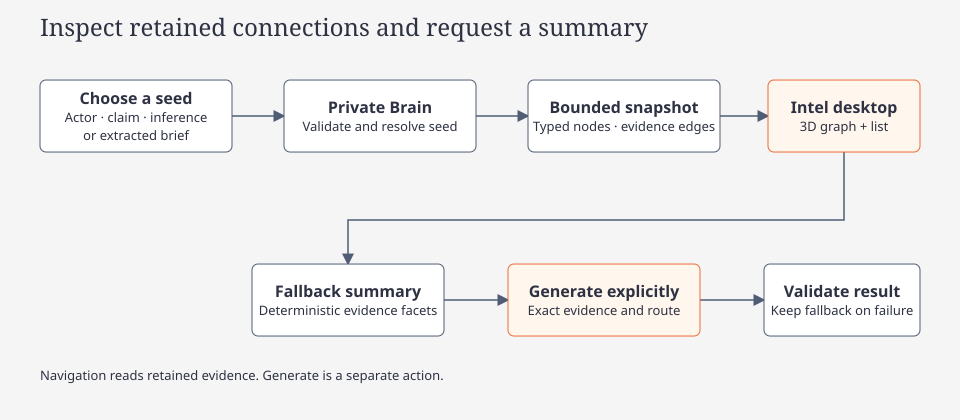](../../diagrams/brain-topology.html)

## Intel reports

Article Recon report execution is historical. `create_report_job`, resume/retry and worker entry reject execution. Startup retirement revokes unfinished report and descendant leases, records durable retirement markers and signals workers. It preserves historical result bundles and provenance, leaves brief chains and article owner generations intact, and fences late report publication.

[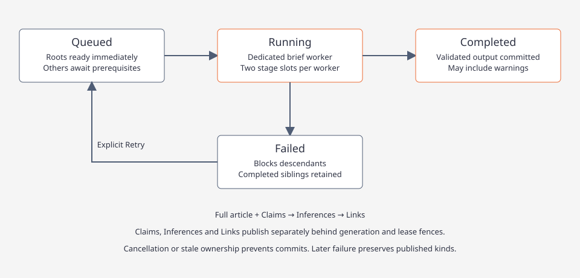](../../diagrams/intel-job-states.html)

## Atlas

[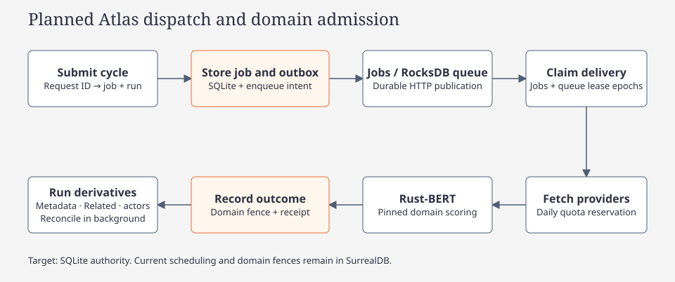](../../diagrams/atlas-pipeline.html)

`atlas-collection-v3` pins the Rust-BERT worker, checkpoint and threshold before new acquisition and admission. Fleetworks delegates inference to the private classifier service. Native discovery reserves the shared daily provider-account quota before fetching. Country heat bands and deduplication apply to acquisition. Every evaluated occurrence has a durable outcome; admitted articles publish one primary and an optional supported secondary domain. Metadata, Related and actor/lifecycle indexing use scoped receipts under the same source and ownership fences. Cycles publish no claims or generated briefs and require no vector work.

| Stage | Execution | Unit |
| --- | --- | --- |
| Discovery and coverage | GNews/NewsData, then NewsAPI/Currents, with transactional daily quota admission and heat bands | Article |
| Local admission | Rust-BERT zero-shot scores for six domains in bounded batches. Resume uses the exact saved model pin | Article occurrence and immutable outcome |
| Entities | Complete original title and description. Bounded NLP runs in the private service with the Atlas overlay. | Article metadata |
| Publisher prior | Immutable native WP:RSP index per pass; domain suffix match | Article metadata |
| Related | Local posting lists and verified spans; shared mentions are tentative leads | Canonical article pair |
| Actor and lifecycle indexing (phase 6, `STAGE_ACTOR_ARTICLES=12`) | Brain Actor binding, `mentioned_in` Links, at most 20 tentative Related records and current occurrence receipts; bounded pages and conditional publication | Article occurrence |

Collection completion requires settled admission outcomes and durable derivative handoff. Independent actor and reconciliation readiness track current admitted occurrences separately; an article with no actor still receives an index receipt. Operationally unresolved work remains retryable/partial; valid rejection has its own outcome and never becomes `unk`. Pausing preserves checkpoints; resuming acquisition/admission requires the exact saved model and manifest. Proven derivative-only continuation can complete without loading a classifier. Retained legacy tags remain historical facts and cannot establish current domain membership. [Historical maintenance](classifier.md#historical-admission-and-provider-monitoring) is an explicit separate job; it preserves original source, evidence and cycle statistics. Terminal cycle publication atomically outboxes provider monitoring to a separate scheduler pool. Zero-shot cycles record monitoring evidence without fitting or promoting a classifier.

## Discovery-index overview

Three discovery services power catalog lookups, all backed by schema-v2 SurrealDB FULLTEXT indexes:

- **`search_actor_names`** — exact normalized form → actor IDs + match reasons + revision; active canonical names only; collisions stay ambiguous; diagnostics `catalog unavailable` / `query too short` / `unsupported type`; limit 1..=25.
- **`search_actor_aliases`** — aliases with strength `curated`/`catalog`/`learned`, `alias_type`, `provenance`; ambiguous when >1 live owner; exact + bounded prefix tiers on the alias index; owner-union merge.
- **`search_articles`** — two per-field FULLTEXT BM25 on schema-v2 title/description indexes; title weighted above description-only; deterministic ties; matched-field attribution; rank = BM25 of matched field — relevance is NOT confidence; bounded excerpt on original byte offsets; dedup by article id; cursor ≤4096, page ≤50; category-membership/day/source/run filters; related candidates exclude the seed and are not corroboration; stale/pending/discarded/deleted hits rejected by construction — canonical corpus is admitted-only.

Index maintenance: FULLTEXT + categories indexes are engine-maintained atomically with admission/delete transactions. Matcher rebuilds coalesced off async workers via process-wide `catalog_epoch` + `MatcherCache` (stale-epoch single-flight rebuild, RwLock old-or-new swap; epoch bumps on catalog seed and merges). Curated alias backfill with provenance at matcher load, idempotent. Incomplete catalog readiness is `catalog unavailable`, never empty success.

NLP-off body matching: word-boundary exact pass always runs on cleaned bodies; NLP person/org pass is enrichment only (contract flip of the old "body requires NLP" rule).

Recon integration: turn-start and material-gap discovery now search BOTH actor and article indexes (recon/orchestrate.rs discover_catalog_articles / replan_discovery); lookup never creates actors or claims; Jev cannot override identity ambiguity.

API: `GET /api/v1/articles/search` → `ArticleSearchPage` {hits with article id/revision, excerpt, matched_field, rank, categories/source, revision fingerprint, next_cursor}; capabilities feature `"article-search"`.

Current domain filters use `governance`, `security`, `economic`, `human`, `environmental` and `scientific`. Historical seven-topic tags remain explicitly legacy; a matching string alone does not establish current membership. See [taxonomy](../concepts/strategic-domains-taxonomy.md).

See [classification and Related articles](../concepts/atlas-classification-and-related-articles.md) for metadata storage, receipts, publisher scores, exact lineage, deletion and navigation. The Atlas view exposes country bands, map, origins, history and retained headlines. Coverage summarizes the current cycle.

GNews, NewsData, Currents are catalog tools for manual runs and omitted from the Recon picker.

## News and Legal context tools (#29)

`newsapi_search`, `newsapi_headlines`, `courtlistener_case_search`, `courtlistener_docket_search`, `courtlistener_judge_search` serve context kinds `news` and `legal`. They are evidence only: `ToolIo` sets `context`, produce no bindings, never feed Hunter.

`directives::context_targets` (keyword rule):

- Adds missing news/legal targets to d1; strips ones the prompt did not ask for.
- Keywords inside the subject’s name do not count (`entity_mask`). “Who owns Fox News?” spends no news quota. “Latest news about Fox News” does.
- Query = directive entity as exact phrase (`How::EntityPhrase`). Dates only from the prompt (`prompt_dates`).

Picker puts matching context tools first after the opening primary pick (`picker::context_tools`). Missing key → omitted from eligible catalog.

- Caps: `news_calls_per_turn` 2, `legal_calls_per_turn` 3
- CourtListener 429 skips remaining CourtListener steps
- Executor spaces CourtListener 12 s; no retry of NewsAPI/CourtListener 429
- `context_gate` drops rows whose title/snippet lacks a directive entity

Synthesis: news lines get publish date and source; court lines get court, filing date, case name. Warm WP:RSP index adds up to five Source reliability lines (Admiralty A–F).

## Admiralty source evaluation (WP:RSP)

| Axis | Scale | Source |
| --- | --- | --- |
| Source Reliability | A–F | English WP:RSP via MediaWiki `action=parse` on `Wikipedia:Reliable_sources/Perennial_sources/{1..8,X}`. `gr`→B, `nc`/`m`→C, `gu`→D, deprecated/blacklisted→E, unlisted→F. **A** is never assigned from RSP alone. |
| Information Credibility | 1–6 | Focus Brief: verified independent support roots 1/2/3+→3/2/1; weakest supported item controls the aggregate grade. Conflicts→4, all-refuted→5, unresolved/partial→6. Legacy peer heuristics remain historical only. |

Legacy records used `clamp(base × reliability_factor × credibility_factor, 0, 1)`. Focus Brief uses the deterministic `brief-rating-v2` support score, bypassing that scaling and peer shortcuts. The WP:RSP index caches 30 days in process memory and `app_state.wikipedia_rsp_index`.

## Local preprocessing

The process-shared NLP worker, immutable source references and SurrealDB caches are described in [nlp-preprocessing.md](../concepts/nlp-preprocessing.md). Auto is the default; complete investigative coverage retains original evidence windows before assessment. [Evidence flow](../../diagrams/nlp-preprocessing.svg).

## Intel brief publication

Opening Focus Brief persists analysis intent. Claims use the captured title and description. Inferences require a complete, validated Body artifact tied to the current source. Claims, Inferences and Links publish separately, with canonical index work following each eligible publication. Failed later stages preserve earlier published results.

### Intel brief preparation (intel-brief-v2 dependency graph)

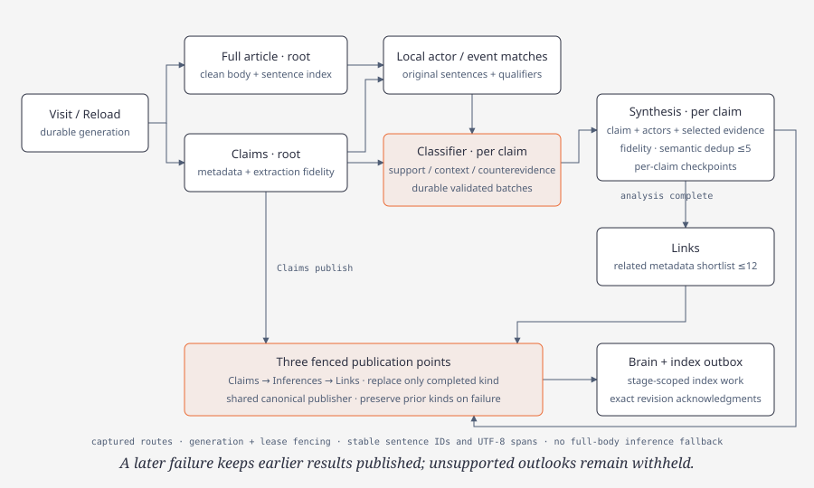

A Focus Brief visit, body-ready event, recovery or **Reload** calls `ensure_intel_brief_pipeline`, which attaches to the one durable `intel_brief` job per article generation (`intel_recon::brief_pipeline`, contract `intel-brief-v2`). Admission atomically records the job, all four tasks, captured inputs and run visibility. The dependencies are explicit. **Full article** and **Claims** are independent roots, **Inferences** depends on both, and **Links** on Inferences. The background worker runs a two-slot brief drainer (`brief_stages::drain_parallel`, `STAGE_SLOTS=2`): a slot is reserved before a lease is claimed, each claimed stage runs on its own Tokio task with its own backend over the shared SurrealDB runtime, and only the two dependency-free roots may run together (v1 exclusivity otherwise holds in the repository claim predicates). Roots are bound at admission to `{article_id, metadata, node_revision}` (Claims read the immutable metadata snapshot, never the body); a descendant stays unbound (`input_hash=''`, unclaimable) until `bind_ready` compare-and-sets it exactly once to `{body:{task_id,output_hash},claims:{task_id,output_hash}}`, in either commit order. Every stage carries an immutable `StageContext {job_id, task_id, job_generation, lease_epoch, metadata_snapshot, route_snapshot}` into prompts, model scopes, Body cleanup and fidelity; operation IDs are `{task_id}:e{lease_epoch}:{operation_key}:{payload_hash}` and attempts carry the job generation. A failed root blocks only its descendants (shown `Queued · blocked by X`, transitively); Retry re-queues failed tasks only. Reload supersedes the chain with `force_body`; per-node reuse adopts unchanged roots by node revision and descendants whose prior input hash (prerequisite output hashes + node revision) matches, so a body-only reload makes zero Claims requests. Links always re-reads its live candidate set. An active `intel-brief-v1` chain is fenced and cut over to a new v2 generation on the next visit; canonical Brain IDs keep the `intel-brief-v1` contract so they stay stable.

**Immutable analytical context.** Root inputs capture the current occurrence's authoritative selected domains/definitions, canonical metadata actors and verified aliases. Claims remain metadata-only. Completed Body output binds its immutable body revision locally at inference/Link joins; pending own-chain completion does not create a new semantic generation. Reuse requires the same semantic revision, while changed source/body/domain/prompt/route policy supersedes only affected work. Inference support, extraction fidelity, conditions and counterevidence are distinct. Indexed actor/text discovery has a combined initial cap of 100 raw candidates before hydration/dedup and retains the existing 12-candidate curator packet. A shared country, broad domain or name alone is not confirmed support.

**Degrading and bounded latency.** Inferences fans out one thinking-model request per claim. Each claim's result is checkpointed (`brief_pipeline::checkpoint_*`), a failing claim is recorded rather than failing the stage, and the stage commits `warning: N of M claims could not be analyzed (...)` ("Completed with warnings") so Links runs on the analyzed claims; all claims failing still fails the stage with the provider category. Retry resumes failed branches or reopens a warning stage and its descendants, re-asking only the failed claims. Provider calls use a stall-aware chain: a timed-out route falls through to the next route (no resend, no backoff), thinking stages send a per-model reasoning effort with thinking-sized deadlines, and an interactive operation wall-clock cap (600s, 900s thinking) covers queue, pacing, backoff and attempts. A per-stage `StageLedger` adds what one operation cannot see: a stage request budget and route health, so sibling operations (per-batch classification, generation, fidelity, dedup) pass over a route that just failed instead of each re-paying it, and SSE timeout error events count as stalls.

- **Full article** reuses retrieval and validation, then cleans locally (`clean_body`): NLP keep-anchors, then Classifier keep/remove decisions over ambiguous blocks only (≤12 blocks per batch, provider output defaults), then verbatim removals and revalidation. Display and analysis consume the one `intel-clean-body-v1` artifact. No model rewrites the body.
- **Claims** see title/description only; extraction and actor detection are unchanged. **Inferences** use claim-specific evidence (`brief_context`): the local sentence index matches detected actor names and observed spellings, collects the actor's mention sentences and necessary nearby attribution/pronoun context, and retains correction/denial candidates. Each claim is associated with its mentioned actors; claim event terms provide additional local candidates, including event details without repeated actor names. Classifier decisions label bounded candidate batches as support, context, counterevidence or irrelevant. Synthesis receives one claim, its associated actors, and selected original sentences, with stable IDs and UTF-8 spans. After classification succeeds, each claim gets an analysis request or reuses its validated analysis; empty evidence can legitimately produce an empty inference result. Prompts ask for justified antecedents, consequences and outlook, preserve unresolved conditions, and reject unsupported speculation. There is no full-body inference fallback and no arbitrary article-chunk analysis. Every matched candidate reaches bounded Classifier batches. The final analysis retains counterevidence first, then support and context within a 12,000-byte evidence budget, records duplicate/budget omissions and restores source order. An oversized atomic sentence or counterevidence-only overflow fails explicitly. Up to three analysis requests may run concurrently; results retain claim order. **Links** see a local shortlist of related metadata (≤12, self and syndicated copies excluded).
- **Validation and routing.** Classifier uses the shared native Decisions adapter with constrained chat fallback and captured routes. Each validated context batch is checkpointed against its claim, original body spans, policy/prompt and captured Classifier chain; Retry reuses those decisions before looking up generated-claim checkpoints. An incomplete context classification withholds only that claim's analysis, records `phase=context`, and lets independent claims finish. A failed generation records `phase=generation`. Synthesis uses the Inferences generation route; its validator accepts only the request's claim ID and offered sentence IDs. Restored checkpoints are revalidated, and receipts distinguish a reused analysis from a newly sent request. Provider output/reasoning defaults and pacing apply to every dispatch and retry. After fidelity, exact repeats are removed locally and compact Synthesis ID selection deduplicates paraphrases to at most five distinct inferences. Selection sees at most 12 candidates per pass, carries at most five into the next, and never resends the article body. Fidelity or final selection failure still blocks publication of unvalidated results; all claims failing still fails Stage 3 with the provider category. Cancellation drops in-flight requests. The inference revision includes the selection policy, Classifier route and prompts, so incompatible cached analysis is replaced while compatible Claims remain reusable.
- **Fidelity.** Claims go to Evidence Curator extraction-fidelity decisions; inferences go to Claim Assessor support decisions in batches (≤12 items; native Jev or constrained chat fallback). Receipts are cached by content, policy and route. Inference support checks include the cited support and counterevidence plus every Classifier-selected counterevidence sentence for that claim, even when generation omits a counter-citation. Those original spans remain in provenance. Items not judged faithful are withheld; a citation existing is never support.
- **Publication.** Claims, Inferences and Links each publish after their fenced stage completion. `storage/brief_stages.rs::commit` writes the leased stage output, task state, metadata, final retained run fence and publication work in one transaction. The brief worker reuses that output after interruption. For evidence stages the display projection, canonical Brain effects, index work, receipt and acknowledgment commit together. The combined display snapshot (`intel_brief_publication`) advances after each completed kind; canonical Brain publication uses the shared `storage::insight::publish_snapshot_on` and a kind-scoped derivation writer. Claims do not wait for Body, Inferences or Links. The Inferences commit writes only Inferences; the Links commit writes tentative Brain Related article leads and separately validated typed Links. Untouched kinds carry forward without rewriting or re-enqueuing their memories. Historical reports never take precedence. Evidence provenance, live owner checks, generation fencing, stable canonical IDs and transactional rollback remain shared with the insight-refresh lane. Complete retained acquisition and resolvable assessed original passages gate inference publication; the complete local article is retained, but model evidence coverage is explicitly selective. Tentative leads retain their exact candidate revision, interpretation and verification gap. Metadata alone cannot establish independent supports/contradicts. Specific metadata assertions may confirm contextualizes, updates, precedes or conditional potential_impact only after deterministic and semantic gates. The full-story lane supports all six directed kinds with explicit independent acquisition roots for corroboration/contradiction, complete per-side evidence and an actual threshold-passed semantic receipt. Canonical publication reconstructs that bounded decision envelope and current evidence/endpoint revisions in the same transaction; failed or stale proposals cannot retire unrelated still-live confirmed Links. A later stage failure preserves earlier successful publications. A canonical failure rolls back the canonical publication transaction and is reported in the **Publication / Index** footer; it does not turn completed extraction into failure. Published means canonical rows committed; Indexed requires acknowledgment of their current revisions, with pending, disabled and failed index work reported separately. Cached completed artifacts can revalidate publication on a later visit without repeating extraction.

Operational job retention is 72 hours from immutable creation time, across every state, app and kind. Required article/run/thread/memory ownership is typed; deletion retires entire job trees and revokes leases. Startup cleanup runs before recovery; periodic five-minute sweeps use the same bounded cleanup service. Jobs exposes explicit global Completed, Stopped (cancelled/superseded) and Failed (failed/partial) history clearing; service roots and trees with running tasks or active services are excluded from retention cleanup. Explicit history clearing additionally preserves active task-job descendants, including taskless ones. Manual clearing uses the same retirement fences and preserves published data and pending canonical index work. Stop job handles supported running, queued and retry-scheduled work; durable task cancellation revokes leases and queued work cannot dispatch. Stopped brief chains stay stopped on an ordinary visit; Reload admits a fresh generation. Compact retirement markers prevent late callbacks, retries and stable-ID registration from recreating expired work. Completed report bundles, Brain data and aggregate telemetry survive; pending index consistency work is rebound under fresh service generations. Logs for removed rows display “Job history expired.” See [job lifecycle](../../diagrams/jobs-lifecycle.html).

`insight_owner_state`, `insight_snapshot`, `insight_derivation`, `insight_derivation_evidence` and `insight_derivation_link` add provenance to the existing Brain database. Before active mutation, publication verifies desired generation, immutable artifact/body/tool/memory revisions and the task lease owner, epoch, state and expiry. Canonical memories, sources, premise lineage, typed links, active head and index outbox commit together. User edits remain canonical; deleted items retain historical provenance with deleted status. Qualified v2 identities separate modality, polarity, attribution and time; legacy identities remain readable.

Recall retrieves 20 unique candidates total by default; the local `insight_recall_limit` setting is clamped to 10–20. It admits at most five within 1,500 estimated tokens/6,000 serialized bytes and recovers original retained evidence locally. Current-owner outputs, common roots and missing lineage do not become independent support. Brain browsing uses Claims and Actor-name associations rather than similarity suggestions. See [Brain recall](../../diagrams/brain-recall.html), [Intel brief publication](../../diagrams/intel-brief-chain.html) and [persistence](../../diagrams/persistence.html).

Related article eligibility requires **at least two distinct overlapping entity mentions** in the exact source/candidate headline or description. Repetitions and aliases of one normalized name count once; country/category fields do not count as mentions. Atlas ingest persists Related associations; Intel Related reflects those retained pairs and rechecks current revisions. Brain Actor Articles instead counts direct retained actor mentions, observed links and claim origins, without requiring a second article or a two-entity pair. A browse visit adds no name-only or canonical-actor suggestions. Original claim Sources preserve provenance independently. Investigation entity associations require Recall on; later disabling Recall preserves earlier receipts. The local match receipt is `shared-headline-entities-v4-possessive`; changing this policy invalidates only Related matching and the dependent Links shortlist, preserving compatible Body/Claims/Inferences and fidelity checkpoints.

Summary flush and local index worker rows describe long-lived elected services, including idle time, rather than finite requests. Both worker loops refresh service heartbeats periodically while elected; task attempts report actual work and failures separately.

## Native and web HTTP boundaries

The native app and [Intel Web](intel-web.md) use the versioned gateway. Server-loaded credentials distinguish Native, WebRelay, Operator and InternalService purposes, with independent permissions and current deployment/access scope. Loopback requests obey the same purpose, permission and context gates. Native work submissions require authenticated current registration and confirmed configuration authority; workstation Jobs/Logs enforce their scoped associations. Private Linux services use separate internal credentials and remain behind the gateway.

The browser enters through the same-origin web relay, whose purpose credential stays server-side. Connect exchanges a registered context for a server-issued session; subsequent requests and streams enforce current session, Host/Origin, permission and registration checks. A displayed Connect ID selects context and grants no authentication authority. Native Open Intel Web uses that real gate. Topology remains in the browser; native Brain provides discovery and authoritative dossier controls. Direct Compose readiness checks and separately configured web startup are operator actions. [Web lifecycle](../../diagrams/intel-web.html)

The existing [native verifier](../../../scripts/fleetworks_verify.py) selects and renders shared-view PNG/tree fixtures; scoped Cargo tests separately exercise Runtime/state/input assertions. The [candidate helper](../../../scripts/fleetworks_candidate.py) builds/packages a staged macOS `.app`, manifest, ZIP and checksums. The [native CI lane](../../../.github/workflows/fleetworks.yml) selects both architectures through the [shared Mac workflow](../../../.github/workflows/fleetworks-native.yml), with exact source/toolchain/Rune identity and verification of downloaded artifact bytes. These source paths are implemented; complete dual-architecture hosted execution, installed-app GUI/OS integration, tested minimum macOS, signing/notarization and trusted publication retain separate acceptance gates. Generated frames and bundle checks carry their own evidence and cannot establish those later outcomes. [Native verification limits](native-verification.md)

## Async runtime safety

`@tag:async-runtime`

Service hosts run network and storage operations asynchronously. CPU-intensive hardware sampling and synchronous parser work use bounded background execution. Long-running stage leases renew through task-owned heartbeat guards. Durable job and index fences make ownership independent of the lifetime of any one client connection.

## Process lifecycle and signal handling

`@tag:process-lifecycle`

The operator selects the deployment directory, env file and Compose project explicitly. Compose stop/down acts on that project and preserves persistent backend data; native application close leaves services and accepted work running. The HTTP host handles SIGINT and SIGTERM and bounds graceful connection draining. Retired host-process ownership records remain historical recovery material, not a current launcher contract. See the [deployment guide](../../../deploy/README.md).

## Atlas background ownership

Foreground Atlas pins the classifier identity, stages occurrence inputs, and atomically publishes one-primary/optional-secondary outcomes and hands off durable per-occurrence derivative jobs. Collection completes after acquisition/admission and guaranteed handoff; independent job leases drive Metadata, Related, Actors and checkpointed Reconcile. Current-generation actor readiness, reconciliation readiness and index-outbox delivery remain separate from collection completion. Its terminal transaction creates an independent provider-monitoring job at a frozen observation watermark. The scheduler processes provider monitoring independently of collection. A zero-shot cycle does not enqueue model fitting or promotion. Retained reclassification has its own 64-occurrence activations, original-source captures and task fences; it cannot rewrite original cycle statistics or delete published historical evidence because a new gate rejects an article. [Classifier ownership](classifier.md#historical-admission-and-provider-monitoring) and the [Atlas flow](../../diagrams/atlas-pipeline.html) describe these boundaries.
