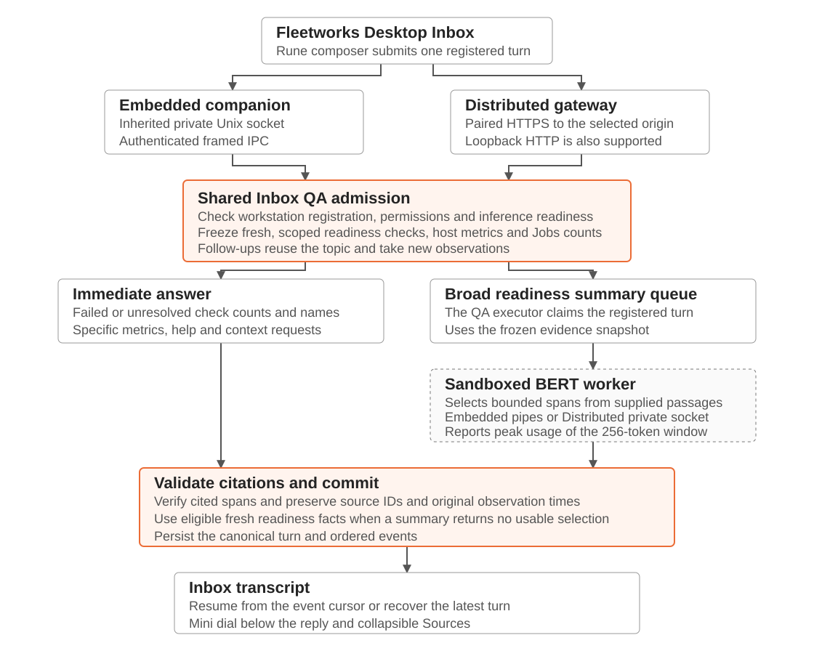

# Assistant chat contract

The typed wire contract for the native contextual Assistant lives in [`chat.rs`](../../../crates/fleetworks-contracts/src/chat.rs). V1 serves one endpoint, `POST turns`, over HTTP and over local IPC (`IpcOperation::ChatTurnSubmit`, `chat_turn_submit`). It checks the caller and the request and answers `{"status":"ok"}` (`ChatTurnAck`). It stores nothing, starts no job, and never writes an assistant reply. The backend advertises `chat` as `supported`, and the native composer clears its draft on send. On a failure the text comes back if nothing new was typed. The HTTP and IPC parity test checks the ok reply and a 400 for empty input on both transports. The view parts are described in [native-design-system.md](native-design-system.md#assistant-conversation-parts-chat_uirs).

## Routes

| Method | Path | Needs |
| --- | --- | --- |
| POST | `/api/v1/workstation/chat/turns` | Native credential, `SubmitInteractive` and a registration. **Served**: answers ok. |
| GET | `/api/v1/workstation/chat/threads` | `ReadWorkstationActivity` and a registration. Not served yet. |
| GET | `/api/v1/workstation/chat/messages` | `ReadWorkstationActivity` and a registration. Not served yet. |
| GET | `/api/v1/workstation/chat/events` | `ReadWorkstationActivity` and a registration. Not served yet. |

The server rechecks every permission. Advertising `chat` says what the backend implements, not what a caller may do.

## Capability

`Capabilities.chat` is absent when the backend does not implement chat. When present it carries a `version` and an `availability` of `supported`, `unsupported` or `unavailable`. These are kept apart from permissions and configuration so a client can say why sending is off. `ChatCapabilities::can_send` is true only for an exact version match that is `supported`.

## Turn

A turn request carries a durable `request_id`, the registered `context`, an optional `thread_id` with `expected_thread_revision`, a typed `source` (`actor`, `job`, `cycle` or `readiness` plus an ID) and the operator's `input`.

- The caller never sends evidence. The server resolves evidence for the source from its own authorized data. A request with an unknown field, including an `evidence` field, is rejected.
- A revision needs a thread ID.
- Input is at most 4 KiB, not empty, and holds no control character other than a newline or tab.
- The request's registration and context revisions must match the caller's current registration, or the reply is 409.
- The turn source must be a job, cycle or readiness check. The native app does not send from a plain page.
- V1 replies with `ChatTurnAck` only. `ChatTurnReceipt` (request, thread, turn, message and job IDs, revision, state, `reused`) is typed for the later durable version.

## Reads

| Read | Bounds |
| --- | --- |
| Messages | At most 50 per page. A page is at most 256 KiB. |
| Events | At most 100 per page. A read waits at most 4 seconds. Events are ordered by `sequence` and resume from `after`. |
| Final answer | At most 32 KiB. |
| Sources on a message | At most 16. Each is a kind, an ID and a short label, never evidence text. |

Turn states are `queued`, `running`, `retrying`, `final` and `failed`. V1 is a status, then one final answer. There is no partial text, no tool execution and no automatic publication.

## Inbox QA V2

The [V2 wire contract](../../../crates/fleetworks-contracts/src/chat/qa.rs) is available through the Embedded companion's inherited Unix socket. Distributed retains Inbox notifications. In Embedded, Workstation Settings shows the Assistant model, readiness, provisioning, size and context usage while Backend inference is on. Workstation Status provides an Assistant shortcut and keeps deterministic diagnostics accessible independently. The Inbox prompts the operator to enable inference when it is off. On a companion advertising `inbox-qa-triage-v1`, the composer can answer supported direct questions while model inference is starting or unavailable.

### Prompt flow

1. The Rune composer sends the question, a request ID, the registered request context, and an optional source reference. The backend uses the registration to authorize the request. It rejects caller-supplied evidence and conversation history. [Native Inbox](../../../apps/fleetworks-desktop/src/inbox_qa.rs) · [Embedded transport](native-connections.md#backend-types-and-parity)
2. Admission selects the readiness, host metrics, Jobs counts and selected activity needed for the question. It builds the model's snapshot from its own authorized readings and includes up to two completed exchanges from the same credential, registration, access epoch, and generation. A follow-up such as “What about now?” reuses the authorized subject and supported intent when they are available, then collects fresh readings. A new explicit selection takes precedence. When the retained subject has a comparable earlier observation, the reply pairs the current reading with a separate timestamped citation for the previous one. Request-ID replays preserve the original turn and its authorization boundary. [Admission and evidence](../../../crates/argos-osint-api/src/inbox_qa.rs) · [Turn store](../../../crates/argos-osint-core/src/storage/inbox_qa.rs)
3. Straightforward readiness, metric and job-count questions return typed timestamped facts directly, including the terminal time window on failed-job counts. Broad summaries and conversational turns can queue one job for the supervised Rust-BERT worker. The worker processes only the selected model, checks for cancellation between decoding steps, and reuses the attention cache. [Intent routing](../../../crates/argos-osint-api/src/inbox_qa/question.rs) · [Executor](../../../services/api-host/src/inbox_qa_service.rs) · [Decoder](../../../tools/assistant-bert/src/dialogue.rs)
4. Batched text updates arrive as provisional events. For an operational draft the worker and backend accept complete authorized facts. Terminal answers cite exact passages from the snapshot, with their original observation times. When a generated operational reply fails verification, the backend can answer with the current recorded facts. The terminal turn clears the provisional text, seals the canonical reply, and moves the observation boundary forward for the next turn. [Validation](../../../crates/fleetworks-contracts/src/qa_worker.rs) · [Event store](../../../crates/argos-osint-core/src/storage/inbox_qa.rs)
5. The transcript reconciles the latest turn and event pages by cursor. The compact dial reports the peak input count and percentage of the selected model's input window. **Sources** starts collapsed and shows each citation's observation time when expanded. Stop seals the turn with any already published citations. [Native transcript](../../../apps/fleetworks-desktop/src/inbox_qa.rs)

### Jobs and Inbox triage

Use **Find related activity** on a selected private job or expanded readiness notice. The companion resolves a typed job or readiness reference in the current registration. An explicit stage/check relation can open the associated diagnostic. A historical readiness notice links to **Current status**. A current check alone provides no evidence of the earlier cause. Missing relations, ambiguous choices and unavailable inference have distinct outcomes.

The inline lookup returns one compact result and creates no Assistant exchange or job. **Explain in Assistant** fills the composer with the selected subject for the operator to submit. Both flows use scoped activity and fresh readiness. Navigation is a typed native action that runs after operator input and uses the ordinary destination authorization.

### Models and lifecycle

| Model | FP32 weights | Input tokens | Output tokens |
| --- | ---: | ---: | ---: |
| FLAN-T5 Base (preferred) | ~990 MB | 512 | 128 |
| FLAN-T5 Small (fallback) | ~308 MB | 512 | 128 |

The companion selects a model using fresh memory headroom, workload reserve and the worker budget. The revisioned settings operation changes enablement. Turning inference off fences the active generation and reaps its worker. A verified runtime pack provides the model executable and its libraries. The companion can reuse a verified optional model pack or fetch its pinned checkpoint files into the private asset cache. The worker remains idle between turns, runs without network access, and uses one beam. Cancellation can reap an interrupted worker and trigger a warm restart. [Pack provisioning and resource limits](../../../deploy/inbox-qa.md)

Each exact host fact preserves its decimal value, unit, subject and observation time. Jobs evidence comes from the authorized workstation scope. Resolved, failed, unknown and retired checks remain distinct, and passed checks can cite the authenticated registration. Direct responses report zero model input tokens. Older workers can omit usage or report their legacy limit. Model-generated text stays read-only. The zero-shot classifier has its own model and execution path.

### Decision model qualification

Explicit relationships and unambiguous facts resolve in the companion. When multiple eligible sources remain, the Assistant reports that triage is unavailable. The operator can narrow the subject in the composer. Decision models are not yet available in Workstation Settings.

The [hosted scoring workflow](../../../.github/workflows/fleetworks-decision-qualification.yml) accepts an exact PR SHA through `Fleetworks` dispatch with `decision_qualification=linux` or `macos`. It verifies pinned Julia-1 and vLLM d3-edge assets, calibrates on a separate incident group, and records held-out precision, coverage, out-of-scope choices and warm eight-candidate p95. Its receipts describe isolated scoring. Julia uses the publisher’s October 19 Q8 snapshot because the later snapshot has a tokenizer metadata incompatibility with the pinned shared runtime. [Julia GGUF loading issue](https://github.com/ggml-org/llama.cpp/issues/32882)

Release qualification also requires combined answer and navigation checks, resource measurements with FLAN and indexing active, and separate evidence for each native target. The Liquid pack also requires distribution license review.

### Operations

| Private operation | Permission |
| --- | --- |
| `qa_settings` | Registered Native backend read |
| `qa_settings_update` | Registered Native `manage_inbox_qa`, current setting revision |
| `qa_turn_submit` | Registered Native interactive submit and the evidence source’s read grant |
| `qa_related_activity` | Registered Native backend read for readiness or workstation activity read for a job |
| `qa_latest`, `qa_events` | Registered Native workstation activity read |
| `qa_cancel` | Registered Native interactive submit |

Settings can include the current provision, verification, model load, or activation stage. An unavailable reason is a fixed code such as `pack_missing`, `pack_invalid`, `sandbox_unsupported`, `worker_start_failed`, `insufficient_resources`, or `model_provision_failed`. The notification feed remains available during setup and inference changes.

A turn's `provisional_reply` carries its bounded accumulated draft for cursor-gap recovery. A `provisional_delta` is ordered with the other events and has no citations. The canonical terminal turn and its verified findings replace the draft. Terminal transitions clear provisional text, including previously retained draft event text. A recovered turn with a partly published reply is sealed before it can append a second draft. Each active registration can submit one turn at a time. Per-placement worker and lease limits keep the pending work bounded. [V2 wire contract](../../../crates/fleetworks-contracts/src/chat/qa.rs)
