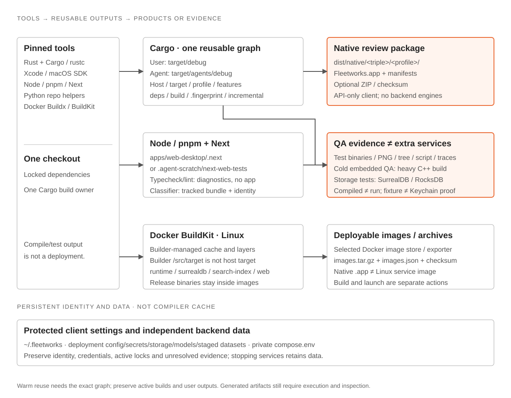

# Build artifacts, paths and tools

[Contributing](contributing.md) · [Native loop](../../diagrams/dev-loop-native.html) · [Deployment](../../../deploy/README.md) · [Verification evidence](native-verification.md)

**A large Cargo test executable is a QA harness, not another deployed service.** Affected storage/compatibility tests link embedded SurrealDB and RocksDB into their test process. The Rune native app uses the API-only client graph and does not embed those engines. Production Linux services and their private stores have separate ownership.

Paths below are relative to the repository root unless marked **inside image**. These are output categories, not a cache-cleanup list.

## Rust: reusable compilation versus runnable products

Rust 1.95.0/Cargo/rustc use `Cargo.lock`; macOS packaging also checks Xcode command-line tools/SDK. Agent commands go through [agent_cargo.py](../../../scripts/agent_cargo.py) with `--locked`. Selected engine/native dependencies may also use C/C++, CMake and libclang/bindgen.

| Path | Role |
| --- | --- |
| `target/debug/` | User's implicit-host debug graph; agents preserve it |
| `target/agents/debug/` | Shared agent implicit-host debug graph; one build owner |
| `target/<triple>/debug/`, `target/agents/<triple>/debug/` | Explicit-target graphs; not interchangeable with implicit host |
| Corresponding `release/` | Only for required packaging, performance or release evidence; routine local checks/tests stay debug |
| `<profile>/fleetworks-desktop`, `argos-api-host`, `fleetworks-search-index` | Selected Cargo binary target, when built for that platform; an executable is not a packaged app/image or a running service |
| `<profile>/examples/native_fixture` | Synthetic Rune QA executable; shares production views/handlers |

Within a selected graph:

| Directory/file | Why it exists |
| --- | --- |
| `deps/<test-name>-<hash>` | Unit/integration test executable; the suffix distinguishes compilation inputs, not service instances |
| `deps/*.rlib`, `deps/*.rmeta` | Compiled Rust libraries / compiler metadata; not standalone programs |
| `deps/libfleetworks_workstation-*.rlib` | Native settings/identity, credential-file references, durable recovery and legacy-folder compatibility; linked into the app, no separate service |
| `*.d` | Source-dependency information used for rebuild decisions |
| `.fingerprint/`, `incremental/` | Cargo freshness and incremental compiler state; preserve active/reusable graphs |
| `build/*/out/` | Build-script outputs, generated bindings and native/static libraries such as `.a` archives, including C/C++ engine artifacts where features require them |

`check`/Clippy can populate libraries/metadata without producing an app; `cargo fmt` changes source only.

Embedded compatibility tests deliberately exercise the library engine rather than the independently deployed database. The network backend still uses its configured SurrealDB service; Jobs owns its embedded RocksDB delivery queue. Native-only builds need neither backend engines nor Docker. [Storage boundaries](jobs-persistence.md)

## Native app and Rune evidence

| Tool | Output |
| --- | --- |
| `scripts/fleetworks_candidate.py build-native --agent` | Default `dist/native/<resolved-triple>/<debug-or-release>/Fleetworks.app` and `Fleetworks.app.manifest.json`; `--output <review-dir>` may select task-owned scratch |
| Same helper, `--archive` | `Fleetworks-<version>-<sha12>-<run>.<attempt>-<triple>.zip` and `.zip.sha256` beside the app; [candidate naming/verification](../../../scripts/fleetworks_candidate.py) |
| App bundle | `Contents/MacOS/fleetworks-desktop`, `Contents/Info.plist`, `Contents/Resources/`, embedded `Contents/Resources/fleetworks-manifest.json`; no service engines |
| `scripts/fleetworks_verify.py native-ui --agent` | Default `.agent-scratch/native-ui/selected-*/`, or new/empty `--output`; selected `.png`, `.tree.json`, optional `.trace.jsonl`, bounded command logs and `manifest.json` |

Build flow: flushed stage/command markers and live Cargo diagnostics on **stderr** → package/validate → app path and result metadata on **stdout**. `--open` opens only the validated app and preserves an already running app. Building, packaging, fixture generation, inspected captures and installed GUI approval are separate results.

## Web: dependencies, compiler output and QA

Node 24/pnpm use the locked workspace dependencies. Next runs the React Compiler; `@argos/ui`, `@argos/intel` and `@argos/api-client` remain shared packages.

| Tool / path | Role |
| --- | --- |
| `node_modules/` | Installed dependencies and tool caches; not a deployable site |
| `pnpm build` → `apps/web-desktop/.next/` | Normal Next server/static chunks, generated types and cache; not a static-export `out/` site |
| `ARGOS_WEB_TEST_DEV=1` → `.agent-scratch/next-web-tests/` | Isolated Next dev or authorized production-build output; matching build/check/browser commands use this same mapping |
| `apps/web-desktop/.next/dev/lock`, `.agent-scratch/next-web-tests/dev/lock` | Active dev locks; build locking uses `<selected-output>/lock`. A different port does not isolate output. Never remove a user's lock |
| `pnpm typecheck`, `pnpm lint` | TypeScript `--noEmit` / ESLint diagnostics; no runnable JS product. Next's incremental TypeScript work may retain `.tsbuildinfo` |
| `pnpm test`, `pnpm test:live` | Vitest component/adapter and Node transport QA; console results, optional requested coverage reports, no deployed service artifact |
| `pnpm test:e2e` | Playwright default `test-results/` or explicit `--output`; retained failure traces. Default reporter is console, HTML report only when selected |
| `tests/web/<spec>-snapshots/` | Maintained screenshot reference PNGs; changes require deliberate inspection |
| `ARGOS_WEB_CAPTURE_DIR` | Screenshot-gate capture override; default `.agent-scratch/tester-gate/screenshots` |

Use `ARGOS_WEB_PROFILE=dev ARGOS_WEB_TEST_DEV=1` for the isolated repository dev browser loop. Preserve the user's frontend and normal `.next`. [Browser checks](react-ui-testing.md)

## Linux images, archives and generated classifier code

| Tool / target | Output and location |
| --- | --- |
| Docker Buildx/BuildKit | Builder-managed layers/caches; Rust builder `/src/target` is **inside the builder**, separate from host `target/agents`. Native dependencies use per-architecture cache mounts |
| Bake `backend` | `runtime`, `surrealdb`, `search-index`; `server` adds `web`. Individual Bake targets use those same four names |
| Image names | `fleetworks-runtime`, `fleetworks-surrealdb`, `fleetworks-search-index`, `fleetworks-web`; explicit review tags or `local`/version aliases. Build output lives in the selected exporter/image store, not a host Cargo directory |
| `runtime` / `search-index` | **Inside image:** `/usr/local/bin/argos-api-host` / `/usr/local/bin/fleetworks-search-index`; the service host selects roles. `surrealdb` packages the pinned database, `web` packages Next output/server dependencies |
| `scripts/fleetworks_candidate_images.py pack --directory <dir>` | `<dir>/images.tar.gz`, `images.tar.gz.sha256`, `images.json`; exact revision/platform/image identities for candidate verification |
| `pnpm build:classifier` | Generated source assets under `crates/argos-osint-core/assets/classifier/`: `natural-classifier.js`, `natural-bayes.patch`, `source-manifest.json`, `bundle-identity.rs` |
| Optional Linux Rust-BERT worker | `tools/atlas-bert` is a separate LibTorch workspace, not the macOS client. Its Linux verification helper uses the agent debug graph with `--agent`, or `<output>/cargo-target/` otherwise; the [standalone release recipe](classifier.md#linux-deployment-and-retained-standalone-worker-setup) uses `target/atlas-bert/release/argos-atlas-bert` |
| Linux worker bundle helper | `tools/atlas-bert/scripts/verify_linux.py` writes selected `<output>/bundle/{bin,model,python,licenses}`, `manifest.json`/`SHA256SUMS` inside the bundle, `atlas-bert-linux-{amd64,arm64}.tar.gz`, `evidence.json` and bounded logs. It checks native Linux architecture, libraries and checkpoint inference; this map does not claim those checks ran |
| Classifier tools | Node/esbuild adapt pinned Natural/Apparatus inputs using `.agent-scratch/classifier-build-input/`. These tracked provenance/code assets are not trained models or native app engines; `pnpm check:classifier` verifies them |

Atlas NLP/classifier service roles reuse the runtime image; their architecture-matching worker/libraries/model assets are separately staged deployment inputs, not new Bake targets.

[Bake definitions](../../../deploy/docker-bake.hcl) · [Dockerfile](../../../deploy/Dockerfile) · [Classifier builder](../../../scripts/build_classifier_bundle.mjs) · [Candidate/release policy](versioning.md#release-candidates)

## Persistent data is not build output

| Location | Keep separate |
| --- | --- |
| `~/.fleetworks/` | Protected installation identity, credential references and unresolved journals; not a build/cache destination |
| `.agent-scratch/native-review/<name>/` | An isolated **deployment**, despite its scratch location: private `secrets/`, `config/`, `storage/{surrealdb,jobs,search-index}`, `staged-datasets/`, `models/`, logs and deployment metadata |
| `compose.env` with `--root-env` | Private ignored configuration pointing to retained deployment data; not generated code or disposable compilation cache |

Stop retains deployment data. Never clean user/global caches, active outputs, locks, credentials or unresolved evidence to free build space. Inspect ownership and reserve capacity first; cleanup follows [cache hygiene](contributing.md#build-cache-hygiene), not filename guesses.
