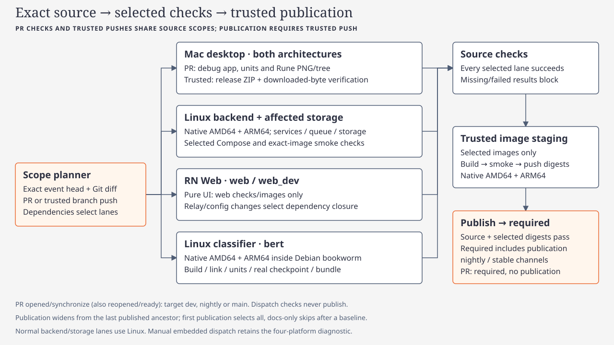
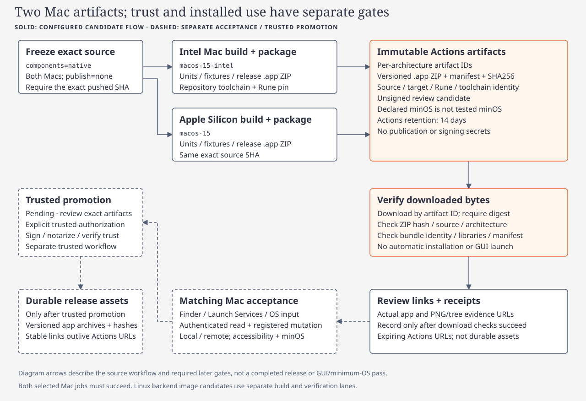

# CI workflows

[Code route](index.md) · [Contributing](contributing.md) · [Versioning](versioning.md)

One [Fleetworks workflow](../../../.github/workflows/fleetworks.yml) selects current product checks. Feature/fix PRs into `dev`, `nightly` or `main` run on creation and every pushed update. Integration-branch pushes verify the merged revision and publish only selected, verified artifacts.

[](../../diagrams/ci-scopes.html)

| Event | Checks | Published output |
| --- | --- | --- |
| PR opened / synchronized / reopened / ready into `dev`, `nightly`, `main` | Changed components; read-only jobs | Test/fixture evidence; no release ZIPs or registry writes |
| Push to `nightly` | Selected checks and artifact gates | Versioned GitHub assets and GHCR images; `nightly` channel |
| Push to `dev` or `main` | Selected checks and artifact gates | Versioned GitHub assets and GHCR images; `stable` channel |
| Manual Fleetworks dispatch | Full or exact-base scoped checks | Evidence only; no channel publication |
| Direct embedded / mutation dispatch | Explicit compatibility / diagnostic matrix | Diagnostic evidence only |

PR synchronization already covers each feature/fix push; there is no second hardcoded feature-branch workflow. Commit-policy title/body edits and path-scoped dataset integrity retain their own triggers. No independent scheduled full rebuild, retired terminal build, Docker-save release archive, candidate workflow or automatic Release Please PR remains.

## `fleetworks.yml` — scoped branch checks

The [shared planner](../../../scripts/fleetworks_verify.py) compares PR merge bases or push revisions. Pure web UI changes select web checks and its image; local workstation/native changes select the two Mac legs. Shared Rust contracts widen backend/native checks. Unknown build inputs or unavailable comparisons select all scopes. Documentation alone selects repository policy checks (`scripts/fleetworks_doc_links.py`, `scripts/release_check.mjs`, `.opencode/tests/*.test.mjs`, `.github/scripts/test_*.py` and `scripts/test_fleetworks_*.py`). Manual `workflow_dispatch` accepts `mode` (`full` or `pr`), `base`, `head` and `components` (`auto`, `native`, `backend`, `all`), where scoped `pr` dispatches require an exact `base` SHA and non-`auto` component dispatches require an exact `head` SHA.

For trusted publication, the [release planner](../../../scripts/fleetworks_release.py) widens the same check/build plan to include changes since the last reachable published artifact. The first publication covers every production target. This prevents a replaced pending run or earlier failure from losing an unpublished component. Checks and publication consume this one authoritative plan.

| Selected scope | Required evidence |
| --- | --- |
| Rune native | Physical Intel and Apple Silicon Macs; scoped units, actual shared-view Runtime PNG/tree/input fixtures and complete debug app build |
| Backend | Native Linux AMD64 and ARM64; service build/units, isolated pinned datastore, bootstrap/network roles and selected storage/queue recovery contracts |
| Embedded storage | Linux AMD64 and ARM64 compatibility gate; separate from the Mac client graph |
| Images / Compose | Selected image targets; exact loaded image IDs and isolated Compose/source journey when backend or relay/deployment inputs require it. Web-only packaging does not build backend engines |
| React Native Web | Locked dependencies, types, Hooks/compiler lint, units, strict Next build/output guard, live relay/runtime lifecycle and production Chromium contracts; development profile when selected |
| Rust-BERT | Native Linux AMD64 and ARM64 inside Debian bookworm; build/link/units, pinned real checkpoint inference and extracted bundle checks |

`Fleetworks source checks` (`source_checks`) rejects failed planning, missing/failed/cancelled selected jobs and unexpected skips. Trusted image staging (`release_images` via [fleetworks-release-images.yml](../../../.github/workflows/fleetworks-release-images.yml) and [release_images.py](../../../.github/scripts/release_images.py)) then builds, smokes and pushes exact digests once; the separate image archive build is gone. `prepublish` gates trusted publication (`publish` via [publish_release.py](../../../.github/scripts/publish_release.py)), and final **Fleetworks required** (`required`) requires every selected check and publication step to succeed. An unselected lane must skip intentionally.

```sh
base="$(git rev-parse HEAD^)"
python3 scripts/fleetworks_verify.py plan --base "$base" --head "$(git rev-parse HEAD)"
python3 scripts/fleetworks_verify.py local --base "$base"
```

`--event pull_request` compares the merge base. `--json-output <file>` retains source/scope identity. Local mode includes working-tree changes. Manual hosted checks require a pushed exact revision:

```sh
python3 scripts/fleetworks_verify.py dispatch pr --ref <branch> --base <full-base-sha>
python3 scripts/fleetworks_verify.py dispatch full --ref <branch>
```

## Native app review evidence

[Native verification](native-verification.md) uses [fleetworks-native.yml](../../../.github/workflows/fleetworks-native.yml) on `macos-15-intel` (`x86_64-apple-darwin`) and `macos-15` (`aarch64-apple-darwin`), caching `target/agents` by target, toolchain, `Cargo.lock` and `apps/fleetworks-desktop/Cargo.toml`. Its `package` job runs `cargo fmt --check`, scoped unit tests (`fleetworks-desktop`, `fleetworks-workstation`, `fleetworks-contracts`) via `scripts/agent_cargo.py`, explicit `fleetworks_verify.py native-ui --agent --require-clean` captures, and `scripts/fleetworks_candidate.py build-native`. PRs build debug apps and fixture evidence; a selected trusted channel build packages a release ZIP with the calculated artifact version and runs the `verify` job (`fleetworks_candidate.py verify-native`) against the downloaded artifact ID, SHA256, source revision, architecture and linked libraries.

[](../../diagrams/native-release.html)

App assets are unsigned. Fixture generation and downloaded-byte verification do not establish human visual approval, installed GUI/input/accessibility, minimum-OS behavior, signing or notarization. Those remain separate evidence. Actions evidence expires; verified GitHub Release assets persist.

## `embedded.yml` — affected storage compatibility

[Embedded compatibility](../../../.github/workflows/embedded.yml) is reusable for selected Linux storage changes. It runs format, Clippy with warnings denied, workspace tests, service-host help and required in-process storage contracts via `scripts/local_matrix.sh --storage embedded`. It enforces Jobs-only direct SQLite ownership and rejects LanceDB.

A direct manual dispatch retains the four-platform diagnostic, including both Macs:

```sh
gh workflow run embedded.yml --ref <branch>
```

Normal Rune lanes do not install backend engines. The [local embedded gate](contributing.md#full-local-embedded-gate--github-ci-monitoring) still applies to affected compatibility changes.

## `intel-web.yml` — local web client checks

The reusable [web workflow](../../../.github/workflows/intel-web.yml) gets the exact event revision. Node comes from `.node-version`; pnpm is pinned by `package.json`. It has no duplicate automatic branch trigger. Direct dispatch remains available.

Units and browser checks retain permission, reconnect, responsive-layout and React Compiler contracts. Screenshots are inspected evidence, not permission to relax pixel thresholds. Keep production and development results distinct. For local builds/browser checks, set `ARGOS_WEB_TEST_DEV=1` to preserve the user's `.next` output and locks. [Browser workflow](react-ui-testing.md)

## `atlas-bert.yml` — classifier worker checks

The [BERT workflow](../../../.github/workflows/atlas-bert.yml) runs only for affected classifier inputs or explicit full selection. Both physical Linux architectures use `python:3.11-bookworm`, matching deployment ABI. It configures the exact checkout's Git ownership before source checks, then verifies pinned Torch/checkpoint dependencies and real inference from the extracted worker bundle. Native app checks are separate. [Classifier boundary and commands](classifier.md)

## Release, policy and diagnostics

| Workflow | Responsibility |
| --- | --- |
| [fleetworks-native.yml](../../../.github/workflows/fleetworks-native.yml) | Reusable two-target native `package` + `verify` checks and trusted versioned app packaging |
| [fleetworks-release-images.yml](../../../.github/workflows/fleetworks-release-images.yml) | Trusted native Linux image build/smoke/digest staging via [release_images.py](../../../.github/scripts/release_images.py); no PR registry credentials |
| [commit-policy.yml](../../../.github/workflows/commit-policy.yml) | **Conventional commits and shared version** checks for PR title/body and integration landing policy; publication also runs policy inside its own dependency chain |
| [datasets.yml](../../../.github/workflows/datasets.yml) | Path-scoped (`datasets/**`, `.gitattributes`) LFS pointer and full object integrity checks, never database seeding |
| [mutation.yml](../../../.github/workflows/mutation.yml) | Explicit hosted Linux diagnostic (`ubuntu-24.04`); local agents do not run mutation tests |

Policy/helper tests run in the lightweight scope job. The backend resolves `ARGOS_SURREAL_BIN` and required server mode **before API unit tests**; passing checks without a configured datastore cannot replace storage evidence. Container Rust builds use the installed Git CLI for pinned Git dependencies; a source fetch is distinct from compiling the Rune UI or C++ storage engine.

Only trusted integration pushes get publication writes, with packages permissions confined to image staging/promotion and contents writes confined to the publisher. All selected artifacts must verify before channel aliases move. Retries preserve existing immutable assets. [Artifact identities, channels and recovery](versioning.md#release-automation)

## Local verification before CI

Follow the [scope/freeze policy](agent-workflow.md#scope-and-finish-line). Use one build owner, the reusable debug graph and only affected checks. Source, fixture, downloaded-artifact and real deployment results prove different things; report skips and blockers explicitly.

```sh
python3 deploy/verify.py --name fresh-review --platform linux/amd64 --web --atlas --source-journey
```

This authorized smoke owns a fresh project and synthetic data. `--no-build --image-ids <file>` verifies preloaded images without building/pulling. It never owns the user's running stack. No workflow dispatch or release is implied merely by editing documentation.
