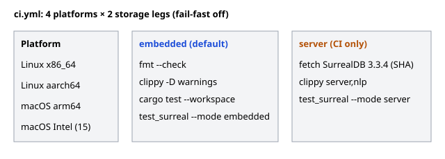

# CI workflows

[Code route](index.md) · [Wiki](../../index.md)

Three workflows live in `.github/workflows/` (owned by Code Architect; code changes don't touch `.github`).

## `ci.yml` — build and test matrix

Runs on pushes to `main` and when a PR is opened, reopened or marked ready for review (drafts skipped). PR pushes do not build. All 8 legs run every time. `fail-fast: false`, 90-minute timeout, Rust 1.95.0, no debuginfo.

| Platform | Runner | Legs |
|---|---|---|
| Linux x86_64 | `ubuntu-24.04` | embedded, server |
| Linux aarch64 | `ubuntu-24.04-arm` | embedded, server |
| macOS arm64 | `macos-14` | embedded, server |
| macOS Intel | `macos-15-intel` | embedded, server |

Every leg calls the same entry point you run locally, `scripts/local_matrix.sh`:

- **Embedded** (default features `embedded,nlp`): installs libclang on Linux, then `local_matrix.sh --storage embedded` = `cargo fmt --check` → clippy `-D warnings` → `cargo test --workspace --locked` → `test_surreal.py --mode embedded` (all `storage_*` tests on in-process RocksDB).
- **Server** (`--no-default-features --features server,nlp`): checks the pinned SurrealDB hashes in `scripts/test_surreal.py` match `.planning/2026-10-22-surrealdb/design.md`, fetches the SHA-256-verified SurrealDB 3.3.4 binary (cached), then `local_matrix.sh --storage server --surreal-bin <bin>` = clippy on core+bin → `test_surreal.py --mode server`. Unit tests are not rerun here.

Storage tests are selected by `ARGOS_SURREAL_MODE`; with no mode and no `ARGOS_SURREAL_BIN` they skip, so the plain `cargo test` in the embedded leg doesn't duplicate them. `test_surreal.py` sets `ARGOS_SURREAL_REQUIRED=1`, so a missing server fails instead of skipping.

Cache: `Swatinem/rust-cache` keyed per OS × storage, covering `target/agents` (where `scripts/agent_cargo.py` builds).

**Local rule:** agents run only `scripts/local_matrix.sh --storage embedded`. Server mode is CI-only.

## `commit-policy.yml`

On PRs (including title/body edits) and pushes to `main`: `node scripts/release_check.mjs event` enforces Conventional Commits on the PR title/body or new `main` commits, `release_check.mjs versions` checks workspace/lockfile/manifest versions agree, and the `.opencode/tests` release/tool/planning tests run.

## `release-please.yml`

On pushes to `main` (or manual dispatch): Release Please opens/updates the release PR and tags from Conventional Commits (`release-please-config.json`, `.release-please-manifest.json`). Uses a GitHub App token or `RELEASE_PLEASE_TOKEN` so release PRs trigger CI; see [versioning.md](versioning.md).
