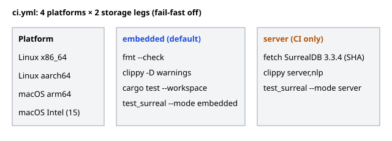

# CI workflows

[Code route](index.md) · [Shared agent execution policy](agent-workflow.md) · [Wiki](../../index.md)

Six workflows live in `.github/workflows/` (owned by Code Architect; CI changes are scoped separately from product edits).



## `ci.yml` — build and test matrix

Runs on pushes to `main` and when a PR is opened, reopened or marked ready for review (drafts skipped). PR pushes do not build. Adding the `ci:full` label to a PR runs the full matrix in that PR's checks; Code Architect adds it at the end of a feature, fix or review-fix round (remove and re-add it to run again). A manual dispatch (`gh workflow run ci.yml --ref <branch>`) runs it on a branch with no PR, but those runs don't show in PR checks. All 8 legs run every time. `fail-fast: false`, 90-minute timeout, Rust 1.95.0, no debuginfo.

| Platform | Runner | Legs |
|---|---|---|
| Linux x86_64 | `ubuntu-24.04` | embedded, server |
| Linux aarch64 | `ubuntu-24.04-arm` | embedded, server |
| macOS arm64 | `macos-14` | embedded, server |
| macOS Intel | `macos-15-intel` | embedded, server |

Every leg calls the same entry point you run locally, `scripts/local_matrix.sh`:

- **Embedded** (default features `embedded,nlp,classifier`): installs libclang on Linux, then `local_matrix.sh --storage embedded` = `cargo fmt --check` → clippy `-D warnings` → `cargo test --workspace --locked` → `test_surreal.py --mode embedded` (all `storage_*` tests on in-process RocksDB).
- **Server** (`--no-default-features --features server,nlp,classifier`): checks the pinned SurrealDB hashes in `scripts/test_surreal.py` match `.planning/2026-10-22-surrealdb/design.md`, fetches the SHA-256-verified SurrealDB 3.3.4 binary (cached), then `local_matrix.sh --storage server --surreal-bin <bin>` = clippy on core+bin → `test_surreal.py --mode server`. Unit tests are not rerun here.

Storage tests are selected by `ARGOS_SURREAL_MODE`; with no mode and no `ARGOS_SURREAL_BIN` they skip, so the plain `cargo test` in the embedded leg doesn't duplicate them. `test_surreal.py` sets `ARGOS_SURREAL_REQUIRED=1`, so a missing server fails instead of skipping.

Cache: `Swatinem/rust-cache` keyed per OS × storage, covering `target/agents` (where `scripts/agent_cargo.py` builds).

**Local vs. hosted rule:** never run the all-platform or `server` storage stack from `.github/workflows/ci.yml` locally. Agents must **stabilize the local host machine build and embedded storage tests first** (`uname -ms`, `rustc -vV | grep '^host:'`), using [workspace-compatible targeted commands or intentional package-only alternatives](contributing.md#targeted-local-rust-builds-and-tests-fast-iteration) during iteration before running `scripts/local_matrix.sh --storage embedded`. Once local builds are stable and changes are pushed, monitor GitHub Actions checks/runs for issues on other platforms and `server` storage mode when CLI access is available (`gh pr checks`, `gh run list --branch "$(git branch --show-current)"`, `gh run view <run-id> --log-failed`).

## Efficient local verification before CI

Follow the [shared agent execution policy](agent-workflow.md) for build ownership, stable Cargo features, resource budgets, early smoke, failure diagnosis and evidence reuse. The [contributor recipes](contributing.md#targeted-local-rust-builds-and-tests-fast-iteration) illustrate workspace-compatible selectors and intentional package-only alternatives. Finish assigned production edits before build handoff; later edits to compiled inputs must be reported to the owner.

Start the normal gate with parent storage selection unset:

```sh
env -u ARGOS_SURREAL_MODE -u ARGOS_SURREAL_BIN -u ARGOS_SURREAL_REQUIRED \
  scripts/local_matrix.sh --storage embedded
```

The workspace phase then skips mode-selected storage contracts, and `test_surreal.py` runs them once in required embedded mode. For targeted storage tests, explicitly set `ARGOS_SURREAL_MODE=embedded ARGOS_SURREAL_REQUIRED=1`. Those intentional workspace skips are not a storage pass. The shared policy preserves mandatory native verification and local mutation/server/all-platform restrictions; `.github` edits remain Code Architect-owned. See the [testing guidelines](../../../.opencode/skills/argos-testing/SKILL.md) for contract-specific evidence rules.

## `datasets.yml` — LFS dataset integrity

Runs for dataset, `.gitattributes` or its own workflow changes on `main` and pull requests, plus manual dispatch. This is the only job that requests an LFS checkout of the full actor catalog. `git lfs fsck --objects --pointers HEAD` verifies committed pointers and LFS objects; a metadata-only check confirms `datasets/argos_actors.csv` is an LFS pointer in Git and its checkout has the declared full file size. It does not parse the catalog or seed a datastore.

Rust, mutation, web and policy checkouts explicitly leave LFS objects unmaterialized. Their tests use isolated synthetic catalogs; the large dataset is not embedded in Rust binaries. This avoids downloading the same catalog in every platform/storage leg. Checkout credentials are not persisted, and the Rust matrix has read-only contents permission.

## `commit-policy.yml`

On PRs (including title/body edits) and pushes to `main`: `node scripts/release_check.mjs event` enforces Conventional Commits on the PR title/body or new `main` commits, `release_check.mjs versions` checks workspace/lockfile/manifest versions agree, and the `.opencode/tests` release/tool/planning tests run.

## `release-please.yml`

On pushes to `main` (or manual dispatch): Release Please opens/updates the release PR and tags from Conventional Commits (`release-please-config.json`, `.release-please-manifest.json`). Uses a GitHub App token or `RELEASE_PLEASE_TOKEN` so release PRs trigger CI; see [versioning.md](versioning.md).

## `intel-web.yml` — local web client checks

The web workflow runs on matching web/config/build-check changes on `main` and pull requests (including PR pushes), plus manual dispatch. Node comes from `.node-version`; pnpm is pinned to 12.15.0. The first-party checkout/setup/artifact actions are pinned to their verified v7 commit SHAs. Existing Rust, commit-policy and release workflows are unchanged. Agents start here and inspect the affected workflow files before selecting checks; workflow edits remain Code Architect-owned.

| Check | Enforced behavior |
| --- | --- |
| Frozen install and peer check | Reproducible lockfile and compatible dependency peers |
| `pnpm test` | Offline unit, component and Query/MSW contracts; Vitest configuration changes trigger this workflow |
| `pnpm typecheck` / `pnpm lint` | Type checking and recommended Hooks/compiler diagnostics with zero warnings |
| `pnpm build` | Next server build using the strict React Compiler pipeline; the upstream need not run at build time |
| `pnpm check:web-build` | Built Next configuration retains strict compiler options and RN Web/shared transpilation; compiled **application** chunks contain compiler memoization (framework runtime alone is insufficient) |
| `pnpm test:live` | Offline raw-relay, production runtime/restart and isolated development/HMR lifecycle contracts; runs after the Next build and browser installation |
| Offline Playwright | The same Chromium fixtures run against the production Next server and the Next development server; both exercise RN Web UI, compilation, hydration, connection/actions and responsive layout. Production nonce CSP and same-origin API assertions apply to the production server. |
| Retained evidence | Export/dev test results and screenshots use separate directories under `test-results/`; HTML reports use `playwright-report/export` and `playwright-report/dev`. Uploaded with `always()` and seven-day retention. |

Local agents can isolate the production build/check pair with `ARGOS_WEB_TEST_DEV=1 pnpm build` followed by `ARGOS_WEB_TEST_DEV=1 pnpm check:web-build`. Both use the existing `.agent-scratch/next-web-tests` mapping and preserve launcher `.next`; omitting the setting keeps default build behavior. This pair verifies compiled output. Follow with `ARGOS_WEB_TEST_DEV=1 pnpm test:e2e` for the default production browser profile using that same isolated build; development remains `ARGOS_WEB_PROFILE=dev pnpm test:e2e`. Browser results and the full frontend gate remain separate evidence. Follow the [contributor isolation rules](contributing.md#build-and-test) and keep the user’s frontend running.

New PR web runs cancel stale runs for the same PR; main runs are not cancelled. The web job has a 25-minute limit for the build, live lifecycle tests and both browser profiles.

The evidence upload ignores absent files when an earlier step fails; it does not turn a missing build/test into a pass. Captures are review evidence, not automatic visual approval. No public deployment, live provider keys, secrets or native builds are involved. Path filters mean a docs-only PR does not run this job; configure required checks with that behavior in mind rather than assuming a workflow run for every PR.

The user authorized the original web workflow addition and this follow-up CI update under Code Architect ownership. Workflow/action validation, the real build guard (including rejection cases), peer/type/lint/build/browser commands and artifact generation are checked locally. Hosted Actions execution requires publication and is not claimed as local evidence.

Local build owners apply [build cache hygiene](contributing.md#build-cache-hygiene) before verification, between large phases and at handoff. Preserve the reusable host/embedded cache, reclaim verified obsolete artifacts and measure disk headroom before launching the next gate.

Chromium browser fixtures disable LCD subpixel text and font hinting so the shared screenshot baselines use grayscale text on Linux and macOS. Keep the screenshot pixel threshold unchanged; inspect real layout or state differences rather than accepting them as rasterization noise.

The required-mode storage runner includes actor-catalog associations and article confidence/sorting contracts. A workspace test pass without a configured datastore can skip these checks; use the embedded/server harness for datastore evidence.

Worker lifecycle and ordered-queue fixtures own isolated test processes, private homes and Tokio runtimes. Repository initialization finishes before timing shutdown; the owning runtime stays alive until all pools and writes stop. The 500ms shutdown and 350ms Drop budgets remain enforced, and worker-thread panics fail the fixture.

## Supplemental process checks

Launcher/stack lifecycle changes also run `python3 scripts/test_web_stack.py --terminal-captures .agent-scratch/stack-review` after building `argos` and `argos-api-host` through the isolated Cargo wrapper and building the Next server. `--tui-only --tui-web-profile installed` narrows this to Venture back/value restoration, TUI return, same-parent storage reuse, shared API/Web TUI and terminal cleanup. These PTY/process checks are local supplemental evidence; the workflows above do not execute this script. Keep actual hosted results separate.

The composer-launch regression `python3 scripts/test_web_stack.py --composer-smoke`
runs the same PTY harness in its own temp `ARGOS_HOME`: `storage init --mode
embedded`, then `stack up --tui`, submit a recon prompt from the Home composer,
assert the investigation surface replaces the Home launcher, and then hold a
bounded 45 s window in which no `stack overflow`/`fatal runtime error` may
appear and the child must stay alive. It finishes with clean `ARGOS_EXIT=0` and
termios restored. It needs only `argos` built (no
`argos-api-host`) and is POSIX-only (skips elsewhere). Like the stack lifecycle
checks, it is local supplemental evidence that the workflows do not execute;
keep actual hosted results separate.

Live-transport changes also run `pnpm test:live` after the Next build. Its offline Node fixtures verify origin checks, raw relay framing, dropped upstream connections and the real Next runtime across a stateless restart. Browser fixtures intercept WebSockets as well as REST; request-count assertions cover quiet pages, push metrics, pending work and reconnect. The web workflow runs these contracts in its live relay/runtime lifecycle step after building Next and installing Chromium. Local executions and hosted results remain separate evidence.

## Scoped mutation diagnostics

[mutation.yml](../../../.github/workflows/mutation.yml) is a Linux embedded diagnostic gate triggered on pushes to `main`, separate from the platform/storage matrix. Its current trigger is defined in the workflow; there is no manual-dispatch trigger. It pins cargo-mutants 27.1.0 and uses [.cargo/mutants.toml](../../../.cargo/mutants.toml) to restrict mutation sites to NLP selection, provider attempt/request policy and Atlas classification, with the core library and property integration tests as the oracle. Supported default features are `embedded,nlp,classifier`; the workflow remains authoritative for any explicit mutation feature selection. No live providers or server storage are used.

The runner keeps the unmutated baseline check, fails on missed or timed-out mutations and retains outcome/log artifacts for seven days, including failure evidence. The 120-minute workflow limit bounds this expensive diagnostic; a timeout is incomplete evidence, not a passing baseline. Configuration and local smoke results do not establish a hosted mutation result. Review survivors before changing tests; equivalent mutants require a documented rationale rather than silently weakening the gate.

## Rust mutation execution restriction

Until further notice, agents must not run Rust mutation tests or mutation baselines locally, including `cargo mutants` and cargo-mutants runner invocations. Use the GitHub Actions `mutation.yml` workflow for execution and inspect its hosted results. Local mutation execution is deliberately skipped, not passed; ordinary targeted checks and the embedded gate remain required.
