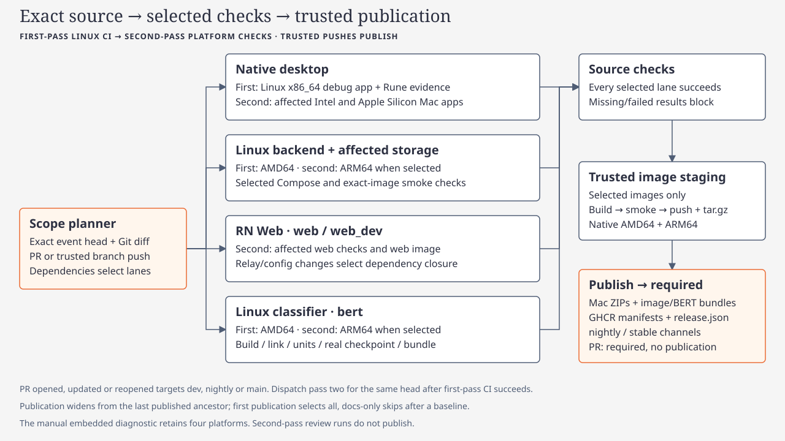
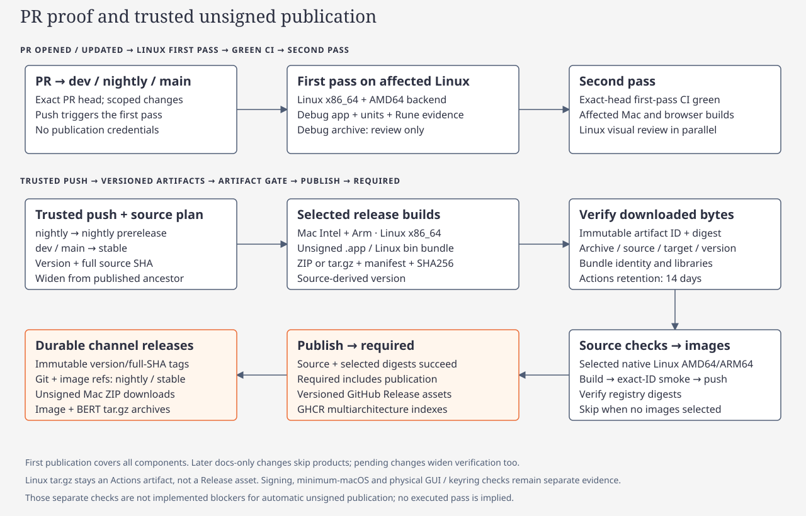

# CI workflows

[Code route](index.md) · [Contributing](contributing.md) · [Versioning](versioning.md)

One [Fleetworks workflow](../../../.github/workflows/fleetworks.yml) selects current product checks. Feature and fix PRs into `dev`, `nightly` or `main` run the Linux first pass on creation and every pushed update. The remaining affected targets run in an explicit second pass after first-pass CI succeeds. Integration-branch pushes verify the merged revision and publish only selected, verified artifacts.

[](../../diagrams/ci-scopes.html)

| Event | Checks | Published output |
| --- | --- | --- |
| PR opened, synchronized or reopened into `dev`, `nightly`, `main` | First pass with affected Linux x86_64 native and AMD64 backend lanes | Linux debug app, test and fixture evidence when selected |
| After first-pass CI succeeds | Dispatch second pass for the same PR head. Run the remaining selected platforms and web lanes | Test, fixture and debug artifacts |
| Push to `nightly` | Selected checks and artifact gates | Versioned GitHub assets and GHCR images; `nightly` channel |
| Push to `dev` or `main` | Selected checks and artifact gates | Versioned GitHub assets and GHCR images; `stable` channel |
| Manual Fleetworks dispatch | Full or exact-base scoped checks | Evidence only; no channel publication |
| Direct embedded / mutation dispatch | Explicit compatibility / diagnostic matrix | Diagnostic evidence only |

PR synchronization covers each feature or fix push. The second pass is a dispatch of the same workflow. Commit-policy title/body edits and path-scoped dataset integrity retain their own triggers. No independent scheduled full rebuild, retired terminal build, duplicate candidate workflow or automatic Release Please PR remains.

## `fleetworks.yml` — scoped branch checks

The [shared planner](../../../scripts/fleetworks_verify.py) compares PR merge bases or push revisions; pull requests run the planner from the trusted base revision (or fall back directly to the full matrix when the base lacks the planner). Pure web UI changes select web checks and its image for the second pass. Native and workstation changes select Linux x86_64 for the first pass and the two Mac legs for the second. Shared Rust contracts widen backend/native checks. Known workflow and planner paths select their owning checks and a native candidate where applicable. Unknown inputs or unavailable comparisons widen the applicable pass. Documentation alone selects repository policy checks (`scripts/fleetworks_doc_links.py`, `scripts/release_check.mjs`, `.opencode/tests/*.test.mjs`, `.github/scripts/test_*.py` and `scripts/test_fleetworks_*.py`). Standard manual dispatch accepts `mode` (`full` or `pr`), `base`, `head` and `components` (`auto`, `native`, `backend`, `all`). Scoped `pr` dispatches require an exact `base` SHA. Explicit component dispatches require an exact `head` SHA.

For trusted publication, the [release planner](../../../scripts/fleetworks_release.py) widens the same check/build plan to include changes since the last reachable published artifact. The first publication covers every production target. This prevents a replaced pending run or earlier failure from losing an unpublished component. Checks and publication consume this one authoritative plan.

| Selected scope | Required evidence |
| --- | --- |
| Rune native | Linux x86_64 in the first pass, Intel and Apple Silicon in the second. Scoped units, real-view Runtime PNG/tree/input fixtures and complete debug packages |
| Backend | Native AMD64 first, ARM64 second. Service build/units, isolated pinned datastore, bootstrap/network roles and selected storage and queue recovery contracts |
| Embedded storage | Native AMD64 first, ARM64 second. Applies to selected storage and compatibility changes |
| Images / Compose | Selected AMD64 backend images and packaged Compose first. Affected ARM64 images and Web image coverage follow in second. Tests use exact loaded image IDs and an isolated deployment |
| React Native Web | Second pass. Locked dependencies, types, Hooks/compiler lint, units, Next build guard, live relay and Chromium contracts, with the development profile when selected |
| Rust-BERT | Native AMD64 first, ARM64 second. Debian bookworm build, pinned real checkpoint inference and extracted bundle checks |

`Fleetworks source checks` (`source_checks`) rejects failed planning, missing/failed/cancelled selected jobs and unexpected skips. The event and pass determine which lanes are selected. First-pass results cover the Linux app and affected AMD64 backend lanes. The second pass consumes a successful first-pass run for the same open PR, base and head. Its **Fleetworks second pass** result covers the deferred selected lanes. A trusted publication independently verifies its selected targets, including Mac ZIPs when the native release scope is selected. Trusted image staging (`release_images` in [fleetworks.yml](../../../.github/workflows/fleetworks.yml) via [release_images.py](../../../.github/scripts/release_images.py)) then builds, smokes, pushes exact digests and exports `fleetworks-images-linux-{amd64,arm64}.tar.gz` archives once. `prepublish` gates trusted publication (`publish` via [publish_release.py](../../../.github/scripts/publish_release.py)), which attaches selected macOS app ZIPs, Linux image archives, Atlas BERT Linux worker bundles and `release.json`, and final **Fleetworks required** (`required`) requires every selected check and publication step to succeed. An unselected lane must skip intentionally.

```sh
base="$(git rev-parse HEAD^)"
python3 scripts/fleetworks_verify.py plan --base "$base" --head "$(git rev-parse HEAD)"
python3 scripts/fleetworks_verify.py local --base "$base"
```

`--event pull_request` compares the merge base. `--json-output <file>` retains source/scope identity. Local mode includes working-tree changes. Manual hosted checks require a pushed exact revision:

```sh
python3 scripts/fleetworks_verify.py dispatch pr --ref <branch> --base <full-base-sha>
python3 scripts/fleetworks_verify.py dispatch full --ref <branch>
```

## Depot image build pilot

The [image helper](../../../.github/scripts/release_images.py) accepts `--builder depot --depot-project <id>`. Buildx is the default. The Depot path uses the same Bake file, targets, tags and version, and loads each single-architecture build into the matching GitHub runner's Docker daemon. The runner checks the loaded images and runs the existing Compose smoke with `--no-build` or the web-only smoke. A Depot build or load failure fails the selected image check.

Provision a dedicated review project with GitHub OIDC trust for this repository and keep public fork PR access disabled. Set the repository variable `DEPOT_REVIEW_PROJECT_ID` to enable the pilot on same-repository PRs into `nightly` and on standard dispatches of the `nightly` branch. Forks use the Buildx job, which has no OIDC permission. Clear the variable to roll back. Trusted release staging uses Buildx during the pilot. Enable Depot for releases only after verifying that review jobs cannot exchange their OIDC identity for release-project access and that releases still publish the exact bytes smoked on the runner. [Depot GitHub OIDC](https://depot.dev/docs/container-builds/integrations/github-actions#authentication)

Compare `image_builder=depot` and `image_builder=buildx` dispatches at the same exact head with the same scope and both Linux architectures. Use a backend/Compose selection and a web-only selection. Compare first runs on cold builders and repeat on warm builders, using the per-architecture image-check artifact's `timings_seconds.bake_and_load` and `timings_seconds.smoke` alongside total job duration and GitHub runner minutes. Record which project/cache was used for each Depot measurement. Verify the fork lane, then confirm digest/config equality, archive checksums and immutable tag reuse in an authorized release pilot before switching trusted staging.

```sh
gh workflow run fleetworks.yml --ref <branch> \
  -f mode=pr -f base=<full-base-sha> -f head=<full-head-sha> -f image_builder=depot
```

## Native app review evidence

[Native verification](native-verification.md) uses [fleetworks-native.yml](../../../.github/workflows/fleetworks-native.yml) on `macos-15-intel` (`x86_64-apple-darwin`) and `macos-15` (`aarch64-apple-darwin`), plus [fleetworks-native-linux.yml](../../../.github/workflows/fleetworks-native-linux.yml) (`desktop_linux`) on `ubuntu-24.04` (`x86_64-unknown-linux-gnu`), when `desktop` or `local_backend` scopes match their pass, caching `target/agents` by target, toolchain, `Cargo.lock` and native/companion manifests. The native workflows run `verify-engine-free`, `cargo fmt --check`, scoped unit tests (`fleetworks-desktop`, `fleetworks-workstation`, `fleetworks-contracts`) via `scripts/agent_cargo.py`, explicit `fleetworks_verify.py native-ui --agent --require-clean` captures (using Mesa Lavapipe on Ubuntu), `scripts/fleetworks_candidate.py build-native` (bundling desktop + companion `argos-api-host`), and Docker-free `scripts/fleetworks_local_backend_smoke.py`. The Linux job includes the `backend-choice` capture and exercises Embedded IPC alongside a real HTTP gateway fixture with disposable storage. The selected backend jobs supply separate Distributed Compose and service evidence. PRs build debug apps and fixture evidence; a selected trusted channel build packages a release macOS ZIP / Linux `.tar.gz` with the calculated artifact version and verifies the archive's ID, SHA256, source revision, architecture, linked libraries, and local-IPC smoke on the extracted bundle. Release promotion currently attaches the macOS ZIPs while Linux candidate archives remain non-release CI artifacts (`Fleetworks-linux-app-*`).

[](../../diagrams/native-release.html)

App assets are unsigned. Fixture generation and downloaded-byte verification do not establish human visual approval, installed GUI/input/accessibility, minimum-OS behavior, signing or notarization. Those remain separate evidence. Actions evidence expires; verified GitHub Release assets persist.

## `embedded.yml` — affected storage compatibility

[Embedded compatibility](../../../.github/workflows/embedded.yml) is reusable for selected Linux storage changes. It runs format, Clippy with warnings denied, workspace tests, service-host help and required in-process storage contracts via `scripts/local_matrix.sh --storage embedded`. It enforces Jobs-only direct SQLite ownership and rejects LanceDB.

A direct manual dispatch retains the four-platform diagnostic, including both Macs:

```sh
gh workflow run embedded.yml --ref <branch>
```

Normal Rune lanes do not install backend engines. The [local embedded gate](contributing.md#full-local-embedded-gate--github-ci-monitoring) still applies to affected compatibility changes.

## `intel-web.yml` — local web client checks

The reusable [web workflow](../../../.github/workflows/intel-web.yml) gets the exact event revision. Node comes from `.node-version`; pnpm is pinned by `package.json`. It has no duplicate automatic branch trigger. Direct dispatch remains available.

Units and browser checks retain permission, reconnect, responsive-layout and React Compiler contracts. Screenshots are inspected evidence, not permission to relax pixel thresholds. Keep production and development results distinct. For local builds/browser checks, set `ARGOS_WEB_TEST_DEV=1` to preserve the user's `.next` output and locks. [Browser workflow](react-ui-testing.md)

## `atlas-bert.yml` — classifier worker checks

The [BERT workflow](../../../.github/workflows/atlas-bert.yml) runs only for affected classifier inputs or explicit full selection. Both physical Linux architectures use `python:3.11-bookworm`, matching deployment ABI. It configures the exact checkout's Git ownership before source checks, then verifies pinned Torch/checkpoint dependencies and real inference from the extracted worker bundle. Native app checks are separate. [Classifier boundary and commands](classifier.md)

## Release, policy and diagnostics

| Workflow | Responsibility |
| --- | --- |
| [fleetworks-native.yml](../../../.github/workflows/fleetworks-native.yml) | Reusable two-target native `package` + `verify` checks and trusted versioned app packaging |
| [ui-visual-review.yml](../../../.github/workflows/ui-visual-review.yml) | Dispatchable PR visual evidence capture and inline PR comment attachment via [ui_visual_review.py](../../../.github/scripts/ui_visual_review.py) |
| [commit-policy.yml](../../../.github/workflows/commit-policy.yml) | **Conventional commits and shared version** checks for PR title/body and integration landing policy; publication also runs policy inside its own dependency chain |
| [datasets.yml](../../../.github/workflows/datasets.yml) | Path-scoped (`datasets/**`, `.gitattributes`) LFS pointer and full object integrity checks, never database seeding |
| [mutation.yml](../../../.github/workflows/mutation.yml) | Explicit hosted Linux diagnostic (`ubuntu-24.04`); local agents do not run mutation tests |

Policy/helper tests run in the lightweight scope job. The backend resolves `ARGOS_SURREAL_BIN` and required server mode **before API unit tests**; passing checks without a configured datastore cannot replace storage evidence. Container Rust builds use the installed Git CLI for pinned Git dependencies; a source fetch is distinct from compiling the Rune UI or C++ storage engine.

Only trusted integration pushes get publication writes, with packages permissions confined to image staging/promotion and contents writes confined to the publisher. All selected artifacts must verify before channel aliases move. Retries preserve existing immutable assets. [Artifact identities, channels and recovery](versioning.md#release-automation)

## Nightly gsd order

1. Push a focused change. The automatic first pass uses the PR merge-base diff to select only affected Linux x86_64 app and AMD64 backend work. This can include services, embedded storage, backend images, packaged Compose or classifier checks. Mac apps, web checks and the web image wait for the second pass.
2. As soon as the exact-head [Linux app and Rune evidence](#native-app-review-evidence) are available, reviewers can test the package while affected backend jobs continue. Exercise affected behavior on Linux, using both **Embedded** and **Distributed** when a shared contract changes. Record the reviewer verdict and the inspected captures or walkthrough on the PR. Fix reported regressions and review the new head.
3. Dispatch the second pass as soon as first-pass **Fleetworks required** is green for the exact head. Continue any outstanding Linux visual review in parallel. The workflow resolves the base from the open PR and checks the full head SHA and successful first pass. It runs affected deferred targets, including Intel and Apple Silicon Mac builds and checks, the React Native Web build and browser checks, and ARM64 backend checks. It skips the previously verified Linux app and AMD64 backend jobs. Trusted integration pushes still run release verification independently.

```sh
gh workflow run fleetworks.yml --ref "<pr-head-branch>" \
  -f stage=second -f pr="<pr-number>" -f head="<full-head-sha>"
```

If the first pass selects no Linux app or backend work, its policy gate still records the exact head. Run the second pass for deferred web or platform work. Track per-head first-pass, review and second-pass results in the [GSD workflow](../../../.agents/skills/gsd/SKILL.md#nightly-workflow-canonical).

## Local verification before CI

Follow the [scope/freeze policy](agent-workflow.md#scope-and-finish-line). Use one build owner, the reusable debug graph and only affected checks. Source, fixture, downloaded-artifact and real deployment results prove different things; report skips and blockers explicitly.

```sh
python3 deploy/verify.py --name fresh-review --platform linux/amd64 --web --atlas --source-journey
```

This authorized smoke owns a fresh project and synthetic data. `--no-build --image-ids <file>` verifies preloaded images without building/pulling. It never owns the user's running stack. No workflow dispatch or release is implied merely by editing documentation.
