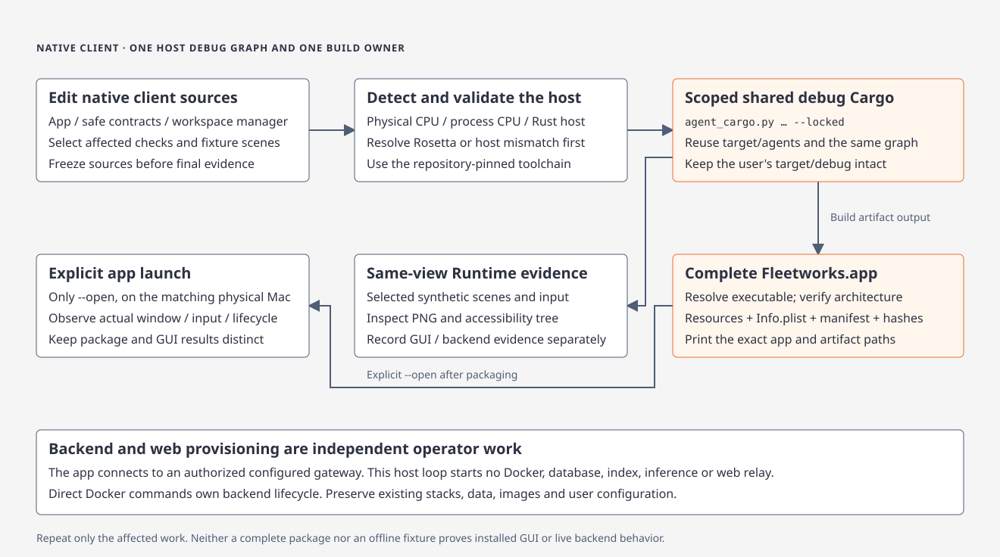
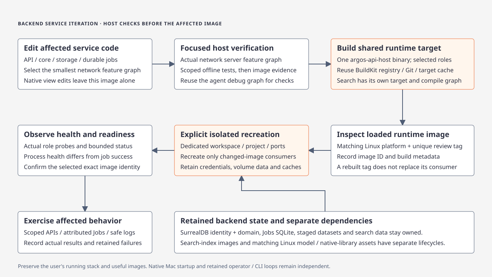
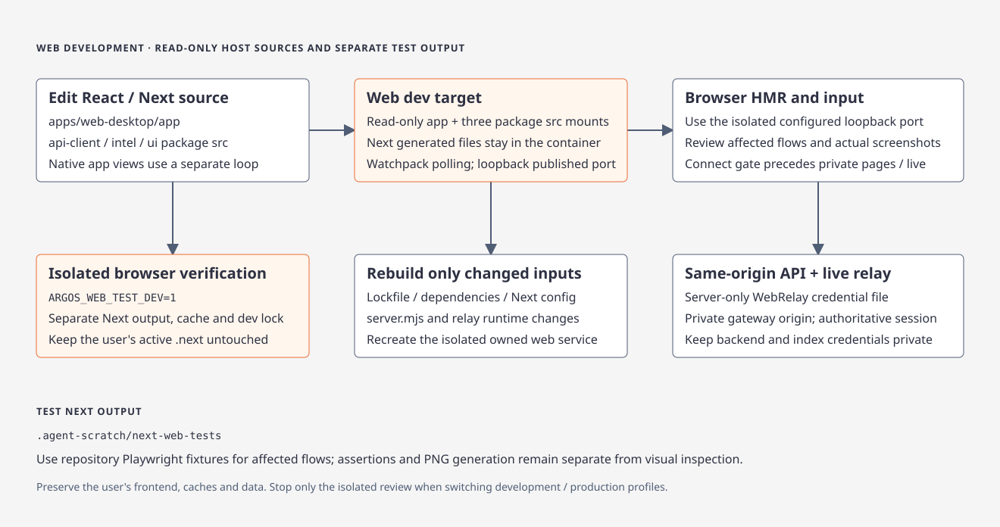
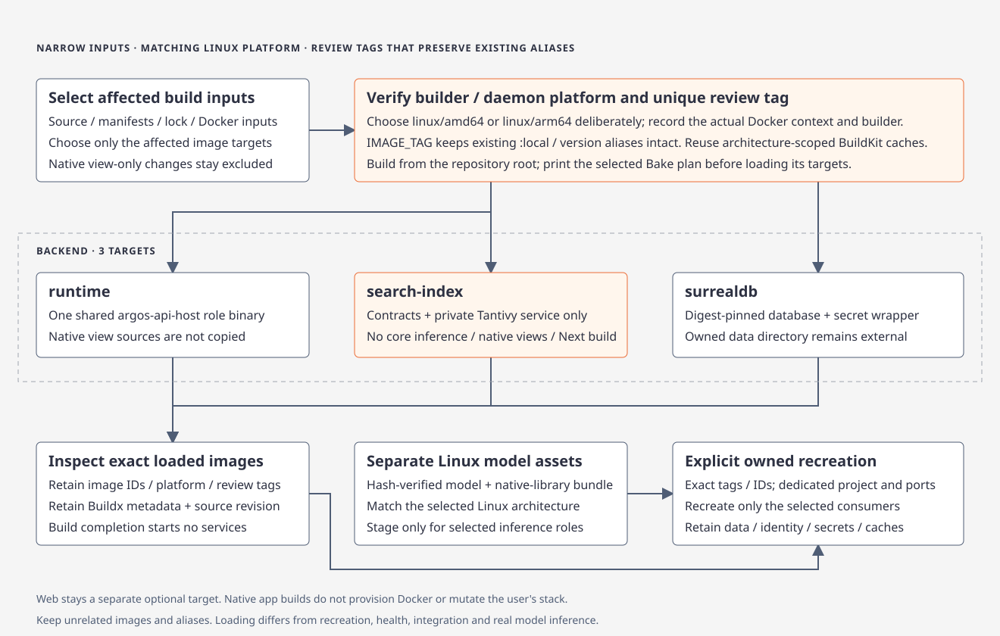
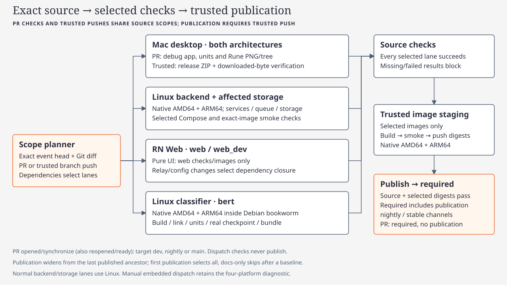
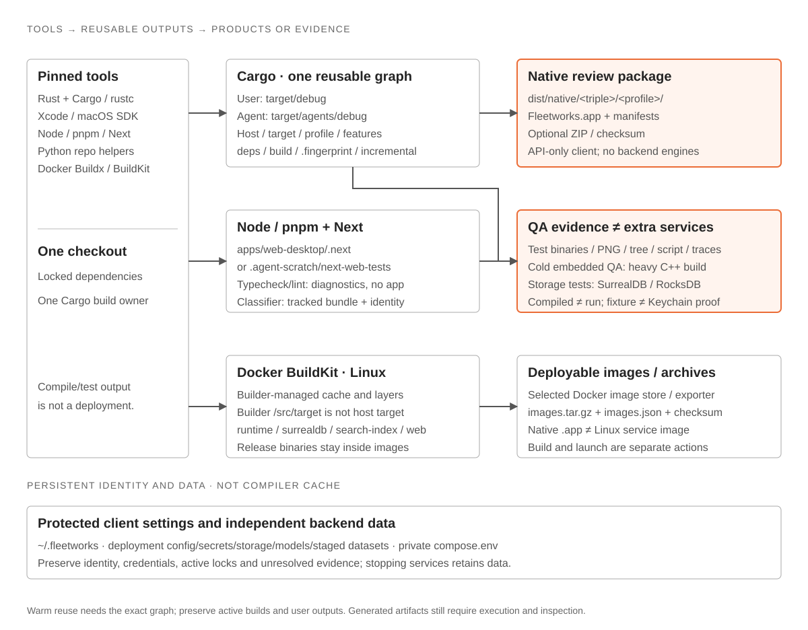

# Contributor workflow

[Code route](index.md) · [Shared agent execution policy](agent-workflow.md) · [Wiki](../../index.md)

Detailed agent rules, loaded before editing or running checks.

## Build and test

Before running verification tests, ask the user to confirm the proposed tests and scope unless those tests are already explicitly authorized in the current session. When the user will verify, run only the requested minimal static checks and report tests and gates as not run. The gate commands below describe authorized verification; they do not override this confirmation requirement.

Browser checks use the repository Playwright runner. Its development server sets `ARGOS_WEB_TEST_DEV=1` to isolate Next output and locks under `.agent-scratch/next-web-tests`; custom test configurations must inherit this setting. Different ports alone do not isolate Next’s development lock. Preserve the user’s `.next` cache and frontend process.

The same existing setting isolates an authorized production build and its compiled-output check. Use the matching pair so both inspect `.agent-scratch/next-web-tests`:

```sh
ARGOS_WEB_TEST_DEV=1 pnpm build
ARGOS_WEB_TEST_DEV=1 pnpm check:web-build
```

Without that setting, both retain the normal launcher `.next` behavior. The isolated build/check pair does not establish a production browser pass or the full frontend gate. After that pair, `ARGOS_WEB_TEST_DEV=1 pnpm test:e2e` runs the repository’s default production browser profile against the same isolated output. Development uses `ARGOS_WEB_PROFILE=dev pnpm test:e2e` and always isolates output. Never stop the user’s launcher or remove its lock to make verification run.

Rust 1.95.0 is pinned. Agents build through `python3 scripts/agent_cargo.py … --locked`, which writes to `target/agents`. Leave `ARGOS_EMBED` unset. The wrapper also removes inherited values. Use `cargo fmt` directly. Keep `target/debug` for the user's builds. Local checks use the host's native architecture.

Run `cargo fmt --all -- --check` before costly Rust checks. If it fails, inspect the dirty diff, format the affected task-owned files under the existing authorization, preserve semantics and unrelated work, then rerun the check. Formatting failure must be resolved or reported; never silently waive the gate.

For Fleetworks client, service, deployment or web work, start with the [scope planner](ci.md#fleetworksyml--scoped-branch-checks). `local` runs the selected host-native iteration checks and includes working-tree paths. Native client contract and workstation unit tests need no datastore. Run the selected hosted checks for platform, server and packaged evidence. Use the embedded gate for affected compatibility and embedded-storage behavior.

<a id="development-loops-local-cli-and-docker"></a>

### Development loops: native app and Docker

Fleetworks has a Rune macOS client, an independently operated Linux backend and Intel Web. The app connects to the gateway; direct Docker Compose operates services. Pick the shortest loop that exercises the changed contract, then widen. The commands below are the fast paths; deployment details stay in the [deployment guide](../../../deploy/README.md).

[](../../diagrams/dev-loops.html)

| Changed code | Loop | Rebuild needed |
| --- | --- | --- |
| Rune app and its client/workstation contracts | **1. Native app** | Scoped host debug tests, selected real-view captures and complete app bundle |
| `argos-api-host` roles, core, storage, jobs (service side) | **2. Runtime image** | `runtime` image |
| `apps/web-desktop/app`, `packages/{ui,intel,api-client}/src` | **3. Web dev container** | None; files reload |
| Web dependencies, relay, Next config, Dockerfile, Compose, SurrealDB wrapper, private search | **4. Image build** | Affected `web`, `runtime`, `surrealdb` or `search-index` image |
| Platform, packaging or release behavior | **5. Hosted CI** | Pushed revision |

**1. Native app loop.** Detect the physical host, run affected app/contracts/workstation tests and build the complete review app through the shared helper. Default host builds reuse the implicit debug graph; an explicit target intentionally selects its separate target directory. Opening the app remains explicit.

[](../../diagrams/dev-loop-native.html)

```sh
python3 scripts/fleetworks_verify.py platform --format json
python3 scripts/agent_cargo.py test --locked -p fleetworks-desktop -p fleetworks-workstation -p fleetworks-contracts
python3 scripts/fleetworks_candidate.py build-native --agent --target host --profile debug
```

Use [selected native verification](native-verification.md) for affected Runtime/PNG/tree/script evidence. The helper streams Cargo progress/diagnostics and stage markers live on stderr, then packages/validates and prints the `.app` path and result metadata. Only `--open` opens the validated app; an already running app is preserved. Native build/fixture commands do not provision a backend. Installed-app, minimum-OS and platform validation stay separate from fixture generation.

**2. Runtime image loop (service changes).** Service roles run from the `runtime` image, so a host build alone does not change them. Run the single helper command to auto-initialize `native-local` if missing, rebuild the backend service images, redeploy the Docker Compose containers, and trigger `fleetworks_candidate.py build-native --target host --profile debug --open` on supported macOS (`x86_64-apple-darwin` or `aarch64-apple-darwin`; pass `--backend-only` or run on Linux to skip the native build):

```sh
python3 deploy/native_review.py up
```

Edit the private, Git-ignored root `compose.env` for local settings; concurrent reviews (`--name <other> --api-port <port>`) keep their per-review env paths without touching an existing root `compose.env`. Reuse the exact env file/project for `ps`, `logs` and `down`. BuildKit retains dependencies; rebuilding an image alone without `up` or `--force-recreate` does not recreate a running consumer. For a server-feature check without containers, use the `server,nlp,classifier` graph in [Targeted local Rust builds](#targeted-local-rust-builds-and-tests-fast-iteration).

[](../../diagrams/dev-loop-runtime.html)

**3. Web development loop.** The independently configured Next server uses a fixed internal gateway origin and separate WebRelay credential. For Docker development, layer `compose.yml` and `compose.dev.yml` over the same native-review base. Source mounts reload on save; dependency, relay or Next configuration changes require the affected image. Start/stop the exact selected Compose files and project explicitly. Browser checks use isolated output as described under [Build and test](#build-and-test).

[](../../diagrams/dev-loop-web.html)

**4. Image build loop.** Build a single target to validate packaging without running the stack, then smoke it.

[](../../diagrams/dev-loop-images.html)

```sh
export VERSION="$(tr -d '[:space:]' < version.txt)"
docker buildx bake -f deploy/docker-bake.hcl web                # one image
docker buildx bake -f deploy/docker-bake.hcl backend
docker build -f deploy/Dockerfile --target runtime -t fleetworks-runtime:local .
docker build -f deploy/Dockerfile --target surrealdb -t fleetworks-surrealdb:3.3.4 .
python3 deploy/verify.py --name isolated-review [--web] [--dev] [--atlas]
```

The standalone Compose command uses `up --no-build --pull never` with the exact preloaded review tags. The [deployment guide](../../../deploy/README.md) supplies provisioning, env-file and project selection; no terminal-client images remain.

**5. Hosted CI.** Preview the selected lanes with `python3 scripts/fleetworks_verify.py plan`, push, and inspect results for the exact revision as described in [CI](ci.md#fleetworksyml--scoped-branch-checks). Compose and packaged smokes on AMD64 and ARM64 run here.

[](../../diagrams/ci-scopes.html)

Stable iteration order: static checks and unit tests (loop 1), then the affected container loop (2 to 4), then hosted CI (5). Do not jump to image builds for changes a host build and unit test can verify.

**Resource and isolation rules.** Docker and Compose runs are heavy and shared. Use a dedicated workspace and `COMPOSE_PROJECT_NAME` per checkout, and remap `FLEETWORKS_WEB_PORT` and `FLEETWORKS_API_PORT` when another stack is running. Never stop, rebuild or remove the user's running stack, volumes or images. Check `docker system df` and free disk before image builds. Raise Docker Desktop memory if a Rust image build is killed.

### Verification ownership and host resources

One integration/build owner uses a stable feature graph and resource-based concurrency; see [execution policy](agent-workflow.md#coordinate-work-that-can-actually-run-in-parallel). Freeze edits before builds and reuse unaffected evidence.

| Verification need | Cache choice |
| --- | --- |
| Native settings, SDK or view iteration | Warm scoped native debug graph; no backend engine build |
| Focused API/storage test matching the embedded gate | Retain the gate's exact workspace package/target set, features, profile, host and storage mode; narrow execution with the relevant test filter |
| Deliberately smaller package graph | Inspect its resolved dependency features once, record the difference and budget a separate build |

The service-host development dependency activates core fixtures. Matching core feature names alone does not guarantee matching `log`, `tracing`, proc-macro or build-dependency inputs; compare the resolved graph. A test-name filter limits cases; Cargo may still compile and launch every selected test harness, including harnesses with zero matches. [Artifact costs](build-artifacts.md#build-cost-signals)

Prefer public typed constructors for internal test fixtures; use literal JSON when the wire format or its rejection is the contract under test. Production-only checks exclude `#[cfg(test)]` fixtures. Before linking many workspace test executables, run the [workspace/all-target Clippy recipe](#targeted-local-rust-builds-and-tests-fast-iteration) in the selected graph to catch fixture API/SDK type errors early.

To focus required embedded execution while retaining the workspace test graph:

```sh
ARGOS_SURREAL_MODE=embedded ARGOS_SURREAL_REQUIRED=1 \
  python3 scripts/agent_cargo.py test --workspace --locked '<test-filter>' \
  -- --nocapture --test-threads=1
```

Replace `<test-filter>` with the meaningful API/storage test name or module. This compiles selected workspace targets and executes matching tests; confirm the intended tests actually matched and ran. Choose a deliberately scoped package/target command below when a separate graph is appropriate.

### Build artifacts and paths

[](../../diagrams/build-artifacts.html)

Storage/compatibility test binaries may link embedded SurrealDB/RocksDB: they are QA harnesses, not extra deployed services. The native API client stays engine-free. See the [build artifact map](build-artifacts.md) for tools, target/profile paths, packages, web/Docker outputs and persistent-data boundaries. Preserve active graphs and user outputs.

### Build cache hygiene

Check `df -h .` and scoped `du -sh` before builds, between large phases and at handoff.

| Check | Action |
| --- | --- |
| Graph and paths | Reuse the [selected graph](#verification-ownership-and-host-resources) in `target/agents/debug`, or `target/agents/<triple>/debug` for an explicit target. Reuse unchanged preflight evidence. |
| Build mode | Use scoped debug `check`/`test`, or `build`/`run` when an executable is needed. Release/cross-target builds serve required evidence. Cargo validates freshness. |
| Ownership | One build owner retains useful binaries, dependencies, fingerprints and incrementals. No fresh per-agent caches, copied fingerprints or cache-switch restarts. Protect `target/debug`. |
| Capacity | Budget growth, linking/debug information and a reserve from a comparable graph. Monitor between stages; stop only task-owned work before exhausting the reserve and report remaining phases as blocked. |
| Obsolete candidate | Require exact package/target/hash provenance in `.d` and fingerprint metadata showing the unit is no longer selectable by current required graphs. Removed packages or mandatory dependency changes can supply that proof; age, an old hash or an unused lock cannot. |

If recovery is necessary:

1. Inventory a bounded repo-local agent-cache subset: owner, regular-file/no-symlink status, device/inode, link count and allocated bytes. Deduplicate inodes; reclaim estimates include only single-link files or fully covered hardlinks. Do not hash whole caches.
2. The build owner revalidates provenance, identity, active outputs and open files immediately before removal, briefly quiescing only its own build if needed. Preserve current native/server/embedded graphs and shared dependencies.
3. Measure actual free space afterward; allocated estimates may differ. Record removed paths, retained useful binary and remaining reserve in the task handoff.

Never run blanket `cargo clean`, remove locks to bypass contention or erase user/global caches, source, scripts, logs, credentials, QA evidence or unresolved data. Interrupted, skipped and unreached phases never count as passes.

### Targeted local Rust builds and tests (fast iteration)

Detect the native host with `uname -ms` and `rustc -vV | grep '^host:'`. Reuse one feature graph and `target/agents`. Set `CARGO_BUILD_JOBS` from memory pressure. For an affected embedded contract, keep the workspace's compatibility features `embedded,nlp,classifier`.

```sh
python3 scripts/agent_cargo.py check --locked -p argos-osint-core
python3 scripts/agent_cargo.py clippy --workspace --all-targets --locked -- -D warnings
ARGOS_SURREAL_MODE=embedded ARGOS_SURREAL_REQUIRED=1 \
  python3 scripts/agent_cargo.py test --locked --workspace \
  --test storage_jobs <filter> -- --nocapture
```

Use `--lib`, `--bin <bin>` or `--test <name>` for the relevant target. Preserve activating targets when matching workspace features. Confirm that tests ran. `python3 scripts/test_surreal.py --mode embedded --no-fail-fast` runs required embedded contracts. Native, API and administrative process checks follow the affected contract in [CI](ci.md).

Future smaller gateway test lanes or reduced-debug profiles remain unvalidated follow-ups. Plan profile/feature changes separately, budget a fresh build and rerun affected checks.

For an authorized focused Fleetworks storage contract, use an isolated pinned server and the network service feature graph. Resolve the checksum-verified executable with `python3 scripts/test_surreal.py --mode server --fetch-only`.

```sh
ARGOS_SURREAL_MODE=server ARGOS_SURREAL_REQUIRED=1 ARGOS_SURREAL_BIN=/absolute/path/to/surreal \
  python3 scripts/agent_cargo.py test --locked -p argos-osint-core \
  --no-default-features --features server,nlp,classifier --test storage_brief
```

### Fail early, then run the gate

Follow the [scope/freeze policy](agent-workflow.md#scope-and-finish-line). Exercise the decisive realistic fixture before the broad gate; see [native fixture prerequisites](../../../.opencode/skills/argos-testing/SKILL.md#31-native-fixture-prerequisites-and-diagnostic-output). Fix demonstrated in-scope failures and rerun affected checks; defer unrelated findings.

### Full local embedded gate & GitHub CI monitoring

For affected embedded and compatibility changes, run the native gate after focused stability.

```sh
env -u ARGOS_SURREAL_MODE -u ARGOS_SURREAL_BIN -u ARGOS_SURREAL_REQUIRED \
  scripts/local_matrix.sh --storage embedded
```

The gate runs format, Clippy, workspace tests, actual service-host CLI help and required embedded storage. Its broad workspace test phase uses `--no-fail-fast` to collect independent target failures while retaining a failing exit status; the earlier formatting and compile/lint preflight still stop on errors. Parent mode variables stay unset so mode-selected storage runs once. Targeted storage tests set mode and required execution explicitly. Embedded storage retains workspace library/binary unit targets to preserve dependency-feature unification; those units and some native-only fixtures execute in both phases. Selecting only storage integration targets can create another cold graph. CLI help prints Cargo progress while building the normal service executable and may require a separate runtime graph.

Pull requests into `dev`, `nightly` and `main` run selected Fleetworks checks on creation and every pushed update. Affected Linux storage changes select embedded compatibility; the normal Rune Mac lanes stay engine-free. Direct `gh workflow run embedded.yml --ref <branch>` retains the four-platform diagnostic. Integration pushes publish only verified, source-scoped [channel artifacts](versioning.md#release-automation). Dispatch `mutation.yml` for hosted mutation evidence. Once changes are published, inspect the checks for the exact revision with `gh pr checks`, `gh run list` or `gh run view --log-failed`. `.github` remains Code Architect-owned. MiniLM requires explicit opt-in.

## Storage facts

- Fleetworks uses a workspace-specific network datastore. See [direct backend deployment](../../../deploy/README.md).
- Network service builds use `--no-default-features --features server,nlp,classifier`.
- The compatibility build and embedded storage contracts use `embedded,nlp,classifier`.
- Domain storage uses SurrealDB. Only `fleetworks-jobs` may directly depend on SQLite (`rusqlite`); CI enforces that boundary and rejects LanceDB.
- Storage tests pick their mode from `ARGOS_SURREAL_MODE` and skip without it (and without `ARGOS_SURREAL_BIN`); run them via `test_surreal.py`.


## Classifier dataset resolution order

The seed corpus resolution order for the classifier is:

1. Explicit file path (passed via `--file` flag) — **authoritative**: an invalid or missing explicit selection is an error, never a silent fallback to the next candidate
2. `ARGOS_CLASSIFIER_CSV` environment variable — **authoritative**: an invalid or missing env selection is an error, never a silent fallback to the next candidate
3. Saved Profile `[data_paths].article_csv` — relative to `ARGOS_HOME`; a missing saved selection is an error.
4. Repo `dataset/` (**singular** directory) — the resolver looks for `dataset/argos_atlas_strategic_domains_v2.csv` **inside it**.
5. Repo `datasets/` (**plural** directory, the customer's directory) — the default seed CSV is `datasets/argos_atlas_strategic_domains_v2.csv`; 1,020 distinct synthetic scenarios with Train/Calibration/Development/Test partitions. The original unversioned CSV remains the frozen v1 fixture and is selectable explicitly. The seed corpus is **synthetic development material** and is never ingested into live Atlas/Brain evidence. Do not mix with `datasets/argos_actors.csv` or the old seven-topic corpus
6. `<ARGOS_HOME>/dataset/` (runtime default)

**Rust dataset resolver (unit U4) rules:**
- Explicit, environment and saved Profile selections are **authoritative** — an invalid or missing explicit/env/saved selection is an **error**, never a silent fallback to the next candidate
- There is **no** `CARGO_MANIFEST_DIR` developer-path fallback

## Classifier bundle build workflow

**Status:** bundle build/parity scripts, explicit native maintenance, local admission and the background monitoring consumer are implemented. Verification results are recorded separately; these commands do not establish a quality or performance result. Synthetic-only installations retain the explicitly activated baseline until independently reviewed promotion evidence exists.

- **Rebuild:** run `node scripts/build_classifier_bundle.mjs` to generate the committed bundle at `crates/argos-osint-core/assets/classifier/natural-classifier.js` from the verified vendored upstream files (`natural@8.2.6`, `apparatus@0.0.10`) via the deterministic adaptation patch. The script performs **no network access** at build time; the pinned packages must already be present locally.
- **Verify:** run `node scripts/build_classifier_bundle.mjs --check` to compute the SHA-256 of the current bundle and compare it against the committed `source-manifest.json` entry; this verifies byte-for-byte fidelity and fails closed on upstream drift. Output includes `crates/argos-osint-core/assets/classifier/source-manifest.json` with upstream versions/commits/tarball+per-file hashes/adaptation list/bundle hash.
- **Parity test:** run `node scripts/test_classifier_bundle.mjs` to load the same upstream modules in Node with unmodified semantics and compare against the committed bundle (same labels, same feature order, same log scores) against its pinned oracle and declared tolerance; record the actual measured delta for each regenerated fixture set. The test also asserts the bundle has no unresolved `require`, no `fs`/`events`/`os`/`webworker-threads` usage, and no dependency on a Node-only global. Run the check on the current accumulated tree before recording success.
- The bundle is **committed** in the repository; whenever a pinned dependency version changes, the bundle must be regenerated and `--check`-verified. The root `package.json` devDependencies pin `natural: "8.2.6"`, `apparatus: "0.0.10"`, `esbuild: "0.21.5"`.
- **No Node.js for classifier runtime:** classifier build/test commands use Node only as tooling. The shipped classifier bundle runs inside the Rust binary's embedded QuickJS worker with 128 MiB memory / 1 MiB stack ceilings and inference batch size 64.

## Workflow rules

- **Worktrees are edit-only:** run only `cargo fmt` there. The integration checkout owns scoped verification and any affected compatibility gate.
- **Scope and verification:** follow the [finish-line policy](agent-workflow.md#scope-and-finish-line); no unrequested cleanup, late broad audits or unchanged full-suite retries.
- **Commits:** Conventional Commits (`feat` minor, `fix`/`perf` patch; breaking = `!` + `BREAKING CHANGE:` footer). Check with `node scripts/release_check.mjs message --file <path>` and `… versions`. Artifact CI calculates commit-derived versions; source baseline updates remain explicit maintainer work. Never hand-bump during ordinary work or invent `Release-As`. Stage exact paths; preserve unrelated changes.
- **`.github`** changes go through Code Architect.
- **Planning:** multi-phase work uses `.planning/<YYYY-MM-DD-slug>/` (`task_plan.md`, `findings.md`, `progress.md`); see [planning-artifacts](planning-artifacts.md).
- **Scratch** lives only in `.agent-scratch/`, never in `crates/`, `docs/`, `scripts/`; never stage it.
- **Docs:** architecture/contract changes update docs and diagrams in the same change ([conventions](conventions.md#architecture-and-concepts)). Tests stay offline.

## Evidence, estimates and workflow improvements

The [execution policy](agent-workflow.md) owns scope, delegation, evidence reuse and honest estimates. Keep commands here and link shared rules instead of duplicating them. Documentation-only work uses static checks, not Rust builds.
