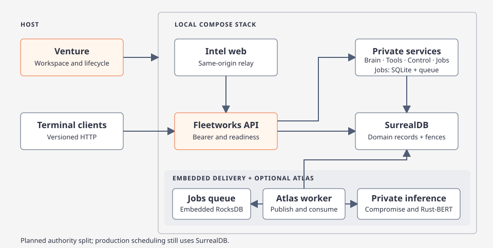

# Fleetworks

[Code route](index.md) · [Architecture](architecture.md) · [Deployment guide](../../../deploy/README.md)

Fleetworks Desktop is the API-only macOS control hub. Its eight pages use an independently operated gateway; launching the app does not launch the backend or Intel Web. Atlas, Brain, Tools, Models and Profile target shared backend resources within the caller's permissions. Workstation, Workspaces and Jobs & Logs separate local identity from registered request activity. Start with [native connections](native-connections.md), [protected workspaces](native-workspaces.md) and the [native build/fixture guide](../../../apps/fleetworks-desktop/README.md).

Linux domain services share the network datastore. Jobs exclusively owns its SQLite operational logs and embedded RocksDB queue; [actor discovery](actor-search.md) has a separate private Tantivy service. The [isolated native-review deployment](../../../deploy/README.md) builds backend-only images and leaves web/client launch independent. Backend network readers accept explicit current-format configuration and saved credentials; they do not migrate historical files or revive environment provider keys during ordinary reads.

Venture and terminal commands below are retained operator compatibility surfaces while replacement/installed dual-Mac parity gates remain open. Venture owns only its recorded operator workspace and stack. Those paths are distinct from the native protected OS-home container. Retaining a command does not authorize it to bypass current registration, purpose permissions or configuration revisions; older contextless mutations are rejected by the gateway.

[](../../diagrams/fleetworks.html)

## Try the workspace and clients

From a checkout, build the launcher and six sibling executables.

```sh
cargo build --locked -p fleetworks-venture -p fleetworks-cli --bins
target/debug/venture --workspace ./review-workspace init
target/debug/venture --workspace ./review-workspace client profile workspace
```

Workspace selection uses `--workspace`, `FLEETWORKS_WORKSPACE`, then `.fleetworks` under the current directory. Venture displays the absolute workspace path. The initial directories are `datasets/`, `exports/`, `config/`, `secrets/`, `models/`, `logs/`, and `storage/`.

Use `config/workspace.toml` for `[datasets]` bindings and `[environment]` defaults. Dataset paths are relative to the workspace. Use `secrets/environment.toml` for private environment defaults. An explicitly set process variable takes precedence over either file.

Run `venture --workspace ./review-workspace import --from "$HOME/.argos"` to copy selected provider API-key configuration and model defaults. Venture reports counts and rejects destination conflicts. Import preserves the source files.

## Connect to the API

The clients default to `http://127.0.0.1:8080`. Pass `--api-origin` or set `FLEETWORKS_API_ORIGIN` to select the API listener. The API bearer can come from `--api-token-file`, `FLEETWORKS_API_TOKEN`, `FLEETWORKS_API_TOKEN_FILE`, or the workspace's `secrets/api-token`. Use the same token as the API when it requires one. Unauthenticated HTTP is restricted to loopback. Remote connections require HTTPS and a bearer token.

See the [CLI command reference](../../../apps/fleetworks-cli/README.md) for route-specific commands and their API requirements. Use `venture status` for storage-backed readiness and `venture client <app> --help` for an individual CLI.

## Launch the Compose stack

Run `venture --workspace ./review-workspace up` from the repository root with a local Docker engine and Docker Compose installed. A new interactive setup defaults to `local-net`; a new non-interactive setup uses `compose-disk`. Pass `--storage` to select a target explicitly. Venture prepares credentials and records project ownership before starting managed host processes and the Compose API, private services, workers, and web relay.

- `local-net` connects to running SurrealDB. Set `FLEETWORKS_STORAGE_URL` and `FLEETWORKS_STORAGE_ROOT_PASSWORD_FILE`. Jobs owns its local embedded stores. Use `host.docker.internal` for ports published on the Docker host.
- `local-process` starts and supervises a disk-backed SurrealDB 3.3.4 process on the host. Venture supplies their connection settings to the stack and preserves their workspace data on stop.
- `remote` is the interactive choice for `--storage external`. Venture checks the configured SurrealDB URL at `/health` before recording the stack.
- `compose-disk`, `host-disk`, and `host-memory` select the Compose disk database, a Venture-managed host disk database, or a disposable host database.

Later launches reuse the recorded configuration. Open the printed web address, `http://127.0.0.1:3000` by default. Set `FLEETWORKS_WEB_PORT` or `FLEETWORKS_API_PORT` to remap the loopback ports. Use `venture status`, `venture logs --follow`, and `venture stop` with the same workspace. Stop retains persistent data. See the deployment guide for [local-network credentials](../../../deploy/README.md#local-network-services) and [native process prerequisites](../../../deploy/README.md#venture-managed-host-processes).

Use `venture web` to start the stack and open Jobs and Logs, or `venture web --terminal logs` to follow Compose output. Both accept the `up` options. Attach to an existing stack with `venture client jobs tui` to inspect jobs and logs or confirm retry and cancellation. Exiting the terminal session leaves the stack running.

The six `tui` client commands render a full-screen ratatui view on a terminal and keep their line session for pipes ([details](../../../apps/fleetworks-cli/README.md#full-screen-tui-sessions)). Native clients and Venture are built on the host, while service roles run from the `runtime` image that `up` rebuilds. See the [development loops](contributing.md#development-loops-local-cli-and-docker) for choosing between CLI, web-dev and image iteration.

Use `up --dev --storage local-net` or `web --dev --storage local-net` for Next development mode. Venture remembers the profile for status, logs and stop. Use `up --no-build` for preloaded images. [Development setup](../../../deploy/README.md#web-development)

Add `--atlas` to start the Atlas worker, Compromise NLP, and Rust-BERT classifier services with delivery through Jobs. Submit a durable cycle with `venture client atlas start --request-id <id>`. Use a new request ID for each new collection. The [Atlas deployment guide](../../../deploy/atlas-dispatch.md) explains the provider and model files required for a live cycle.

## Run the network API and workers

Build the service host with network storage enabled.

```sh
cargo build --locked -p argos-api-host --no-default-features --features server,nlp,classifier
```

The service host compiles the embedded RocksDB queue. Linux source builds need `libclang-dev`; macOS builds need Xcode or its Command Line Tools. Set `LIBCLANG_PATH` when using a nonstandard LLVM installation. Client-only builds do not compile this engine.

Set `FLEETWORKS_WORKSPACE` and `ARGOS_HOME` to the same absolute workspace path. Set `FLEETWORKS_STORAGE_URL` to the SurrealDB `ws://` origin on a private network or `wss://` origin for TLS. The namespace, database, and runtime username default to `fleetworks`. Use `FLEETWORKS_STORAGE_NAMESPACE`, `FLEETWORKS_STORAGE_DATABASE`, and `FLEETWORKS_STORAGE_USERNAME` to override them.

Run `argos-api-host --role bootstrap` before serving against the authenticated datastore. It applies the schema and creates the database-scoped Editor account. Set `FLEETWORKS_STORAGE_ROOT_PASSWORD_FILE` and `FLEETWORKS_STORAGE_PASSWORD_FILE` to files containing the bootstrap and runtime passwords. The root username defaults to `root` and can be set with `FLEETWORKS_STORAGE_ROOT_USERNAME`. Use a randomly generated 32–256 character runtime password with letters, digits, or `-._~`. Keep the runtime password file across restarts. A new in-memory server starts with a new database identity.

Then run the host with `--role api`, `--role worker` and `--role brief-worker` using the runtime credentials. The API additionally needs `FLEETWORKS_API_TOKEN_FILE` and `FLEETWORKS_API_ALLOWED_HOSTS`. The latter is a comma-separated list of exact Host authorities, such as `127.0.0.1:8080,localhost:8080`. Set `FLEETWORKS_API_ALLOWED_ORIGINS` to the allowed browser origins. The API binds to loopback unless `FLEETWORKS_API_BIND` is set explicitly. Both worker roles run without an HTTP listener.

Standalone private services use the same workspace and network storage settings. Start each with `argos-api-host --role <role>` and set `FLEETWORKS_<SERVICE>_BIND` and `FLEETWORKS_<SERVICE>_ALLOWED_HOSTS`, where `<SERVICE>` is the uppercase role name. Share each bearer file between the service and its callers. Venture provisions these connections automatically.

| Role | Responsibility | Shared bearer variable |
| --- | --- | --- |
| `brain` | Actor dossiers, retained briefs and actions, Related articles, topology | `FLEETWORKS_INTERNAL_TOKEN_FILE` |
| `tools` | Tool catalog, submission and results | `FLEETWORKS_TOOLS_TOKEN_FILE` |
| `control` | Model defaults, Profile and configuration exports | `FLEETWORKS_CONTROL_TOKEN_FILE` |
| `jobs` | Job reads, retry/cancellation, and SQLite operational logs | `FLEETWORKS_JOBS_TOKEN_FILE` |
| `execution` | Retained API-key model attempts | `FLEETWORKS_EXECUTION_TOKEN_FILE` |

Set `FLEETWORKS_BRAIN_ORIGIN`, `FLEETWORKS_TOOLS_ORIGIN`, `FLEETWORKS_CONTROL_ORIGIN`, and `FLEETWORKS_JOBS_ORIGIN` on the gateway. Set `FLEETWORKS_EXECUTION_ORIGIN` on Brain, the worker and brief worker. The gateway owns live event streams; the brief worker owns stage validation and publication. Profile identifies Control's process, while gateway readiness identifies the gateway.

Execution resolves captured provider accounts from workspace configuration and streams progress and results. Its callers load route metadata without provider API keys and cannot write `auth.json`; local endpoints and the ChatGPT subscription execute in the caller. Role-default edits apply to new work, and endpoint changes invalidate captured routes. Callers own retries and validation.

With `--atlas`, `atlas-worker` consumes Jobs-owned embedded queue deliveries after SurrealDB records the transitional job and outbox transaction. Stored job revisions and database identity govern cancellation, retries and completed-run replay. The `nlp` and `classifier` roles accept authenticated requests. Use `venture train-legacy` to train the Natural classifier against a snapshot of the selected CSV.

## Rollout status

| Area | Implemented behavior |
| --- | --- |
| Venture and workspace | Configuration import, local-network and managed process modes, owned lifecycle, client launch |
| Atlas | Durable dispatch and replay, separate NLP/Rust-BERT services, shared daily NewsAPI quota in SurrealDB |
| Brain and Intel | Retained briefs and publication recovery, actor search by exact name or indexed alias. Seed with `venture seed-actors --file <workspace CSV>`. [Actor catalog guide](actor-catalog.md) |
| Tools, Models and Profile | Durable manual tool results, saved model defaults, workspace health and server-side configuration exports |
| Interactive terminal | Six line-oriented clients via `venture client <app>`; explicit subcommands provide one-shot output |
| Model execution | Shared provider pacing, per-account admission and private execution for retained API-key attempts |

Check the selected revision's workflow results for verification evidence. The [CI guide](ci.md#fleetworksyml--scoped-branch-checks) describes native, server, image, Compose, queue, web and classifier checks.

## Verification

Use [the network smoke](../../../scripts/fleetworks_network_smoke.py) with the built host and the repository-pinned SurrealDB 3.3.4 binary. It creates isolated memory and disk fixtures and checks authenticated startup, retained routes and restart behavior.

## Operational persistence migration

The Jobs process exclusively opens `FLEETWORKS_JOBS_SQLITE_PATH` (default: `<workspace>/storage/jobs/jobs.sqlite3`). Venture mounts `storage/jobs/` only into Jobs at `/var/lib/fleetworks-jobs`; other processes use its authenticated HTTP endpoint. WAL mode and FULL synchronization persist acknowledged writes. Stop retains the database.

Standalone operational logs use SQLite. Existing SurrealDB log history remains in the domain database; investigation traces and transactional job lifecycle events retain their existing storage. Job scheduling, leases, attempts, recovery and Profile telemetry still use SurrealDB. The SQLite crate supplies scheduling primitives, but production scheduler cutover is pending the domain handoff/fencing port. Drain existing jobs before switching new submissions; do not copy active leases across stores.

The target pairs SQLite job state with a RocksDB queue embedded in Jobs, replacing RabbitMQ. See [ownership, rollout scopes and acceptance](jobs-persistence.md) before treating the scheduler migration as complete.
