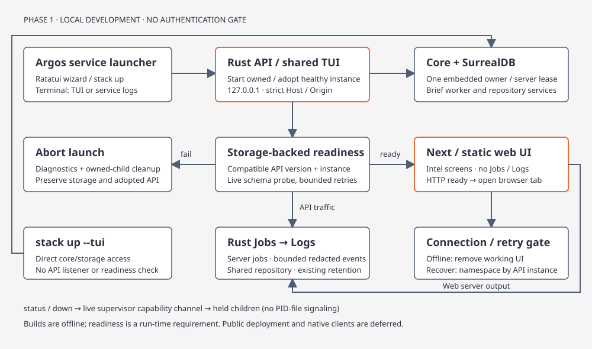

# Local Intel web application

[Code route](index.md) · [Usage](../concepts/usage.md) · [Living specification](../../argos-intel-living-spec.md)

`@tag:intel-brief`

[](../../diagrams/intel-web.html)

The Next static export is a client of the Rust HTTP API. It never opens SurrealDB or receives provider credentials. In log mode, the launcher starts a child copy of `argos` in a hidden API-host mode; that child owns the repository and elected core workers/heartbeat. A separate `argos-api-host` binary is optional for standalone use/adoption. With an owned API and `--terminal tui`, the supervisor hosts the same API router in-process and the TUI shares its single runtime repository; this supports embedded storage without a second owner. The in-process host starts the workers/heartbeat before readiness; the TUI reuses those workers. The process heartbeat runs every 30 seconds. An owner with no beat for 90 seconds is treated as gone. Standalone `stack up --tui` continues directly to core/storage without an HTTP listener.

## Source boundaries

| Layer | Source | Responsibility |
| --- | --- | --- |
| Core | [intel_service.rs](../../../crates/argos-osint-core/src/intel_service.rs) | Bounded article occurrence pages, immutable brief projections, ensure/reload admission, Related |
| HTTP | [argos-osint-api](../../../crates/argos-osint-api/src/lib.rs) | `/api/v1`, DTO validation, storage readiness, Host/Origin/CORS |
| Host | [argos-api-host](../../../crates/argos-api-host/src/main.rs) | Optional standalone loopback listener, repository ownership, brief worker, shutdown |
| Supervisor | [stack](../../../crates/argos-osint-bin/src/stack/mod.rs) | Preflight, owned/adopted API, readiness-before-frontend, live control channel, cleanup |
| Presentation | [presentation.rs](../../../crates/argos-osint-bin/src/stack/presentation.rs), [node.rs](../../../crates/argos-osint-bin/src/stack/node.rs) | Shared-process API, terminal lifecycle, nvm environment, web HTTP readiness and OS browser handler |
| Client | [api-client](../../../packages/api-client/src/index.tsx) | Context and TanStack Query v5, backend/instance cache namespaces, readiness polling; app-supplied `BackendSettings` snapshots/request IDs |
| Web settings | [backend-settings.ts](../../../apps/web-desktop/app/backend-settings.ts) | Browser URL/storage selection and UUID generation; consistent static/client snapshots without an initialization setState effect |
| UI | [intel](../../../packages/intel/src/index.tsx), [ui](../../../packages/ui/src/index.tsx) | Bulletin, Focus Brief, Related leads and bounded topology navigation; operational Jobs/Logs remain in Rust |
| Service logs | [traffic.rs](../../../crates/argos-osint-bin/src/stack/traffic.rs) | API access events and frontend output attached to existing Jobs/Logs service rows |
| Static host | [serve_web.mjs](../../../scripts/serve_web.mjs) | Loopback export hosting, CSP and Host restrictions |

UI creation and review follow the [React UI design rules](react-ui.md), including the [Argos look and feel](react-ui.md#argos-look--feel-reference) and the [React Native/Compiler baseline](react-ui.md#react-native-and-compiler-baseline). Component design may be original inside the Argos theme. API and product semantics remain defined here.

## Web presentation

The React Native Web client uses the Dark Digitized HUD + Glassmorphism system (core TUI palette with glass surfaces and severity tones) through `@argos/ui`; browser shell CSS shares it. See the [Argos look and feel](react-ui.md#argos-look--feel-reference) and [visual language](react-ui.md#visual-language). Component treatments may vary inside that theme. The shell exposes connection state and a bottom Desktop/Bulletin/Topology taskbar. Bulletin remains the initial view; Desktop offers an Intel launcher that returns to the retained feed without resetting its filters or selected article. Bulletin uses a category sidebar at widths of at least 1000px and wrapping channel controls below that, compact day controls, labeled search and glass feed rows; Focus Brief retains the approximately 24/48/28 wide split and Extracted/Reader/Context controls below 850px. Reading text wraps within each pane. Selected controls expose pressed state; keyboard focus remains visible independently of selection. See [React UI components](react-ui.md#current-web-components) for reusable treatments.

The TUI reader and its See more overlay use the same stored description. Acquisition body content remains separate input to enrichment; it does not replace displayed reader prose. Overflow fixtures keep those sources different and recalculate section positions after changing description length.

## Interactive topology graph

React Native Web topology uses a 3D force graph. [Topology.tsx](../../../packages/intel/src/topology/Topology.tsx) owns data, selection, filters and the accessible lists; [ForceCanvas.tsx](../../../packages/intel/src/topology/ForceCanvas.tsx) wraps `react-force-graph-3d` (pinned in `packages/intel`). Keep this canvas. Do not replace it with another chart library or a hand-rolled layout. The WebGL canvas is client-only and lazy-loaded behind `Suspense` with a loading state; static export never renders it. The library mutates its data, so the canvas receives cloned nodes/links. A WebGL or lazy-load failure retains an actionable error boundary and the accessible list twin; a 3D renderer does not change evidence semantics or authorize native-device support. Topology data and the `POST topology` seed contract are unchanged. The TUI keeps its existing topology view.

- **Selection:** the first node is selected by default; Clear selection sets an explicit none (distinct from the default). The selected node stays visible under every filter. Selection moves the 3D camera toward the node. A **Neighborhood** panel shows kind, label, outgoing/incoming counts and neighbors grouped by kind; each neighbor is a button that selects it.
- **Controls:** Zoom in/out changes camera distance around the current orbit target; the first settled layout fits each graph once, preserving later camera adjustments. Fit frames the graph; Reset reheats and fits; Pause/Resume layout, Clear selection and Reset filters remain explicit buttons. Pointer orbit controls support 3D inspection.
- **Filters:** node kind toggles, label text filter, connection-label filter, and neighbors-only depth (All / 1 / 2) around the selection. Non-matching nodes are removed from the graph; a no-match state offers Reset filters.
- **Accessibility:** the canvas has a summary `aria-label` (node/connection/kind counts, selection) and is not the only path to content. Parallel lists "Topology nodes" (pressable, `aria-pressed`) and "Topology connections" (`from → label → to`) follow the same filters. Kind color is paired with a text kind label.
- **Reduced motion:** `prefers-reduced-motion` zeroes zoom/center transitions, pre-settles the layout (120 warmup ticks and zero cooldown ticks) and disables node dragging.
- **Error boundary:** The lazy `ForceCanvas` (loaded behind `Suspense` with a `LoadingState` fallback) is wrapped in `@argos/ui` `ErrorBoundary` with `onRetry={reset}`; the boundary increments a `resetKey` on retry, remounting the canvas children cleanly. The top-level `Workspace` in `packages/intel/src/index.tsx` is likewise wrapped in `ErrorBoundary` so a crash in any view resets to a retryable fallback without unmounting the shell.
- **Rejected:** ChartKit was evaluated and not used: it has no network/graph chart, is React Native-only, and would need `react-native-svg`.

Inferences are the final section in the middle Reader pane, following the source link. Narrow React Native layouts keep them in Reader rather than Extracted. Core TUI places them last after Related in its center stack, preserving independent left/center scrolling and topology return.

## Async presentation

`@tag:abort-signal`

Bulletin, brief evidence/status, Related and Topology use shared RN loading/empty components. Initial requests, background refresh, next-page loading and failures are distinct; zero confidence is preserved as a value. Missing cycles and zero matching rows have explicit empty states after successful reads. The workspace owns a native ScrollView; Bulletin requests opaque cursor pages near its end, guards concurrent/failed fetches, deduplicates occurrences and retains a manual load/retry control. Query keys keep categories, days, searches and backend instances separate. See [async UI contract](react-ui.md#async-data-and-pagination).

- **AbortSignal propagation**: TanStack Query v5 hooks (`useRead`, `useArticles`, `useTopology`, `useRelated`, and the `health` connection probe in `packages/api-client`) accept the query context `{ signal }` and forward it into `request<T>`. `combineSignals` aggregates the caller's signal with a default 10-second timeout (`AbortSignal.timeout(10000)`), preferring native `AbortSignal.any` with an `AbortController` fallback for multi-signal cleanup. Component unmounting, view navigation, or query key invalidation immediately aborts in-flight browser `fetch` requests. The `request` function wraps both `fetch` and `response.text()` in one `try`/`finally`, so `combined.cleanup?.()` (which removes the abort listeners) always runs whether the request completes, fails, or is aborted mid-body-read; an abort during `response.text()` is surfaced as an aborted fetch rather than a silent partial parse.
- **Typed `ApiError` contract**: Non-200 HTTP responses parse structured JSON bodies (`{"error": "..."}` or `{"message": "..."}`) or fallback to trimmed text, throwing a typed `ApiError` containing the numerical `status` code and optional payload. HTTP 204 No Content cleanly resolves to `undefined`.
- **Search input debouncing**: In `packages/intel/src/index.tsx`, the Bulletin search input uses a 300ms `useEffect` debounce timer (`debouncedSearch`). Rapid keystrokes immediately update local input state for responsive typing, while queries to `useArticles` fire only after typing pauses for 300ms, preventing SurrealDB `string::contains` query storms.


## Feed imagery

React Native Intel Bulletin cards show a cover-cropped article thumbnail to the left of the main text container. Featured/regular thumbnails use 240×180 / 160×120 pixels on wide viewports; below 600 pixels they use 72×88 pixels with tighter card spacing. The text container can shrink and wrap without horizontal page overflow. Missing/unsafe image URLs and load failures collapse the thumbnail, preserving the article action. Images load directly in the client under the existing image CSP; the API retains image URL metadata. The core terminal TUI has no image renderer, image fetch/decode work or terminal graphics probe.

## API contract

`@tag:api-timeouts`

All application endpoints are unauthenticated. The host binds **only `127.0.0.1`**. Host must equal `127.0.0.1:PORT` or `localhost:PORT` (HTTP port 80 may omit its default port). Origins are normalized to the browser’s canonical origin before allowlisting. An Origin, when supplied, must exactly match the configured loopback web origin; rejected Origins receive no CORS permission. Requests without Origin support local CLI clients. This is a trusted local development interface, not remote access protection.

- **Request timeout**: The Axum router (`crates/argos-osint-api/src/lib.rs`) applies a 30-second request timeout layer via `tokio::time::timeout(Duration::from_secs(30), next.run(request))`. In-flight requests exceeding 30 seconds are terminated with HTTP 408 `StatusCode::REQUEST_TIMEOUT` and structured JSON `{"error": "Request timed out"}`.
- **Configurable client timeouts**: The API client's `request` defaults to a 10-second timeout (`timeoutMs = 10000`, applied by `useRead`); topology, related, and brief/detail reads opt in to 30 seconds (`useTopology`, `useRelated`, and `Focus`'s `detail` read) to match the 30-second Axum server timeout. `useAction(path, signal?)` accepts an optional `AbortSignal` that is forwarded into `request`, so a caller can abort an individual mutation.
- **Structured JSON errors**: Protection middleware (`protect`) enforces structured JSON responses (`Content-Type: application/json`) for forbidden access errors: `{"error": "Host refused"}`, `{"error": "Origin refused"}`, and `{"error": "Origin required"}` with HTTP 403 `StatusCode::FORBIDDEN`.
- **Bounded graceful shutdown**: Standalone API hosting (`crates/argos-api-host/src/main.rs`) wraps Axum graceful draining in a 15-second deadline upon receiving `SIGINT` or `SIGTERM`. If hanging requests or slow clients do not finish within 15 seconds, termination is enforced to guarantee that sockets, background workers, and storage runtime locks are freed.


| Method / path (under `/api/v1`) | Input / result |
| --- | --- |
| GET `health/ready` | Live schema read; service/version/instance, storage/ready booleans; 503 when schema/storage fails |
| GET `capabilities` | API version, six categories and supported features |
| GET `days` | Retained Atlas run days and categories |
| GET `articles` | `category`, `day`, optional `search`, `cursor`, `limit` (1–100, default 30); rows/revision/next_cursor |
| GET `articles/detail` | `run`, `id`; retained body, actors, claims, lifecycle, publication, latest job and indexing receipt |
| GET `articles/related` | `run`, `id`, optional `cursor`, `limit` (1–100); related leads with basis and tentative state |
| POST `brief/ensure` | `{run,id}`; attach/admit one chain for unchanged inputs; `{job_id}` |
| POST `brief/reload` | `{run,id,request_id}`; explicit new generation; retrying the same request ID attaches to that generation |
| GET `brief/stages` | `id` job; stage views and committed outputs |
| GET `jobs` | Bounded 100 recent/active jobs |
| GET `jobs/detail` | `id`; job and its brief stages |
| POST `jobs/retry` | `{id}`; existing safe failed-task requeue; completed tasks are untouched |
| POST `topology` | `{seed}` using core `TopologySeed`; default bounded core topology, navigable node seeds |

Article lists use keyset pagination over **occurrences** (run/article pairs), ordered by published time descending, seen time descending, article ID then run ID. They filter run days in one query and never loop through `list_runs`/`list_articles`. The additive `atlas_article_bulletin` index is bootstrapped idempotently without changing record formats or schema version. Search is scoped to a day/category and limited to 256 bytes. Cursors are bounded JSON tuples and must be treated as opaque by clients. Brief DTO `revision` hashes display content, while `source_revision` is the core article metadata hash used to fence topology seeds. Metadata actors and unbound claims use retained source seeds, preserving their provisional status. Revisions hash result content; they do not advance merely because a client polls.

The Focus Brief reader shows the stored article description. The detail response still includes a retained body for extraction; the client does not render it. Opening a Focus Brief automatically calls `brief/ensure` for its run/article occurrence, including navigation from Related. Admission uses the same core chain contract as the TUI: unchanged inputs attach to existing work. The client admits once per mounted occurrence/backend session; detail polling and refresh do not repeatedly submit it. Reopening safely reattaches; explicit Reload still creates a new generation. Admission failures are visible above the brief on all layouts, with Ensure / resume available for retry in Context.

Brief generations and canonical publication are separate states. The DTO includes the latest job and a matching canonical indexing receipt when available; absence is shown as not indexed. Related articles are leads, never proof of corroboration. Topology navigation does not write memories; canonical publication belongs to core brief jobs. The narrow Focus Brief uses Extracted/Reader/Context tabs; wide layout allocates approximately 24/48/28 percent.

## Running locally

Use Rust 1.95.0, nvm with Node **24.22.1** installed, and pnpm **12.15.0** available under that Node version. Toolchain installation is a separate user action; `doctor` checks tools without installing them. JavaScript versions and peer compatibility are pinned in the workspace manifests and lockfile. React Compiler is enabled through Next with pinned `babel-plugin-react-compiler` 1.0.0; Hooks/compiler lint is enforced with zero warnings. The shared React 19.2.3 / RN 0.86.3 / RN Web 0.21.4 pins match the bundled React/RN versions in Expo 57.0.31 metadata; this is a dependency compatibility spike, not a native build. Native Expo/Tauri compatibility and builds remain later phases.

```sh
# Select .nvmrc in this shell before launching Argos (install once if needed):
nvm install
nvm use
pnpm install --frozen-lockfile
python3 scripts/agent_cargo.py build --locked -p argos-osint-bin
# First use only: select storage explicitly; do not change an existing home's mode.
target/agents/debug/argos storage init --mode embedded
# No arguments opens the TUI / API Server / Web service menu.
# To enter the TUI directly: target/agents/debug/argos stack up --tui
target/agents/debug/argos stack doctor --target web
target/agents/debug/argos stack up --web --port 3000
# Separate terminal:
target/agents/debug/argos stack status
target/agents/debug/argos stack down --web

# API only; --server means HTTP API, not SurrealDB server:
target/agents/debug/argos stack up --server --api-port 8080
# Or build the optional standalone host and run it independently:
# python3 scripts/agent_cargo.py build --locked -p argos-api-host
# target/agents/debug/argos-api-host --port 8080
target/agents/debug/argos stack up --web --api-url http://127.0.0.1:8080

pnpm --dir apps/web-desktop build
# Installed web profile serves out/, never next start:
target/agents/debug/argos stack up --web --profile installed
```

The no-argument welcome menu gathers these settings before dispatching the same `stack up` commands:

| Setting | When asked | Default |
| --- | --- | --- |
| Storage mode | TUI or a locally owned API | Keep configured mode; embedded for a new default-build home |
| SurrealDB storage port | New server-mode home | Auto-selected; distinct from API/web ports |
| HTTP API port | API Server or Web with a locally owned API | 8080 |
| Web port | Web | 3000 |
| Web profile | Web | `dev`; `installed` serves a previously built export |
| Start/connect API | Web | Start locally; connect asks for a loopback URL |
| Terminal display (last question) | API Server / Web | `logs`; choose `tui` to keep the normal TUI visible, or `cancel` to exit |

The no-argument launcher is a Ratatui wizard sharing the main TUI's semantic colors, panels and focus styles. Keyboard and mouse use the same choice rectangles. ↑/↓, Tab or a number selects a choice; Enter continues; Esc restores the previous question/value and exits only at the root service choice; Ctrl+Q/Ctrl+C cancels the wizard. Text fields support cursor movement, Unicode editing, paste and Ctrl+U clear. PgUp/PgDn review the accumulated settings and home. Below 40×14 the launcher asks for a resize. Redirected stdin/stdout retains text prompts for scripts. Existing storage modes are preserved; changing an initialized home requires the explicit storage workflow. New-home storage initialization runs as a separate `argos storage init` process, releasing its datastore handles before TUI/API startup. An adopted API manages its own storage. Server storage needs the pinned SurrealDB binary (`argos storage install`); build/export prerequisites still apply. Venture starts each selected session in a child process and waits for exit before reopening the menu. This releases the process-scoped repository and background workers, so another session can open embedded storage. Explicit `stack up` commands retain their direct lifecycle.

Web `up` (dev and installed), `build --web` and `doctor --target web` source nvm and run `nvm use` for the exact version in `.nvmrc`. The resulting Node binary and PATH are used for all Node/pnpm checks and frontend processes, even if the caller uses Node 25. The caller's shell and nvm default alias are not changed by the launcher. nvm is found at `$NVM_DIR/nvm.sh`, `~/.nvm/nvm.sh`, or the standard Homebrew nvm locations. Missing nvm or a missing pinned Node version produces an installation instruction; launch does not install tools. Standalone TUI and API Server do not need Node or nvm.

Owned API/web launches require an explicit storage choice: `argos storage init` (`storage/config.json`) or `ARGOS_STORAGE_MODE`. The default embedded build still implies a mode through `load_config`; the launcher does not treat that implicit default as initialized. Next webpack aliases `react-native` to the web-desktop `react-native-web` install so `stack up --web` (dev) and the static export resolve the same UI. The supervisor starts the Next development child with `apps/web-desktop` as its working directory: the development Babel loader resolves `next/babel` from that directory, even when an explicit app path is supplied. Static hosting keeps the repository working directory.

Use `--terminal tui` on `stack up --server` or `stack up --web` for the normal TUI while services run; `--terminal logs` (the explicit CLI default) inherits API and Next/static-host output. The TUI boots on a plain terminal thread, then enters the existing Tokio handle for normal async actions. Repository-driven Brain refreshes use background snapshots. Ctrl-Q, `stack down`, service failure and process signals stop owned services and restore terminal mode. An adopted API cannot share another process's embedded handle: TUI display with adoption requires local server storage, while owned APIs support both storage modes.

### Traffic in Rust Jobs / Logs

Owned API hosts register a **Rust API server** service job. Open Jobs, select it and activate **View logs** (`l`) to see request method, matched route, response status and elapsed milliseconds. Query strings, request headers and bodies are excluded. In a Web stack with TUI display, **Next.js web server** (dev) or **Static web server** (installed) provides the frontend access logs and stdout/stderr. The built static host logs method/path/status/duration too. Frontend output is stripped of terminal escapes, redacted and also appended to the private per-home `stack-services.log`.

Both producers write through the existing in-process repository. A 256-entry queue per service decouples requests/pipes from persistence; input lines are capped at 4 KiB, display text is bounded, and overflow is reported with an omitted-entry count. Service rows do not offer task retry or cancellation; stop them through the stack lifecycle. Clean shutdown completes them, unexpected exits fail them, and the process registry recovers API/web service rows belonging to dead owners. Existing event retention and job filters apply.

Running `api_server` and `web_server` service rows sort ahead of ordinary work so crowded history cannot push them out of the bounded Jobs/API page. Explicit status/app/search filters still apply; use All statuses and all apps to see both. Jobs selects the bounded page of IDs, then loads grouped event/task/attempt metrics for that page instead of running correlated detail scans per row. Event counts retain the root-plus-immediate-children cohort; attempt and start-time metrics match single-job detail. Service rows remain excluded from the work-count header; their attached events are available through View logs.

The React Native Intel package has no Jobs tab, operational job actions or job-stage polling. Brief lifecycle/publication/indexing remain article metadata. Operational HTTP endpoints remain available for local diagnostic clients, but the React Native UI does not consume them.

For web launches, the API passes readiness/Origin checks first, then the frontend must answer HTTP successfully. The launcher opens the URL with its selected `?api=` through the OS default-browser URL handler, which uses the browser's tab preferences. `--no-open` suppresses this; opener failure leaves services running and prints the manual URL. Repeating a matching web `up` can reopen the URL. Static hosting uses the same behavior; a dev compile may take up to the 120-second HTTP-readiness deadline.

`cargo run -p argos-osint-bin` is sufficient for the Rust launcher: managed API child processes use the current executable's internal host mode, with matching API code and Cargo features. They require no sibling host binary or runtime Cargo build. `doctor` reports this built-in mode. The optional standalone host remains supported for independently managed/adopted APIs. The process smoke test launches an isolated `argos` hard link with no companion binary to cover this path.

One supervisor is managed per Argos home. `up` runs in the foreground; its API must pass compatible storage-backed readiness and web Origin permission before Next or static hosting starts. It prints a URL containing the selected backend origin. `status`/`down` use the per-home live supervisor capability channel and instance identity. `down` requests the live owner to stop its held children; an adopted API remains running. When a supervisor process terminates abruptly (leaving an abandoned `stack.json`), `status` detects that the supervisor PID is dead and reports recovery instructions; `down` and subsequent `up` commands automatically reap any surviving orphaned child processes (`api_pid`, `frontend_pid`) holding ports or storage locks, remove the abandoned or corrupted state file, and release embedded storage locks without manual intervention. If a service launch fails inside the Venture interactive wizard, the wizard captures the error diagnostic and surfaces it prominently in the summary notice area rather than silently cycling. Embedded storage keeps its existing exclusive home lock; simultaneous direct TUI/API processes require the supported SurrealDB server mode; the owned `--terminal tui` stack instead shares one process/repository. The launcher never changes that mode automatically.

Directly opened web clients default to `http://127.0.0.1:8080`, accept a loopback `?api=` parameter, and show a connect/retry screen until a compatible API is ready. The web app supplies a hydration-safe settings store through `BackendSettings`: initial API URL overrides the saved endpoint, invalid settings fall back to loopback, and a blocked browser store still allows a session connection. Request UUIDs are app-provided rather than browser globals in shared UI. An open client polls `health/ready` once a minute. Failed readiness polling removes the working UI and blocks mutations; recovery rebuilds queries under the API instance namespace. Static builds do not need an API.

The local static host sets a CSP that permits local scripts, hashed Next inline bootstrap (SHA-256 hashes) and RN Web inline styles, HTTPS article images and loopback API connections; it forbids frames, forms and remote scripts. Dev Next has its own development policy. Public deployment remains deferred.

`scripts/serve_web.mjs` logs disconnects: the response `close` handler emits `ABORTED` (method, path, status, elapsed ms) when the connection closes before finishing and the response is not already writable-ended (`!finished && !res.writableEnded`), so client closes are distinguished from completed responses in the access log.

## Verification

- [API contracts](../../../crates/argos-osint-api/tests/api_contract.rs): real temporary embedded SurrealDB, pagination/revisions, admission/reload idempotency, readiness, missing IDs and CORS/Host rejection.
- [Process smoke](../../../scripts/test_web_stack.py): `python3 scripts/test_web_stack.py` after building `argos`, the optional `argos-api-host` fixture and the static export; uses a temporary Argos home, a stub OS URL opener, and Unix PTYs to check browser dispatch, shared embedded ownership, no terminal article-image graphics probe and terminal restoration. For focused PTY checks while an existing Next dev server holds the workspace lock, use `--tui-only --tui-web-profile installed`; leave that existing server running. `--terminal-captures <directory>` retains PTY streams and bounded service logs for diagnostics.
- [Launcher parsing](../../../crates/argos-osint-bin/tests/stack_cli.rs): exclusive flags, unsupported phases, URL and port validation.
- [Browser E2E](../../../tests/web/intel.spec.ts): offline HTTP fixtures, left-side feed images at 1440/768/390/320px, missing/unsafe/failed images, browse/search, body, mutations, topology and reconnect at wide/narrow viewports; asserts no Jobs/Logs/job-stage requests.
- Launcher/traffic visuals: `scripts/tui_review.py capture --test launcher_cells_and_mouse_targets --include 'launcher-*'` and `--test service_jobs_and_traffic_screens --include 'service-*'` with a fresh named-plan output directory. Live process smoke exercises the wizard and Jobs → View logs with embedded API/Web stacks.
- `pnpm typecheck`, `pnpm lint`, `pnpm build`, `pnpm check:web-build`, `pnpm test:e2e`; also run `ARGOS_WEB_PROFILE=dev pnpm test:e2e` for development-server coverage. Set `ARGOS_WEB_CAPTURE_DIR` to a named-plan directory for captures (default `.agent-scratch/web-ui`); inspect generated PNGs separately from behavior assertions. Responsive fixtures cover long content and all narrow brief panes, with keyboard activation/visible-focus coverage.
- Existing Rust regression gate: `scripts/local_matrix.sh --storage embedded`; server storage remains CI-only.

See the living spec milestone table for actual verification status and remaining acceptance gaps. The [web CI workflow](../../../.github/workflows/intel-web.yml) runs peer/type/Hooks-lint checks, compiler-enabled export and build-artifact verification, then browser fixtures against both export and development modes on matching changes. Separate fixture screenshots, traces and HTML reports are retained for seven days. The workflow remains within the user's scoped Code Architect ownership exception. Existing Rust CI is unchanged; hosted Actions execution is not claimed as local evidence.
