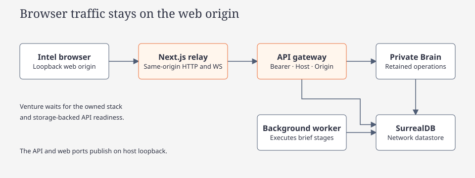

# Local Intel web application

[Code route](index.md) · [Usage](../concepts/usage.md)

`@tag:intel-brief`

The [Fleetworks deployment](fleetworks.md#launch-the-compose-stack) runs Intel Web independently of the native app, with a same-origin HTTP and WebSocket relay. Its server pins `FLEETWORKS_API_ORIGIN` and a separately provisioned WebRelay credential. A browser supplies an existing canonical Connect ID; the backend resolves its current registration and issues opaque session proof. The central server gate protects pages, RSC/prefetch, REST/actions/exports and live access. Host/Origin/CSRF and expected-context revisions fence forged or stale calls. [Connections and authority](native-connections.md#browser-handoff)

The gateway forwards retained actor, brief, Related and topology operations to private Brain. Durable workers retain background execution. Venture remains an external operator deployment tool; opening Intel Web from native only opens the validated advertised Connect URL. Native may close while the independently authenticated browser and accepted jobs continue.

Brief admission commits the job, tasks, captured inputs and run visibility together before a worker can claim a task. To recover a brief left incomplete during admission by an older build, use the Focus Brief reload action to create a fresh generation. Retrying an existing reload request ID attaches to the generation it already created.

[](../../diagrams/intel-web.html)

The React Native UI calls the same-origin Next.js API. Next resolves current session authority and relays only fixed HTTP and WebSocket routes to the authenticated gateway. The gateway and private services own subscriptions, application behavior and SurrealDB access. The upstream origin and WebRelay credential remain server-only; a Connect ID grants no bearer authority. Topology and its accessible list remain web-only.

## Source boundaries

| Layer        | Source                                                                                                                                                        | Responsibility                                                                                                                            |
| ------------ | ------------------------------------------------------------------------------------------------------------------------------------------------------------- | ----------------------------------------------------------------------------------------------------------------------------------------- |
| Core         | [intel_service.rs](../../../crates/argos-osint-core/src/intel_service.rs)                                                                                     | Bounded article occurrence pages, immutable brief projections, ensure/reload admission, Related                                           |
| HTTP         | [argos-osint-api](../../../crates/argos-osint-api/src/lib.rs)                                                                                                 | `/api/v1`, DTO validation, storage readiness, Host/Origin/CORS                                                                            |
| Host         | [argos-api-host](../../../services/api-host/src/main.rs)                                                                                                  | Gateway, private Brain, worker, bootstrap and bounded shutdown                                                       |
| Client       | [api-client](../../../packages/api-client/src/index.tsx)                                                                                                      | Context and TanStack Query v5, backend/instance cache namespaces, readiness polling; app-supplied `BackendSettings` snapshots/request IDs |
| Web settings | [backend-settings.ts](../../../apps/web-desktop/app/backend-settings.ts)                                                                                      | Same-origin browser API and UUID generation; uses hydration-safe snapshots                              |
| UI           | [intel](../../../packages/intel/src/index.tsx), [ui](../../../packages/ui/src/index.tsx)                                                                      | Bulletin, Focus Brief, Related leads and bounded topology navigation; operational Jobs/Logs remain in Rust                                |
| Next server  | [server-api.ts](../../../apps/web-desktop/app/server-api.ts), [proxy.ts](../../../apps/web-desktop/proxy.ts), [serve_web.mjs](../../../scripts/serve_web.mjs) | Same-origin API bridge, fixed server upstream, loopback Host/Origin protection, request nonces and production Next hosting                |

UI creation and review follow the [React UI design rules](react-ui.md), including the [Fleetworks look and feel](react-ui.md#fleetworks-look-and-feel) and the [React Native/Compiler baseline](react-ui.md#react-native-and-compiler-baseline). Use the shared Fleetworks primitives and tokens. API and product semantics remain defined here.

**Package reorganization (Phase 1 remap):** `IntelStatusBar`, `IntelScrollFab`, `intel-theme`, `intel-fonts`, and `intel-metric-colors` have been moved from `packages/ui/src/` into `packages/intel/src/shell/`. The `intel-theme` now exports `intelMetricColors` (cpu/cool/disk/network tints) alongside the shared `intelColors`. Imports in `packages/intel/src/index.tsx` now resolve from `./shell/IntelShell` rather than `@argos/ui`.

## Web presentation

The React Native Web client keeps its terminal-desk/HUD and glass composition. Shared components use `@argos/ui` tokens. Intel screens use the charcoal, gold and ivory palette in [intel-theme.ts](../../../packages/intel/src/shell/intel-theme.ts); browser shell CSS shares that canvas. See the [Fleetworks look and feel](react-ui.md#fleetworks-look-and-feel) and [visual language](react-ui.md#visual-language). The native metal control treatment is separate. The shell exposes connection state and a bottom server/Bulletin taskbar. The masthead/brand header above the shell has been removed in this phase; the connection state and clock now appear in the bottom taskbar. **The app enters the Intel Home (launcher globe) on startup, then navigates to the Bulletin view. The server control returns to the Intel launcher and keeps the retained feed, filters, and selected article.** Bulletin uses a category sidebar at widths of at least 1000px and wrapping channel controls below that, compact day controls, labeled search and glass feed rows; Focus Brief is one scrolling shell: summary, source, actors, retained claims, inferences, related leads, origin, extracted entities and the topology action. Below 900px the reference column stacks under the title. Reading text wraps. Source images preserve their intrinsic aspect ratio with contain sizing and a 520px height cap; the full image remains visible. Bulletin rows open as one control without a duplicate VIEW_DETAILS label. Selected controls expose pressed state; keyboard focus remains visible independently of selection. An `IntelScrollFab` appears at bottom-right when article content exceeds the viewport, enabling scroll-to-end. See [React UI components](react-ui.md#current-web-components) for reusable treatments.


## Interactive topology graph

React Native Web topology uses a 3D force graph. [Topology.tsx](../../../packages/intel/src/topology/Topology.tsx) owns data, selection, filters and the accessible lists; [ForceCanvas.tsx](../../../packages/intel/src/topology/ForceCanvas.tsx) wraps `react-force-graph-3d` (pinned in `packages/intel`, with `three` declared for CSS2D node tiles). Keep this canvas. Do not replace it with another chart library or a hand-rolled layout. The WebGL canvas is client-only and lazy-loaded behind `Suspense` with a loading state; server rendering never evaluates it. The library mutates its data, so the canvas receives cloned nodes/links. A WebGL or lazy-load failure retains an actionable error boundary and the accessible list twin; a 3D renderer does not change evidence semantics or authorize native-device support. The web API uses `GET topology?seed=<Brain memory ID>`; the Rust API infers the seed kind and builds its neighborhood. Launching topology from a Focus Brief navigates to its own topology page, replacing the brief in the workspace. **Return to Brief** restores the retained article; topology never mounts over the previous view. The Bulletin **Topology** control still opens the unseeded page.

- **Selection:** the server-marked root is selected by default. Clicking the graph background clears the selection and shows the whole graph. The selected node stays visible under every filter. The first visit and a graph reset place the selected node at the horizontal and vertical center of the canvas. The landing distance includes that node and its direct neighbors, with caption clearance; only directly connected nodes are drawn at 1st DEG; 2nd DEG explicitly expands the neighborhood without moving the camera again. Reduced motion lands instantly. Later selections, resizing, filtering, query refreshes, simulation stops, node drags, and pans leave the camera where the user put it. The target also has a type-colored pulse and a short arrival scale, replaced by a steady glow under reduced motion. Backspace returns to a previous local focus; browser Back/Alt+Left restores a previous seed navigation. There is no side Neighborhood panel. Selection stays on the graph and the node list.
- **Controls:** depth and individual node-type buttons sit in a wrapping row below the canvas, alongside view telemetry. UNFOCUS and ALL buttons are absent; the canvas reserves its full height for the graph.
- **Display density:** the Next browser shell renders at 75% scale; the topology workspace restores scale 1 for readable type, controls and graph tiles. The graph, legend, neighborhood controls, Nodes list, and Connections list are full width and stacked. The legend sits directly under the graph. Return sits in one row with Neighbors, Nodes, and Connections, which scroll to those sections. Wheel over empty graph space scrolls the page; wheel over a node or edge still zooms. The topology page scrollbar is hidden; the Nodes and Connections lists keep theirs. Connections is its own section below Nodes. The graph opens at 75% of the viewport height. Edge-label placement converts viewport pixels back to layout pixels.
- **Neighborhood:** the default is 1st degree. Only the target and its direct neighbors appear; other nodes are excluded from both the simulation and the list twin. **2nd DEG** draws that next hop and no further. A fresh seed navigation starts at 1st degree; 2nd DEG stays active for local focus changes within that loaded graph until 1st DEG.
- **Nodes and edges:** kind tiles and labels are CSS2D objects with filled glyphs. Article or source images render only when a real image URL is present; a load error falls back to the icon tile. The topology DTO does not carry image URLs, so the icon tile is the current path. Links are dashed, with arrowheads and directional particles. A relationship label appears only as the pointer tooltip while the pointer is over that edge. The connection list still names every relationship. CSS2D tile/edge elements are removed with their engine objects, including Strict Mode remounts and filter changes. The graph starts on a plane inside the existing 3D engine; orbit still permits spatial inspection. Particles, auto-orbit and drag are off under reduced motion. Relationship captions are offset in screen space to avoid node captions and each other; dense captions without a clear position remain available in the connection list. X/Y guides are absent; the subtle grid remains.
- **Graph content:** the canvas contains the graph without control overlays. Depth, node-kind filters and live yaw/zoom follow it in a wrapping row. The former Pause/Filters/zoom toolbar remains removed. The recorded-connection list lives inside Nodes. The legend, filters and tiles share glyph definitions and kind colors; inference is always a supported filter and uses the violet warning glyph. Topic nodes and their incident relationships are omitted from the graph, legend, filters and list twin. CPU/GPU physics stay in the existing force-graph engine. Below 600px, smaller ellipsized tiles fill the canvas and relationship labels stay in the list twin. The canvas summary is a group so its controls remain accessible.
- **Accessibility:** the canvas has a summary `aria-label` and is not the only path to content. Parallel lists "Topology nodes" and "Topology connections" follow the same filters. The list twin contains only nodes in the active neighborhood. The lists remain visible below the canvas. Kind color is paired with a text kind label.
- **Drag cancellation:** the pinned `3d-force-graph@1.80.1` patch guards a repeated drag-end callback after its initial position has already been cleared. Keep node dragging and camera controls enabled outside reduced motion; exercise reentrant pointer cancellation in the browser regression.
- **Reduced motion:** `prefers-reduced-motion` zeroes zoom/center transitions, pre-settles the layout (120 warmup ticks and zero cooldown ticks), disables node dragging and navigation controls, and draws no directional particles. Motion otherwise also warms up for 120 ticks and then cools down.
- **Error boundary:** The lazy `ForceCanvas` (loaded behind `Suspense` with a `LoadingState` fallback) is wrapped in `@argos/ui` `ErrorBoundary` with `onRetry={reset}`; the boundary increments a `resetKey` on retry, remounting the canvas children cleanly. The top-level `Workspace` in `packages/intel/src/index.tsx` is likewise wrapped in `ErrorBoundary` so a crash in any view resets to a retryable fallback without unmounting the shell.
- **Rejected:** ChartKit was evaluated and not used: it has no network/graph chart, is React Native-only, and would need `react-native-svg`.

Inferences are the last evidence section in the React Native brief, after retained claims and before correlated reports. Claim and inference text hides a leading stored assessment tag such as `[claim · supports]` or `[inference · references]`; the statement itself stays. Claim seed matching uses that statement, so a claim opens its memory the same way an inference does. A claim that is not yet a memory opens the extracted brief graph with that claim selected. The source link stays above those sections. Core TUI places inferences last after Related in its center stack. Trend and TLP chips stay hidden because the article DTO does not carry them.

## Async presentation

`@tag:abort-signal`

Bulletin, brief evidence/status, Related and Topology use shared RN loading/empty components. Initial requests, background refresh, next-page loading and failures are distinct; zero confidence is preserved as a value. Missing cycles and zero matching rows have explicit empty states after successful reads. The workspace owns a native ScrollView; Bulletin requests opaque cursor pages near its end, guards concurrent/failed fetches, deduplicates occurrences and retains a manual load/retry control. Query keys keep categories, days, searches, sort modes and backend instances separate. See [async UI contract](react-ui.md#async-data-and-pagination).

- **AbortSignal propagation**: TanStack Query v5 hooks (`useRead`, `useArticles`, `useTopology`, `useRelated`, and the `health` connection probe in `packages/api-client`) accept the query context `{ signal }` and forward it into `request<T>`. `combineSignals` aggregates the caller's signal with a 52-second timeout (`AbortSignal.timeout`), preferring native `AbortSignal.any` with an `AbortController` fallback for multi-signal cleanup. That budget is long enough for a read waiting on storage a running brief still holds, and long enough to receive the API's JSON timeout instead of the browser's "signal timed out" abort. Component unmounting, view navigation, or query key invalidation immediately aborts in-flight browser `fetch` requests. The `request` function wraps both `fetch` and `response.text()` in one `try`/`finally`, so `combined.cleanup?.()` (which removes the abort listeners) always runs whether the request completes, fails, or is aborted mid-body-read; an abort during `response.text()` is surfaced as an aborted fetch rather than a silent partial parse.

- **Server global feed** (`@tag:intel-categories`): Rust owns category membership, ordering and opaque cursors. `category="all"` selects admitted rows with nonempty memberships, deduplicating article identities to their newest occurrence; it does not imply every legacy/unknown row is admitted. Named filters use `categories[]` membership, not scalar equality. Latest orders by publication/seen time then article/run identity; Hottest prepends temperature. The client menu displays the six strategic-domain names and sends the canonical IDs. Article cards use a current name only for an admitted `atlas-admission-publication-v4` projection with one or two distinct domain IDs and a matching primary. Older and malformed projections retain an explicit legacy label. `unk` is not an accepted new-domain filter. Query keys isolate category/day/search/sort/backend/instance; see [async UI behavior](react-ui.md#async-data-and-pagination).
- **Typed `ApiError` contract**: Non-200 HTTP responses parse structured JSON bodies (`{"error": "..."}` or `{"message": "..."}`) or fallback to trimmed text, throwing a typed `ApiError` containing the numerical `status` code and optional payload. HTTP 204 No Content cleanly resolves to `undefined`.
- **Search input debouncing**: In `packages/intel/src/index.tsx`, the Bulletin search input uses a 300ms `useEffect` debounce timer (`debouncedSearch`). Rapid keystrokes immediately update local input state for responsive typing, while queries to `useArticles` fire only after typing pauses for 300ms, preventing SurrealDB `string::contains` query storms.

## Feed imagery

React Native Intel Bulletin cards show an article thumbnail to the right of the main text container. Every thumbnail is the same 120px square, and the photo scales to fit inside it. The text container can shrink and wrap without horizontal page overflow. Missing/unsafe image URLs and load failures collapse the thumbnail, preserving the article action. Images load directly in the client under the existing image CSP; the API retains image URL metadata. The core terminal TUI has no image renderer, image fetch/decode work or terminal graphics probe.

## API contract

`@tag:api-timeouts`

The Fleetworks API requires a bearer token and uses explicit Host and Origin allowlists. Its same-origin Next relay attaches the bearer on the server. Compose publishes only the API and web ports on host loopback. The network role also supports Atlas submission and job cancellation through the versioned API. See [Fleetworks network setup](fleetworks.md#run-the-network-api-and-workers).

- **Request timeout**: The Axum router (`crates/argos-osint-api/src/lib.rs`) applies a 45-second request timeout layer via `tokio::time::timeout(Duration::from_secs(45), next.run(request))`. In-flight requests exceeding 45 seconds are terminated with HTTP 408 `StatusCode::REQUEST_TIMEOUT` and structured JSON `{"error": "Request timed out"}`. The Next relay waits 55 seconds. While a brief stage is queued or running, article detail skips the topology-seed snapshot so progress refreshes do not rebuild that graph on the busy store. Retained claims/inferences do not wait for catalog or navigation enrichment: each gets a one-second budget. A cold catalog yields `actors_pending: true`; only the actor section waits, and the live watcher invalidates the snapshot when the shared matcher becomes ready. Slow canonical bindings yield `bindings_pending: true`; extracted-brief navigation remains available.
- **Configurable client timeouts**: The API client's `request` defaults to 52 seconds (`REQUEST_TIMEOUT_MS`, applied by `useRead`, article pages, topology, related, and brief admission). That sits between the 45-second API deadline and the 55-second relay deadline. `useAction(path, signal?)` accepts an optional `AbortSignal` that is forwarded into `request`, so a caller can abort an individual mutation. Live brief progress keeps the socket when one storage read exceeds 20 seconds and tries again on the next tick.
- **Structured JSON errors**: Protection middleware (`protect`) enforces structured JSON responses (`Content-Type: application/json`) for forbidden access errors: `{"error": "Host refused"}`, `{"error": "Origin refused"}`, and `{"error": "Origin required"}` with HTTP 403 `StatusCode::FORBIDDEN`. The Fleetworks network role returns HTTP 401 for missing or invalid bearer authentication.
- **Bounded graceful shutdown**: Standalone API hosting (`services/api-host/src/main.rs`) wraps Axum graceful draining in a 15-second deadline upon receiving `SIGINT` or `SIGTERM`. If hanging requests or slow clients do not finish within 15 seconds, termination is enforced to guarantee that sockets, background workers, and storage runtime locks are freed.

| Method / path (under `/api/v1`)      | Input / result                                                                                                                                                                |
| ------------------------------------ | ----------------------------------------------------------------------------------------------------------------------------------------------------------------------------- |
| GET `health/ready`                   | Live schema read; service/version/instance, storage/ready booleans; 503 when schema/storage fails                                                                             |
| GET `capabilities`                   | API version, server-advertised categories and supported features; strategic-domain migration tracked separately                                                                                                                          |
| GET `articles/search`                | `ArticleSearchPage` {hits with article id/revision, excerpt, matched_field, rank, categories/source, revision fingerprint, next_cursor}; capabilities feature `"article-search"` |
| WS `live`                            | Same-origin relay; replace subscriptions with `{type:"subscribe",metrics,brief:{run,id,watch}\|null}`; Rust sends metrics, brief progress/change notifications and heartbeats |
| GET `host/metrics`                   | Rust host CPU/memory/disk percentages and network KB/s; nullable warming/unavailable measurements                                                                             |
| GET `days`                           | Retained Atlas run days and categories                                                                                                                                        |
| GET `articles`                       | `category`, `day`, optional `search`, `sort` (`latest` or `hottest`), `cursor`, `limit` (1–100, default 30); rows include `temperature`; rows/revision/next_cursor                                            |
| GET `articles/detail`                | `run`, `id`; retained body, actors, claims, lifecycle, publication, latest job and indexing receipt                                                                           |
| GET `articles/related`               | `run`, `id`, optional `cursor`, `limit` (1–100); related leads with basis and tentative state                                                                                 |
| POST `brief/ensure`                  | `{run,id}`; attach/admit one chain for unchanged inputs; `{job_id}`                                                                                                           |
| POST `brief/reload`                  | `{run,id,request_id}`; explicit new generation; retrying the same request ID attaches to that generation                                                                      |
| GET `brief/stages`                   | `id` job; stage views and committed outputs                                                                                                                                   |
| GET `jobs`                           | Bounded 100 recent/active jobs                                                                                                                                                |
| GET `jobs/detail`                    | `id`; job and its brief stages                                                                                                                                                |
| POST `jobs/retry`                    | `{id}`; requeue eligible failed work. Atlas job retries use the durable dispatch contract and require network authentication. |
| POST `jobs/cancel`                   | Fleetworks only. `{id}`; request cancellation of active, cancellable work. |
| GET `logs`                          | Optional `job_id` and `limit` (1–100). Recent durable event summaries with provider diagnostics sanitized. |
| GET `tools`, `models/defaults`, `profile` | Tool registry, configured model defaults and API workspace/readiness projections. Model defaults include an authoritative `roles` catalog; retained legacy assignments remain migration metadata. |
| POST `atlas/cycles`                  | Fleetworks only. `{request_id}`; accept durable work and return stable job/run IDs. Use the same request ID to recover an uncertain submission. |
| GET `topology`                       | `seed=<Brain memory ID>`; Rust infers actor/claim/inference kind and rebuilds the bounded neighborhood                                                                        |
| POST `topology/resolve`              | Read-only compatibility resolution from a fully sourced brief item to an existing Brain memory ID; 409 while indexing is pending                                              |
| POST `topology` (Rust compatibility) | Existing typed core seed contract retained for Rust callers; not exposed as a browser graph fetch                                                                             |

`@tag:host-metrics` — [host_metrics.rs](../../../crates/argos-osint-api/src/host_metrics.rs) samples the Rust API host with the pinned sysinfo implementation in `spawn_blocking`, behind the same Host/Origin/no-store protections. One mutex-protected sampler per router caches for at least one second and preserves CPU/network deltas. CPU/network are null until two samples exist; memory is used/total, disk is the longest matching mount for ARGOS_HOME, and network is received plus transmitted bytes across non-loopback interfaces divided by elapsed seconds and 1024. Missing totals/interfaces stay null; measured zero stays zero. `platform` is the host OS name from sysinfo (`System::long_os_version`), bounded to 64 characters, and is null when that name is unavailable. No browser machine values, process list or hostname is exposed. `chipset` is the host architecture and logical core count, formatted `x86 · 16 cores`, and is null while telemetry is unavailable. The status-bar server control shows the short platform name (or server). The chipset is a separate rounded badge in that format.

The browser `useHostMetrics` query cache is populated by the shared `/api/v1/live` WebSocket; it does not poll REST. Rust owns one lazy background sampler shared across live clients, publishing CPU/memory/network samples about once per second and refreshing disk capacity every 30 seconds. Slow system reads cannot block socket heartbeats or brief progress. Samples older than 15 seconds become unavailable; measured zero remains zero. Disconnects clear displayed numbers to dashes while readiness remains independent. The REST metrics endpoint remains a diagnostic/one-shot adapter.

## REST snapshots and live updates

`@tag:live-updates`

- **Same-origin REST admission:** the Next relay validates the incoming loopback Host and port, then compares the browser Origin with that validated host. Next may reconstruct the request URL with a different internal hostname; that URL hostname is not the browser origin. `localhost` and `127.0.0.1` remain distinct origins, and mismatched hosts/ports are refused.
- **Stateless Next boundary:** [server.mjs](../../../apps/web-desktop/server.mjs) hosts Next and [live-relay.mjs](../../../apps/web-desktop/live-relay.mjs) forwards frames to the private Rust `/api/v1/live`. Next validates same-origin upgrades and bounds transport buffers; it stores no application sessions, job state, subscription registry or metrics cache. All subscription selection and lifecycle monitoring belong to the UI/Rust pair. A Next restart needs no shared state: the UI reconnects, resends its channel selection and resynchronizes the brief via REST. Rust addresses never enter the browser, including WebSocket URLs.
- **REST:** initial article/brief reads, pagination, search and actions remain ordinary requests. General reads and Related have no repeating timer, keep a 30-second freshness window and do not refetch on window focus. Only the active, visible Bulletin feed gets a slow 60-second freshness check. Days/counts/feed observers are disabled on other screens; readiness remains a separate once-per-minute probe. Brief mutations invalidate their occurrence, Related and feed keys; read-only topology resolution invalidates nothing.
- **One socket:** the app-owned adapter multiplexes metrics and the current brief. Leaving a brief removes its subscription; the final listener closes the connection. Reconnect uses capped exponential backoff, not REST polling. A silent stream triggers reconnection. Failed upstream handshakes do not reset backoff just because the Next connection opened.
- **Brief progress:** [live.rs](../../../crates/argos-osint-api/src/live.rs) reads the bounded stage/job/index receipt projection while work is ongoing. Progress frames update Query state. Detail invalidation coalesces with an existing request (`cancelRefetch: false`), so duplicate live observers cannot cancel and restart a pending snapshot. Only meaningful lifecycle/index transitions (and the initial resync) invalidate the selected REST detail snapshot; incremental running text does not trigger repeated detail calls. Completed, failed/cancelled or otherwise settled work stops the watcher until a new subscription/generation. Reconnect obtains the current durable state, covering events missed while disconnected. Subscription/navigation never creates Brain memories.
- **Limits:** commands are capped at 16KiB and the protocol is read-only. Progress text is bounded and sanitized. Heartbeats and backpressure cleanup bound abandoned connections. Rust sampling and pending-work checks are server-owned; there is no five-second React polling loop.

Article lists use keyset pagination over **occurrences** (run/article pairs), ordered by published time descending, seen time descending, article ID then run ID by default; Hottest prepends temperature descending. They filter run days in one query and never loop through `list_runs`/`list_articles`. The additive `atlas_article_bulletin` index is bootstrapped idempotently without changing record formats or schema version. Search is scoped to a day/category and limited to 256 bytes. Cursors are bounded JSON tuples and must be treated as opaque by clients. Brief DTO `revision` hashes display content, while `source_revision` is the core article metadata hash used to fence topology seeds. Metadata actors and unbound claims use retained source seeds, preserving their provisional status. Revisions hash result content; they do not advance merely because a client polls.

Related reads require current admission for the requested seed and both pair endpoints before grouping, totals and pagination. Stored native pair fingerprints are validated against source and metadata in the same fenced transaction; legacy text/category hashes alone cannot establish a positive lead. Missing/stale native fingerprints exclude the pair, while historical article detail remains readable. The same native fingerprints fence topology Related edges. See the [Related storage contract](../concepts/atlas-classification-and-related-articles.md#phase-6-and-cross-cycle-related).

The Focus Brief reader shows the stored article description. The detail response still includes a retained body for extraction; the client does not render it. Opening a Focus Brief automatically calls `brief/ensure` for its run/article occurrence, including navigation from Related. Unchanged inputs attach to existing work. The client admits once per mounted occurrence/backend session; live updates and refresh do not repeatedly submit it. Reopening safely reattaches; explicit Reload still creates a new generation. Admission failures are visible above the brief on all layouts, with Ensure / resume available for retry in Context.

Brief actor, claim and inference rows expose their own canonical `topology_seed` only when an existing memory is linked through the current article topology. Brief-link resolution uses the dedicated `brief_binding_snapshot` reader: direct article neighbors only, with no Related/topic expansion, association hydration or neighborhood summary construction. Completed-brief reads therefore avoid graph-page-only work while retaining direct canonical identity and provenance checks. The projection reuses modern derivations, actor mentions, legacy claim bindings and lifecycle/provenance fences; it does not assume an extraction-local ID is a Brain ID. Actor ambiguity stays unresolved. The article's launch action uses an available canonical memory, while each item action uses that item's memory. Canonical Actor items open their dossier; Claim and Inference items open their memory graph. Extracted actors open a source actor dossier without waiting for indexing. Extracted claims and inferences that do not yet have a memory open `brief:{run}/{id}`, a read-only graph of the stored brief items. Item controls stay disabled only when the brief has no extracted text. A lifecycle/index notification still refreshes canonical bindings when indexing completes. Navigation never creates memories. Structured inference rows retain their own identity and navigation action. Extracted-item navigation includes a bounded `focus` query identifying the selected `actor:`, `claim:` or `inference:` node inside the same brief graph; browser history preserves that focus. Stored assessment prefixes are removed from displayed evidence labels while original retained text and provenance remain intact.

Brief generations and canonical publication are separate states. The DTO includes the latest job and a matching canonical indexing receipt when available; absence is shown as not indexed. Related articles are leads, never proof of corroboration. Topology navigation does not write memories; canonical publication belongs to core brief jobs. The browser workspace is pinned to the viewport. Topology content scrolls inside the workspace, and Neighborhood/Nodes lists contain their own overscroll; the bottom taskbar stays outside those scroll regions. The React Native Focus Brief is the single shell described above.

## Running locally

Start the local production web stack through Venture.

```sh
cargo build --locked -p fleetworks-venture -p fleetworks-cli --bins
target/debug/venture --workspace ./review-workspace web --storage compose-disk
```

Open the printed URL after readiness. Use the same workspace for `status`, `logs` and `stop`. [Venture lifecycle and storage selection](fleetworks.md#launch-the-compose-stack)

For frontend work, use the workspace's pinned Node and pnpm versions, install with `pnpm install --frozen-lockfile`, and follow the [React testing guide](react-ui-testing.md) for isolated production and development fixtures.

The browser requests relative `/api/v1/…` paths. Venture's Compose stack sets `FLEETWORKS_API_ORIGIN` and `FLEETWORKS_API_TOKEN_FILE` in the Next server environment. Readiness gates the working UI and actions. Recovery namespaces queries under the API instance.

`@tag:web-routing` — the shared `IntelNavigation` screen contract has an in-memory adapter for native hosts/tests and an app-owned browser History adapter. `/home` is the launcher (`/` is an alias), `/bulletin` is the retained feed, `/brief?run=...&id=...` loads an occurrence directly, `/actor?id=<canonical-id>` reads an Actor Dossier, and `/topology?seed=<memory-id>` contains only a durable Brain memory ID. Its type and neighborhood are inferred server-side; no JSON object or originating article IDs appear in the URL. Return-to-brief context is retained in browser history state. Reload, browser back/forward and direct entry work; the root workspace stays mounted to retain feed filters during navigation. Missing occurrence IDs show an explicit empty state. Invalid graph seeds show the normal unselected state.

`@tag:api-proxy` — In addition to the stateless WebSocket relay, Next exposes only the existing allowlisted GET/POST paths through its catch-all route handler. It validates Host/Origin, enforces JSON and the Rust 16KiB mutation limit, forwards cancellation and opaque cursors, disables caches/redirects, and returns a public unavailable error without the Rust address. Browser headers/cookies do not propagate to Rust. The Next server never opens the database. The production server uses per-request script nonces, same-origin-only API connections, RN inline styles, HTTP/HTTPS/data/blob images, frame/form restrictions and loopback Host checks; dev adds only the HMR/eval allowances it needs.

## Verification

- [Fleetworks network smoke](../../../scripts/fleetworks_network_smoke.py) exercises authenticated gateway and private Brain behavior against isolated storage.
- [Packaged smoke](../../../deploy/verify.py) checks Venture startup, readiness through the web relay, Atlas dispatch and owned shutdown. [CI scopes](ci.md#fleetworksyml--scoped-branch-checks)
- [API contracts](../../../crates/argos-osint-api/tests/api_contract.rs) cover pagination, revisions, admission/reload idempotency, missing IDs and ingress rules.
- [Browser fixtures](../../../tests/web/intel.spec.ts) cover production and development navigation, responsive presentation, mutations and reconnect. Follow [React UI verification](react-ui-testing.md).

The Intel landing view reads the existing readiness query through the backend context (`health` and `connectionError`), without extra readiness requests. Its full-shell graph adds one orbiter for each passing API-response/service/version/storage/workspace check. Three-second status cycles appear below the core; its state progresses from red through amber checks and green healthy to blue ready. The separate landing offline indicator is hidden. Compatible readiness and completion of the admitted-orbiter arrival sequence both gate first Home workspace entry. The orbit does not replay when returning to Home from Bulletin, Brief or Topology, and it is skipped for those deep links; reduced-motion and non-WebGL fallback compositions are static.

## Actor Dossier

`@tag:intel-brief` · `@tag:web-routing` — Focus Brief has one Identified Actors section; every actor action opens a dossier. Canonical actors open `/actor?id=…`. Extracted references open `/actor?run=…&article=…&actor=…`, a retained source preview. The source reference is checked against the source brief, and its exact ID can be verified through the actor endpoint; a 404 displays the source preview without inventing a canonical identity, catalog fields or recorded associations. Host history stores Brief origin and the Actor return destination separately, allowing Brief → Actor → Topology → Actor without changing graph selection behavior. Direct canonical actor links read by ID; source links reload the exact retained occurrence. No name resolution or brief admission occurs. Linked cards open their exact run/article occurrence (normal Brief admission then applies).

`GET /api/v1/actors/detail?id=…` rejects blank/control/over-256-byte IDs, follows `actor_bind::resolve_in`, and requires an active Actor memory and row. Missing or wrong-kind identities return 404. The selected profile read never initializes the catalog matcher. Catalog actors receive verified Actor seeds independently of article topology/indexing readiness. Backend/instance/actor Query keys isolate responses; readiness and abort signals gate reads, and refetch keeps the current snapshot. The status bar reports actor read state.

The core reader reuses all-retained depth-one topology with 100 nodes/200 edges. The dossier returns `inferences`/`loaded_inferences` separately from `claims`/`loaded_claims`, retaining recorded roles and receipts. Claims require a direct recorded actor reference, with structured role/binding state and original receipts. Shared-article/name matches are excluded from direct claim associations; recorded inference associations have their own section. Article mentions retain exact occurrence IDs and revision receipts; “Actor mentioned in article” is not corroboration. Loaded counts are retained reference/mention counts, never catalog/global totals. Claims label creation time “Recorded”; cards use publication dates. Gaps or truncation show “Partial neighborhood—open topology to explore.” No memory, job, admission or model writes belong to this read.

The compact dossier uses a full-width identity header and one workspace scroll; at 900px the reading column/sidebar split is 2:1, with a thin divider. Below that width the sidebar follows the reading column. Overview, claims, inferences and linked briefs precede metadata and aliases in reading order. The header groups return/refresh actions, identity chips, the topology action and three loaded-count summaries. Cards use their measured container width, with a 20px header, 16px reading/sidebar panels and 12px record gaps, matching Bulletin component density. Identity state describes identity, never activity. No TLP, aggregate confidence, motivation or first-observed assessment is inferred.

Dossier and topology snapshots refresh once per minute while selected to reflect automatic article retention. Removed occurrences lose their mention receipts and retired relationships in the retention transaction. A shared insight remains associated while retained sources support it; protected investigation articles preserve their contributions.

Brief actor enrichment is incremental: existing metadata and retained ready cleaned-body actors stay visible while cleanup is pending. A queued or running Body stage keeps `actors_body_pending` true even when retained matches are available; with no actors yet, `actors_pending` requests the labeled actor skeleton. `actors_body_unavailable` marks terminal cleanup failure as incomplete detection. A ready clean-artifact scan appends body-only canonical IDs and de-duplicates existing identities. These updates travel through the existing generation-matched brief live refresh. Reads do not index occurrences or admit jobs; Full article commit and the background drainer own durable mentions.

## Bulletin sorting and article confidence

`GET /articles` accepts optional `sort=latest|hottest` (default `latest`). Latest retains the existing publication/seen/id/run cursor. Hottest uses temperature descending followed by those same deterministic tie breakers, with temperature included in its opaque cursor. The Query namespace includes sort and never reuses another order’s cursor. The Bulletin keeps both controls beside Day. Updated clients require an updated Rust API for Hottest; restarting only Next does not replace an older API binary.

Focus Brief shows Article Confidence above Identified Actors. The section uses the terminal’s six-row ANSI Shadow Admiralty glyphs, the persisted publisher prior (F when unavailable), evidence information grade, score/100, counts and provisional state. Numeric zero remains assessed zero. A known publisher prior supplies the existing capped initial rating when no scored evidence exists, labeled “publisher prior only”; it is not evidence of corroboration. When both bases are unavailable, N/A includes the reason. Counts in this section come from the displayed claim/inference arrays and update independently of scoring eligibility. The estimate is an evidence assessment, not a truth probability.

Per-job Logs include the selected job’s durable events and transactional job/task lifecycle and retry records, including descendants. Job creation, task claim and task completion write lifecycle records in their existing transaction. Jobs → View logs clears unrelated app, severity and text filters. Active Logs follow refreshes at the bounded dashboard cadence even when API-hosted work produces no local TUI event.

Actor and topology pages keep a live subscription to their originating article while indexing can change its associations. Meaningful brief refresh events invalidate the active dossier/topology reads without cancelling an in-flight refresh. Reopening a dossier always revalidates it, avoiding reuse of an earlier verified-empty neighborhood after publication.


## Classifier setup

Configure the private Rust-BERT service through the [Atlas overlay](../../../deploy/atlas-dispatch.md). Atlas reports a missing or invalid model pin on its durable job. Six-domain article labels and topology summaries use the ordinary read APIs.

## Domain labels and topology summaries

The category menu uses governance/security/economic/human/environmental/scientific and accepts additive ordered `categories[]` while retaining scalar category compatibility. Legacy strings remain readable. Current cohort authority is carried separately from raw category strings; taxonomy alone cannot relabel a historical rejected row. Eight additive Brain facets use the existing summary pane with an explicit Generate action; ordinary topology GET/read/poll/navigation does not queue provider work.

Article cards interpret a membership as an official domain only when the API supplies current `taxonomy_version`, `admission_state=admitted`, current `publication_version` and one or two unique ordered domains with the scalar primary first. Other retained tags use the historical category presentation, including historical rejected rows that retain the string `economic`. Detail keeps its authoritative classification view; a familiar string alone grants no current domain authority.

Summary delivery binds cached content to the current frozen prompt/source hashes, basis and resolvable references. A rejected cached upgrade leaves the deterministic fallback and a retryable failure. Only explicit Generate/Retry may discard that exact invalid cache row and requeue the same identity; a concurrent valid publication wins the compare-and-delete guard. Stale API basis actions return conflict before route resolution or queue mutation.
