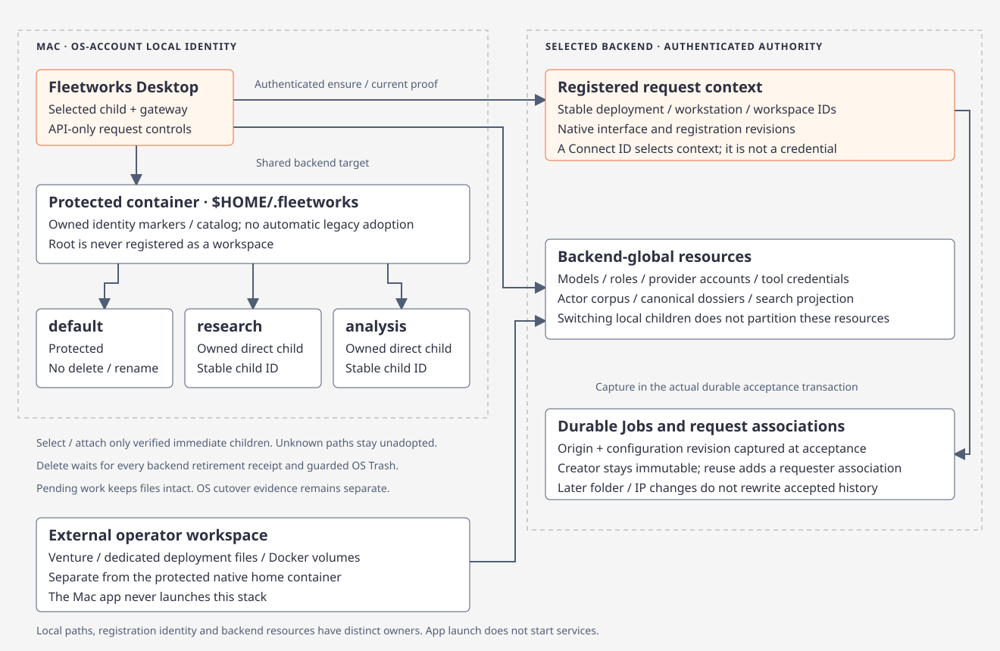

# Fleetworks interfaces

[Code route](index.md) · [Usage](../concepts/usage.md)

The native macOS app connects to an independently running gateway. Its five backend pages share the selected deployment's resources within the caller's permissions; local workspace selection controls request origin and activity. Intel Web uses a separately provisioned relay credential and a server-issued registered session. Venture retains operator workspace/stack management while terminal replacement and installed-app parity gates remain open.

| Surface | Source | Contract |
| --- | --- | --- |
| Native macOS app | [Rune app](../../../apps/fleetworks-desktop) · [Bounded SDK](../../../crates/fleetworks-contracts/src/client.rs) | [Connections and context](native-connections.md) · [Protected local workspaces](native-workspaces.md) |
| Venture | [Launcher](../../../apps/venture/src/main.rs) · [Workspace](../../../crates/fleetworks-workspace) | [Workspace, lifecycle and storage modes](fleetworks.md) |
| Retained terminal clients | [CLI suite](../../../apps/fleetworks-cli) · [API contracts](../../../crates/fleetworks-contracts) | [Compatibility command reference](../../../apps/fleetworks-cli/README.md); old contextless mutations cannot bypass new gateway checks |
| Native Jobs and Logs | [Activity API](../../../crates/argos-osint-api/src/activity.rs) · [Scoped storage](../../../crates/argos-osint-core/src/storage/jobs_view.rs) | Registered workstation activity; independent action permissions and private shared-job restrictions |
| Intel web | [Web server](../../../apps/web-desktop) · [Intel UI](../../../packages/intel) · [API client](../../../packages/api-client) | [Intel web contract](intel-web.md) |
| Brain and worker roles | [Service host](../../../services/api-host/src/main.rs) | [Service boundaries](architecture.md#fleetworks-service-boundaries) |

## Contributor checks

Use the [native Runtime/PNG/tree fixtures](../../../apps/fleetworks-desktop/README.md) and [Fleetworks CI scopes](ci.md#fleetworksyml--scoped-branch-checks) for the affected client or service. Native-only builds do not compile backend engines. Use the [browser verification guide](react-ui-testing.md) for Intel Web. Changes to retained Ratatui source use its [contributor verification contract](tui-verification.md); a terminal screenshot is not native-app evidence.
