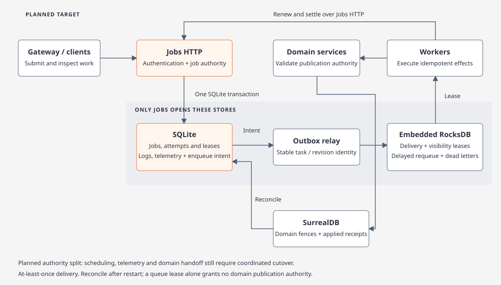

# Jobs persistence and embedded delivery

[Architecture](architecture.md) · [Storage map](storage.md) · [Venture](fleetworks.md) · [Deployment](../../../deploy/README.md)

`@tag:jobs-persistence`

## Planned ownership

Fleetworks is moving operational job traffic out of the domain datastore and replacing RabbitMQ with a disk-backed queue embedded in Jobs. This is a target architecture; the rollout table below identifies unfinished integration.

| Owner | Authoritative data | Boundary |
| --- | --- | --- |
| Jobs / SQLite | Jobs, tasks, attempts, execution leases, retries, cancellation, progress, logs, operational telemetry and enqueue intents | Authenticated Jobs HTTP; SQL never exposed to clients |
| Jobs / RocksDB | Delivery messages, visibility leases, acknowledgments, delayed requeues and dead letters | Embedded in the same Jobs process; workers use queue HTTP operations |
| Domain services / SurrealDB | Articles, actors, evidence, briefs, results, business admission/accounting, domain publication fences and applied-operation receipts | Existing domain repositories and service APIs |
| Venture | Workspace paths, credentials, service lifecycle and storage selection | No RabbitMQ server or external broker configuration in the target startup |

Only Jobs opens either operational database. Other containers must not mount its data directory. Both stores persist beneath workspace `storage/jobs/`; stop and container replacement retain them. `local-net` selects the existing **domain** SurrealDB endpoint; local job storage remains owned by Jobs. `local-process` manages domain SurrealDB; it does not need a native broker in the target architecture.

## Durable handoff and execution

1. Commit the job mutation and enqueue intent together in SQLite. Persist the operation key and result in that transaction so a lost response can be retried safely.
2. Relay the intent to RocksDB using a stable workspace-generation/task/revision identity. Repeating the same identity and payload succeeds without another delivery; conflicting payloads fail. Mark the SQLite intent delivered only after the queue confirms its durable write. Replay unfinished intents after restart.
3. A worker claims a delivery with a visibility lease. The Jobs service supplies time, owner and epoch. Renew long-running deliveries; reclaim expired ones after a crash. Queue receipt alone grants no domain publication authority.
4. Acknowledge after durable execution settlement. Requeue transient failures with delay and bounded retries; retain terminal delivery failures for inspection. Delivery is at least once, so execution effects must be idempotent.

SQLite uses WAL with FULL synchronization. RocksDB keeps its WAL enabled and syncs acknowledged mutations. Blocking engine calls stay off Tokio runtime threads; bound request concurrency, page sizes, caches and retention. The queue reuses the compatible RocksDB binding already selected by SurrealDB to avoid competing native `rocksdb` link dependencies.

## Domain publication and cancellation

Moving tables cannot preserve the current cross-table transaction guarantees by itself. Domain admission writes a durable operation intent with its domain mutation; Jobs accepts that intent idempotently. Publication uses a durable proposal plus a domain-owned generation fence and applied receipt. An HTTP lease check followed by a separate domain write is insufficient: cancellation, expiry or takeover can occur between them.

Resolve pending publication proposals before acknowledging conflicting cancellation/takeover or offering replacement execution. After restart, reconcile applied receipts and reject unapplied work without current authority. Keep quota, billing/admission and paid-call interruption safeguards in the domain correctness boundary. The complete scheduler migration must port these rules before removing its SurrealDB guards.

## Rollout scopes

| Scope | Required result | Current boundary |
| --- | --- | --- |
| SQLite ownership | Persisted operational primitives, standalone logs, private HTTP and Jobs-only disk mount | Implemented; focused persistence and HTTP checks pass |
| Embedded delivery | RocksDB queue, Atlas adapter, visibility recovery, Rabbit-free startup and deployment references | Native Atlas smoke passes; Docker image/deployment gate pending |
| Operational authority | Route scheduling, attempts, process heartbeat/recovery, retry/cancel and dashboard reads through Jobs together | Planned; production scheduling still uses SurrealDB |
| Domain handoff | Admission intents, publication reconciliation, cancellation/expiry/generation fences | Planned; existing domain transactions remain authoritative |
| Telemetry | Move writes, hourly/daily rollups, retention and Profile readers together | Planned; do not move only writers |
| Cutover | Persisted drain proof and backend generation, then enable new SQLite submissions | Drain-first policy selected; no live lease copying |

Drain existing queued/running work through the old backend before switching new submissions. Previously published Rabbit messages are absent from the new queue: an empty unpublished outbox alone does not prove drain. Check unfinished tasks, execution leases, outstanding deliveries and pending publication effects. Preserve old records, credentials and data; retain legacy ownership decoding so an old managed stack can still be stopped. Never run both schedulers against the same job generation.

Historical standalone SurrealDB logs are retained in their original store; the current log adapter does not copy them automatically. The final dashboard/history disposition must be explicit before job reads switch.

## Scaling and acceptance

The first deployment has one Jobs owner and multiple remote worker processes. RocksDB is embedded; sharing its files among worker containers is not horizontal scaling. Additional Jobs owners require explicit workspace/queue partition ownership, routing and failover. This change provides neither replicated high availability nor physical disk isolation. Both engines still compete for host CPU, memory and storage bandwidth.

Treat performance as a measured outcome. Compare core-domain write latency under concurrent enqueue, lease, progress, log and telemetry load; record job throughput, delivery latency, memory, queue depth, outbox lag and recovery time. Backpressure and retention must bound growth.

Acceptance requires disk reopen and process-kill recovery, single-owner claim races, stale epoch rejection, duplicate publication/ack replay, delayed retries, dead letters, cross-store handoff crash points and drain/restart fencing. Exercise cancellation, expiry and source replacement during domain publication. Run synthetic isolated HTTP/startup fixtures; keep the user's stack untouched. A primitive store test is not evidence that full scheduler isolation is complete.

Implementation entry points: [operational store](../../../crates/fleetworks-jobs), [Jobs host](../../../services/api-host/src/jobs_service.rs), [log adapter](../../../crates/argos-osint-core/src/storage/jobs_client.rs), and [transitional domain dispatch](../../../crates/argos-osint-core/src/storage/job_dispatch.rs).
