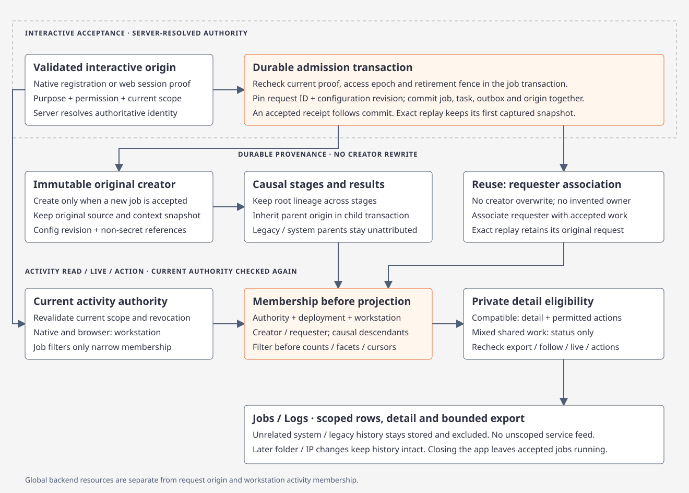

# Native connections and registered context

[Client](../../../apps/fleetworks-desktop/README.md) · [Protected identity](native-workspaces.md) · [Control/design guide](native-design-system.md) · [Verification](../../../.planning/2026-11-12-native-pairing-implementation/acceptance.md)

[](../../diagrams/native-connections.html)

## Cold-launch startup

A cold launch opens **Choose a backend** with **Embedded** and **Distributed** available from the first frame. [Quiet Orbit](../../design/matte-canvas/motion.md) plays at its reference pace above the tiles and settles into a still. Reduced Motion uses the still immediately. The orbit scales as one unit on the same `#060709` canvas as setup and the services.

Choosing a tile opens **Setup Gateway** with that backend selected. The Distributed URL is prefilled when one is saved. Quiet Orbit carries its current pose into the setup header and stays docked through connection and registration. Use **Start Embedded Backend** or **Connect** to proceed. **Back** returns focus to the selected tile without replaying launch. **Done** opens the data setup sequence below the centered mark. The dots identify the current stage for actor seeding, actor indexing, classifier training, backend inference, or workstation checks. Each stage has its own confirmation, progress, and outcome. The wizard skips work already verified by the Embedded backend and lets you review those stages. Use **Reset** to choose a different actor or training CSV or review the index's current catalog source again. Reset clears the setup input and retains imported data, models, index coverage, and completed hashes. Unsupported or optional work can be left for later. **Backend inference** shows where Inbox answers run and the current setting. Finish setup with inference Off or when provisioning is unavailable. **Settings → Gateway** shows the same setting. The last step shows a compact health checklist with green checks for verified readiness and red Xs for confirmed failures. Missing or pending observations have separate states. Select **Open Workstation** to enter Workstation Status and settle the mark into the sidebar. Reduced Motion places the static mark directly in each destination.

A launch with `--api-origin` or `--api-token-file` skips the chooser. The `backend-choice` fixture exercises the production chooser with synthetic effects. The startup controls are in `apps/fleetworks-desktop/src/startup.rs` and the scene is in `apps/fleetworks-desktop/src/orbit.rs`.

The actor seed and classifier training stages select **Bundled CSV** in an installed package. Once the relevant backend action is available for the registered workstation, setup automatically validates and stages the bundled file. Setup shows **Ready to seed** or **Ready to train** with the validated row count. Starting either job requires explicit confirmation. Select **Local CSV** to provide a different file using a path on Linux or the native picker where available.

The package reads both defaults from `share/fleetworks/resources/datasets/` on Linux or `Contents/Resources/datasets/` on macOS. The dataset manifest records the source revision and checksums. [Bundled dataset manifest](../../../datasets/native-defaults.json)

The optional `native-github-dataset` build feature exposes the GitHub URL source. Its dedicated download client uses configured HTTPS proxies and validates redirect destinations.

On **Start Embedded Backend**, the embedded companion warms its bundled Compromise NLP engine when built with NLP support. That check measures the bundled engine. Atlas and Focus Brief depend on their own advertised services. The bundled Natural classifier supports explicitly confirmed, candidate-only training in data setup and through later maintenance actions. Starting the backend never trains or activates a model. Natural training availability does not establish readiness for Atlas's separate Rust-BERT classifier. The base Embedded connection remains available when an optional engine is unavailable.

News cycles require a Distributed gateway with Atlas enabled. Embedded Setup and News Cycles link to the Distributed connection flow. On a registered Atlas gateway, News Cycles checks the Atlas worker and Rust-BERT readiness before allowing a new cycle. Use **Configure API keys** to see the four sources and enter a primary or fallback key for each. Saved, missing, and unchecked statuses remain visible. A saved slot confirms presence. Missing keys also link to OSINT Tools. Jobs & Logs shows prerequisite failures returned by the worker. [Atlas deployment](../../../deploy/atlas-dispatch.md)

If readiness expires while you review a validated CSV, the app keeps the dataset and review visible. Use **Refresh checks** in the review and confirm explicitly once the operation is available for the same registration and configuration revision. Changes to the backend context or configuration require a new review.

Embedded seeding uses the companion’s memory and disk guard. A resource interruption can retry the same job from its committed rows after revalidating the pinned CSV. Startup identifies memory pressure, low workspace space, and unavailable measurements separately. The catalog becomes ready after the complete seed receipt, and index readiness requires a separate reader observation.

## Backend types and parity

| Backend type | Setup and ownership |
| --- | --- |
| **Embedded** | **Start Embedded Backend** starts the bundled companion with a private state directory. The app uses framed stdio IPC. **Stop Embedded Backend** stops the companion after its shutdown handoff. |
| **Distributed** | **Connect** authenticates to the selected operator-managed gateway over HTTP(S). This type also covers a Compose gateway on the same machine. The operator owns the service lifecycle, deployment credentials and persistent stores. |

Both types use the shared native contract for registered identity, readiness, actor CSV seeding and search, Natural training where offered, and scoped jobs and logs. Equivalent operations use the same permission, revision, acceptance and recovery rules. Availability comes from the selected backend's capabilities and readiness. Embedded startup readiness reflects its bundled engine probes. Distributed readiness reflects its configured service probes and worker owners. Atlas collection uses the Distributed Atlas overlay’s worker, private NLP and Rust-BERT runtime. Intel Web uses a Distributed relay credential and its own session boundary. The app fences requests and clears state when the backend context changes. Existing saved profiles keep the `local` and `remote` transport identifiers. Embedded uses the `local://` profile origin and the `local-ipc` companion role. Distributed uses the saved HTTP(S) origin.

The [HTTP/IPC parity test](../../../services/api-host/tests/http_ipc_parity.rs) uses a real HTTP gateway and the Embedded companion with disposable storage. It verifies common behavior, including availability and validation for configured Natural maintenance, and records transport-specific authority and shutdown behavior. Distributed Compose and installed GUI evidence are tracked as separate journeys. The [Linux CI guide](ci.md#nightly-gsd-order) describes how parity and visual evidence fit into the first pass.

## Inbox and Assistant dock

The toolbar **Inbox** bell shows the unread count and opens a full-height drawer on the right. The current page, scroll position, and Assistant stay in place behind a dimmed backdrop. Reduced Transparency uses an opaque panel with the same bounds. The bell, **Close**, Escape, and the backdrop dismiss the drawer. Focus stays in the drawer while it is open and returns to the bell on dismissal. Reduced Motion opens it immediately.

Filter this workstation’s observed notifications by text. Groups collect related job, service, or connection changes and show time headings. Unread groups lead, ordered by their oldest unread item. Expand a group to read items in chronological order. Opening the drawer leaves items unread. Mark an individual item or all items read. **Open job** goes to a tracked job and **View status** opens the matching readiness details on Workstation Status. Background actor indexing is a readiness update and leaves the Jobs & Logs count unchanged.

The app keeps at most 50 items and clears them when the connection authority changes. Notifications cover visible job completion, readiness transitions, and connection success or failure. Item text uses fixed wording and bounded titles without exposing error text, URLs, or credentials.

The contextual **Assistant** dock is built and tested but **disabled** (`Assistant::enabled` is false). It needs the typed chat capability, which the backend does not advertise yet, so sending would stay gated even if shown. While it is disabled the original context rail stays in place. When enabled it docks at 380 pt if the center view keeps at least 640 pt, stays hidden otherwise, and floats over the right edge only when the operator asks. Enter sends, Shift+Enter adds a line, and an input method that is composing keeps Enter. The draft stays with its pinned context, and a new connection authority clears both.

## Command panel

Cmd/Ctrl+K or the centered command pill opens a grouped list of known actions: go to a page, Setup Gateway, Settings, Open Inbox, and Show or hide Assistant when it is enabled. Typing only filters that fixed list, and there is no arbitrary command runner. Arrow keys move, Enter runs, and Escape closes and returns focus to the toolbar button. Actions that could accept work, such as seed or index, only open their page, where the existing review step still applies. While the panel is open it is the only overlay.

<a id="pairing-and-keychain-agreed-target"></a>

## Pairing and Keychain

**Distributed flow:** Gateway URL → operator approval once → macOS Keychain or Linux D-Bus Secret Service (or explicit Linux session-only mode) → authenticated reconnect. [Verification status](../../../.planning/2026-11-12-native-pairing-implementation/acceptance.md) records actual checks; injected secret-store tests do not establish live Keychain/Secret Service or installed-app passes.

| Step | Behavior |
| --- | --- |
| Enter URL | Pin one validated origin: remote HTTPS or loopback HTTP. A new installation waits for Connect. Explicit connection may reuse a known pairing/access reference for the selected origin. An explicit URL restores only its own known reference. |
| Start / approve | Persist the exact request ID and pairing polling secret before HTTP (written to macOS Keychain, Linux Secret Service, or held in process memory when Linux session-only mode is active). The app displays request ID/code; an independently authenticated Operator approves it within the ten-minute challenge window. IDs/codes/installation markers alone grant no API access. |
| Save / connect | Authenticate the issued scoped Native credential, check compatibility, then save its secret in Keychain/Secret Service (or memory in Linux session-only mode) before reporting connected. Register/reuse the protected installation. Settings retain only origin/deployment/credential references (`system_keyring` or `session_only` storage mode) and recovery state. |
| Reconnect | Read the exact installation/origin keyring item (`system_keyring`) or live session memory, authenticate and verify the saved deployment. Never scan other items or fall back silently to files or unauthenticated access. Missing/locked Linux Secret Service requires either unlocking it and retrying or explicitly choosing session-only mode. |
| Recover | Lost HTTP outcomes and failed secret-store promotion retain the exact ID/secret/issuance intent. Retry replays that request; denied/expired/revoked access requires explicit Pair again. Keychain/Secret Service locked/denied/unavailable and network failures remain separate actionable states. |
| Stop / resume | Change gateway URL or leave setup to cancel/fence client callbacks. Focus loss pauses pending transport; focus return in setup resumes the retained request. Local cancellation does not revoke server access or cancel accepted jobs. |

### Pairing API

All routes are POST. `PairingClient` exposes only start/poll; protected APIs retain authenticated `Client` behavior. The pairing and authenticated HTTP clients disable redirects and environment proxies and bound bodies and timeouts. Polling/access secrets never enter URLs, UI state, Debug or diagnostics.

| Route | Authority / result |
| --- | --- |
| `/api/v1/pairing/start` | Public bounded challenge request: request ID, installation marker, 256-bit polling secret; returns pairing ID/code/expiry/poll interval |
| `/api/v1/pairing/poll` | Exact pairing ID + polling secret; returns pending, denied, expired or approved. Approved contains scoped access; replay returns the same issuance, not a new credential |
| `/api/v1/admin/pairing/approve`, `/deny` | Operator-purpose credential with ReadBackend, RegisterWorkstation and ManageConfiguration; exact pairing ID/code. The server derives Native scope/epoch/grants |
| `/api/v1/admin/pairing/revoke` | Current Operator authority and credential ID; fences paired authority/admission and related registered/browser proof without rewriting accepted origins |

### Operator approval and revocation

Use the app's displayed request ID/code and a separately provisioned private **Operator** token file:

```sh
python3 scripts/fleetworks_pairing.py \
  --origin https://gateway.example.test \
  --operator-token-file /absolute/private/operator-token \
  approve --pairing-id "<displayed-id>" --approval-code "<displayed-code>"
```

Use `deny` with the same ID/code, or `revoke --credential-id <paired-id>`. The helper pins the origin, refuses redirects/proxies, bounds input/output and never prints bearer bytes. Native/WebRelay credentials cannot approve pairing. [Deployment credentials](../../../deploy/README.md#credentials)

An isolated macOS native review can use `python3 deploy/native_review.py up --approval-handoff --name <review>` to open a local operator prompt when Setup Gateway starts a pairing request. The prompt shows the origin, pairing ID and code so the operator can compare them with the native screen and explicitly click **Approve**; the native client never receives the Operator credential. The handoff is limited to the selected loopback review and expires within one hour. Existing Keychain access reconnects without a fresh approval. Standard launches and production approval continue through the separate Operator command above. [Review setup](../../../deploy/README.md#isolated-native-backend-review)

The [synthetic local pairing screen](https://github.com/xxxcess/argos-osint/pull/67#issuecomment-6880990486) records the waiting layout and retry control in the PR; the accompanying [CI artifact](https://github.com/xxxcess/argos-osint/actions/runs/43617239215) includes wide and compact PNG/tree evidence. These fixture images use a fake code and do not establish a live Keychain result.

Approval → authenticated readiness/capabilities → Keychain → connection. A gateway failure after approval preserves the pending request: correct backend configuration and choose **Retry**. HTTP 503 means setup is unavailable; it does not mean pairing is unsupported. [Deployment troubleshooting](../../../deploy/README.md#troubleshooting)

Revocation, changed issuer policy/scope/access epoch and reset invalidate paired authority. Local Keychain deletion alone is not server revocation. Existing static Native, WebRelay and headless credentials remain supported independently.

## Explicit operator/headless file mode

Normal GUI setup needs no token file. Explicit `--api-origin <origin> --api-token-file <private-file>` preserves the file-based launch override; it does not populate Keychain. Optional `--provision-gateway-credential` stores only the protected file-catalog binding and exits without GUI/network startup; it is not a prerequisite for normal pairing. Existing files are never silently adopted, migrated or deleted. [Commands](../../../apps/fleetworks-desktop/README.md#build-and-provision)

## Authority and registration

| Boundary | Contract |
| --- | --- |
| Credentials | Native, WebRelay, InternalService and Operator purposes have explicit permissions. Connect IDs and caller-supplied headers grant no authority. |
| Distributed credentials | Operator-approved, origin-bound credentials use the operating system keyring or explicit Linux session-only mode. Explicit file-based launch keeps its own exact-origin binding. |
| Identity | Connect/activity contract 2: opaque workstation ID = Connect ID; authenticated scope + protected installation marker determine identity. Optional IP never merges installations. New requests contain no workspace fields. |
| Transport | Distributed pins the HTTP origin and disables environment proxy/redirect forwarding. Embedded negotiates a bounded IPC session with its companion. Both revalidate current proof, permissions and revisions at admission and reads. |
| Invalidation | Gateway/access changes fence old clients, reads, caches and confirmations. Missing registration or optional services disables only dependent actions; permitted shared reads remain usable. |
| Retirement | Fence admission and sessions; drain associated jobs and uncertain effects, then retire the workstation. Retained v1 folders keep their protection; accepted causal work may finish while retiring. |

Schema 10 adds pairing and credential records. Coordinate bootstrap and compatible readers/writers using the existing deployment selection; preserve scope, installation/workstation identity, registration mappings, unresolved requests and immutable origins. The earlier workstation-v2 migration fences legacy registrations/sessions and requires fresh proof for those migrated entries; pairing does not replace retained static/headless credentials. [Registry migration](../../diagrams/connect-registry.html)

## Browser handoff

[](../../diagrams/intel-connect-gate.html)

| Boundary | Contract |
| --- | --- |
| Connect | Enter an existing opaque workstation ID. Separately provisioned WebRelay resolves it; the browser cannot register guessed IDs. |
| Session | Host-only HttpOnly SameSite=Strict `fleetworks_connect_v2`; HTTPS adds Secure. Old workspace cookies require fresh Connect. Allowlist public fields and require Connect ID = workstation ID. |
| Cache/cursors | `workstation-v2` namespace includes deployment, workstation, registration and authority revisions/epochs; IP is not identity. Old workspace contexts/narrowing/cursors fail explicitly. |
| Protected access | Central server guard precedes page/RSC/prefetch, REST/export and live data. Host/Origin/ingress and expected context revisions fence forged requests/stale-tab mutations. |
| Lifecycle | Switch/expiry/denial clears Query/live state; logout revokes server proof. Bounded live rechecks include deployment/workstation/registration/revisions/epochs and close stale streams. Native may close independently. |

## Durable requests and activity

[](../../diagrams/brief-job-context.html)

- Admission captures immutable creator context transactionally; reuse adds a genuine requester association. Causal jobs retain their accepted origin/lifecycle fence. Version-aware readers preserve historical child metadata without allowing new child admission.
- Membership precedes rows, totals, facets, paging, private details, results, logs, exports, streams and mutations. Shared status does not grant private access; unknown/system/unregistered work has no all-backend fallback.
- Uncertain delivery retains original operation/request ID, exact body/context and original registration. `GET /api/v1/workstation/requests/detail` resolves it read-only using `original_registration_id`. Unknown stays unresolved; navigation/reconnection never creates a replacement POST.

## Bounded operational logs

`@tag:jobs-persistence`

Jobs SQLite owns safe summaries, not provider stdout/payloads. Membership/private eligibility applies before querying that owner, including counts/facets/cursors. Native displays a bounded selected-job queue/log view; finite updates pause when hidden/unfocused and never cancel accepted jobs. No tabs or filter/follow/copy/export/retry/cancel toolbar.

Richer backend APIs retain independent permissions. Opaque cursors bind proof/scope/snapshot, expire and require restart after invalidation. Follow/export stay bounded; partial exports and unavailable counts remain explicit.

**Layout.** When the Jobs page is at least 940 pt wide, the paged list is a 300 pt column beside the selected job's detail. Below that the two stack, and below 660 pt the list and detail alternate with **Back to jobs**. Refreshes keep the selected job and page.

## Readiness and maintenance

A bundled or selected local CSV gets a column check on the workstation, then transfers bounded bytes through an authenticated Distributed upload or framed Embedded IPC. Changing the source clears the previous validation. The app stages the same bytes it validated and displays the validated row count before the operator confirms actor seeding or Natural training. The local source path stays on the workstation. Index build requires completed seeding with actors present. Training creates a candidate and requires a separate activation step. Readiness and optional host metrics keep missing and stale observations distinct from success. [Maintenance figure](../../diagrams/workstation-readiness.html) · [Dataset workflow](../../../deploy/README.md#configured-native-maintenance-inputs)

The Embedded backend records the SHA-256 of each successfully seeded actor CSV and trained classifier CSV in its local database. Submitting the same content again reuses the completed work, even after a restart or under a new filename. A healthy search index is reused when its serving generation and checkpoint cover the current catalog. An incomplete catalog or an index that needs recovery can still be repaired.

Cycles use bounded workstation summaries and revision/idempotency-bound association tombstones. Delete preserves shared evidence/audit and does not cancel a cycle. Accepted receipts mean queued, not completed.

## Configuration and model choices

| Edit | Contract |
| --- | --- |
| Models | `/api/v1/models/defaults` advertises canonical roles and `configured_routes` choices, not exhaustive remote discovery. Select the actual provider/account/model tuple. Effort/variant share one supported provider/model setting. |
| Provider key | Preserve hidden account fields and unchanged secrets. Permissions/revisions still apply; conflicts retain pending edits. |
| Tool slots | Independent optional patches: omitted/null preserves; empty explicitly clears; nonempty replaces. Native blank fields preserve; Clear actions are explicit. Saved bytes are never returned. |

## Source and verification

[Contracts/SDK](../../../crates/fleetworks-contracts/src/) · [Native effects](../../../apps/fleetworks-desktop/src/) · [Protected settings](../../../crates/fleetworks-workstation/src/native/) · [Registry](../../../crates/argos-osint-core/src/storage/connect_registry.rs) · [Job context](../../../crates/argos-osint-core/src/storage/job_context.rs) · [Gateway boundary](../../../crates/argos-osint-api/src/context_boundary.rs)

The [acceptance tracker](../../../.planning/2026-11-12-native-pairing-implementation/acceptance.md) separates implementation, actual focused/gate results, inspected Runtime evidence, hosted platforms and installed-app checks. A source audit or generated image is not runtime approval.
