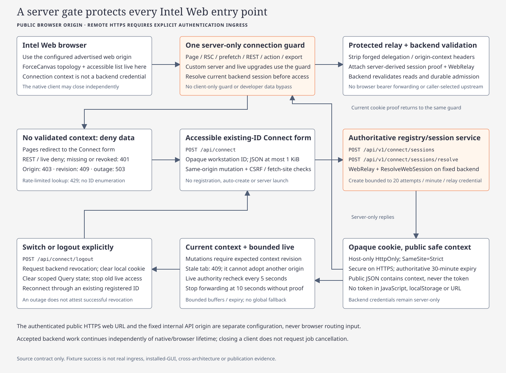
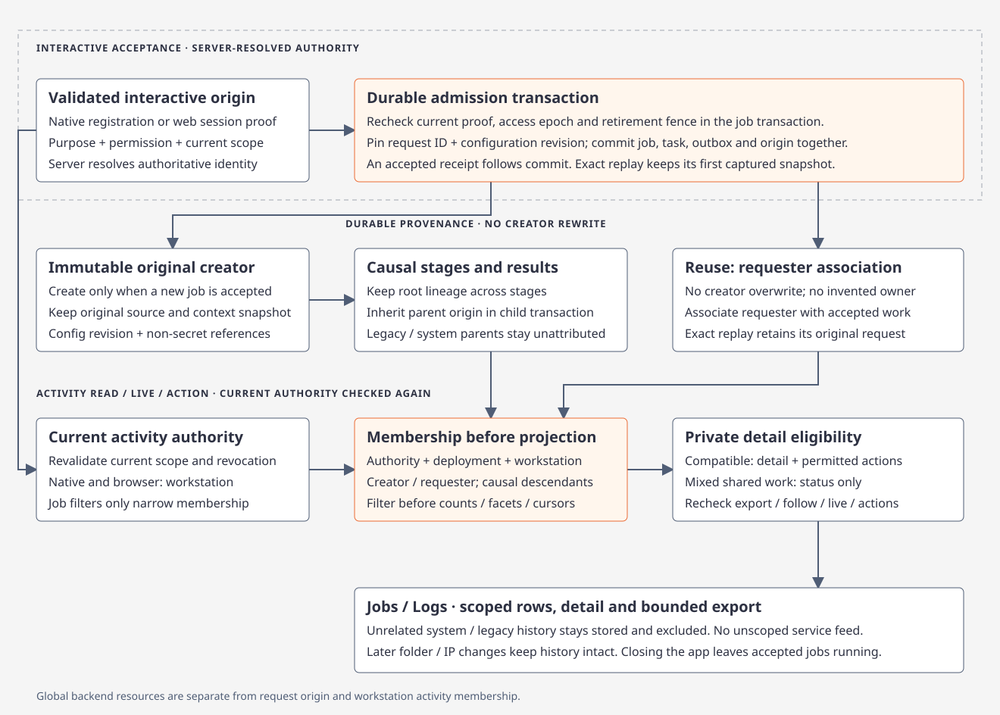

# Native connections and registered context

[Client](../../../apps/fleetworks-desktop/README.md) · [Protected identity](native-workspaces.md) · [Control/design guide](native-design-system.md) · [Verification](../../../.planning/2026-11-12-native-pairing-implementation/acceptance.md)

[](../../diagrams/native-connections.html)

<a id="pairing-and-keychain-agreed-target"></a>

## Pairing and Keychain

**Implemented flow:** Gateway URL → operator approval once → macOS Keychain → authenticated reconnect. [Verification status](../../../.planning/2026-11-12-native-pairing-implementation/acceptance.md) records actual checks; implementation does not establish a live Keychain or installed-app pass.

| Step | Behavior |
| --- | --- |
| Enter URL | Pin one validated origin: remote HTTPS or loopback HTTP. A new installation waits for Connect. A known selected pairing/access reference may reconnect on startup; an explicit URL restores only its own known reference. |
| Start / approve | Persist the exact request ID and Keychain polling secret before HTTP. The app displays request ID/code; an independently authenticated Operator approves it within the ten-minute challenge window. IDs/codes/installation markers alone grant no API access. |
| Save / connect | Authenticate the issued scoped Native credential, check compatibility, then save its secret in Keychain before reporting connected. Register/reuse the protected installation. Settings retain only origin/deployment/credential references and recovery state. |
| Reconnect | Read the exact installation/origin Keychain item, authenticate and verify the saved deployment. Never scan other items or fall back to token files, another origin or unauthenticated access. |
| Recover | Lost HTTP outcomes and failed Keychain promotion retain the exact ID/secret/issuance intent. Retry replays that request; denied/expired/revoked access requires explicit Pair again. Keychain locked/denied/unavailable and network failures remain separate actionable states. |
| Stop / resume | Change gateway URL or leave setup to cancel/fence client callbacks. Focus loss pauses pending transport; focus return in setup resumes the retained request. Local cancellation does not revoke server access or cancel accepted jobs. |

### Pairing API

All routes are POST. `PairingClient` exposes only start/poll; protected APIs retain authenticated `Client` behavior. Both transports disable redirects/proxies and bound bodies/timeouts. Polling/access secrets never enter URLs, UI state, Debug or diagnostics.

| Route | Authority / result |
| --- | --- |
| `/api/v1/pairing/start` | Public bounded challenge request: request ID, installation marker, 256-bit polling secret; returns pairing ID/code/expiry/poll interval |
| `/api/v1/pairing/poll` | Exact pairing ID + polling secret; returns pending, denied, expired or approved. Approved contains scoped access; replay returns the same issuance, not a new credential |
| `/api/v1/admin/pairing/approve`, `/deny` | Operator-purpose credential with ReadBackend, RegisterWorkstation and ManageConfiguration; exact pairing ID/code. The server derives Native scope/epoch/grants |
| `/api/v1/admin/pairing/revoke` | Current Operator authority and credential ID; fences paired authority/admission and related registered/browser proof without rewriting accepted origins |

### Operator approval and revocation

Use the app's displayed request ID/code and a separately provisioned private **Operator** token file:

```sh
python3 scripts/fleetworks_pairing.py \
  --origin https://gateway.example.test \
  --operator-token-file /absolute/private/operator-token \
  approve --pairing-id "<displayed-id>" --approval-code "<displayed-code>"
```

Use `deny` with the same ID/code, or `revoke --credential-id <paired-id>`. The helper pins the origin, refuses redirects/proxies, bounds input/output and never prints bearer bytes. Native/WebRelay credentials cannot approve pairing. [Deployment credentials](../../../deploy/README.md#credentials)

Approval → authenticated readiness/capabilities → Keychain → connection. A gateway failure after approval preserves the pending request: correct backend configuration and choose **Retry**. HTTP 503 means setup is unavailable; it does not mean pairing is unsupported. [Deployment troubleshooting](../../../deploy/README.md#troubleshooting)

Revocation, changed issuer policy/scope/access epoch and reset invalidate paired authority. Local Keychain deletion alone is not server revocation. Existing static Native, WebRelay and headless credentials remain supported independently.

## Explicit operator/headless file mode

Normal GUI setup needs no token file. Explicit `--api-origin <origin> --api-token-file <private-file>` preserves the file-based launch override; it does not populate Keychain. Optional `--provision-gateway-credential` stores only the protected file-catalog binding and exits without GUI/network startup; it is not a prerequisite for normal pairing. Existing files are never silently adopted, migrated or deleted. [Commands](../../../apps/fleetworks-desktop/README.md#build-and-provision)

## Authority and registration

| Boundary | Contract |
| --- | --- |
| Credentials | Native, WebRelay, InternalService and Operator purposes have explicit permissions. Connect IDs and caller-supplied headers grant no authority. |
| Local access | Operator-approved origin-bound Keychain access for normal GUI; explicit file-based launch mode remains separate. Neither forwards another origin’s credential. |
| Identity | Connect/activity contract 2: opaque workstation ID = Connect ID; authenticated scope + protected installation marker determine identity. Optional IP never merges installations. New requests contain no workspace fields. |
| Transport | Pin origin; disable environment proxy/redirect forwarding; bound responses. Gateway admission/read boundaries revalidate current proof, permissions and revisions. |
| Invalidation | Gateway/access changes fence old clients, reads, caches and confirmations. Missing registration or optional services disables only dependent actions; permitted shared reads remain usable. |
| Retirement | Fence admission and sessions; drain associated jobs and uncertain effects, then retire the workstation. Retained v1 folders keep their protection; accepted causal work may finish while retiring. |

Schema 10 adds pairing and credential records. Coordinate bootstrap and compatible readers/writers using the existing deployment selection; preserve scope, installation/workstation identity, registration mappings, unresolved requests and immutable origins. The earlier workstation-v2 migration fences legacy registrations/sessions and requires fresh proof for those migrated entries; pairing does not replace retained static/headless credentials. [Registry migration](../../diagrams/connect-registry.html)

## Browser handoff

[](../../diagrams/intel-connect-gate.html)

| Boundary | Contract |
| --- | --- |
| Connect | Enter an existing opaque workstation ID. Separately provisioned WebRelay resolves it; the browser cannot register guessed IDs. |
| Session | Host-only HttpOnly SameSite=Strict `fleetworks_connect_v2`; HTTPS adds Secure. Old workspace cookies require fresh Connect. Allowlist public fields and require Connect ID = workstation ID. |
| Cache/cursors | `workstation-v2` namespace includes deployment, workstation, registration and authority revisions/epochs; IP is not identity. Old workspace contexts/narrowing/cursors fail explicitly. |
| Protected access | Central server guard precedes page/RSC/prefetch, REST/export and live data. Host/Origin/ingress and expected context revisions fence forged requests/stale-tab mutations. |
| Lifecycle | Switch/expiry/denial clears Query/live state; logout revokes server proof. Bounded live rechecks include deployment/workstation/registration/revisions/epochs and close stale streams. Native may close independently. |

## Durable requests and activity

[](../../diagrams/brief-job-context.html)

- Admission captures immutable creator context transactionally; reuse adds a genuine requester association. Causal jobs retain their accepted origin/lifecycle fence. Version-aware readers preserve historical child metadata without allowing new child admission.
- Membership precedes rows, totals, facets, paging, private details, results, logs, exports, streams and mutations. Shared status does not grant private access; unknown/system/unregistered work has no all-backend fallback.
- Uncertain delivery retains original operation/request ID, exact body/context and original registration. `GET /api/v1/workstation/requests/detail` resolves it read-only using `original_registration_id`. Unknown stays unresolved; navigation/reconnection never creates a replacement POST.

## Bounded operational logs

`@tag:jobs-persistence`

Jobs SQLite owns safe summaries, not provider stdout/payloads. Membership/private eligibility applies before querying that owner, including counts/facets/cursors. Native displays a bounded selected-job queue/log view; finite updates pause when hidden/unfocused and never cancel accepted jobs. No tabs or filter/follow/copy/export/retry/cancel toolbar.

Richer backend APIs retain independent permissions. Opaque cursors bind proof/scope/snapshot, expire and require restart after invalidation. Follow/export stay bounded; partial exports and unavailable counts remain explicit.

## Readiness and maintenance

Status distinguishes identity/gateway, service readiness and optional API-host metrics; missing/stale data is unavailable, never invented zero/success. Seed and Natural training select purpose-validated CSV uploads and confirm the current configuration revision. Index build requires completed actor seeding and actors in the database. Training creates a candidate without activation; Rust-BERT inference is separate. [Maintenance figure](../../diagrams/workstation-readiness.html) · [Dataset workflow](../../../deploy/README.md#configured-native-maintenance-inputs)

Cycles use bounded workstation summaries and revision/idempotency-bound association tombstones. Delete preserves shared evidence/audit and does not cancel a cycle. Accepted receipts mean queued, not completed.

## Configuration and model choices

| Edit | Contract |
| --- | --- |
| Models | `/api/v1/models/defaults` advertises canonical roles and `configured_routes` choices, not exhaustive remote discovery. Select the actual provider/account/model tuple. Effort/variant share one supported provider/model setting. |
| Provider key | Preserve hidden account fields and unchanged secrets. Permissions/revisions still apply; conflicts retain pending edits. |
| Tool slots | Independent optional patches: omitted/null preserves; empty explicitly clears; nonempty replaces. Native blank fields preserve; Clear actions are explicit. Saved bytes are never returned. |

## Source and verification

[Contracts/SDK](../../../crates/fleetworks-contracts/src/) · [Native effects](../../../apps/fleetworks-desktop/src/) · [Protected settings](../../../crates/fleetworks-workstation/src/native/) · [Registry](../../../crates/argos-osint-core/src/storage/connect_registry.rs) · [Job context](../../../crates/argos-osint-core/src/storage/job_context.rs) · [Gateway boundary](../../../crates/argos-osint-api/src/context_boundary.rs)

The [acceptance tracker](../../../.planning/2026-11-12-native-pairing-implementation/acceptance.md) separates implementation, actual focused/gate results, inspected Runtime evidence, hosted platforms and installed-app checks. A source audit or generated image is not runtime approval.
