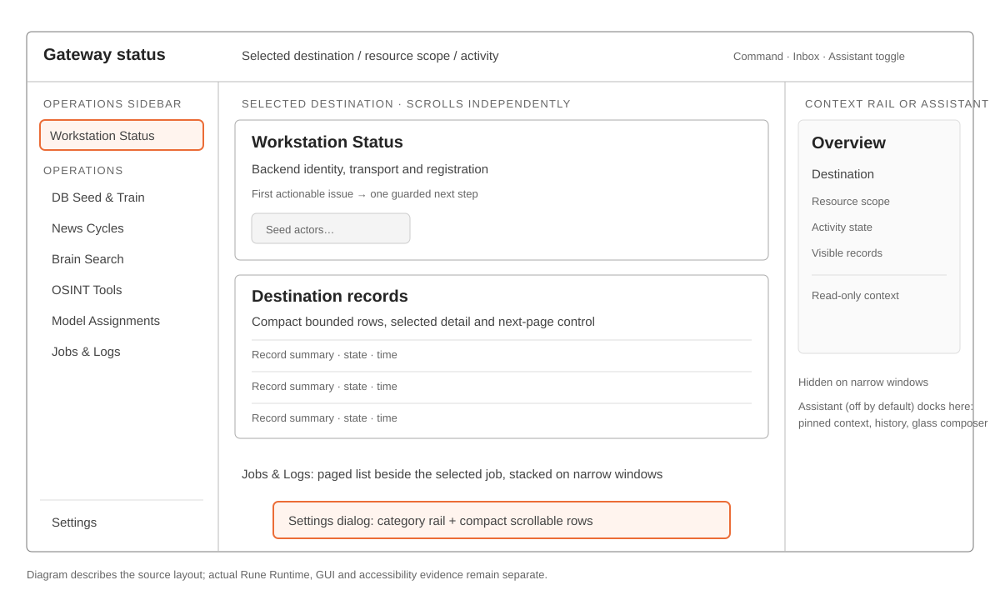
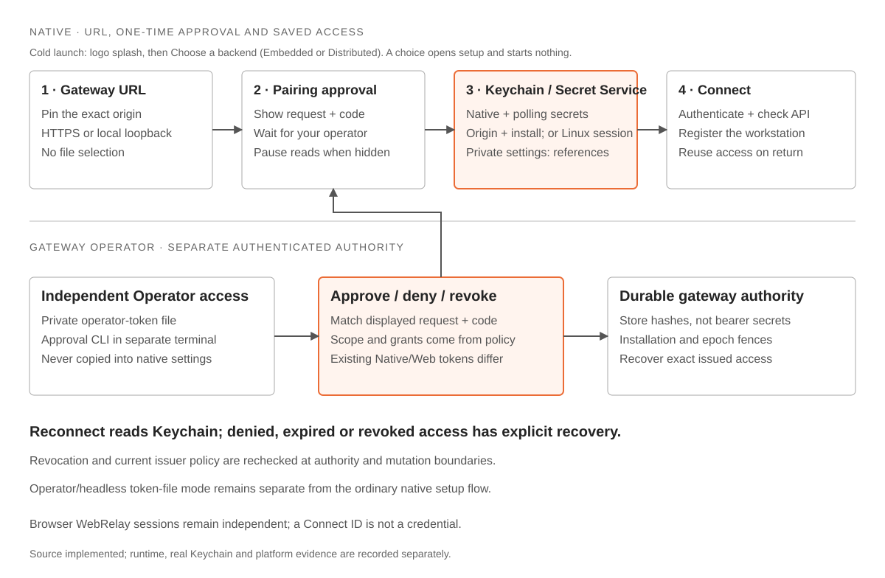
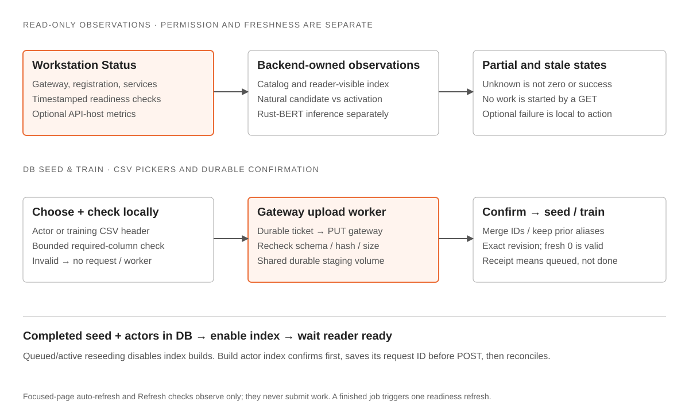

# Native workstation design

[Native client](../../../apps/fleetworks-desktop/README.md) · [Connections](native-connections.md) · [Identity](native-workspaces.md) · [UX verification status](../../../.planning/2026-11-13-native-immersive-ux/acceptance.md) · [Pairing verification](../../../.planning/2026-11-12-native-pairing-implementation/acceptance.md)

Rune macOS API client (`apps/fleetworks-desktop`). One selected destination; the backend owns data and execution. Intel Web shares paint/branding (`@tag:look-and-feel`) and workstation Connect while keeping its layout, typography, navigation and topology/list behavior.

## Reviewed visual reference · November 2026

These [inspected Rune Runtime captures](https://github.com/xxxcess/argos-osint/pull/67#issuecomment-6879191295) come from the passing [macOS ARM CI job](https://github.com/xxxcess/argos-osint/actions/runs/43606326381) at `fddb8405`. They show synthetic UI states; the installed native app has a separate review phase. **These captures predate the matte deep-space theme, Quiet Orbit and continuous Jobs loading, so their colors, finishes and Previous/Next controls are obsolete.** Regenerate them with the [review steps](native-verification.md#splash-theme-and-live-state-review) before using them as current evidence.

| Wide workstation shell | Workstation Settings |
| --- | --- |
|  |  |
| Readiness checks | Compact paged jobs (before cursor loading) |
|  |  |

The [compact Settings capture](https://github.com/user-attachments/assets/cd303831-684c-44bb-a4e4-1accf037b421) records the modal at the `640×480` minimum window size.

## Authority and references

Explicit user decisions govern. This page is the maintained control/design contract; [migration/authority](native-connections.md) owns active wire semantics. The unchanged [supplied handoff](../../design/native-workstation-handoff/argos_workstation_identity_implementation_spec.md) and [detailed design rationale](../../design/native-workstation-handoff/argos_native_design_system_guide.md) preserve source requirements and mockups. Their November 2026 baseline descriptions are historical, not current verification. The original structural reference's Tauri/Linux-client, workspace identity, sample hardware and Rust-BERT-training assumptions are superseded; the matte surface direction is current again: the interim liquid-metal and pointer-lighting system was removed in favor of the [matte deep-space theme](../../design/native-workstation-handoff/brand-space-ui/fleetworks-deep-space-theme.md).

Normal setup implements [pairing and macOS Keychain](native-connections.md#pairing-and-keychain-agreed-target). Explicit operator/headless file mode stays independent. Runtime/backend/live Keychain evidence remains separately tracked.

## Complete native control allowlist

Ordinary selection, progression, dismissal, confirmation and recovery belong to each listed control. The user-requested Workstation Settings dialog groups existing workstation and configuration routes; it adds no backend administration authority.

| Surface | Allowed controls and content |
| --- | --- |
| Shell | Actual native window controls; `Setup Gateway` (`ActionButton`, `connection-editor`); sidebar collapse; clickable `gateway-status-header` showing connection status; `Workstation Status` (`nav-workstation`) always visible; Workstation/Operations section labels and bottom `Settings` (`open-workstation-settings`) entry. When disconnected (`!state.connected()`), sidebar shows only `Workstation Status`, `Setup Gateway` (`nav-setup`) and Settings; `Page::ALL` and `⌘1–6` remain guarded to Workstation Status. When connected, sidebar reveals all six `Page::ALL` destinations with live busy status and count badges, and `scope_bar` shows resource scope + syncing/online pill. The selected destination occupies the center, with a read-only context rail on wide windows. |
| Workstation Settings | Centered `workstation-settings` dialog over the retained destination; compact General, Appearance, Gateway, Models and Tools category rail; bounded scrolling settings rows. General shows registration, readiness and deployment state; Appearance reflects macOS transparency/motion preferences; Gateway shows URL and opens Setup Gateway; Models and Tools open their existing destination controls. |
| Setup | 3-stage `stage_stepper` (`Origin URL` → `Workstation Pair` → `Gateway Ready`); Gateway URL → operator pairing approval → Keychain → authenticated checks/registration. Waiting request/code, Retry/Pair again, Change gateway URL and `setup-advanced-toggle` (`Switch` to reveal `readiness_cards::checks`) reflect the current stage; no user-managed token file. |
| Workstation Status, via header / default landing | Default home page (`Page::Workstation`, `setup_gateway: false`). When disconnected, renders only `Native Client` (`"Connect to a gateway to register this workstation."`) and `Gateway Backend` (with `workstation-setup-gateway` CTA, hiding `Host Resources` and `readiness_cards::checks`). When connected, renders `Host Resources` (clickable CPU/Memory/Disk `metric_ring_tile` controls opening a `Dialog` `modal_prompt` via `WorkstationInspector`), `Native Client` (with `Workstation registered` pill) and `Gateway Backend` (showing the deployment badge and expandable `readiness_cards::checks` tiles), and optional authoritative API-host percentages/platform/chipset. Eligible actor-catalog, index and classifier checks offer direct repair actions with existing permission and preflight guards. |
| DB Seed & Train | 3-stage `stage_stepper` + `SeedStage` (`Seed`, `Classifier`, `Maintenance`) `SegmentedControl`; preflight readiness relayed directly via each action button's inline status chip; actor/training CSV selection, validated upload and confirmed seed/Natural candidate jobs; index build only after completed seeding with actors present; busy async job/upload buttons trigger a clipped liquid-metal `LoopSpec::slide` shimmer surface |
| News Cycles | `New Cycle`; compact cursor-paged cycle tiles expanding inline metadata; `Inspect summary` opening `Dialog` (`modal_prompt`); selected-cycle history Delete with in-place confirmation |
| Brain Search | One search field; bounded interactive actor tiles; selected authoritative dossier with `DossierFacet` (`Overview`, `Associations`) `SegmentedControl` and `Collapsible` alias/attribute sections; no native graph |
| OSINT Tools | Provider/service cards; interactive credential rows opening `Dialog` (`tool-api-key`) with masked primary/fallback inputs and explicit `Switch` toggles (`inline_toggle_row`) to clear primary or fallback slots |
| Model Assignments | `ModelsTab` (`Roles`, `Providers`) `SegmentedControl`; configured provider cards with inline masked keys and `Switch` preserve-if-blank toggle; canonical role cards expanding `role_row_editor` (`Select` pickers for provider, model, reasoning variant and ordered fallback Move up/Move down/Remove actions) |
| Jobs & Logs | Compact bounded workstation queue and logs with continuous cursor loading (one `Load more` control, at most 64 pages and 500 rows, rows and selection kept on refresh) and a `RollingText` count; interactive job tiles; `ProgressCircle` + determinate `Progress` bar; `Pop out summary` opening `Dialog` (`modal_prompt`); `Retry job` CTA (`job-retry-preview`) with in-place confirmation (`job-action-confirmation`) and receipt strip for permitted failed retryable jobs; selecting a job supplies authorized safe operational summaries in `safe_log_table` |

Sidebar order when connected is `Workstation Status` followed by `DB Seed & Train`, `News Cycles`, `Brain Search`, `OSINT Tools`, `Model Assignments`, `Jobs & Logs`, then Settings in the footer; when disconnected (`!state.connected()`), `Workstation Status`, `Setup Gateway` and Settings remain available (`Page::ALL` is hidden and `navigate()`/`⌘1–6` clamp to `Workstation Status`). Render only the selected destination behind the Settings dialog. There is no chat transcript or composer.

Excluded: separate Test/Disconnect, saved-profile CRUD, workspace/folder/Trash controls, classifier activation, account creation/deletion/base-URL forms, configuration import/export, native article filters, manual tool Run/input/results, and job/log cancel/filter/follow/copy/export toolbars. Backend APIs may retain these independent capabilities for authorized callers.

## Identity, setup and actions

| Contract | Required behavior |
| --- | --- |
| Installation | Protected settings initialize without a default child. Existing folders, markers and journals remain intact. |
| Connect | Opaque backend workstation ID; authenticated scope + installation marker establish identity. Optional mutable IP never merges installations or defines identity. |
| Credential | Origin-bound Keychain secrets after operator approval; revocable scoped Native authority. Settings/journals retain only references/recovery. Explicit file mode never becomes a fallback. |
| Authority change | Fence old requests, caches, live responses and pending confirmations. Keep permitted shared reads usable when registration/optional services are unavailable. |
| Mutation | Explicit action + current permission/capability/readiness + context/revision/idempotency fences. Accepted/queued is not completed. Navigation never submits work. |
| Uncertain delivery | Retain original request ID/body/context/registration. Read-only reconciliation never creates replacement work. |

Setup shows one actionable state: pairing approval, Keychain access or network progress. Registration/readiness follows successful authentication. Focus loss pauses transport; URL changes/navigation fence callbacks while retaining recovery. No CLI flag error paragraphs in normal setup. Source implementation is distinct from inspected Runtime, backend and live Keychain evidence.

## Destination contracts

| Area | Data and effect boundary |
| --- | --- |
| Seed/index/train | Server-configured validated inputs and exact configuration revision. Missing/stale inputs disable only their operation. Natural training produces a candidate; activation and Rust-BERT inference are separate facts. |
| Cycles | Bounded cursor-paged `GET /api/v1/atlas/cycles`; `POST /api/v1/atlas/cycles/delete` tombstones this workstation association, preserving shared evidence and durable audit. Deletion is not cancellation. Current summaries supply time/state and optional `article_count`; unreported pipeline counts stay unavailable. |
| Dossier | Canonical actor lookup, debounce/latest-response fences, identity/summary first, then supported claims/links. Missing confidence or summaries stay unavailable; long content scrolls in the inspector. |
| Tool keys | Independent slot patches: omitted/null preserves, explicit empty clears, nonempty replaces. Blank native fields preserve; Clear actions are explicit (`Switch` toggles in `tool-api-key`). Saved bytes are never returned. |
| Models | Server-advertised `configured_routes` catalog, not exhaustive live provider discovery. Provider selection resolves its account/model tuple. Effort and variant address the same supported `provider::model` setting. Preserve hidden fields, unchanged secrets and pending edits on conflict. |
| Activity | Server membership precedes rows, counts, paging, logs/results/streams/actions. Shared status does not imply private access. Never fall back globally when unregistered; summaries are not provider stdout. |

## Brand palette and matte surfaces

Implemented in [`theme.rs`](../../../apps/fleetworks-desktop/src/theme.rs), [`icons.rs`](../../../apps/fleetworks-desktop/src/icons.rs), [`material.rs`](../../../apps/fleetworks-desktop/src/material.rs), [`orbit.rs`](../../../apps/fleetworks-desktop/src/orbit.rs) and [`ui_components.rs`](../../../apps/fleetworks-desktop/src/ui_components.rs). The theme is **matte deep space**: one `#060709` canvas, charcoal tonal steps, cool gray text, metallic sheen only on the main logo, a cool shimmer only while loading, and fractured-obsidian texture only on Submit, Confirm, Create, Delete and Connect. Full rules, every token, the texture recipe and the contrast check: [Matte deep-space theme](../../design/native-workstation-handoff/brand-space-ui/fleetworks-deep-space-theme.md).

### Palette and semantic tokens (`theme.rs`)

| Token / role | Hex / value | Purpose |
| --- | --- | --- |
| `BACKGROUND` / `SURFACE_INSET` | `#060709` | Window canvas and inset wells; shared by splash, setup and services |
| `SURFACE` / `SURFACE_RAISED` / `SURFACE_ELEVATED` | `#0B0E13` / `#111720` / `#181E28` | Content, raised rows and tiles, hover and dialogs |
| `TEXT_PRIMARY` / `TEXT_SECONDARY` / `TEXT_MUTED` | `#E8EDF4` / `#BEC7D4` / `#9AA6B6` | Cool values and titles, supporting copy, captions |
| `ACCENT` / `ACCENT_PRESSED` / `ACCENT_HOVER` / `ACCENT_HIGHLIGHT` / `ACCENT_DEEP` | `#A9B8CC` / `#8FA1B8` / `#C3CFDF` / `#DCE6F3` / `#4F5E73` | Neutral cool accent; `ACCENT_HIGHLIGHT` is the 2 px focus ring; `ON_ACCENT` ink is `#060709` |
| `SELECTION_SURFACE` | `#1B2533` | Selected nav and pill fill |
| `BORDER_CONTROL` / `BORDER_SUBTLE` | `#6F7B8D` / `#262D38` | Essential control boundary vs decorative framing |
| Cool metal and shadow stops | `METAL_DARK_*`, `METAL_PANEL_*`, `METAL_EDGE_*`, `LIGHT_SURFACE_GLOW` `#D5DCE5`, `GOLD_GLOW` `#9AA6B6` (name is historical), `CAST_SHADOW` `#020304` | Fractured texture and logo only; no card or control uses them for gloss |
| Status tones | Cyan live `#21D9EE`, Info `#5AB8F0`, Ok `#5FD39A`, Warn `#E5B45B`, Err `#F06A8A`, Violet queued `#B48EFF`, Neutral unknown `#9AA6B6` | `StatusTone::{fg, bg, border}`; always paired with a label or icon |
| Entity constants | `ENTITY_PERSON` `#C08CF5`, `ENTITY_ORG` `#5AB8F0`, `ENTITY_COMPUTE` `#FFB347`, `ENTITY_CLUSTER` `#CAD9F0`, `ENTITY_GRAPH` `#B48EFF` | Dossier subtypes and tool categories |
| Decorative edge alpha | `CARD_EDGE_ALPHA` `0.04` / `SATIN_CONTROL_EDGE_ALPHA` `0.07` | Quiet inset rim; never a substitute for `BORDER_CONTROL` or focus |

### Vector icons (`icons.rs`)

All shell destinations, telemetry tiles and action buttons use custom 16×16 (`view: 16.0`) `rune::Icon` SVG glyphs: `BRAND_MARK`, `WORKSTATION`, `SEED`, `ATLAS`, `BRAIN`, `TOOLS`, `MODELS`, `JOBS`, `CPU`, `MEMORY`, `DISK`, `KEY`, `SHIELD_CHECK`, `ALERT`, `SERVER`, `REFRESH`, `TRASH`, `CHEVRON_RIGHT` and `PLUS`.

### Matte controls and surfaces (`material.rs`)

| Primitive | Behavior |
| --- | --- |
| `ActionButton` + `MetalFinish` | Flat fills with a 1 px edge and a one-step hover. `Gunmetal` and `ObsidianPill` are neutral utilities; `GoldCta` (name kept) is the cool primary for actions that do not submit; `CrimsonDanger` is a destructive entry point that opens a confirmation. `Fractured` (Connect, Confirm, Use this CSV) and `FracturedDanger` (Delete from history) add the fractured-obsidian texture through `El::shape`, tinted cool or rose. A busy button shows an inline `Spinner` and one cool `loading-shimmer` band unless Reduced Motion. Disabled dims to 55 %. |
| `luminous_card` and `interactive_tile` | One tonal step (`SURFACE`, selected `SURFACE_RAISED`), 1 px `BORDER_SUBTLE` edge or the tone border when selected, radius 10. `interactive_tile` lifts to `SURFACE_ELEVATED` on hover. No gradient, glow, shadow or pointer light. |
| `configure_kit` | Functional 1 px edges only; clears `submit_highlight`, `depth_top`, `depth_bottom` and drop shadows for every preference. |
| `glass` (`Composer`, `Overlay`) | Unchanged blur recipes (composer 0.84 / 10 pt, overlay 0.91 / 14 pt, opaque when Reduced Transparency or opaque materials), now with a `BORDER_SUBTLE` top edge instead of an ivory glow. |
| `skeleton_block` | Flat `SURFACE_RAISED` block; one 45 % cool sheen band in 1.5 s while motion is allowed, static under Reduced Motion, hidden from accessibility. |
| Pointer tracking (`app.rs`) | `State::pointer_offset` and `shadow_offset` are still updated with `tx.live_only()`, but no material reads them. They remain only so call sites keep their signatures; remove them with those parameters in a later cleanup. |
| Brand mark | Canonical [`fleetworks-mark.svg`](../../../assets/brand/fleetworks-mark.svg) for small sizes; the rich logo and Quiet Orbit are in [`assets/brand`](../../../assets/brand/README.md). `Page::ALL` hit bounds and `accessibility_json()` are checked in [`appearance_tests.rs`](../../../apps/fleetworks-desktop/src/appearance_tests.rs). |

## Layout, transitions and progressive disclosure

| Concern | Implemented behavior |
| --- | --- |
| Window & chrome | Initial `1440×860`; minimum `640×480`; `Sidebar` `PaneState::new(220.0).range(180.0, 340.0)` with Workstation/Operations labels and Settings footer; selected central destination and a 236pt read-only context rail when the available main width is at least 1120pt; full-size content chrome with macOS traffic lights (`launch.rs`). |
| Compact layout | The context rail hides below 1120pt available main width, and toolbar titles shorten below 520pt content width to clear the Setup Gateway action. `Brain Search` switches from a `340px` results split + detail pane to single-column list/detail navigation below `720px` content width; `safe_log_table` adapts columns below `320px` and `500px`; settings content has its own bounded scroll owner. |
| Transitions | Destination container (`screen-setup` or `screen-<key>`) animates with `Transition::offset(0.0, 12.0).combined(Transition::opacity())`; wide `Brain Search` `dossier-pane-*` animates with `Transition::offset(8.0, 0.0).combined(Transition::opacity())`. Both are omitted when `preferences.reduced_motion` is true. |
| Async & live telemetry | `async_status_strip` pairs a `Spinner` + indeterminate `Progress::new(None)` bar during active requests with a static `status_dot` when settled. The top bar always shows the connection pill; request activity is a spinner in a reserved 13 pt slot beside it, never a replacement. Resolved content stays visible through a refresh, and a failed refresh keeps same-scope data marked stale ([state contract](../../design/native-workstation-handoff/brand-space-ui/fleetworks-realtime-state-contract.md)). `metric_ring_tile` pairs `ProgressCircle` (34px) + `RollingText` for valid `0.0..=100.0` host percentages (`N/A` icon fallback when unavailable). `Jobs & Logs` pairs `RollingText` total count with `ProgressCircle` + determinate `Progress::new(Some(frac)).show_value()`. |
| Sidebar indicators & navigation gating | Always shows `Workstation Status` (`nav-workstation`) and Settings. When `!state.connected()`, Setup Gateway appears and `navigate()` / `⌘1–6` guard hidden destinations; when connected, `Page::ALL` appears with `sidebar_row_status` (`RowStatus::Busy`) and `sidebar_row_badge` live counts on `News Cycles` and `Jobs & Logs`. |
| Progressive disclosure & modals | `stage_stepper` + `SegmentedControl` (`SeedStage`, `ModelsTab`, `DossierFacet`); button-relayed preflight status chips on `DB Seed & Train`; `inline_toggle_row` (`Switch`) on `Setup Gateway`, `OSINT Tools` and `Model Assignments`; `Collapsible` alias/attribute blocks on `Brain Search`; `Dialog` (`modal_prompt`) inspectors for `WorkstationInspector` (`workstation-telemetry`), `selected_cycle_id` (`cycle-inspector`), `selected_job_id` (`job-operational-summary`) and `tool-api-key`. |
| Keyboard & states | Top-left → bottom-right traversal with `⌘1–6` page shortcuts when connected (`app.rs`), `2px` `ACCENT_HIGHLIGHT` focus rings, independent selection states, and distinct local loading/empty/unsupported/denied/stale/failed/uncertain representations. Unknown metrics stay `N/A` / unavailable, never invented zero. |

## Required evidence

Inspect actual production Rune Runtime PNG/tree/input evidence for all seven surfaces plus setup and relevant failure states at both sizes (`1180×780` / `1280×800` and `640×480`), keyboard/scroll/selection, reduced preferences and `matte()` visual parity. Supplied mockups are synthetic composition references. Generated-but-uninspected images, unit tests, installed GUI/accessibility, backend integration and hosted dual-Mac evidence are separate claims. [Verification workflow](native-verification.md) · [UX overhaul verification](../../../.planning/2026-11-13-native-immersive-ux/acceptance.md) · [Pairing acceptance baseline](../../../.planning/2026-11-12-native-pairing-implementation/acceptance.md)

### Opaque materials preference

Blur runs inside the window, so no platform forces the opaque mode. Linux no longer falls back to matte by default. Opaque drawing is chosen by macOS Reduce Transparency, or on any platform by setting `FLEETWORKS_OPAQUE_MATERIALS` to `1`, `true`, `yes` or `on` before launch. Where Rune cannot copy the frame for a blur, it draws the tint alone, which stays readable. The command panel draws its own panel with the same modal behavior as `rune_kit::Dialog` (focus trap, Escape and outside press close it). Other dialogs, such as Settings, still use `rune_kit::Dialog` and stay opaque.

### Assistant conversation parts (`chat_ui.rs`)

The Assistant pane has the parts for a conversation but no way to fill one yet. `Assistant::messages` stays empty, sending stays gated, and the dock itself stays off by default. Nothing in `chat_ui.rs` touches a network, transport or provider. The wire contract is described in [assistant-chat-contract.md](assistant-chat-contract.md).

| Part | Behavior |
| --- | --- |
| Message bubble | Operator messages sit right on an accent tint. Assistant messages sit left on a raised surface. Each has an accessible label such as "Assistant message". |
| Turn state chip | **Queued**, **Working**, **Retrying, attempt N** and **Failed: reason** are shown as they are. A final answer has no chip. There is no partial or fake streaming text. |
| Sources | A short list of `kind: label` lines under an answer. Only the label is shown, never raw evidence text. |
| History | The newest 50 messages scroll and stick to the bottom. A note says how many older messages are not shown. With no messages, the plain status line shows instead. |
| Authority change | A new connection authority clears the messages with the draft and the pin. |

### Component catalog (fixtures)

Scenes `catalog` and `catalog-opaque` draw production components together: the four button finishes in default, busy, disabled and with-status states, every status tone, selected and unselected tiles, an opaque reading panel and a section header. The catalog has no route and no menu entry. Only a fixture scene turns it on (`State::fixture_show_catalog`). Hover, focus and pressed need input and are covered by scripted scenes. The web side has a state matrix over the production Button in `packages/ui/__tests__/component-catalog.test.tsx`.
