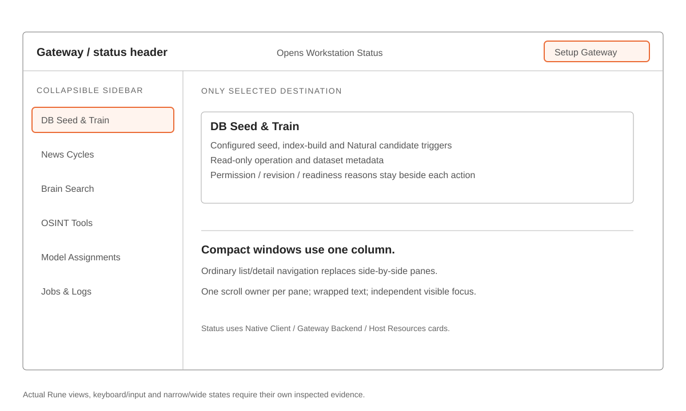
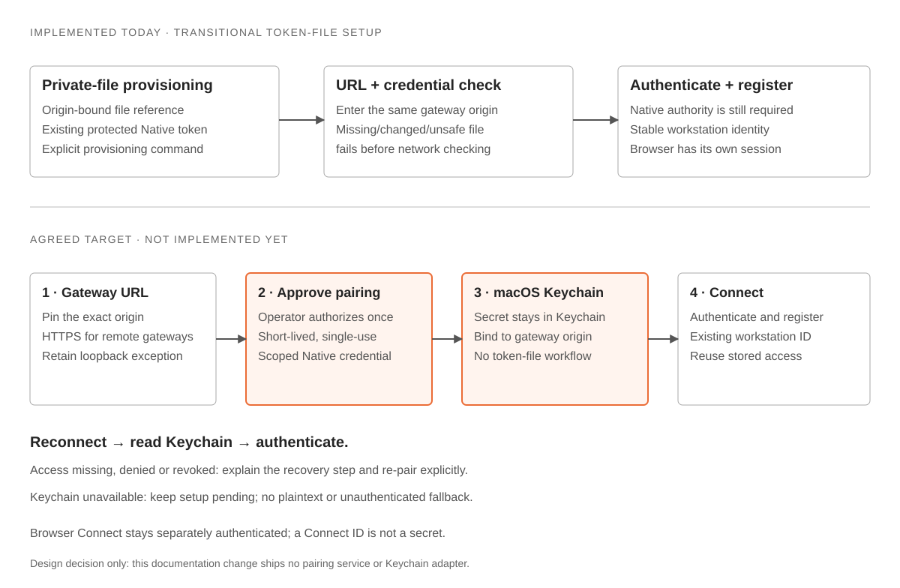
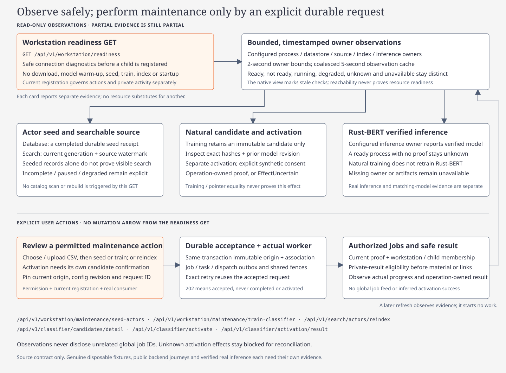

# Native workstation design

[Native client](../../../apps/fleetworks-desktop/README.md) · [Connections](native-connections.md) · [Identity](native-workspaces.md) · [Verification status](../../../.planning/2026-11-12-native-pairing-implementation/acceptance.md)

Rune macOS API client. One selected destination; the backend owns data and execution. Intel Web shares paint/branding and workstation Connect while keeping its layout, typography, navigation and topology/list behavior.

## Authority and references

Explicit user decisions govern. This page is the maintained control/design contract; [migration/authority](native-connections.md) owns active wire semantics. The unchanged [supplied handoff](../../design/native-workstation-handoff/argos_workstation_identity_implementation_spec.md) and [detailed design rationale](../../design/native-workstation-handoff/argos_native_design_system_guide.md) preserve source requirements and mockups. Their November 2026 baseline descriptions are historical, not current verification. The original structural reference's Tauri/Linux-client, workspace identity, glossy surfaces, sample hardware and Rust-BERT-training assumptions are superseded.

Normal setup implements [pairing and macOS Keychain](native-connections.md#pairing-and-keychain-agreed-target). Explicit operator/headless file mode stays independent. Runtime/backend/live Keychain evidence remains separately tracked.

## Complete native control allowlist

Ordinary selection, progression, dismissal, confirmation and recovery belong to each listed control; they do not authorize extra administration pages.

| Surface | Allowed controls and content |
| --- | --- |
| Shell | Actual native window controls; Setup Gateway; sidebar collapse; clickable gateway/status header; six sidebar destinations below |
| Setup | Gateway URL → operator pairing approval → Keychain → authenticated checks/registration. Waiting request/code, Retry/Pair again and Change gateway URL reflect the current stage; no user-managed token file. |
| Workstation Status, via header | Read-only Native Client, Gateway Backend and Host Resources cards; selectable Connect ID; optional authoritative API-host percentages/platform/chipset |
| DB Seed & Train | Actor/training CSV selection, validated upload and confirmed seed/Natural candidate jobs; index build only after completed seeding with actors present; refresh checks and read-only dataset/model/status metadata |
| News Cycles | New Cycle; workstation cycle cards; selected-cycle history Delete with in-place confirmation |
| Brain Search | One search field; bounded results; selected authoritative dossier, no native graph |
| OSINT Tools | Provider/service cards; key-provisioning modal only for actual provisionable credentials |
| Model Assignments | Configured provider table with inline keys; canonical role provider/model, supported effort/variant and ordered fallback controls |
| Jobs & Logs | Bounded workstation queue; selecting a job supplies authorized safe operational summaries |

Sidebar order is exactly DB Seed & Train, News Cycles, Brain Search, OSINT Tools, Model Assignments, Jobs & Logs. Status is not a seventh item. Render only the selected destination.

Excluded: separate Test/Disconnect, saved-profile CRUD, workspace/folder/Trash controls, classifier activation, account creation/deletion/base-URL forms, configuration import/export, native article filters, manual tool Run/input/results, tabs and job/log retry/cancel/filter/follow/copy/export toolbars. Backend APIs may retain these independent capabilities for authorized callers.

## Identity, setup and actions

| Contract | Required behavior |
| --- | --- |
| Installation | Protected settings initialize without a default child. Existing folders, markers and journals remain intact. |
| Connect | Opaque backend workstation ID; authenticated scope + installation marker establish identity. Optional mutable IP never merges installations or defines identity. |
| Credential | Origin-bound Keychain secrets after operator approval; revocable scoped Native authority. Settings/journals retain only references/recovery. Explicit file mode never becomes a fallback. |
| Authority change | Fence old requests, caches, live responses and pending confirmations. Keep permitted shared reads usable when registration/optional services are unavailable. |
| Mutation | Explicit action + current permission/capability/readiness + context/revision/idempotency fences. Accepted/queued is not completed. Navigation never submits work. |
| Uncertain delivery | Retain original request ID/body/context/registration. Read-only reconciliation never creates replacement work. |

Setup shows one actionable state: pairing approval, Keychain access or network progress. Registration/readiness follows successful authentication. Focus loss pauses transport; URL changes/navigation fence callbacks while retaining recovery. No CLI flag error paragraphs in normal setup. Source implementation is distinct from inspected Runtime, backend and live Keychain evidence.

## Destination contracts

| Area | Data and effect boundary |
| --- | --- |
| Seed/index/train | Server-configured validated inputs and exact configuration revision. Missing/stale inputs disable only their operation. Natural training produces a candidate; activation and Rust-BERT inference are separate facts. |
| Cycles | Bounded `GET /api/v1/atlas/cycles`; `POST /api/v1/atlas/cycles/delete` tombstones this workstation association, preserving shared evidence and durable audit. Deletion is not cancellation. Current summaries supply time/state and optional `article_count`; unreported pipeline counts stay unavailable. |
| Dossier | Canonical actor lookup, debounce/latest-response fences, identity/summary first, then supported claims/links. Missing confidence or summaries stay unavailable; long content scrolls in the inspector. |
| Tool keys | Independent slot patches: omitted/null preserves, explicit empty clears, nonempty replaces. Blank native fields preserve; Clear actions are explicit. Saved bytes are never returned. |
| Models | Server-advertised `configured_routes` catalog, not exhaustive live provider discovery. Provider selection resolves its account/model tuple. Effort and variant address the same supported `provider::model` setting. Preserve hidden fields, unchanged secrets and pending edits on conflict. |
| Activity | Server membership precedes rows, counts, paging, logs/results/streams/actions. Shared status does not imply private access. Never fall back globally when unregistered; summaries are not provider stdout. |

## Matte materials and brand

| Token/recipe | Target |
| --- | --- |
| Canvas | `#060709` |
| Card / raised control | `#0B0C0F` / `#111317`, opaque |
| Primary / supporting / quiet text | `#F3EEE4` / `#D6D2C4` / `#B8B4A8` |
| Gold / pressed gold | `#C6A56E` / `#C4A265`; dark text on gold |
| Functional boundary | Contrast-checked token such as `#898274`; focus remains independently visible |
| Decorative satin edge | Static 1–2% ivory on cards, 2–3% on controls; never substitutes for a functional boundary |
| Primary action | At most one compact flat gold primary per native surface; other actions use graphite |
| Interaction | Small fill/border changes, no layout movement; read-only cards never acquire hover/focus/cursor behavior |
| Brand | Canonical five outlined rays, ivory disc, gold crescent; preserve geometry/accessibility/aspect ratio and base-path-safe assets; transparent knockout, obsidian only for intentionally opaque icons |

Reuse shared theme/material primitives. No broad gradients, gloss, chrome rims, reflective sweeps, backdrop blur, decorative surface animation or noisy textures. Reduced transparency/motion keeps static opaque surfaces. Preserve web semantic colors and geometry; decorative 1–3% edges require real numeric contrast checks for essential controls and focus.

## Layout and state

| Concern | Rule |
| --- | --- |
| Window | Initial 1180×780; minimum 640×480; existing 220-point sidebar defaults |
| Compact | Single column and ordinary list/detail navigation; no horizontal page overflow for normal text |
| Scroll | One owner per pane; stable heading/action region; wrapped long text and bounded lists/logs |
| Keyboard | Top-left → bottom-right traversal; visible independent focus, selection and collapsed-nav labels/tooltips |
| Type/space | Existing Kit body/small/medium, monospace for logs/IDs; shared spacing, no new face |
| Reads | Start only affected stale/initial reads on view entry/focus; reuse fresh observations; cancel/fence obsolete reads. Logs/metrics update finitely only while visible/focused. |
| States | Distinguish loading, verified empty, unsupported, denied, stale, failed and uncertain locally. Unknown metrics/counts are unavailable, never invented zero. |

## Required evidence

Inspect actual production Rune Runtime PNG/tree/input evidence for all seven surfaces plus setup and relevant failure states at both sizes, keyboard/scroll/selection, reduced preferences and 1×/2× logo fit. Supplied mockups are synthetic composition references. Generated-but-uninspected images, unit tests, installed GUI/accessibility, backend integration and hosted dual-Mac evidence are separate claims. [Verification workflow](native-verification.md) · [Executed results and open obligations](../../../.planning/2026-11-12-native-pairing-implementation/acceptance.md)
