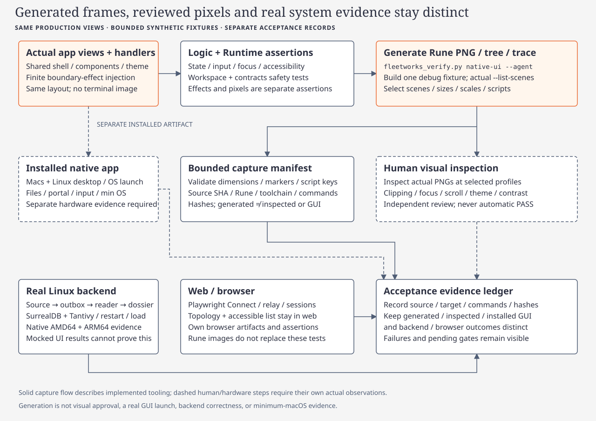

# Selected native UI verification

[Code route](index.md) · [Fleetworks](fleetworks.md) · [Cache guidance](contributing.md#build-cache-hygiene)

The existing [Fleetworks verifier](../../../scripts/fleetworks_verify.py) exposes
`native-ui` for selected same-view Rune fixture captures. Its
[stdlib helper](../../../scripts/fleetworks_native_verify.py) builds
`native_fixture` once per invocation, queries that executable's actual
`--list-scenes`, then runs the requested scenes, viewports and scripts. Inventory
size is not a release contract; new scenes do not require changing a universal
test count.

[](../../diagrams/native-verification.html)

This command requires a supported physical Mac (`x86_64-apple-darwin` or `aarch64-apple-darwin`) or Linux x86_64 host (`x86_64-unknown-linux-gnu`) with Vulkan (or Mesa Lavapipe) and the repository-pinned Rust toolchain. It does not install prerequisites, invoke Node/Docker, contact a backend, package/install the app or launch a GUI. An explicit execution target must match the physical host. Default `--target host` rejects an ambiguous Rosetta or mismatched Rust host and omits Cargo's `--target` argument so the existing implicit host debug graph stays reusable. On Linux, `HOME` and `XDG_CACHE_HOME` remain isolated and `DBUS_SESSION_BUS_ADDRESS` is excluded from fixture captures. Explicit matching targets remain available when that distinct graph is intentional.

## Select the affected views

Use `--agent` for agent work: it calls `agent_cargo.py build --locked` with the
shared `target/agents` cache. Human invocations without `--agent` use direct Cargo.
Both use debug builds and the compiler-artifact executable path, including paths
affected by Cargo target-directory overrides. Keep one build owner and freeze the
selected source before generating final evidence. A dirty checkout is recorded
as dirty and does not establish immutable commit-only provenance.

Scenes `assistant-open`, `assistant-opaque`, `command-panel` and
`command-panel-opaque` draw the Assistant dock (with a synthetic conversation)
and the command overlay in their glass and opaque forms, and `catalog` and
`catalog-opaque` draw the component catalog. The Mac lane captures all six; the
Linux lane captures the glass ones. They send nothing and use no
backend.

A selected baseline capture:

```sh
python3 scripts/fleetworks_verify.py native-ui --agent \
  --scene brain-search-ready --size 1280x800 --scale 2 \
  --output .agent-scratch/native-ui/brain-review
```

An additional scripted actor-selection case, alongside that scene's baseline:

```sh
python3 scripts/fleetworks_verify.py native-ui --agent \
  --scene brain-search-ready --size 1280x800 --scale 2 \
  --script brain-search-ready=apps/fleetworks-desktop/tests/fixtures/scripts/brain-search-open.json \
  --script-expect-key brain-search-ready=dossier-name \
  --output .agent-scratch/native-ui/brain-selection-review
```

These are usage examples; they are not recorded verification results. Repeat
`--scene`, `--size` and `--scale` to select their Cartesian product. Scripts add
cases for their selected scene at every chosen size/scale. Baseline virtual time
defaults to zero; `--script-at` defaults to one second and must cover the script's
event times. Optional expected keys verify the scripted final state structurally,
not its visual appearance. Script files must be bounded JSON inside the repository.

The capture limit is 128 cases, with 64–4096-point viewports, integer scales 1–3
and a 16-megapixel per-image limit. The default profile is 1280×800 points at 2×.
Select only affected combinations. Zero scenes, unknown runtime names, invalid
dimensions/scales, escaping scripts and incomplete outputs fail.

To discover names, use a separate `native-ui --agent --list-scenes` invocation.
Generation already validates the runtime inventory automatically. `--dry-run`
prints the requested plan without building or asserting scene availability.

Output must be a new/empty review directory outside installed applications and
real protected native settings or preserved legacy folder containers. The default creates a new directory under
`.agent-scratch/native-ui`; existing evidence is not overwritten. Use ignored
scratch or an output directory outside the checkout to keep clean-source checks
meaningful. `--revision SHA --require-clean` is available for exact CI evidence.

## Read the evidence correctly

The manifest records source SHA/dirty state, pinned Rune revision, toolchain,
physical/process architecture, target mode, Cargo.lock and executable hashes,
actual runtime inventory, commands, bounded stdout/stderr logs and timings. Each
capture records its selected profile, virtual time, script hash and PNG/tree/trace
hashes. PNG chunks/checksums and dimensions, tree viewport/scale/fixture marker and
script trace metadata are validated. Failures retain a failed manifest and bounded
diagnostics; oversized logs are labeled truncated and fail rather than passing.

Rendering uses a temporary fixture home and stripped runtime environment. The
fixture uses the production view/handler path with synthetic effects; this is not
a filesystem/network sandbox or live backend integration proof.

The `--local-review-fixture` option is limited to `pairing-waiting` and injects a
synthetic, nonexistent approval-socket path into that fixture process only. CI
uses it to capture the local confirmation wording and retry control; it does not
start a helper, contact a gateway, or approve a pairing request.

For log-consuming, job-streaming, readiness, and backpressure/error recovery paths,
native unit/Runtime checks may bind an offline loopback `TcpListener` gateway over
`127.0.0.1:0` to serve scripted [`fleetworks_contracts::operational_logs`](../../../crates/fleetworks-contracts/src/operational_logs.rs)
responses into live `rune::Runtime` instances (see [log_tests.rs](../../../apps/fleetworks-desktop/src/log_tests.rs)).
This tests real HTTP wire framing, registered headers, `429`/`503` backpressure
degradation, error rows, and cursor validation while keeping `apps/fleetworks-desktop`
free of backend Docker engines.

| Evidence | What this command records |
| --- | --- |
| Runtime generation | Exit status plus validated nonempty PNG/tree and optional script trace |
| Visual inspection | `not_performed`; inspect the generated images separately and record actual findings |
| Real app/GUI behavior | `not_run`; use the separately built app and record actual window/input/lifecycle evidence |
| Unit tests | `not_run_by_this_command`; retain scoped test results separately |
| Backend/inference | Not exercised; source-to-visible search and real model/checkpoint gates remain separate |

The [dual-Mac workflow](../../../.github/workflows/fleetworks-native.yml) (`package`
and `verify` jobs on `macos-15-intel` and `macos-15`) runs `cargo fmt --check`,
scoped `fleetworks-desktop`, `fleetworks-workstation` and `fleetworks-contracts`
unit tests, and then invokes this same `native-ui --agent --require-clean`
helper across its explicit `--scene` and `--script` selections (`1280x800` and
`640x480` at `1×` and `2×`) before building the debug `.app` (or packaging and
verifying the release ZIP on trusted channel runs). Its manifest remains honest
about pending visual/GUI evidence: an uploaded artifact or successful renderer
exit does not supply either result. Adding or renaming native scenes or
interaction scripts requires coordinating `.github/workflows/fleetworks-native.yml`
updates with Code Architect.

When the user is available for interactive review, a passing app artifact for the
local Mac architecture starts native review before the remaining hosted matrix
finishes. Record the artifact's exact revision, close the running app, rebuild the
isolated backend and native app locally, and open the app. Track unfinished Linux,
storage and installed-app checks separately; artifact creation alone is not a
local behavior pass.

The [offline Python fixtures](../../../scripts/test_fleetworks_native_verify.py)
cover selection/artifact-path fences, implicit debug cache reuse, bounded profiles,
runtime inventory, missing/corrupt PNG/tree, dimensions, failed renderer exits,
script final keys, stale output protection and physical target mismatches. For
packaged app launch debugging, `fleetworks_candidate.py` `build-native` / `package-native` /
`verify-native --open --diagnostic` runs the executable directly with `--diagnostic`,
initializing stderr tracing, non-secret startup preflight, and early non-zero crash
capture before handoff. Actual helper tests/rendering must be executed by the integration owner and recorded in
the active acceptance tracker (for the cutover baseline, see
[cutover acceptance](../../../.planning/2026-11-11-rune-macos-cutover/acceptance.md)).

## Dispatchable UI visual review

After an agent freezes a native or web UI PR revision, dispatch
[`ui-visual-review.yml`](../../../.github/workflows/ui-visual-review.yml) with the
open PR number, full head SHA and the smallest affected capture selection. The
workflow checks out the exact revision, generates Rune/Playwright images, retains
the full evidence artifact and attaches selected PNGs inline to a PR comment. The
comment states the source SHA and selected scenes. Inspect the images and record
that visual review separately from successful generation. Link curated comment
attachments from the affected design docs, or supply `release_tag` for an existing
trusted Release whose commit is the same SHA; the workflow can attach its image
bundle there. A workflow artifact alone expires and is not a GitHub Release asset.

```sh
UI_PR_NUMBER=67
UI_HEAD_SHA="$(git rev-parse HEAD)"
UI_BRANCH="$(git branch --show-current)"
gh workflow run ui-visual-review.yml -R xxxcess/argos-osint --ref "$UI_BRANCH" \
  -f pr="$UI_PR_NUMBER" -f head="$UI_HEAD_SHA" -f scope=native \
  -f native_scenes=registration-ready -f native_script=settings
```

Use `scope=web -f web_surface=bulletin` for a web-only change, choosing
`brief`, `topology`, `actors` or `all` only when affected. `scope=both` runs both
paths. Native scene names are comma-separated; `native_script=none` is the default.
Keep the PR open through capture/comment publication and inspect the exact run
before claiming success. New `workflow_dispatch` workflows accept events only
after their file exists on the repository default branch. For a PR that introduces
this workflow, use the existing native/web CI evidence artifacts and manually
attach selected PNGs to its PR comment with `gh pr comment --attach`; report the
dispatch path as pending until merge.
