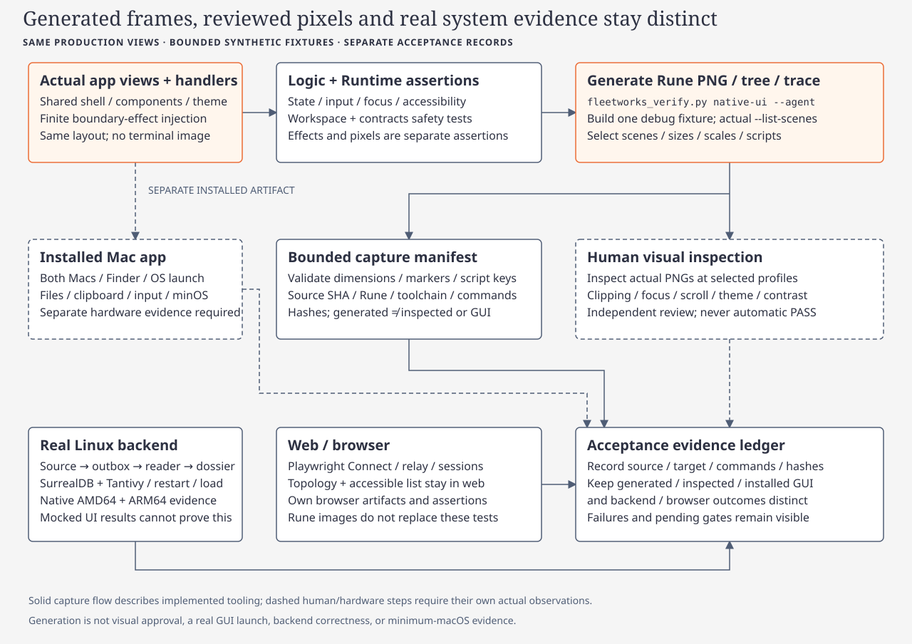

# Selected native UI verification

[Code route](index.md) · [Fleetworks](fleetworks.md) · [Cache guidance](contributing.md#build-cache-hygiene)

The existing [Fleetworks verifier](../../../scripts/fleetworks_verify.py) exposes
`native-ui` for selected same-view Rune fixture captures. Its
[stdlib helper](../../../scripts/fleetworks_native_verify.py) builds
`native_fixture` once per invocation, queries that executable's actual
`--list-scenes`, then runs the requested scenes, viewports and scripts. Inventory
size is not a release contract; new scenes do not require changing a universal
test count.

[](../../diagrams/native-verification.html)

This command requires a supported physical Mac and the repository-pinned Rust
toolchain. It does not install prerequisites, invoke Node/Docker, contact a
backend, package/install the app or launch a GUI. An explicit execution target
must match the physical Mac. Default `--target host` rejects an ambiguous Rosetta
or mismatched Rust host and omits Cargo's `--target` argument so the existing
implicit host debug graph stays reusable. Explicit matching targets remain
available when that distinct graph is intentional.

## Select the affected views

Use `--agent` for agent work: it calls `agent_cargo.py build --locked` with the
shared `target/agents` cache. Human invocations without `--agent` use direct Cargo.
Both use debug builds and the compiler-artifact executable path, including paths
affected by Cargo target-directory overrides. Keep one build owner and freeze the
selected source before generating final evidence. A dirty checkout is recorded
as dirty and does not establish immutable commit-only provenance.

A selected baseline capture:

```sh
python3 scripts/fleetworks_verify.py native-ui --agent \
  --scene brain-search-ready --size 1280x800 --scale 2 \
  --output .agent-scratch/native-ui/brain-review
```

An additional scripted actor-selection case, alongside that scene's baseline:

```sh
python3 scripts/fleetworks_verify.py native-ui --agent \
  --scene brain-search-ready --size 1280x800 --scale 2 \
  --script brain-search-ready=apps/fleetworks-desktop/tests/fixtures/scripts/brain-search-open.json \
  --script-expect-key brain-search-ready=dossier-name \
  --output .agent-scratch/native-ui/brain-selection-review
```

These are usage examples; they are not recorded verification results. Repeat
`--scene`, `--size` and `--scale` to select their Cartesian product. Scripts add
cases for their selected scene at every chosen size/scale. Baseline virtual time
defaults to zero; `--script-at` defaults to one second and must cover the script's
event times. Optional expected keys verify the scripted final state structurally,
not its visual appearance. Script files must be bounded JSON inside the repository.

The capture limit is 128 cases, with 64–4096-point viewports, integer scales 1–3
and a 16-megapixel per-image limit. The default profile is 1280×800 points at 2×.
Select only affected combinations. Zero scenes, unknown runtime names, invalid
dimensions/scales, escaping scripts and incomplete outputs fail.

To discover names, use a separate `native-ui --agent --list-scenes` invocation.
Generation already validates the runtime inventory automatically. `--dry-run`
prints the requested plan without building or asserting scene availability.

Output must be a new/empty review directory outside installed applications and
real native workspace containers. The default creates a new directory under
`.agent-scratch/native-ui`; existing evidence is not overwritten. Use ignored
scratch or an output directory outside the checkout to keep clean-source checks
meaningful. `--revision SHA --require-clean` is available for exact CI evidence.

## Read the evidence correctly

The manifest records source SHA/dirty state, pinned Rune revision, toolchain,
physical/process architecture, target mode, Cargo.lock and executable hashes,
actual runtime inventory, commands, bounded stdout/stderr logs and timings. Each
capture records its selected profile, virtual time, script hash and PNG/tree/trace
hashes. PNG chunks/checksums and dimensions, tree viewport/scale/fixture marker and
script trace metadata are validated. Failures retain a failed manifest and bounded
diagnostics; oversized logs are labeled truncated and fail rather than passing.

Rendering uses a temporary fixture home and stripped runtime environment. The
fixture uses the production view/handler path with synthetic effects; this is not
a filesystem/network sandbox or live backend integration proof.

| Evidence | What this command records |
| --- | --- |
| Runtime generation | Exit status plus validated nonempty PNG/tree and optional script trace |
| Visual inspection | `not_performed`; inspect the generated images separately and record actual findings |
| Real app/GUI behavior | `not_run`; use the separately built app and record actual window/input/lifecycle evidence |
| Unit tests | `not_run_by_this_command`; retain scoped test results separately |
| Backend/inference | Not exercised; source-to-visible search and real model/checkpoint gates remain separate |

The [dual-Mac workflow](../../../.github/workflows/fleetworks-native.yml) invokes
this same helper for explicit baseline/script selections, after scoped desktop
unit tests. Its manifest remains honest about pending visual/GUI evidence. An
uploaded artifact or successful renderer exit does not supply either result.

The [offline Python fixtures](../../../scripts/test_fleetworks_native_verify.py)
cover selection/artifact-path fences, implicit debug cache reuse, bounded profiles,
runtime inventory, missing/corrupt PNG/tree, dimensions, failed renderer exits,
script final keys, stale output protection and physical target mismatches. Actual
helper tests/rendering must be executed by the integration owner and recorded in
the [acceptance tracker](../../../.planning/2026-11-11-rune-macos-cutover/acceptance.md).
