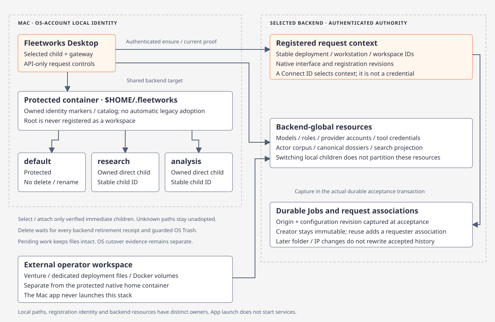
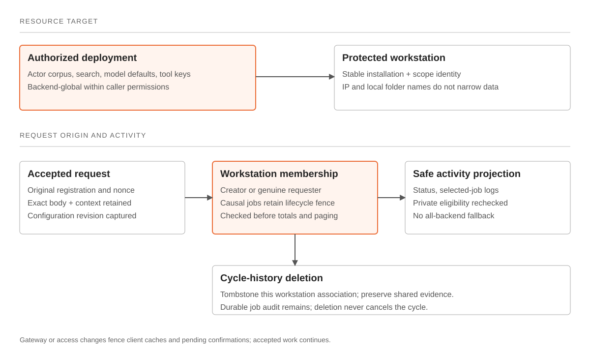
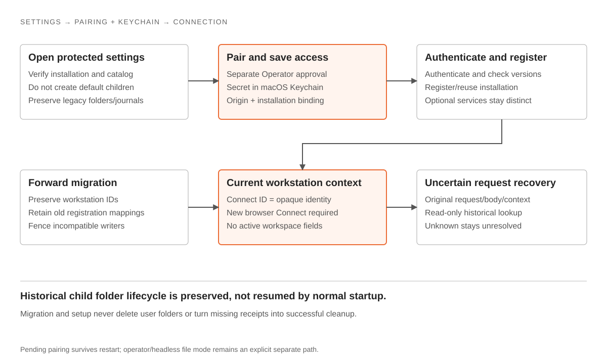

# Native workstation identity

[Fleetworks](fleetworks.md) · [Connections](native-connections.md) · [Protected manager](../../../crates/fleetworks-workstation/src/native/)

The native installation owns protected settings under `~/.fleetworks` in the operating system account home. Workstation registration uses that installation marker and authenticated backend scope. The gateway-issued opaque `workstation_id` is the Connect ID. IP is optional mutable metadata; changing or omitting it does not create a new identity, and two installations sharing an IP remain distinct.

## Protected settings boundary

Normal startup opens settings without creating a `default` child. The manager verifies directory/file object identity and private permissions; revisioned atomic writes use its existing lock. Unknown catalogs, symlinks, external paths and conflicting installation markers fail closed.

| Location | Owns |
| --- | --- |
| `.native-pairing.json` | Installation/origin/deployment/credential references, selected origin and exact pending/issuance recovery; no polling/access secrets |
| macOS Keychain | Installation- and origin-bound polling/access secrets through the blocking `KeychainStore` adapter; denied access never falls back |
| Retained file catalog | Explicit operator/headless credential references; no automatic adoption, migration or deletion |

[Pairing](native-connections.md#pairing-and-keychain-agreed-target) records exact intent before HTTP and issuance before Keychain promotion. Restart/retry recovers only that reference. An approved credential becomes connected only after authenticated compatibility checks and successful storage. Server revocation is independent of local cancellation/deletion.

Explicit `--api-origin` + `--api-token-file` retains file-based launch mode. Optional `--provision-gateway-credential` saves its binding and exits without GUI/network/service startup; normal GUI pairing does not require it.

## Scope and history

New registrations, request contexts and activity queries contain workstation identity without workspace IDs, names or markers. Backend models, keys, actor corpus and search remain shared within authorized deployment scope. Membership is resolved before counts, pagination, details, logs, results, streams and mutations. Unknown/system jobs are never assigned to a workstation as a fallback.

Schema 10 adds pairing records without replacing installation/scope identity or accepted origins. The versioned registry migration preserves workstation IDs and `(scope_id, installation_hash)`, retains old registration mappings and immutable origins for historical readers, fences incompatible admission and requires a fresh browser Connect. Accepted causal children retain the correct workstation lifecycle fence. Legacy child registrations cannot admit new work.

Uncertain submissions retain original operation/request ID, exact body/context and original registration. Authenticated read-only reconciliation uses `original_registration_id`; an unknown lookup keeps the unresolved handle and never sends a replacement POST under a newer registration.

## Legacy folder records

Existing default/named child folders, markers, pending operation journals and unresolved receipts are preserved. They are historical local data, not the active identity or a prerequisite for setup. The native interface exposes no folder creation, attach, selection, removal, Finder or Trash workflow. The retained manager compatibility paths do not authorize deleting user folders during this migration. Cargo workspaces, deployment directories and Jobs' private stores have separate ownership.

## Verification

Manager fixtures cover settings-only initialization, installation identity, injected Keychain access/promotion/recovery, credential-origin/file binding and retained catalogs. Registry/API tests cover forward migration, IP-independent identity, session invalidation and historical request recovery. Actual Rune fixtures exercise the same production views/handlers. See the [acceptance tracker](../../../.planning/2026-11-12-native-pairing-implementation/acceptance.md) for executed results; unit fixtures do not establish installed-app or both-architecture approval.
