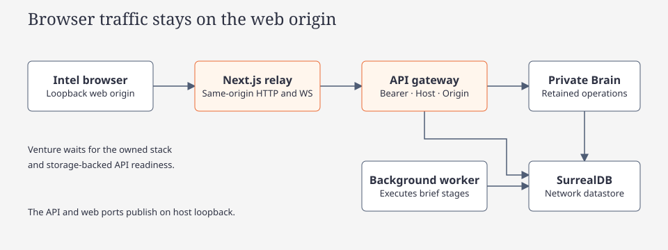
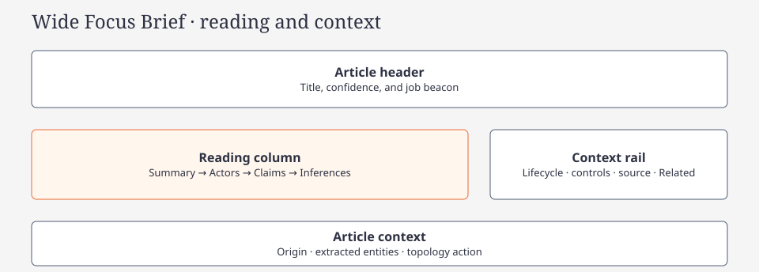

# React UI design and implementation

[Code route](index.md) · [Intel web contract](intel-web.md) · [Testing](react-ui-testing.md)

Applies to `apps/web-desktop`, `packages/{ui,intel,api-client}`. Shared [matte design](native-design-system.md) changes paint while preserving web structure, typography and product contracts. Rune has a separate native allowlist; retired terminals are [historical](../../archive/cli-retirement.md).

## Fleetworks look and feel

Before building, name the screen type, density and nearest shared primitive.

| Decide | Rule |
| --- | --- |
| Type | Existing scale; mono for navigation/metadata, body for prose |
| Space | Visible record gaps; compact only for launchers, palettes, headlines and category bullets |
| Color | Obsidian/graphite and sparse gold/ivory; semantic hues retain their meanings |
| Components | Extend shared primitives; preserve functional boundaries and independent focus/selection |
| States | Loading, empty, error, unavailable, disabled, hover, press and keyboard focus |
| Overflow | Wrap prose, scroll long content and retain usable hit targets |

No alternate graph library: web topology uses `ForceCanvas` and its accessible list twin.

## Ownership and stack

| Concern                            | Authority                                                                                                                                                    |
| ---------------------------------- | ------------------------------------------------------------------------------------------------------------------------------------------------------------ |
| Shared palette and primitives      | [packages/ui](../../../packages/ui/src/index.tsx): `colors`, `fonts`, `Label`, `Copy`, `Button`, `Panel`, `Notice`, `LoadingState`, `EmptyState`, `Skeleton` |
| Screens and responsive composition | [packages/intel](../../../packages/intel/src/index.tsx): Bulletin, Focus Brief, Topology                                                                     |
| Remote state and connection        | [packages/api-client](../../../packages/api-client/src/index.tsx): Context, TanStack Query v5, readiness and backend/instance keys                           |
| Platform settings                  | [web adapter](../../../apps/web-desktop/app/backend-settings.ts): persisted endpoint, hydration-safe snapshots and request IDs through `BackendSettings`     |
| Browser shell and CSS              | [app](../../../apps/web-desktop/app), especially [style.css](../../../apps/web-desktop/app/style.css)                                                        |
| Behavior and offline fixtures      | [Intel web contract](intel-web.md), [browser tests](../../../tests/web/intel.spec.ts), [Playwright config](../../../playwright.config.ts)                    |

Use installed manifests and the app's [Next guidance](../../../apps/web-desktop/AGENTS.md) for version-specific APIs. Next runs a server: the React Native UI calls its same-origin API routes, which forward to Rust. Only server configuration knows the Rust origin; Next does not implement storage/domain behavior. React Compiler is enabled for the web app and its shared transpiled packages; keep it enabled. The Rune macOS client is a separate Rust app; a web build is not native app verification. Keep the pinned dependency set; add libraries only when the task needs them and validate compatibility.

## React Native and Compiler baseline

- Shared components use React Native primitives and `StyleSheet`, with web-only CSS/platform services supplied by the app. [Next configuration](../../../apps/web-desktop/next.config.mjs) aliases `react-native` to the pinned React Native Web install and transpiles `@argos/ui`, `@argos/intel` and `@argos/api-client`. Preserve this path; do not replace shared controls with DOM-only components.
- React Compiler is required in the Next dev/build pipeline, using pinned `babel-plugin-react-compiler` 1.0.0 with React 19's compiler runtime. `panicThreshold: "all_errors"` surfaces detected compilation failures; preservation of existing memoization guarantees is explicit. Do not disable the compiler or add blanket `use no memo` directives to bypass failures. Let it handle ordinary memoization; keep manual memoization only for a demonstrated need or an existing contract.
- [ESLint](../../../eslint.config.mjs) registers the stable recommended Hooks/compiler rules; `pnpm lint` fails on warnings too. Render must stay pure, Hooks unconditional, props/state immutable, ref access outside render and effect dependencies complete. Fix violations rather than suppressing rules or hiding state updates in timers.
- `BackendProvider` receives app-owned `BackendSettings`; `useSyncExternalStore` provides consistent static/client snapshots. The web adapter supplies a same-origin API base and UUIDs; Rust upstream configuration stays on the Next server. A separate browser History adapter implements the shared Home/Bulletin/Brief/Topology route contract and retains the workspace across navigation. Future native hosts supply their own adapter and compiler integration; a passing web build is not a native validation claim.

Compiler optimization is not a correctness proof. Typecheck, Hooks/compiler diagnostics, strict compiled builds and behavior/visual verification work together. When changing the compiler pipeline or dependency pins, verify actual shared-package transformations or emitted compiler memoization as well as browser behavior; a flag alone is not evidence.

## Visual language

| Authority | Responsibility |
| --- | --- |
| [Shared UI](../../../packages/ui/src/index.tsx) | Palette, fonts, matte recipes and primitives |
| [Intel theme](../../../packages/intel/src/shell/intel-theme.ts) | Evidence, metric and execution-state hues |
| [Browser CSS](../../../apps/web-desktop/app/style.css) | Opaque canvas, functional focus ring and scrollbars |
| [Canonical mark](../../../assets/brand/fleetworks-mark.svg) | Five outlined gold rays, ivory disc, gold crescent; transparent knockout |

| Token | Value |
| --- | --- |
| Canvas / card / raised | `#060709` / `#0B0C0F` / `#111317` |
| Primary / supporting / muted text | `#F3EEE4` / `#D6D2C4` / `#B8B4A8` |
| Accent / pressed | `#C6A56E` / `#C4A265` |
| Functional boundary | `#898274` |
| Decorative card / satin control edge | 2% / 3% ivory; never a functional boundary substitute |

### Intel matte desk

@tag:look-and-feel @tag:react-ui @tag:intel-brief

| Surface/state | Recipe |
| --- | --- |
| Read-only card | Opaque matte body, faint static edge; no implied hover/focus action |
| Default control | Graphite body and functional border; hover accent wash, pressed raised fill |
| Quiet control | Transparent fill, retained functional border and supporting text |
| Primary | Flat gold with dark text; hover gold and pressed crescent-gold fills |
| Selected | Stable fill/border plus `aria-pressed`; separate from keyboard focus |
| Disabled | Readable muted label/boundary and semantic disabled state |
| Compatibility exports | `glass` now supplies matte-card paint; `glow()` supplies a static inset rim |

No backdrop blur, gloss, broad reflections, shimmer or decorative card-entry animation. Opaque preferences retain readable static states. Existing view/camera motion remains preference-aware; it introduces no renderer or animation library. Gold is branding, not severity or confidence.

## UI/UX guidance

Use shared `Panel`, `Frame`, `StatusTag`, `Notice`, loading/empty primitives and tokens. Contrast-check text and essential controls after compositing. Pair color with text, icons or semantic state; focus never hides content. Verify default/compact density, recovery actions, long text and no overflow at 1440/768/390/320px. Product semantics stay in [Intel web](intel-web.md).

## Current web components

| Surface | Composition |
| --- | --- |
| Shell | Full window, 75% web density, bottom API/metrics/clock/job taskbar; Topology restores scale 1 |
| Home | Initial launcher; server control returns here while retaining feed/filter/article state |
| Bulletin | Stationary category/day/search/sort chrome; only records scroll; whole-card open action |
| Brief | Full-width header; 8:4 reading/context split, stacked below 900px; one scrolling shell |
| Actor | Identity header; 2:1 reading/sidebar at 900px; source previews remain distinct from canonical actors |
| Topology | Dedicated graph page/list twin; [exact interaction contract](intel-web.md#interactive-topology-graph) |

Shared primitives stay in `@argos/ui`; Intel shell/theme/font modules stay in `packages/intel/src/shell/`. [ArticleCard](../../../packages/intel/src/views/bulletin/ArticleCard.tsx) and [RelatedBriefCard](../../../packages/intel/src/views/brief/RelatedBriefCard.tsx) preserve occurrence identity, imagery and evidence distinctions. No theme toggle or remote-state owner is added.

### Feature composition

[BulletinView](../../../packages/intel/src/views/bulletin/BulletinView.tsx) composes category rail, header/cards and skeleton. [BriefView](../../../packages/intel/src/views/brief/BriefView.tsx) composes header, evidence sections, context rail and Related leads; its controller retains Query/action ownership.

[OrbitScene](../../../packages/intel/src/landing/OrbitScene.tsx) illustrates initial Home readiness, independently of evidence topology. It uses existing readiness observations, static reduced-motion/non-WebGL fallbacks and inline retry. In-app returns/deep links do not replay startup. [Landing semantics](intel-web.md#verification)

## Canvas visualizations

Canvas is not the sole content path: expose the same entities, relationships, selection and filters in accessible lists and provide a canvas summary. Use lazy client-only `ForceCanvas`/`react-force-graph-3d`; pass cloned engine data and semantic tokens. Retain retryable errors, reduced motion, selected-row scrolling, bounded overscroll and initial graph/control/list skeletons. [Topology](intel-web.md#interactive-topology-graph) owns exact geometry, camera and filter behavior; no alternate renderer.

## Layout and interaction

Use RN `View`, `Text`, `Pressable`, `Image` and `StyleSheet`; keep DOM styles/globals, persistence and UUIDs in app adapters. Strings belong in `Text`; zero-valued conditions cannot leak bare `0`. Labels are independent of placeholders. Preserve entered values after errors, native keyboard semantics, logical focus order and usable touch targets. Keep wrapping/`minWidth: 0`, reserve image geometry and retain safe URL/error fallback. Refresh keeps readable data; duplicate pending mutations stay disabled.

## Async data and pagination

@tag:abort-signal

| Observation | Presentation |
| --- | --- |
| Initial fetch | Labeled regional skeleton; idle/disabled query is not loading |
| Snapshot + refresh | Retain readable data/verified empty result; local refresh status |
| Generation stage queued/running | That stage's skeleton, even with older retained output |
| Failed/blocked stage | Diagnostic and recovery; never a false empty claim |
| Completed stage | Output or verified empty; live disconnect does not undo completion |
| Pending actors/body | Actor-local skeleton/incomplete-detection state; other evidence remains |
| Unknown confidence/count | Unavailable/unassessed; numeric zero remains zero |

First-load Brief skeleton matches header, summary, three evidence regions and context rail at the same 900px breakpoint. Later reads use section-sized placeholders, never duplicate whole-view skeletons. Bulletin has one initial feed skeleton despite overlapping day/feed reads; loaded/skeleton rows retain 154px minimum height, 16px padding, 6px gaps and a 120px thumbnail. Longer text can expand rows.

Pagination uses opaque cursors, occurrence deduplication and category/day/search/sort/backend/instance keys. Near-end reads require a next page, no active fetch and no unresolved page error; `cancelRefetch: false` deduplicates scroll events. Keep Load more/retry reachable. Empty categories show verified zero; no days prompt collection.

REST owns snapshots/actions. One app-supplied live transport updates Query for metrics/pending brief progress; meaningful changes invalidate only active detail. General/Related reads do not poll; inactive Bulletin observers stop; visible feed refreshes once per minute. [Live contract](intel-web.md#rest-snapshots-and-live-updates)

## Focus Brief column order

Reading: summary → actors → retained claims → analytical inferences. Context holds lifecycle/actions, source and Related leads, stacking after reading below 900px. Origin, extracted entities and topology navigation stay in the same scroll shell. Inferences remain the last evidence section, including pending/empty/unavailable states.

## Product meaning

Keep category/day/search, occurrence identity, source attribution and topology seeds intact. Distinguish claims/inferences, unknown/zero confidence and publication/indexing. Related leads are not corroboration. Reader displays stored description; retained extraction body does not authorize a reader change. Operational Jobs/Logs remain native. [Product contract](intel-web.md)

## Verification and evidence

Use pinned Node (`nvm use`) and pnpm. Run authorized typecheck, zero-warning Hooks/compiler lint, focused component tests, production build/check and relevant offline repository Playwright. Compiler/dependency/launcher changes also require the dev browser profile and compiled-transform evidence; launcher work includes [process smoke](intel-web.md#verification).

Set `ARGOS_WEB_TEST_DEV=1` for build/check/browser output under `.agent-scratch/next-web-tests`; preserve user Next processes and `.next` locks. Inspect PNGs at 1440/768/390/320px and check keyboard/focus, outcomes and console/hydration separately. Token tests, generated screenshots and builds do not prove visual approval. Record failures, skips and platform gaps. [Commands](react-ui-testing.md)

## React component testing (real-component pattern)

@tag:testing

[Vitest](../../../vitest.config.ts) renders actual components with RN Web aliasing and [setup](../../../vitest.setup.tsx). Use Testing Library/user-event and offline MSW boundaries; isolate Query/settings/handlers. Await user-event; use React `act` for direct events/imperative updates. Cover observable states, cancellation/stale replies, pagination and non-color cues.

[Style helpers](../../../vitest.test-support.tsx) resolve RN Web declarations jsdom cannot compute; they do not prove contrast/layout. Keep production-component and density contracts instead of adding test-only variants. Browser keyboard/screenshots remain separate. [Verification boundaries](react-ui-testing.md)

## Sources and adaptation

Inspired by Vercel's [React Native skills](https://github.com/vercel-labs/agent-skills/tree/main/skills/react-native-skills), [React best practices](https://github.com/vercel-labs/agent-skills/tree/main/skills/react-best-practices), [composition patterns](https://github.com/vercel-labs/agent-skills/tree/main/skills/composition-patterns) and [web design guidelines](https://github.com/vercel-labs/agent-skills/tree/main/skills/web-design-guidelines), reviewed 2026-10-26. Compiler setup follows the [official React installation guide](https://react.dev/learn/react-compiler/installation), [Hooks/compiler lint reference](https://react.dev/reference/eslint-plugin-react-hooks) and [Next integration](https://nextjs.org/docs/app/api-reference/config/next-config-js/reactCompiler). These are original repo-specific instructions, not vendored upstream rule files. The [frontend design skill](https://codegen.com/skills/frontend-design/skill.md) (reviewed 2026-10-28) supplies the decision order — direction, type, space, restrained color, a theme signature, designed states — and defers to this baseline. Component composition may vary inside the Fleetworks theme. Retained ideas: accessible interaction, RN-safe rendering, explicit composition, focused state ownership and measured performance. Native-only packages/navigation, server caching/actions, Vercel deployment and wholesale upstream rule installation are outside this guidance. Routine work uses these local rules offline; refresh upstream deliberately when maintaining the skills.

Current landing behavior is linked from [feature composition](#feature-composition); [testing](react-ui-testing.md) owns regression boundaries.

### Actor dossier composition

[ActorDossierView](../../../packages/intel/src/views/actor/ActorDossierView.tsx) is a compact detail screen using Bulletin ArticleCard/DeskButton, Brief sections/skeleton, source receipts and the shared graphite/mint surfaces. It has one workspace ScrollView, a full-width identity header, a 2:1 reading/sidebar split at 900px, and stacked content below. The topology action sits beside the identity header; loaded claim/inference/mention counts provide a compact summary. Card columns depend on measured available width. Direct claims and premise inferences use separate kind-accented cards with body typography, labeled roles and collapsed provenance disclosures. Metadata fields and aliases use concise rows and wrapping chips. `RelatedBriefCard` accepts an actor association context while preserving related-lead wording by default. Loading, retained refresh, failure/Retry, missing identities and verified empty claims/briefs/aliases have separate states. The Brief contains only the first Identified Actors section; its footer contains source attribution. Every actor opens a dossier. Extracted-only references show an explicit source preview with unknown canonical identity and unavailable recorded associations. No generated assessment or activity label is introduced. See [dossier semantics](intel-web.md#actor-dossier).

### Brief progress stepper

`BriefProgressStepper` replaces the reader’s vertical “Brief in progress” stage/status block with an equal-width horizontal sequence of live extraction stages. Numbered pending steps, mint completed checks, active stage labels and red failed steps preserve each receipt’s own state; parallel stages do not imply completion of preceding steps. Current/failure detail and interrupted-update text follow the track. Labels wrap on narrow readers; the indicator is static, including reduced-motion mode. Existing operational controls and publication/indexing receipts remain separate.

Related leads in the Brief sidebar form a single full-width stack. RelatedBriefCard takes the width of its actual container, including dossier grid wrappers, rather than a viewport-based maximum; text wraps within that width and descriptions retain two-line previews.

Brief actor states preserve available metadata chips during Full article cleanup and append clean-body actors by canonical ID. An initially empty collection uses the actor skeleton until cleanup/matching finishes. Failure remains incomplete detection; an empty result appears only after the pending state ends. The compact progress indicator sits after already available actors, without replacing them or disturbing keyboard order.
