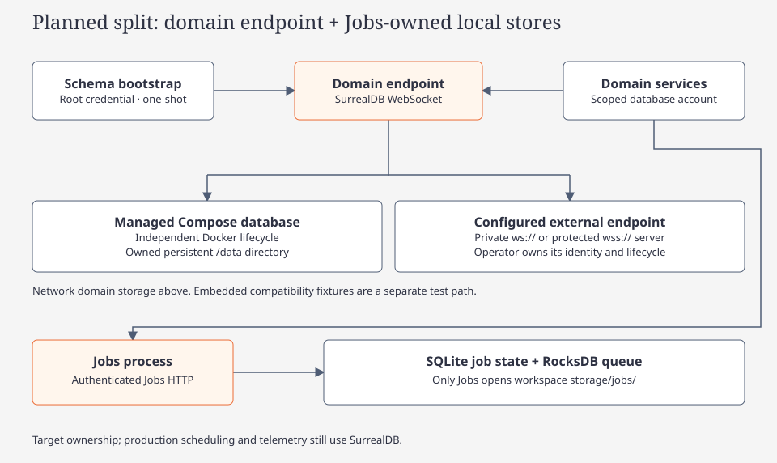

# Storage map

[Code route](index.md) · [Persistence concepts](../concepts/glossary.md#persistence)

`@tag:surreal-storage`

SurrealDB owns domain data. Jobs is moving operational state to SQLite and delivery to embedded RocksDB; see the [planned ownership and rollout scopes](jobs-persistence.md). Services open the [explicitly configured network endpoint](fleetworks.md#launch-the-compose-stack). The native app and browser use the authenticated API.

| Responsibility | Source entry |
| --- | --- |
| Module boundary and engine opening | [storage/mod.rs](../../../crates/argos-osint-core/src/storage/mod.rs), [open.rs](../../../crates/argos-osint-core/src/storage/open.rs) |
| Schema ordering and version guard | [bootstrap.rs](../../../crates/argos-osint-core/src/storage/bootstrap.rs), [schema/](../../../crates/argos-osint-core/src/storage/schema) |
| Jobs-owned operational stores | [fleetworks-jobs](../../../crates/fleetworks-jobs), [planned persistence contract](jobs-persistence.md) |
| Retrying transactions | [tx.rs](../../../crates/argos-osint-core/src/storage/tx.rs) |
| Memory publication and graph projection | [publisher.rs](../../../crates/argos-osint-core/src/storage/publisher.rs), [memory.rs](../../../crates/argos-osint-core/src/storage/memory.rs), [graph.rs](../../../crates/argos-osint-core/src/storage/graph.rs) |
| Vector and lexical recall | [embeddings.rs](../../../crates/argos-osint-core/src/storage/embeddings.rs), [recall.rs](../../../crates/argos-osint-core/src/storage/recall.rs) |
| Transitional SurrealDB job execution | [jobs.rs](../../../crates/argos-osint-core/src/storage/jobs.rs) |
| Atlas dispatch outbox | [job_dispatch.rs](../../../crates/argos-osint-core/src/storage/job_dispatch.rs) |
| Jobs dashboard page | [jobs_view.rs](../../../crates/argos-osint-core/src/storage/jobs_view.rs), [jobs view contracts](../../../crates/argos-osint-core/tests/storage_jobs_view.rs) |
| Contract verification | [tests/](../../../crates/argos-osint-core/tests), [shared harness](../../../crates/argos-osint-core/tests/support), [test_surreal.py](../../../scripts/test_surreal.py) |

Run storage contracts through the harness; a skipped test is not a pass. Agents run only the embedded matrix locally; server checks belong to CI. Legacy `schema_*.sql` files are migration context, not the current schema authority.

## Fleetworks network storage

Bootstrap authenticates as the database root, applies the schema and provisions a database-scoped Editor account for API and worker processes. Runtime processes verify the exact schema version. Disk modes retain the database identity across restarts. A fresh memory store has a new identity, so Atlas rejects deliveries tied to a previous store. The outbox is transactional with job submission, while the Jobs-owned embedded queue transports wake-up messages. See the [network startup instructions](fleetworks.md#run-the-network-api-and-workers) and the [Atlas deployment guide](../../../deploy/atlas-dispatch.md).

## Dataset upload ownership

| State | Owner and replication requirement |
| --- | --- |
| Upload ticket | [SurrealDB metadata](../../../crates/argos-osint-core/src/storage/upload_ticket.rs): five-minute authority-bound tickets, atomic single-use claims and per-issuer quotas; gateway restart or replica routing preserves the ticket |
| CSV bytes | Shared persistent backend staging volume, accessible to every gateway and consuming worker; shared database metadata alone does not share files across hosts |
| Validated dataset and job | Existing staged-dataset references and durable maintenance jobs; a used/expired ticket needs a new upload URL, while accepted work retains its own identity |

Actor imports use a bounded path: `full CSV hash + validation → private unlinked spool → claimed transaction batches`. The worker retains IDs and one parsed actor, not the corpus; batches cap at 128 actors, 2 MiB retained payload and 16 MiB expanded transaction rows. CSV-selected stable IDs update or add actors; absent actors and existing aliases remain. The catalog fingerprint identifies the latest import. See [streamed import contracts](../../../crates/argos-osint-core/tests/storage_actor_seed_execution.rs).

Ticket expiry cleanup is bounded and retains no bearer secrets. Bootstrap adds the ticket tables without rewriting existing records. See the [ticket contracts](../../../crates/argos-osint-core/tests/storage_upload_tickets.rs) and [native maintenance flow](../../../apps/fleetworks-desktop/README.md).

## Recall and source lifecycle

[Brain recall](../../diagrams/brain-recall.html) shows DISKANN candidates followed by lexical top-up. Vector hits must match the current model, generation and memory revision and remain active with an allowed kind. Missing vectors or vector-search failure use lexical recall; vector hits rank first. Results are capped at five memories and 1,500 estimated tokens. See [recall.rs](../../../crates/argos-osint-core/src/storage/recall.rs) and [recall contracts](../../../crates/argos-osint-core/tests/storage_recall_turn.rs).

[Source lifecycle](../../diagrams/brain-source-lifecycle.html) reconciles retained support and durable index work in SurrealDB. The worker rechecks eligibility before index changes. See [lifecycle.rs](../../../crates/argos-osint-core/src/storage/lifecycle.rs), [index_drain.rs](../../../crates/argos-osint-core/src/storage/index_drain.rs) and [lifecycle contracts](../../../crates/argos-osint-core/tests/storage_lifecycle.rs).

## Schema and runtime authority

[Bootstrap](../../../crates/argos-osint-core/src/storage/bootstrap.rs) first applies module `ANALYZER` constants as an idempotent `IF NOT EXISTS` batch outside the retryable transaction (resolving FULLTEXT analyzers against committed catalog state — SurrealDB 3.3.4), then applies all tables/fields/indexes plus schema version read/refusal/write within one retryable transaction. It records `storage_meta:schema.version` and refuses a database newer than the build. The current constant is `storage::bootstrap::SCHEMA_VERSION` (currently 11, additive upgrades), independent of the old `store::SCHEMA_VERSION` (43). Runtime services must use the matching version after explicit bootstrap. The SurrealDB bootstrap does not import a legacy SQLite/LanceDB database or run its numbered migration ladder. See [bootstrap contracts](../../../crates/argos-osint-core/tests/storage_bootstrap.rs).

Schema v2 (SCHEMA_VERSION 1→2, additive, no wipe) added these SurrealDB tables/indices:
- `atlas_admission` — bounded private staging (state pending|evaluating|admitted|discarded|failed, terminal rows pruned)
- `atlas_rejection` — minimal receipt keyed [article_id, input_hash, taxonomy_version]; reconsideration = no receipt for current hash+taxonomy
- `atlas_article_categories` — categories.* non-unique (additive membership)
- `atlas_article_title_search` + `atlas_article_description_search` — FULLTEXT BM25, analyzer `atlas_article_text`
Schema v3 additionally stores classifier run/admission/derivative receipts, foreground intent leases, retained reclassification jobs/origins/items/conflict counters, and provider observation origins, calibration jobs and story-family indexes. Upgrades are additive; published legacy rows keep their historical identity. Exact model and manifest pins survive resumable jobs. Historical derivative activations renew their parent lease between bounded groups as well as during work. Legacy work-manifest updates preserve ownership/revision fields and reject manifests owned by a native writer.

Schema v4 adds the durable dispatch outbox for opt-in worker pools. Atlas workers also reserve daily fetch slots against the existing quota records before sending requests. The same transaction can move a reserved slot to a distinct fallback bucket when the destination has capacity.

[`Store`](../../../crates/argos-osint-core/src/store.rs) is a lightweight handle onto the process [runtime](../../../crates/argos-osint-core/src/storage/runtime.rs). `open_ui`, `open_light` and `open_profile_reader` do not establish separate SQLite or read-only database connections. The legacy `argos.db` path accepted by `Store::open` supplies its parent directory; the method does not open that file. Engine ownership and configuration belong to [open.rs](../../../crates/argos-osint-core/src/storage/open.rs).

SurrealQL statements, record IDs, indexes and transactions in current repository code are valid current SQL-like references. Legacy `schema_*.sql`, plural SQLite table names and numbered migration comments are not the current schema. Follow the actual `DEFINE TABLE`/`DEFINE FIELD` declarations and callers, rather than migration-era module comments.

| Concern | Current records and implementation | Verification |
| --- | --- | --- |
| Atlas admission | `atlas_admission`, `atlas_classifier_run`, `atlas_classification_receipt`, `atlas_classification_projection`; [classifier_admission.rs](../../../crates/argos-osint-core/src/storage/classifier_admission.rs) | [admission contracts](../../../crates/argos-osint-core/tests/storage_classifier_admission.rs) |
| Atlas Actors derivatives | `atlas_classification_derivative`, `atlas_article_index`; [classifier_admission.rs](../../../crates/argos-osint-core/src/storage/classifier_admission.rs), [atlas_actor_index.rs](../../../crates/argos-osint-core/src/atlas_actor_index.rs) | [index contracts](../../../crates/argos-osint-core/tests/storage_actor_index.rs), [catalog repair contracts](../../../crates/argos-osint-core/tests/storage_actor_catalog.rs) |
| Atlas metadata | `atlas_article_metadata`, `atlas_article_mention`, `atlas_related_article` in [atlas_metadata.rs](../../../crates/argos-osint-core/src/storage/atlas_metadata.rs) | [metadata contracts](../../../crates/argos-osint-core/tests/storage_atlas_metadata.rs) |
| Brief stages and publication | `brief_run`, `stage_output`, `intel_brief_publication`, `intel_brief_stage_receipt`; [brief_stages.rs](../../../crates/argos-osint-core/src/storage/brief_stages.rs), [brief_publish.rs](../../../crates/argos-osint-core/src/storage/brief_publish.rs) | [stage contracts](../../../crates/argos-osint-core/tests/storage_brief.rs), [publication contracts](../../../crates/argos-osint-core/tests/storage_brief_publish.rs) |
| Insight execution | `insight_stage_checkpoint`, `insight_refresh_execution`, `insight_refresh_task`, `insight_supersession`; [pipeline_exec.rs](../../../crates/argos-osint-core/src/storage/pipeline_exec.rs), [refresh.rs](../../../crates/argos-osint-core/src/storage/refresh.rs) | [execution contracts](../../../crates/argos-osint-core/tests/storage_pipeline_exec.rs), [refresh contracts](../../../crates/argos-osint-core/tests/storage_refresh.rs) |
| Model telemetry | `recon_model_operation`, `recon_model_attempt`; [recon_jobs.rs](../../../crates/argos-osint-core/src/storage/recon_jobs.rs) | [model/job contracts](../../../crates/argos-osint-core/tests/storage_recon_jobs.rs) |
| Profile | `telemetry_event`, `telemetry_hourly`, `telemetry_daily`; [profile_view.rs](../../../crates/argos-osint-core/src/storage/profile_view.rs) | [profile contracts](../../../crates/argos-osint-core/tests/storage_profile_view.rs) |
| NLP and summary cache | `nlp_artifact`, `nlp_source_ref`, `nlp_feature`, `derived_summary`, `summary_flush_request`; [nlp_cache.rs](../../../crates/argos-osint-core/src/storage/nlp_cache.rs), [summary_flush.rs](../../../crates/argos-osint-core/src/storage/summary_flush.rs) | [summary contracts](../../../crates/argos-osint-core/tests/storage_summary_flush.rs) |

Atlas admission reads at most 512 thin headers per page and reserves them in transactions of at most 64 rows. Reservation leaves the durable cursor unchanged; outcome publication advances it for published work, while a guarded empty-page checkpoint handles pages with no claims. Actor derivative reuse additionally validates the actual index receipt revision and checksum under the source fence. See the [classifier](classifier.md) and [actor revision](actor-catalog.md#article-revision-contract-and-repair) contracts.

Stage completion saves publication work with the leased stage output, completion metadata and retained run fence. The brief worker replays pending publication from persisted outputs. For Claims, Inferences and Links the display, canonical Brain effects, index work, receipt and queue acknowledgment commit together. Publication failure leaves extraction complete and the work eligible for retry. Atlas phase-6 batching likewise does not create one 100-article transaction: each occurrence's relationships and receipt commit together, and successful occurrences remain available if another fails.

The Jobs dashboard reads a bounded page of top-level ids before loading event, task and attempt metrics. Those page metrics are grouped by the selected ids. Running `api_server` and `web_server` rows rank ahead of ordinary work inside the active filters. A single job's event total covers that job and its immediate children, matching the page cohort. See [Jobs and Logs](../concepts/usage.md#jobs-and-logs).

Topology snapshots keep their consistent transaction in a worker that owns `BEGIN` through `COMMIT`/`CANCEL`. If the awaiting caller is dropped (for example by the HTTP timeout), the worker stops traversal and awaits rollback through `run_tx`; dropping the request does not drop the open SDK transaction. This cleanup applies to topology snapshots, including brief navigation binding reads; other transaction callers retain their existing behavior. Brief navigation uses `brief_binding_snapshot` and returns after direct node admission; it skips graph-only topic/Related expansion, payload details, association hydration and neighborhood-summary generation.

## Discovery services

Three discovery services support catalog lookups, all keyed against the schema-v2 FULLTEXT indexes:

- **`search_actor_names`** — exact normalized form → actor IDs + match reasons + revision; active canonical names only; collisions stay ambiguous; diagnostics: `catalog unavailable` / `query too short` / `unsupported type`; limit 1..=25.
- **`search_actor_aliases`** — aliases with strength `curated`/`catalog`/`learned`, `alias_type`, `provenance`; ambiguous when >1 live owner; exact + bounded prefix tiers on the alias index; owner-union merge.
- **`search_articles`** — new `storage/article_discovery.rs`: two per-field FULLTEXT BM25 statements on the schema-v2 title/description indexes; title weighted above description-only; deterministic ties; matched-field attribution; rank = BM25 of matched field — relevance is NOT confidence; bounded excerpt on original byte offsets; dedup by article id; cursor ≤4096, page ≤50; category-membership/day/source/run filters; related candidates exclude the seed and are not corroboration; stale/pending/discarded/deleted hits rejected by construction — canonical corpus is admitted-only.

---

## Index maintenance contract

FULLTEXT + categories indexes are engine-maintained atomically with admission/delete transactions (deliberate choice over a new outbox record kind — no drain consumer would exist). Matcher rebuilds coalesced off async workers via process-wide `catalog_epoch` + `MatcherCache` (stale-epoch single-flight rebuild, RwLock old-or-new swap; epoch bumps on catalog seed and merges). Curated alias backfill with provenance at matcher load, idempotent. Incomplete catalog readiness is `catalog unavailable`, never empty success.

NLP-off body matching: word-boundary exact pass always runs on cleaned bodies; NLP person/org pass is enrichment only (contract flip of the old "body requires NLP" rule).

---

## Intel web read service

The [UI-independent Intel service](../../../crates/argos-osint-core/src/intel_service.rs) supplies keyset article occurrence pages and brief projections to the [local HTTP API](intel-web.md). Bootstrap adds the `atlas_article_bulletin` category/time/ID index idempotently; record formats and schema version remain unchanged. The API host owns the repository and the native app does not open it. Existing embedded locks/server leases therefore remain authoritative.

## Actor catalog

The [seeded actor catalog](actor-catalog.md) adds provenance-bearing catalog fields to `brain_actor` and the leased `brain_actor_seed:catalog` completion/progress receipt. Actor, alias, typed-memory and graph-node batches commit together. Existing schema version 1 is extended idempotently; no automatic data wipe or actor conversion runs at startup. A user-requested `storage reset --yes` removes data and the receipt while keeping configuration, credentials, models and datasets.

Job/task creation, claim and completion now retain `job_event` lifecycle rows atomically with their transition. The per-job log reader combines those rows with `argos_event` for the same descendant cohort, ordered by time with deterministic ties; unscoped durable telemetry retains its sequence pagination. Clear events continues to clear the durable telemetry journal; job lifecycle history remains with its job until job cleanup.

## Classifier filesystem state

Local model artifacts and manual training journals are managed by [classifier/artifact.rs](../../../crates/argos-osint-core/src/classifier/artifact.rs) and [classifier/readiness.rs](../../../crates/argos-osint-core/src/classifier/readiness.rs), outside SurrealDB. `classifier/models/<id>/` is immutable; `active.json` is the checked atomic pointer, and committed activation records authorize named rollback. The stable shared writer lock spans fitting, authorization, activation and terminal manual-job persistence. Readiness does not initialize a repository or ingest synthetic CSV rows as evidence. The [acceptance record](../../../.planning/2026-11-05-atlas-performance-completion/acceptance.md) separates filesystem save/restore proof from required embedded database contracts.

Revision-conditional Atlas outcome commits live in `classifier_admission`; retained reclassification lives in `atlas_admission_maintenance`. Provider observation retention and terminal-cycle calibration jobs live in `classifier_calibration`. The cycle's terminal receipt and calibration enqueue share the same owned transaction. Monitoring has separate task ownership and cannot change cycle success. Its provider labels remain unapproved for training or promotion. Filesystem management alone does not establish these SurrealDB contracts. See the [classifier map](classifier.md) for file bounds, lifecycle, consent and verification entry points.
