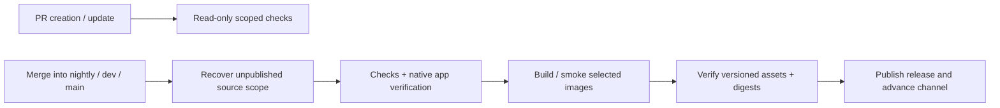

# Versioning, commits and releases

[Code route](index.md) · [Wiki](../../index.md)

Fleetworks uses [Semantic Versioning 2.0.0](https://semver.org/) and
[Conventional Commits 1.0.0](https://www.conventionalcommits.org/en/v1.0.0/).
One version covers the main Rust workspace, including the native macOS app, Linux service host, private search and shared crates. Each member
inherits `workspace.package.version` from `Cargo.toml` with
`version.workspace = true`.
Database schema numbers and provider/API/model versions are separate contracts.

`Cargo.toml`, local-package entries in `Cargo.lock`, `version.txt` and the retained
`.release-please-manifest.json` agree on the source baseline. Published artifact
versions are calculated separately from reachable commits and release tags.
`release-please-config.json` retains the historical bootstrap boundary; the old
automatic Release Please workflow is retired. Do not move that boundary to hide
unreleased work or rewrite shipped tags.

## Commit and PR convention

Use `<type>(optional-scope)!: description`, omitting `!` for compatible changes.
Types and scopes are lowercase. Prefer a short behavior-focused subject; use a
body to explain the problem, resulting behavior, validation and material limits.
Suggested scopes include `native`, `recon`, `intel`, `atlas`, `brain`, `osint`,
`models`, `profile`, `store`, `providers`, `api`, `opencode`, `release`, `deps`
and `graph`. Comma-separated scopes are supported when one coherent change
crosses surfaces. Scopes describe the change; they do not select a crate version.

| Change | Type | Release impact |
| --- | --- | --- |
| New user or library capability | `feat` | Minor |
| Correct existing behavior, including security/dependency fixes | `fix` | Patch |
| Improve runtime or workflow efficiency | `perf` | Patch |
| Internal restructuring without behavior change | `refactor` | None by itself |
| Documentation, tests, build, CI, maintenance, formatting | `docs`, `test`, `build`, `ci`, `chore`, `style` | None by itself |
| Revert housekeeping | `revert` | None by itself; use `fix` when restoring user behavior |
| Incompatible public change, with any type | `!` and `BREAKING CHANGE:` | Minor during 0.x, major from 1.0.0 |

Before 1.0.0, compatible features still bump minor and compatible fixes bump
patch: 0.1.0 → 0.2.0 for a feature or breaking change, 0.1.0 → 0.1.1 for a fix.
From 1.0.0, features bump minor and breaking changes bump major. The highest
impact across unreleased changes wins. Maintenance commits join the next release
without causing one themselves; release notes emphasize features, fixes,
performance and compatibility changes.

Public compatibility includes supported backend/admin commands and machine-readable output,
core library APIs, persisted configuration/portable import formats, user data
readability and documented workflows. An additive database migration that
preserves existing data is normally compatible; a schema counter increment is
not automatically a breaking change. Native/browser layout refinements are normally fixes
or features; removal of a documented workflow needs compatibility assessment.
Never use `chore` to conceal user-facing fixes or breaking changes.

```text
fix(recon): preserve paused transcript position during updates

Keep the retained history anchor when incoming synthesis adds content.
Validated with the transcript follow/history regression tests.
```

```text
feat(api)!: replace the legacy export payload

BREAKING CHANGE: Export now emits the portable configuration schema.
Consumers must migrate their parser to the documented fields before upgrading.
```

This repo requires a nonempty `BREAKING CHANGE:` footer for `!` subjects,
including PR titles; `BREAKING-CHANGE:` is also supported. Footer-only breaking
changes are recognized, but agents should include `!` to make them visible.
Keep the footer in the final squash commit body. `Release-As: X.Y.Z` is reserved
for an explicitly requested maintainer release operation, such as promotion to
1.0.0; agents do not invent an override or bump every commit's version.

## Agent commit tasks

Read this policy when asked to commit, prepare a PR or change release files.
Inspect `git status` and the current staged diff, preserve unrelated/pre-staged
work, and stage exact task files or hunks. Inspect the entire staged diff before
committing. Do not use `git add .` for a dirty shared workspace. Stage only the
relevant portions of mixed files; leave unrelated generated graphs/evidence out.
An editor reports compatibility impact to its parent; the parent owns commits.

Classify planning artifacts using [planning-artifacts.md](planning-artifacts.md).
Include relevant maintained shared docs and curated durable deliverables; keep session
working memory, generated evidence and host selectors local. Do not force-add
ignored files or stage the whole `.planning/` directory.

Use a task-owned scratch message file with actual newlines, then run:

```sh
node scripts/release_check.mjs message --file .agent-scratch/<task>/commit.txt
node scripts/release_check.mjs versions
git diff --cached --check
git commit --file .agent-scratch/<task>/commit.txt
```

Node 20+ is required; the checker has no npm dependencies. It checks commit
syntax, breaking footers and synchronized versions, and reports release impact.
It does not decide whether a change really breaks compatibility or replace the
Rust fmt → Clippy → test gate, scoped native/browser review or other relevant checks. Agents
record actual validation in the commit body and report the SHA. Existing task
authorization governs commits, pushes, merges and releases. The read-only
OpenCode `architect` agent prepares messages/impact only; it does not stage or commit.

OpenCode `coder` and `architect` can load `argos-commit`; `/ecc-commit` routes to it.
`argos-plan`, `argos-implement`, editors and reviewers carry the same policy.
Never manually edit release versions/changelog for an ordinary feature/fix.
Artifact CI calculates versions without editing those source files. Explicit
maintainer baseline/repair tasks may update them together and must pass the checker.

## Release automation

[CI event and scope map](ci.md) · [Native checks and publication](../../diagrams/native-release.html)

| Landing branch | Artifact channel | Version shape |
| --- | --- | --- |
| `nightly` | `nightly` | `X.Y.Z-nightly.<commit-count>.g<full-sha>` |
| `dev`, `main` | `stable` | `X.Y.Z+<branch>.g<full-sha>` |

The [release planner](../../../scripts/fleetworks_release.py) runs without network
writes. It takes an exact source/scope plan, finds reachable published ancestors,
and applies the highest Conventional Commit impact since those releases. Stable
`dev` and `main` share reachable stable history: promoting already released dev
commits does not bump them again. Stable excludes nightly prereleases as release
anchors, so nightly publication cannot hide unreleased stable changes.

Historical untyped feature commits conservatively contribute patch impact and
are reported as `untyped_commits`; they are not silently discarded. Recorded PR
titles and breaking footers in actual merge commits retain their impact. New
malformed breaking commits still fail policy. The PR title/body gate and
integration first-parent landing checks permit feature WIP without requiring
history rewrites.

Every artifact identity includes its full source SHA. Maintenance-only changes
can rebuild an affected component with the same base SemVer and a distinct build
identity. The workspace baseline remains a floor; source version files and
changelog are not rewritten on every build.

### Artifact and channel identities

| Output | Identity / ownership |
| --- | --- |
| Immutable GitHub Release tag | `fleetworks-<branch>-v<artifact-version>`; never repointed |
| Native app | Both supported Mac targets; versioned ZIP, SHA256 and complete source/bundle manifest |
| Immutable GHCR image | `ghcr.io/<owner>/fleetworks-<role>:<channel>-<branch>-X.Y.Z-g<full-sha>`; verified AMD64/ARM64 index |
| Channel aliases | Git refs `nightly` / `stable` and selected image `:nightly` / `:stable`; advance only after artifact verification |
| Release inventory | `release.json` and per-architecture image identity/digest records; exact source, version and selected components |

Runtime, SurrealDB, private search and Web are the only production image targets.
API, control, Jobs, tools, NLP/classifier and worker roles share the runtime image.
No terminal executable, Venture image or automatic Docker-save archive is released.
Optional Rust-BERT bundles remain separate verified inference/deployment inputs.

### Scope, publication and retries



Publication scope includes every changed component since the last reachable
published artifact, even when a pending workflow was replaced or an earlier
build failed. The first publication covers all production targets. Later
native-only or web-only changes leave unrelated images alone; documentation-only
changes publish nothing once that baseline exists.

PRs and manual verification dispatches never publish. Trusted integration pushes
publish only after selected checks pass. Native release packaging receives the
calculated `--version`, so app metadata, its manifest and archive agree without
editing Cargo source versions. Linux jobs smoke exact loaded image IDs, verify
pushed per-architecture digests and verify their combined index before promotion.

Retries preserve already published source/version identities and original assets.
A changed source, incomplete architecture set, mismatched digest or failed
publication cannot pass **Fleetworks required**. A release/build failure needs its
original diagnostic and affected retry; do not move immutable tags or reset the
version baseline as a workaround.

## Release candidates

The previous candidate workflows and their duplicate image-tar builds are
retired. Use exact-revision verification dispatches without publication:

```sh
python3 scripts/fleetworks_verify.py dispatch full --ref <published-branch>
python3 scripts/fleetworks_verify.py dispatch pr --ref <published-branch> --base <full-base-sha>
```

Local app review still uses `scripts/fleetworks_candidate.py build-native` and
`verify-native`. `--archive` produces an optional local ZIP; `--version` requires
an explicit valid artifact SemVer and must also be supplied when verifying that
archive. The image candidate module remains a shared native-daemon/image-ID
helper and optional manual export tool, not an automatic CI archive lane.

Published app archives are unsigned. Signing/notarization, installed GUI/input/
accessibility and minimum-OS testing remain separate evidence. A configured
workflow does not prove that its hosted builds or publication passed.

## GitHub repository setup

1. Protect `dev`, `nightly` and `main` with reviews, **Fleetworks required** and
   **Conventional commits and shared version**. The files do not change external
   branch rules or remove old required-check names from existing rulesets.
2. Use Conventional Commit PR titles and retain breaking footers in squash or
   recorded merge messages. Squash and normal PR merges are supported; direct
   integration commits must satisfy landing policy.
3. Allow the workflow's `GITHUB_TOKEN` to publish repository release assets and
   GHCR packages. Only trusted publisher jobs request writes; PR jobs stay
   read-only. No Release Please App/PAT or bot-created release PR is required.
4. Keep source/version tags protected and immutable. Permit the workflow-owned
   channel refs to advance. Existing package ownership or organization policies
   may require granting this repository Actions access to its GHCR packages.
5. After landing, inspect the exact revision's required checks, Release assets,
   both native architecture records and multiarchitecture registry digests.
   Missing or pending hosted evidence stays unverified.

An explicit promotion to `1.0.0` remains a maintainer decision after assessing
API, configuration and persisted-data guarantees. Do not invent `Release-As` or
retroactively tag a baseline during ordinary feature work.
