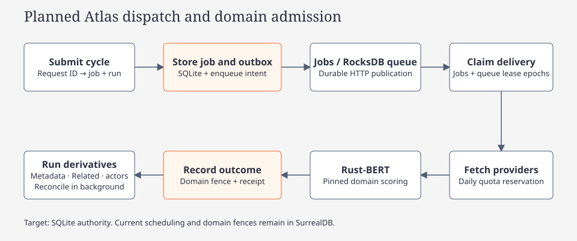

# Atlas classification and Related articles

[Concept route](index.md) · [Wiki](../../index.md)

Atlas's `atlas-collection-v3` cycle retains native news discovery, country heat bands, regional coverage and article deduplication. Article admission uses the local six-model classifier; it does not call a remote classifier role. Retained v1/v2 history remains explicitly versioned. Cycles do not extract claims, assess fidelity, generate briefs, publish Brain claim memories or require vector indexing. Intel and Recon retain their independent on-demand investigative workflows and publication services.

The figure describes the local-admission contract. The [classifier code map](../code/classifier.md) separates model setup, foreground admission, historical work and provider monitoring. Verification and measured throughput are separate evidence.

## Classification and native metadata

The foreground adapter consumes [strategic-domains-v1](strategic-domains-taxonomy.md): six independent scores, exactly two qualifying published domains and occurrence/source/model receipts. It pins before run mutation, inventory or acquisition, keeps a resumed run's exact model, and processes run-scoped work in bounded pages with 64-item local inference chunks. A page reads at most 512 thin headers and reserves claims in transactions of at most 64 rows. Reservations leave the durable cursor unchanged; outcome publication advances it for published work, while pages with no claims use a guarded empty-page checkpoint. Partial reservations remain leased and recoverable after expiry under a new activation. Foreground publication uses subgroups of at most 16 to leave room for heartbeat renewal. A receipt and its outcome/projection/metadata merge commit under one source/owner/epoch fence; earlier subgroups remain durable if a later one fails. A runtime, queue, storage or model fault is blocked/retryable work, never an article `unk` or a fabricated rejection.

Native current-admission authority is separate from preserved tags. New admitted filters require current taxonomy, admission/publication state and a current receipt projection before category ranking/limits. A historical row rejected by reclassification retains its original tags, source and published evidence; those tags do not establish current membership. In particular old `economic` is not the new Economic domain merely because the strings match. Coverage counts the exact retained occurrence scope before category filtering, including legacy and retained rejected rows. Never-retained new rejections retain their outcome receipts but are outside the retained article corpus. Retained reclassification runs as a resumable historical job. Terminal cycles outbox independent bounded provider monitoring; synthetic installs retain their active baseline until reviewed promotion evidence exists.

A bounded native inventory processes complete original title and description fields independently of classifier features. Legacy `unk` data remains identifiable in retained history. Its local parsing overlaps a single publisher lookup and later Classifier batches. Mentions retain spelling, compatible type, normalized comparison key, source field and UTF-8 byte spans. Explicitly disabled or uncompiled NLP is unavailable; no model fallback runs. Empty success, unsupported language and parse failure remain distinct.

Publisher priors use `wikipedia_source_reliability`, normalized URL host and longest valid domain suffix. A lookup pass reuses an immutable WP:RSP index. The index has a 30-day durable TTL, bounded single refresh and last-good behavior. Source scores are A 100, B 85, C 55, D 30, E 12; F is unknown. `brief-rating-v2` combines known source/information axes; a source-only rating is capped at 60 and provisional, while F6 is N/A. Publisher reputation never establishes information credibility or independent corroboration.

Focus Brief projects Actors from current `ArticleMetadata.mentions`, including `unk` articles. It validates source hashes and original UTF-8 spans, retains repeated title/description mentions and typed spellings, and excludes dates/amounts/currencies. Actors are named candidates, not claims of involvement. NLP pending/unavailable/unsupported/failed states are visible without model fallback. Ingestion performs no claim publication or vector indexing; phase 6 writes local identity/association records. A brief visit may later trigger validated full-article analysis and canonical publication; historical Recon reports remain readable evidence and have no publication precedence. See [Intel publication](../../diagrams/intel-brief-chain.html).

## Related leads and storage

Related means **shared headline/description entities**. Local posting lists create canonical undirected article pairs with at least two distinct overlapping compatible person, organization or place mentions. At least one endpoint must have a recognized non-`unk` category; two `unk` rows alone cannot seed a pair. Verified source spans, complete-name Unicode boundaries and input revisions constrain matching. Publisher/country metadata alone cannot create a pair. People/organizations rank before place-only matches, then shared count and rarity; ordering is browsing priority, never confidence.

[SurrealDB metadata storage](../../../crates/argos-osint-core/src/storage/atlas_metadata.rs) defines `atlas_article_metadata`, `atlas_article_mention` and `atlas_related_article`. Article/run content remains authoritative; stale revisions hide associations, and deletion removes dependent metadata without deleting independently retained Brain evidence. Related pages are bounded, reciprocal and carry true totals and coverage. Local reason text such as `Shared mentions: Acme, Jane Doe` grants no corroboration, premise or assessed graph edge.

Intel places Related beneath Full Article in the middle column. Brain Actor groups expose Claims, Threads and Articles; Claims expose Actors and Sources. Lineage uses exact derivation evidence and legacy source run/call IDs, with canonical explicit URLs as fallback; prose similarity never supplies lineage. Opening a row selects that exact article's Intel Focus Brief, including `unk`, and preserves the prior view for Back. Loading a list makes zero model calls.

## Phase 6 and cross-cycle Related

Phase 6 ("Index actors and articles", stage 12, unit `article`, label `actor_articles`) binds each retained occurrence through `brain_actors` and writes an `atlas_article_index(run_id, article_id, input_revision, index_checksum, actor_coverage, indexed_at)` receipt in the same transaction as the occurrence's actor mentions, `mentioned_in` Links and ≤20 tentative Related records. `atlas_actor_index::index_run` advances bounded pages of at most 64 current occurrences through the shared conditional publisher. Foreground, historical maintenance and backfill use the same receipt revisions. Reusing a `Current` Actors derivative requires an actual index receipt with the expected revision and a valid current-contract checksum; claim and completion audits perform that check under the source fence. Missing or stale output is reindexed by the writer. See the [actor revision contract](../code/actor-catalog.md#article-revision-contract-and-repair). A changed title/description/metadata invalidates the receipt and re-indexes only that occurrence.

[Related reads](../../../crates/argos-osint-core/src/related_global.rs) use persisted shared-mention pairs: `RelatedScope::AllRetained` (default) starts from currently admitted occurrences of the source URL; `ThisCycle` keeps only the source cycle's stored leads. The requested seed must itself be currently admitted; a matching URL cannot grant authority to a legacy row. Both paths require two distinct overlapping entity mentions and exact current revisions.

Stored pairs retain legacy text/category hashes in `left_revision`/`right_revision` alongside authoritative `left_native_revision`/`right_native_revision` fingerprints. Related and [topology](../../../crates/argos-osint-core/src/storage/topology.rs) compare the native fingerprints against current admission/source/metadata snapshots under the same source fence. Pairs with missing or stale native fingerprints and legacy/rejected endpoints are excluded before totals, URL grouping and pagination. Legacy article detail remains readable. The [public-read regression](../../../crates/argos-osint-core/tests/storage_atlas_store.rs) covers native positives, forged legacy pairs and stale metadata. One row per canonical URL retains the origins that supplied a qualifying association; canonical Actor identity alone never supplies a suggestion. Brain Actor Articles uses direct current mention receipts without the two-entity Related gate. Intel Related reuses these records; the brief Links stage separately discovers a bounded all-retained actor/text candidate set, without requiring a repeated seed URL; the Intel pane header toggles scope. All leads remain tentative.

## Completion, recovery and compatibility

Collection/classification is required. Enabled metadata settles independently; disabled metadata is skipped, parser/lookup failures give warnings and unavailable coverage. Empty entities and unrated publishers remain honest metadata outcomes. Missing/incompatible local classifier state blocks acquisition/admission before quota use; operationally unresolved items remain retryable and can leave a cycle partial or failed. Historical `unk` remains readable without becoming a current domain. Pause preserves receipts and Resume retries unresolved work. Native acquisition receipts commit with their statistics, so a failed acquisition can resume without replaying successful source requests or double counting discovery pages.

Old unfinished extraction/indexing cycles resume through retained classifications and native metadata. Ambiguous historical `unk` is flagged as legacy provenance rather than bulk reclassified. Historical insights and shared indexing services remain readable. Atlas-owned obsolete refresh/repair work is fenced at upgrade; Intel/Recon work continues. Explicit CLI Repair/Verify remains for historical contracts and rejects `atlas-collection-v1` and `atlas-collection-v2`. The Atlas TUI no longer exposes Repair memories or startup reconciliation.

Profile retains `atlas.backlog`, `atlas.cycles` and `atlas.temperature`. Current telemetry counts articles and metadata coverage; overlapping stage counts are not summed. Historical memory units are explicitly legacy. Running Atlas publishes no claim memories; phase 6 writes only Brain identity/relationship records (Actors, `mentioned_in` Links, tentative Related).

## Verification

Local adapter and policy fixtures exercise finite six-domain scores, exact-two-or-rejection, pinned occurrence receipts, batch/cache identity and operational cancellation. Required embedded tests cover source races, selective atomic outcomes and ownership. Metadata Link fixtures have passed actual publication, chronology/independence abstention and stale-candidate sibling preservation; the full-story semantic-receipt lane has compiled and its behavior tests are underway. These checks are not a final embedded-gate or empirical throughput result.

Metadata/Related fixtures check concurrent classification writes, source spans, unknown categories, incompatible types, revisions/deletion, reciprocal bounded pages and exact multi-source lineage. Independent Intel/Recon publication and indexing fixtures remain in the workspace gate.

Run the embedded matrix from the [contributor workflow](../code/contributing.md). For fresh TestBackend captures use `scripts/tui_review.py`: `dump_atlas_related_screens` covers Intel Related and explicit empty/loading/error states; `dump_brain_kind_screens` covers Brain Claims/Actors and association tabs; `intel_brief_stacked_left_column_renders_all_sections_and_scrolls` covers publisher/evidence confidence; `analytics_viewports_and_data_states` covers Profile Atlas. Select the affected stems at 160×50, 120×40, 100×32, 80×24 and 60×18. Inspect the emitted PNGs and record visual, interaction and metric results separately under the named local plan, following [TUI verification](../code/tui-verification.md). Live providers, a live terminal, server-mode and MiniLM checks require separate evidence.

## Potential corroboration and validated Links

Stage 4 of the [Intel brief chain](../code/architecture.md#intel-brief-preparation-intel-brief-v2-dependency-graph) proposes article–inference leads from indexed actor/text discovery. The combined initial retrieval budget is 100 raw rows before hydration and deduplication; the existing curator packet stays at most 12 candidates. Exact run/article occurrences, metadata revisions and explicit truncation/coverage survive the merge. Shared actor, country or broad domain is discovery overlap, never corroboration.

Tentative leads remain **Potential corroboration · metadata leads, not confirmed support**, with their exact candidate revision and verification gap. Separate typed Links use source relation target: supports, contradicts, updates, precedes, contextualizes or potential_impact. Metadata cannot supply independent acquisition roots, so it never confirms supports/contradicts. Specific contextual/temporal/conditional relationships still require complete cited assertions and a passed semantic decision; recency alone is not an update, publication order is not causation, and potential impact retains conditions/limitations without invented event probabilities.

The full-story lane uses independently retained per-side evidence, explicit acquisition roots and exact source qualifications. Inferred publisher/domain roots, shared acquisition and syndicated identical artifacts do not establish independence. Canonical publication reconstructs the actual bounded evaluator proof and checks current endpoints/source evidence in its transaction. A stale proposal cannot retire an unrelated still-live confirmed sibling. Republishing unchanged evidence changes a publication locator, not the assertion's semantic revision. Historical unvalidated relation strings remain readable without receiving a current validation receipt.

Related article eligibility remains **at least two distinct overlapping entity mentions** in source/candidate headline or description. Repeated aliases of one normalized name count once; country/category fields do not count as mentions. Brain Actor Articles counts direct retained actor mentions, observed links and claim origins without a second-entity Related gate. Browse visits make no model calls or new associations. Original claim Sources retain provenance independently.
