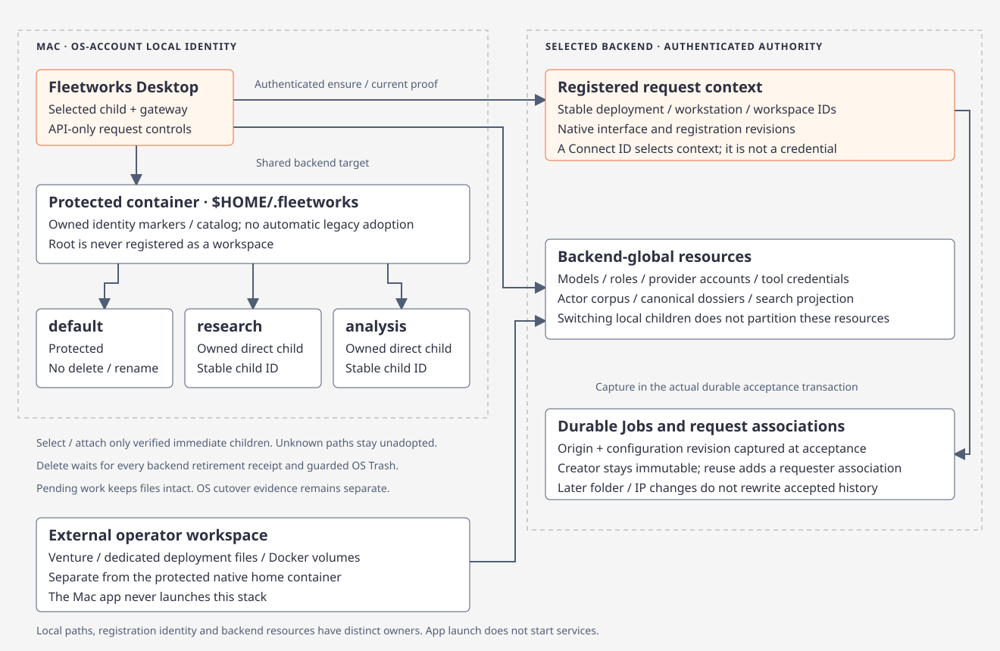
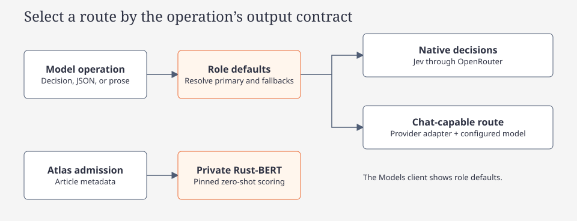
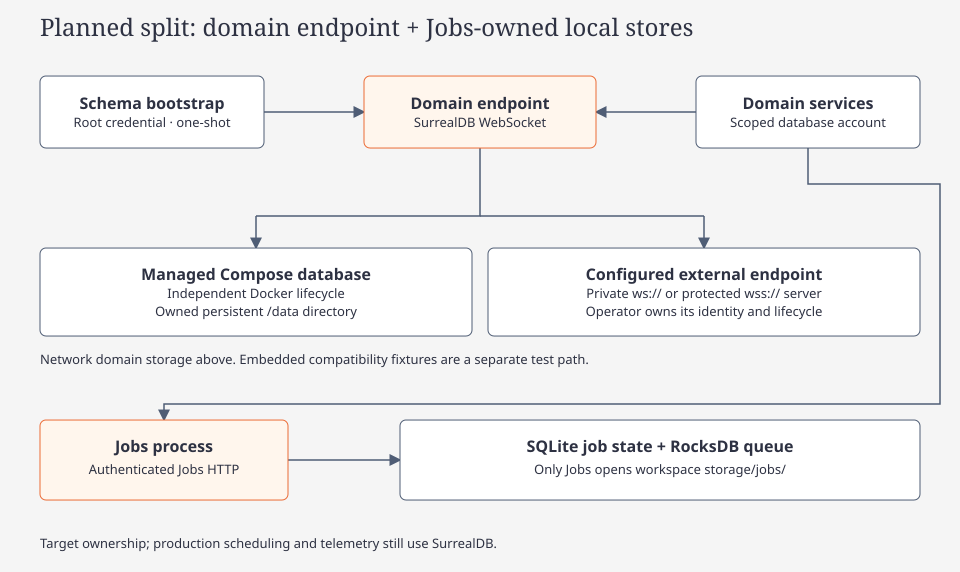

# Concepts

[Concept route](index.md) · [Wiki](../../index.md)

Service and evidence terms used across Fleetworks. See the [architecture](../code/architecture.md) for implementation boundaries.

## Apps and services

| Name | Role |
| --- | --- |
| Venture | Initializes the workspace, owns local services and launches terminal clients |
| Intel | Web workspace for Bulletin, Focus Brief, Actor Dossier and Topology |
| Atlas | Collects headlines and hands off durable classification and derivative work |
| Brain | Serves retained actors, brief details, Related articles and topology through a private service |
| Jobs and Logs | Reads durable work and events, with retry and cancellation for eligible jobs |
| Tools, Models and Profile | Reads the tool catalog, role defaults, workspace and service health |

## Model roles

A role selects a provider and model with ordered fallbacks in `config.toml`. Provider accounts live in `auth.json`. The shared provider executor owns route resolution and pacing. Live Atlas category admission uses the separate pinned Rust-BERT service. [Providers](providers.md)

## OSINT providers

Atlas collection and the retained context tools use configured provider accounts. Daily Atlas and storage-backed NewsAPI slots are shared through the datastore. [Provider admission](providers.md#atlas-news-provider-admission)

## Intel brief jobs and historical reports

A Focus Brief retrieves the full article and extracts Claims, then joins both for claim-specific Inferences. Local actor-mention sentences become candidates; Classifier selects support, context and counterevidence; Synthesis analyzes each claim with its actors and selected original sentences (up to three concurrent analysis requests). Repeated conclusions, including paraphrases, are deduplicated before Links. Claims, Inferences and Links publish separately as each stage completes, through the same index outbox. Article-link leads enter as tentative Related memories with verification gaps. Later failures preserve earlier published results. The web brief and Jobs client expose durable stage progress and publication or index status. Actors appear above Claims; Claim and Inference records open topology from their exact publication identities. Related reflects retained ingest associations requiring at least two distinct shared entity mentions.

Historical `intel_report_job` attempts, sections and provenance remain readable as historical records. Focus Brief publishes through the current job chain.

Brain retains actor, claim and source associations with their original provenance. Name grouping preserves individual identities, and direct actor associations remain independent of Related eligibility.

## Brain Memory Topology and Scope Analysis

Brain topology is a seed-scoped read projection, defaulting to two hops (1..3)
and all retained origins, with optional current-cycle scope. Brain claim/actor
graphs and Intel Focus Brief claim/actor records supply exact typed identities.
Selecting a record changes inspection; recentering changes the seed and saves
history. Retained-source entries remain truthful when canonical indexing is absent.

- **Presentation nodes**: Actor, explicit ActorGroup, Claim, Inference, derived Topic, Article and Source. A Topic groups recorded topic/category attributes and is not a canonical Brain memory kind. Actor name groups do not assert shared identity; inference premises do not assert world truth.
- **Edges**: Link/Related payloads use typed `EndpointRef::Source`, `EndpointRef::Article` and `EndpointRef::Memory` destinations. Snapshot edges carry stable IDs, endpoint node keys and qualified direction (`concerns`, `mentioned_in`, `source`, `supports`, `premise`, `possible context`). Derived mentions/topics retain their own recorded receipts.
- **Scope Worker**: Explicit candidate evaluation runs on dedicated worker pool `POOL_BRAIN_SCOPE` (`brain_scope`). It uses a lightweight Store and separately persists validated inference memory/metadata and Links; it does not use atomic brief publication. Retained-source projections cannot become canonical premises through browsing.

## Persistence

- Fleetworks uses a [workspace-scoped network SurrealDB endpoint](../code/fleetworks.md#launch-the-compose-stack).
- Memory, provenance, graph edges and vector indexes live behind the [storage boundary](../code/storage.md).
- Current storage modules define schema bootstrap and recall behavior.

Current schema authority: [storage bootstrap and module schemas](../code/storage.md).

## Graph

The [code route](../code/index.md) maps modules and contracts. Follow [tags](../tags.md) and scoped source searches for relationships; the [wiki refresh workflow](../maintenance.md) keeps navigation current.

## NLP artifacts and selections

An acquisition artifact preserves retrieved Markdown. A derived prose artifact has its own hash and coordinates. Complete annotations are cached candidates, not validated identities or claims. A selection records exact source ranges and selected/omitted sentence IDs; it does not prove the model read omitted evidence. See [local preprocessing](nlp-preprocessing.md).

## Source claim, inference and insight lifecycle

A **claim** records what a source asserts, including uncertainty, allegation, denial, attribution and time. It does not assert that Fleetworks independently established the proposition. An **inference** is a new conclusion justified by assessed claims and original evidence, with premise IDs, limitations and rationale. **Fidelity** measures faithful extraction; **relation** describes supports/contradicts/insufficient evidence; neither is a retrieval score or probability.

An **insight snapshot** is immutable original evidence, entity bindings, stage coverage, premise assessments and memory revisions for one owner generation. The owner head can be active, pending, previous, insufficient_evidence or blocked. Pending work keeps previous history visible. Valid-empty assessed output differs from failure. Historic fact/inference/context labels remain legacy records and are not automatically promoted. Source-local candidate IDs prevent homonyms from being merged solely by normalized name.

## Related article leads

Atlas pins the Rust-BERT classifier for each new collection cycle and schedules native metadata work after admission. Related article pairs represent exact compatible shared headline/description mentions with a category-qualified seed. They supply no corroboration or assessed graph edge; Intel Links remain evidence-grounded propositions. Publisher-based Initial confidence is a source prior, independent from evidence confidence. See [Atlas classification and Related articles](atlas-classification-and-related-articles.md).

Actor spelling normalization removes terminal English possessives and collapses whitespace while retaining original mention spans. After [catalog seeding](../code/actor-catalog.md), names and strong aliases resolve only to unambiguous static actor IDs. Historical source-scoped records remain provisional until a reset/reseed. Background identity maintenance repairs historical spelling variants locally and uses contextual Entity Resolver decisions for broader aliases; cross-source redirects require an explicit `same` assessment. Related article overlap remains independent of actor identity.
