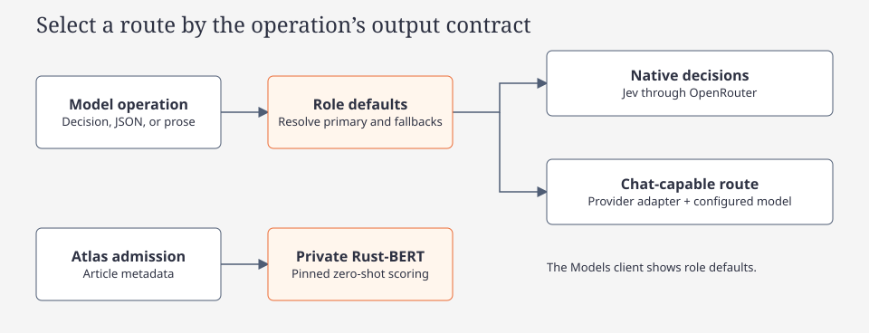
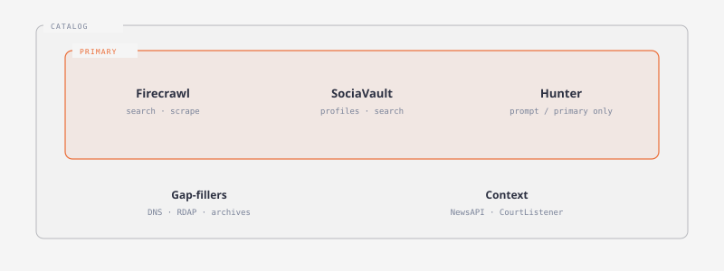
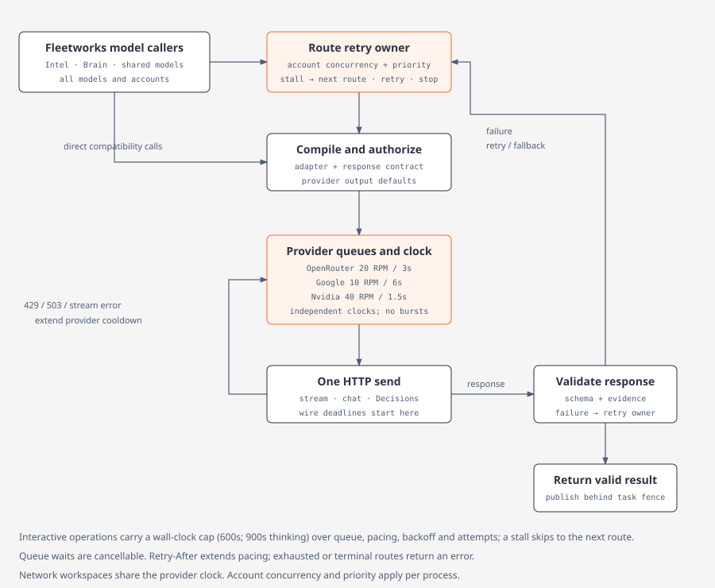

# Providers

[Concept route](index.md) · [Wiki](../../index.md)

Native Profile and Models manage the selected backend's shared provider accounts and role defaults through explicit versioned gateway operations. Ordinary network readers use current-format backend configuration and do not reload old files or environment provider keys. Local child selection changes request origin, not account ownership. [Configuration boundary](../code/fleetworks.md)

| Concern | Where |
| --- | --- |
| Provider credentials | Protected backend `auth.json`; browser and native never receive saved key bytes |
| Roles and defaults | Current-format backend `config.toml` with confirmed configuration revision |
| Local saved connections | Protected native origin/token-file references, separate from backend accounts |

| Model provider | Saved account kind | Endpoint |
| --- | --- | --- |
| OpenRouter | `openrouter` | Optional HTTPS base |
| Google | `google` | `https://generativelanguage.googleapis.com/v1beta/openai` |
| Nvidia | `nvidia` | `https://integrate.api.nvidia.com/v1` |

The current Models roles are independent pipeline assignments:

| Role key | Responsibility |
| --- | --- |
| `recon_agent` | Recon directives, grounded queries and extraction |
| `recon_decisions` | Recon tool selection and bounded assessment gates |
| `recon_analyst` | Recon findings, inferences and reports |
| `atlas_evaluator` | Atlas admission, support and selection decisions |
| `atlas_analyst` | Atlas claims, inferences, related leads and prose |
| `brain_summary` | Shared readable knowledge summaries |

The defaults API advertises this catalog in `roles`; the native Models page displays these roles and their routes. Older role fields remain readable for one-time migration and inspection. Migration freezes each new assignment independently; an explicitly empty pipeline role stays unconfigured rather than inheriting from another role. Legacy names are not active native role settings.

Each configured role can carry an ordered `fallbacks` list of provider/account/model routes. Route selection preserves account identity, resolves operation capabilities and keeps credentials on the service side. Atlas category admission uses the private Rust-BERT service. Shared decision routes remain available for bounded tasks such as article cleanup and evidence selection.

## OSINT data providers

Primary: Firecrawl, SociaVault, Hunter. Network execution resolves the captured saved backend account; it does not revive environment keys.

- Fallback field on the same row (`*_API_KEY_FALLBACK`) retries once after rate/quota, then is used first for later calls
- Atlas keeps a separate daily counter for the fallback account
- Keys go only to that provider’s host (Firecrawl bearer; SociaVault / Hunter `X-API-Key`)
- Hunter keys never go in the URL

Cache for the credit-reset interval: daily → 1 day; weekly → 1 week; monthly → 30 days.

- Firecrawl and Hunter reset monthly
- SociaVault and Whoxy prepaid never reset; public tools have no plan → 30 days
- NewsAPI, CourtListener, HackerTarget reset daily
- Failed results are never cached
- Live smoke tests are `#[ignore]`

| Provider | Tools | Notes |
|---|---|---|
| Firecrawl | search, scrape, map, batch scrape, crawl (off by default), extract, plus Google/Yandex/Mojeek SERP scrape adapters | Batch scrape and crawl are polled jobs, charged per page. Extract uses a fixed schema (5 credits). Named-engine tools POST `/v2/scrape` at engine SERP URLs; `firecrawl_search` does not satisfy named-engine coverage. |
| SociaVault | profile, search, search users, user content, Google search | 44 one-credit routes. No followers/following or single-post routes. Google search only after a weak Firecrawl search. |
| Hunter | domain finder, email count, domain search, email finder, email verifier, company enrichment, email insight, person enrichment, combined enrichment | Read endpoints only. Inputs from prompt, Firecrawl, SociaVault, or earlier Hunter. `hunter_tech_lookup` aliases company enrichment. |
| Whoxy | `whoxy_whois_history` | Prepaid WHOIS history. Env `WHOXY_API_KEY` / `WHOXY_API_KEY_FALLBACK`. Header `x-api-key` then query `key`. 1 credit for nonempty history, 0 for recognized empty. Cache full history, project `from`/`to`/`limit`. Default pool 0. |
| Holehe | `holehe_email_lookup` | No key. Native Twitter, Spotify, Pinterest adapters (experimental, fixture-validated, not live-validated). 123 upstream catalog ids; others return `unsupported`. |

## Typed provider diagnostics

Failed outbound requests are structured.

**Stages:** `configuration`, `admission`, `connect`, `first_response`, `response`, `stream`, `parse`, `validation`, `persistence`

**Categories:** `auth`, `permission`, `invalid_model`, `configuration`, `malformed_request`, `unsupported_transport`, `rate_limited`, `server`, `timeout`, `network`, `stream_interrupted`, `premature_eof`, `sse_error`, `malformed_payload`, `token_limit`, `refused`, `empty`, `invalid_result`, `persistence`, `cancelled`

Surfaces: Brain summary failure card, Jobs dashboard, `provider_verify` CLI. Events redact secrets.

## Budgeted executor

Shared chain (`provider_chain`): primary **4** attempts (waits 10s, 20s, 30s before retries); each fallback **3** (waits 10s, 20s). Maximum requests `4 + 3F`; all-failure base waits `60 + 30F` seconds. Exhaust the primary before fallback 1, then each fallback top to bottom. Snapshot routes at admission; persist attempt history.

- Every dispatched inference failure follows this policy, including 400/401/403/404, 429, 5xx, network/TLS, timeout, stream, and invalid output
- Missing credentials, invalid route, or definite capability incompatibility is a recorded skip (Blocked if nothing can dispatch)
- Admission wait does not consume an attempt
- Honor provider Retry-After / account cooldowns in addition to base waits
- `complete()` is one streaming request; `complete_one()` is one non-stream request. Hidden stream-to-nonstream retries were removed so the chain owns the budget
- Summary generation uses the same primary budget of 4; a transport switch inside that budget still counts as a request
- Successful fallback is informational and does not mark a cycle Partial
- Provider 429 / 503 defer picker calls; deterministic order when no primaries remain

## News and legal keys

NewsAPI and CourtListener are keyed context providers, not primaries. Keys never appear in URL, tool input, cache key, plan, or stored body (echoed keys redacted). 0 credits; budgets are per-turn call caps. Fallback after rate/quota only. 401/403 do not switch accounts.

| Provider | Tools | Notes |
|---|---|---|
| NewsAPI | `/v2/everything`, `/v2/top-headlines` | Exact-phrase `q`, `pageSize` 10, no pagination. Key `NEWSAPI_API_KEY` as `X-Api-Key` to `newsapi.org`. Developer: 100/day, 24 h late, one month back. Cache 86400 s. |
| CourtListener | case law (`type=o`), dockets (`type=r`), judges (`type=p`) on `GET /api/rest/v4/search/` | Exact-phrase `q`, first page, ≤20, no highlight. Token `COURTLISTENER_API_TOKEN`. Space 12 s. Never retry 429. Cache 86400 s. |
| GNews | `gnews_search` `GET /api/v4/search` | `q` ≤200 chars, `max` 10. `GNEWS_API_KEY` as `X-Api-Key`. Atlas Search (needs `source.country`). Recon does not pick it. |
| NewsData.io | `newsdata_latest` `GET /api/1/latest` | Past 48 h. Do not send `timeframe` on free plan (HTTP 422). `NEWSDATA_API_KEY` as `apikey`. Atlas only. |
| Currents | `currents_latest` `GET /v1/latest-news` | `CURRENTS_API_KEY` as `Authorization: Bearer`. Atlas regional headlines. |
| Wikipedia (public) | `wikipedia_source_reliability` | MediaWiki `action=parse` on WP:RSP. No key. `gr`→B, `nc`→C, `gu`→D, deprecated/blacklist→E, unlisted→F. Uses `osint_user_agent` when set, else the built-in default. Index cached 30 days. |

Recon limits: `news_calls_per_turn` 2, `legal_calls_per_turn` 3. Spec defaults still to confirm: `sociavault_turn_credits_opening` 3, `sociavault_turn_credits_later` 8, `google_fallback_min_results` 3. `opening_sociavault_calls` in old files is unused.

## Verification and testing

- Unit tests for every failure category and stage
- Summary executor budget is 2 total requests, including transport fallback; admission wait consumes no attempt
- Cache invalidation when inputs change

## Investigative assessment routes

Recon assessments use `recon_decisions`; Atlas and Brief support assessments use `atlas_evaluator`. Brief Claims, Inferences and Links generation use `atlas_analyst`. Each role has its own primary route and ordered fallbacks. Extraction and inference use `model_exec::execute_chat`, which skips Decisions-only models without changing route order. Fidelity, corroboration and identity contracts use `DecisionService::evaluate_shared` through the same admission, cancellation and fallback executor; native Jev decisions and chat adapters compile and parse the same finite contract. Cached stage receipts record the actual successful route. Changing captured route contracts invalidates refresh reuse.

## Capability-based route selection

Each operation declares an output contract (`OperationFormat`: bounded decision, generated JSON or prose) next to its scope. A role's resolved chain (primary and ordered fallbacks) is walked in order and the first route whose actual model and connection support that contract is used. The exact TypeSafe Jev family (`typesafe/jev`, `typesafe/jev-<version>`, `~typesafe/jev-latest`; `provider::is_jev_family`) serves only native OpenRouter Decisions; a Jev route on another provider or without a key is an explicit zero-request capability skip, never a chat request. Generative work with a Jev primary picks the first chat-capable fallback; a chain with no compatible route fails before dispatch with a pipeline-role capability error. Roles never borrow another role's routes. Payloads are recompiled per route (native decisions ↔ chat JSON) with one bounded chat repair before the declared fallback.

## Streaming and deadlines

Insight stages stream. Typed `AttemptProgress` events (dispatched, headers received, first model output, receiving ~1/s, heartbeat, stream complete) reach the UI; hidden reasoning counts as activity but its text is never surfaced. SSE is byte-buffered (split UTF-8 safe), `[DONE]` ends promptly, and length/interrupted/EOF outcomes are never accepted. Policies: ordinary calls keep connect 10s / headers 60s / inactivity 30s / total 120s; insight streams use connect 10s / headers 60s / first output 180s / model inactivity 90s / total 600s. Transport heartbeats never extend model deadlines. Native decisions and decision chat fallbacks keep the ordinary policy.

**Thinking stages (Brief Inferences).** Inferences always uses thinking models. Its stage budget sends a reasoning *effort* (never a token ceiling), which each adapter resolves per model: Gemini Flash `low` (thinking is mandatory), Nemotron Super `low`, Ultra `medium`, Gemma `high` (binary on), and Nemotron lightning `enable_thinking=true`. Exact OpenRouter Super/Ultra profiles send `reasoning.effort=low`/`medium` on the first dispatch. Background refresh reads the model catalog's `reasoning.supported_efforts`; endpoint support for the `reasoning` parameter alone never establishes valid effort values. Catalog vocabulary overrides the profile, so swapping models does not inherit Ultra's or Super's controls. A model with no confirmed control (for example DeepSeek) omits the field and records `unsupported-policy:reasoning=efficient`. Non-thinking stages (Claims, Links, cleanup, fidelity) keep the provider default and are never forced off. Thinking stages stream with headers 60s / first output 300s / model inactivity 120s / total 600s (non-streamed: headers 540s / total 600s) because a model that hides its reasoning may emit nothing until the answer; a stall moves to the next route rather than waiting longer, and the operation wall-clock cap bounds total time.

An available catalog entry does not establish generation availability. The historical 2026-10-16 configured-provider reproduction found Ultra stalls through OpenRouter and NVIDIA and Gemini 503 responses; Super generated valid thinking-mode inferences. That reproduction linked Inferences and Links to the then-named Summarization chain. It is dated evidence, not a shipped default or current role-setting instruction. See [the archived reproduction](../../archive/brief-provider-reliability.md).

## Brief operation overrides and the focused path

`defaults.operation_overrides` routes one Intel brief operation (`intel_brief_claims.generate`, `…inferences.generate`, `…inferences.assess`, `…links.generate`, …) to a specific provider/model without changing its logical role; empty entries inherit. The Models CLI displays canonical role chains; operation overrides remain part of workspace settings. `defaults.focused_oversized_brief` (default false) enables the measured focused oversized-story Inferences path; changing it reruns Inferences and Links only.

## Provider adapters and resolved capabilities

Model IDs are data. Three provider adapters in `provider_adapters/` own the wire details: `openrouter`, `google` and `nvidia`. Any other OpenAI-compatible endpoint uses the generic compatible adapter. Each adapter owns its endpoint and auth, model ID normalization, parameter names, schema/tool compilation, stream and usage parsing, and its error dialect. `compile(contract, route, capabilities)` is pure. It returns the endpoint, dialect, JSON body, response channel and effective policy. `normalize_final` and `StreamDecoder` turn a response back into one `Completion`: the answer text or output-tool arguments, finish/refusal status, and usage, which stays null when the provider does not report it. Only the shared executor (`provider_attempt`, `provider_chain`) makes HTTP calls. The compatibility wrappers `provider::{complete, complete_one, decide}` compile through the same adapters.

`provider_capabilities::resolve` builds `ResolvedCapabilities` from these sources, each overriding the one before:

1. Conservative defaults: every optional feature is unknown.
2. Documented profiles in `provider_profiles.json`, matched on the exact provider and model ID.
3. Cached catalog evidence: OpenRouter endpoint `supported_parameters`, intersected over eligible free endpoints, and Google `supportedGenerationMethods` and limits.
4. Scoped rejections observed on the wire, keyed by field **and** value.

An unknown optional feature is never sent, and the answer is validated locally. A decision-only target such as Jev, or a non-text model, fails at compile time with zero requests sent (`capability skip`). `ResolvedCapabilities::digest` hashes only semantic support states, values and limits. Catalog entries are stored in `app_state` under `provider_caps:<hash>`, a hash of provider, base URL, dialect, model and upstream. They have a 24-hour freshness policy, background refreshes for the same key are coalesced into one, and a brief never waits for a refresh.

Structured output follows the contract (BoundedDecision, GeneratedJson or Prose). For GeneratedJson the adapter tries these modes in order and uses the first the model supports:

1. A confirmed strict schema.
2. A forced inert `submit_result` output tool. Its arguments are the answer: there is no execution and no second round trip.
3. JSON mode.
4. Validated text.

OpenRouter adds `provider.require_parameters=true` whenever it uses an optional capability. Google's own host uses native `models/{id}:generateContent` (`streamGenerateContent?alt=sse` when streaming) with `x-goog-api-key`. A custom base ending in `/openai` keeps compatibility chat with the bare model ID. Agent tool loops also use compatibility chat.

Automatic model operations use provider defaults for output length and reasoning. Intel brief stages no longer send application-imposed token ceilings, reasoning-token budgets, or forced low/off reasoning settings. Structured response contracts and local evidence validation remain required. The explicit low-level `RequestPolicy` API still supports opt-in ceilings: `max_output_tokens` is the total ceiling when thinking is off. `thinking_ceiling` is the total ceiling when the model thinks; thinking and visible output share it, and no hidden reserve is added. `reasoning_budget` is sent only where a profile documents a budget field, and it is labelled advisory unless the endpoint enforces it. Reasoning intents (`off`, `efficient`, `low`, `medium`, `high`) map onto each model's own vocabulary:

- Nemotron Super: `none`/`low`/`high`.
- Nemotron Ultra: `none`/`medium`/`high` (`low` is invalid).
- Lightning: `chat_template_kwargs.enable_thinking`.
- Gemini Flash: `low`/`medium`/`high`; thinking cannot be turned off.
- Gemma native: `minimal`/`high`.
- DeepSeek: no reasoning field.

Native Nvidia or Google fields are never sent through OpenRouter, and no temperature is sent unless a profile documents one.

| Route | Initial adapter policy (profile) |
| --- | --- |
| `typesafe/jev-1.13` | Native decisions only |
| `nvidia/nemotron-3-super-120b-a12b:free` | Strict JSON schema |
| `nvidia/nemotron-3-ultra-550b-a55b:free`, `cohere/north-mini-code:free` | Forced output tool; never `response_format` |
| `google/gemma-4-{26b-a4b,31b}-it:free` | JSON mode; schema only once confirmed |
| `apodex/apodex-1.1-mini:free` | Validated JSON until endpoint metadata confirms more |
| `models/gemini-3.8-flash` | Google native schema; thinking `low` minimum |
| `models/gemma-4-26b-a4b-it` | Google native; local JSON validation; `minimal`/`high` thinking |
| Nvidia Super / Ultra / Lightning / DeepSeek | Hosted chat; effort data as above; locally validated JSON |

## Operation wire budget and bounded recovery

Google native schema output uses `responseFormat.text.mimeType: "APPLICATION_JSON"`
(an enum), with the schema under `responseFormat.text.schema`. The separate
legacy JSON-mode `responseMimeType` field accepts the string `application/json`.
See the [Google TextResponseFormat contract](https://ai.google.dev/api/generate-content#TextResponseFormat).

One transport call sends exactly one HTTP request. When a provider rejects an optional `field=value` it names (for example `response_format=json_schema`), `provider_attempt` learns that value for the route and returns a typed recovery proposal. It never resends. The executor (`provider_chain::execute_with_context`) decides whether the operation's budget allows a recompiled dispatch. It applies no backoff, because the request itself changes. An unknown 400 gets no proposal and is not guessed to be transient.

Interactive operations (an open Intel brief, brief-owned cleanup and fidelity) run under `WireBudget::INTERACTIVE`:

- every eligible route keeps its reserved initial dispatch;
- at most two dispatches go to any one route, and only the primary gets a transient retry (one);
- output repair and unsupported-option recovery draw from a shared allowance of two extra dispatches.

A four-route chain therefore sends at most six requests. Other callers keep the ordinary 4/3 retry policy. Each dispatch receives a `DispatchContext` that carries its admission queue time, the backoff it actually waited (shorter when cancelled) and its wire index. Admission polling counts as queue time and is never recorded as retry backoff. Attempt rows record the real backoff in `wait_ms`, along with prompt and completion tokens whenever the adapter reports usage. Reasoning tokens, visible tokens and cost go into the attempt telemetry.

At stage admission, each route's capabilities are resolved once (`provider_capabilities::admit`). Admission also starts a coalesced 24-hour background catalog refresh when the cached entry is missing or stale. The snapshot's digest is stored in the attempt's `declaration_json` (`capability_digests`). A refresh that finishes mid-operation cannot change an in-flight request. Only observed rejections, which can only narrow what is sent, are merged in for a recovery recompile.

**Stalls and the wall-clock cap.** A route that times out (no headers, no first output, stalled stream) moves straight to the next dispatchable route; it is not resent to the route that just stalled, and no backoff is slept before a fallback. A stall with no later route keeps the normal retry rules. Other transient failures (503, network) keep the primary's one retry. Interactive operations also carry an operation wall-clock cap, 600s (900s for thinking stages), that covers admission queue time, provider pacing, backoff and every attempt: each dispatch is bounded by the time left, a backoff longer than the time left is skipped, and when the cap ends the operation the error is `timeout` ("operation wall-clock cap of Ns reached after N request(s); last failure: ...").

## Provider-wide request pacing

Every model HTTP send passes through `provider_rate_limit`, including streamed and non-streamed completions, native Decisions, transcription when configured on a paced provider, chat fallbacks, output repairs and unsupported-option recovery. The scheduler uses one FIFO queue per provider in each process. Network workers also reserve sends against a shared SurrealDB clock per provider across all processes, roles, models and accounts.

| Provider | Fleetworks RPM ceiling | Minimum interval between sends |
| --- | --- | --- |
| OpenRouter | 20 | 3 seconds |
| Google | 10 | 6 seconds |
| Nvidia | 40 | 1.5 seconds |

These are Fleetworks scheduling limits, rather than claims about every provider tier. OpenRouter documents 20 RPM for free variants; Google quotas vary by model and project, with separate token and daily limits. See [OpenRouter limits](https://openrouter.ai/docs/api_reference/limits) and [Google limits](https://ai.google.dev/gemini-api/docs/rate-limits). The Nvidia ceiling is the configured application policy. Other providers retain existing admission behavior.

The first request can start immediately. Idle time earns no burst, and a delayed waiter schedules the following send from its actual admission time. Compilation and authorization precede transport admission. Cancelled waiters release their queue position without reserving quota. Provider queues are independent; a Google cooldown does not stop OpenRouter or Nvidia. Network workspaces share a two-active-requests limit per configured provider account. Interactive tickets have priority over background tickets, with FIFO ordering within each class. Live attempts renew their leases and expired tickets release capacity after a crash. Embedded execution keeps its local scheduler.

HTTP 429 and 503 responses delay all queued sends for that provider, including when the failed request was the route's last attempt. `Retry-After` (seconds or HTTP date) is honored without the diagnostic display cap; absent a header, 429 waits 60 seconds and 503 waits 10 seconds. Stream-delivered rate-limit/server errors feed the same clock. Cooldowns only extend existing waits. The retry executor remains the only retry owner: its retry budget and backoff still apply, and transport pacing may delay the next send further. See [OpenRouter retry guidance](https://openrouter.ai/docs/api_reference/errors-and-debugging).

Queue residence is recorded separately from retry backoff and starts no network/output deadline. The `Dispatched` wire mark is emitted only after transport admission, and native Decisions records its send time at the same boundary. A network worker needs a shared reservation before transport. Standalone compatibility execution uses its local clock. The two-active-request cap and interactive priority per account still apply within each process.

`StageBudget` rows are retained as legacy sizing metadata for core API compatibility; their `policy()` no longer transmits output or reasoning restrictions. Claims, Inferences and Links still send their `brief_contracts` schema: a strict schema where confirmed, otherwise the forced `submit_result` output tool, otherwise JSON mode or validated text. Compact item/field limits describe the brief's data contract rather than a provider token budget. Output-tool arguments are validated exactly like content.

## Atlas news provider admission

Atlas workers reserve a logical fetch in a shared SurrealDB counter for the provider, configured account slot and UTC day. Storage-backed NewsAPI tools share the same NewsAPI counters. A rate or quota response can move a reservation to a configured fallback when its bucket has capacity. Transport retries and same-host redirects stay within the logical reservation. An interrupted request keeps its reservation because the remote provider may have received it. Direct tool execution without a repository uses the existing process-local behavior. Network model admission uses the shared provider clock and account leases described above. Routed calls use their configured account identity. A transport call without a configured alias uses its provider's default account. See [Atlas execution](../code/architecture.md#atlas).

## Canonical Jev decisions

`BlockDecisions` (cleanup) and `FidelityDecisions` (brief fidelity) build a canonical `DecisionContract` and `DecisionState` and compile through `investigation::decisions::compile_native`. State stays minimal: empty sections are omitted, and each item is addressed by field path, for example ``items.item_0``. Contracts are validated before any network access. A malformed contract fails with zero requests.

- Choice: an option map of 2–255 options. The winning probability is `probabilities[choice]` and confidence is kept separately. Confidence never stands in for probability.
- Noul: optional `{true,false}` descriptions. `noul` is P(yes); a "no" answer carries 1 − p.
- Score: an ordered array of 2–10 level descriptions, with no range or option object. The native probability-weighted level is zero-based. It maps linearly onto the application scale `min..=max` and is kept fractional (`score_value`). It is rounded only for the legacy display (`score`).
- Answer types, distribution keys, bounds and sums are all validated. Chat fallbacks return validated labels with no fabricated probabilities, and `ContractAdapter::parse_chat_as` reports the structured mode that actually ran.

## Operation overrides, the Brief fast preset and portable profiles

`defaults.operation_overrides` values are an `OperationOverride` union: an ordinary `ModelAssignment`, or a deny-unknown-fields reference `{route_role = "brain_summary"}`. A reference resolves the named role's *current* chain in `RoleDefaults::resolve_operation`, so a later `brain_summary` model swap is followed without copied IDs. Only the six canonical pipeline role keys are valid targets. Operation keys, `decision_model`, unknown roles and mixed objects (a `route_role` beside assignment fields) are rejected when the TOML is parsed. `reset_operation` removes the key and never edits the referenced role.

The **Brief fast preset** links `intel_brief_claims.generate` and `intel_brief_links.generate` to `brain_summary`. Their logical roles do not change, and Inference support and bounded gates keep their configured routes. The preset ships unset. It is not recommended until the held-out comparison in [benchmarks/brief-fast-preset-heldout.md](../../benchmarks/brief-fast-preset-heldout.md) has been measured with a valid key. Reset removes only the preset's own references and leaves any explicit assignment you set on those operations.

**Editing one operation.** Configure the operation's explicit assignment or canonical `route_role` reference in workspace settings or a portable Profile document. Removing its entry restores the logical pipeline role; it does not edit that role's saved chain. The current Models CLI edits role defaults, not individual operation overrides.

Portable profile documents retain schema 1/2 compatibility. Schema 2 added routing features rejected under schema 1:
- override role references;
- an optional route `account_id`: the internal account-map key, validated against a `providers[]` entry of the same provider kind.

Current exports use schema 3 when pipeline roles or reasoning variants are present; older exports use schema 2 for routing features and schema 1 otherwise. Schema 1/2 role names are migration input, not extra current roles. Import preserves account-map keys instead of collapsing them onto provider kinds. No secret travels in routing fields.

`check_role_compatibility` is contract-based and makes no network request:
- Bounded-decision chains (`recon_decisions`, `atlas_evaluator`, `*.assess`) accept native decisions models and chat models whose labels are validated locally.
- Generation chains (`recon_agent`, `recon_analyst`, `atlas_analyst`, `brain_summary`, `*.generate`) are rejected only when every route, fallbacks included, is a decisions model.
- Unknown text models stay valid with conservative capabilities.
- Role changes preserve the operation output contract; a fallback cannot change role ownership.

## Per-attempt usage, wire timings and task epochs

[Recon job storage](../../../crates/argos-osint-core/src/storage/recon_jobs.rs) defines the current SurrealDB attempt telemetry and operation epoch fields. Their [planned Jobs migration](../code/jobs-persistence.md) must move accounting and Profile readers together while retaining domain admission safeguards. [Storage bootstrap](../../../crates/argos-osint-core/src/storage/bootstrap.rs) applies them; see the [storage map](../code/storage.md).

| SurrealDB table | Fields |
| --- | --- |
| `recon_model_attempt` | `reasoning_tokens`, `visible_tokens`, `reported_cost_usd`, `response_headers_ms`, `first_reasoning_ms`, `first_output_ms`, `stream_completion_ms` (all nullable), `policy_diagnostics_json` (`'[]'`) |
| `recon_model_operation` | nullable `task_epoch`, index `(task_id, task_epoch)` |

Rules for these fields:
- Counters are written only when the provider reported them. Cost is recorded only when it is reported in USD. Missing measurements remain unknown, never fabricated as zero.
- Timings are measured from `sent_at`, using `AttemptProgress` marks (headers, first reasoning, stream complete). The first answer delta comes from the stream observer.
- Brief stages bind each model operation to the task's lease epoch (`OperationScope::with_task_epoch`). The task epoch is part of the operation identity; attempt generation comes from the job generation. A retried task uses a new operation identity.
- Do not query the retired `intel_brief_stage_timings` table. Current stage progress uses `brief_activity` and `brief_stage_meta`; provider attempt timing lives in `recon_model_attempt`.

Brain Actor identity maintenance uses `atlas_evaluator` for bounded identity decisions through the shared executor (native Decisions or chat). It processes a local name/acronym shortlist independently of Atlas cycles; absent configuration leaves local spelling repair active and makes no identity model requests. See [actor identity maintenance](../code/architecture.md#actor-identity-maintenance).
