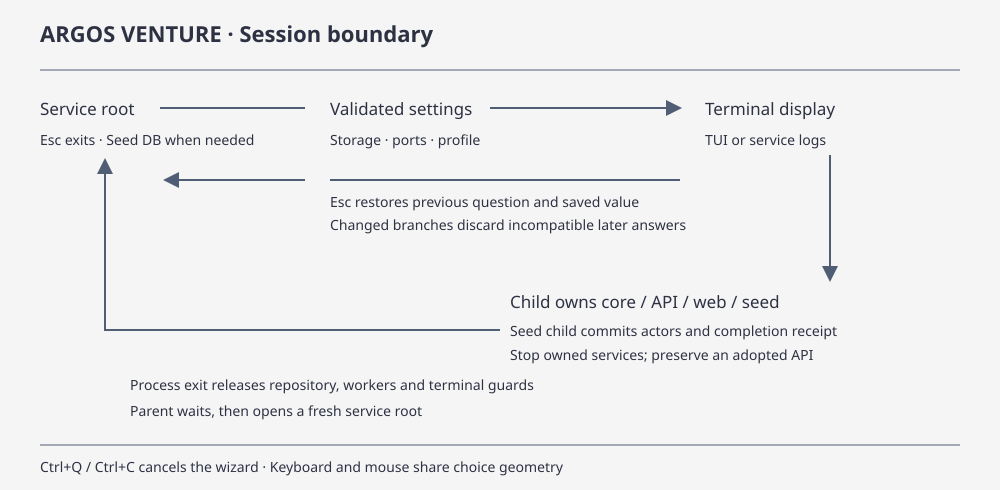

# Use Fleetworks

[Concept route](index.md) · [Venture guide](../code/fleetworks.md) · [Wiki](../../index.md)

Build Venture and its sibling clients from the repository root. The web app and API run in the local Docker Compose stack.

```sh
cargo build --locked -p fleetworks-venture -p fleetworks-cli --bins
target/debug/venture --workspace ./review-workspace web --storage compose-disk
```

Open the web address Venture prints. The default is `http://127.0.0.1:3000`. Venture opens Jobs and Logs in the terminal. Use `web --terminal logs` to follow Compose service output instead. Leaving the terminal view keeps the stack running. Use `venture --workspace ./review-workspace stop` to stop the owned stack.

[](../../diagrams/venture-navigation.html)

Use the same workspace on subsequent commands. Venture initializes a new workspace automatically on startup. For storage modes, port overrides and importing existing provider keys or model defaults, see the [Venture guide](../code/fleetworks.md) and [deployment reference](../../../deploy/README.md).

## Intel

Open **Bulletin** to browse retained articles by day and domain, search, or sort by recency and temperature. Selecting an occurrence opens its **Focus Brief**. It attaches to existing brief work or starts a new generation for the current inputs. Progress and completed evidence update in place. **Reload** explicitly starts another generation.

The brief shows the source description, identified actors, claims, inferences and Related leads. Actor actions open dossiers. Claim and inference actions open their provenance in **Topology**. Related articles suggest possible context through retained shared mentions. [Intel web contract](../code/intel-web.md)

## Atlas

Add `--atlas` when starting Venture to enable durable news collection. Stop an already running base stack before enabling Atlas. Prepare the provider configuration and pinned Rust-BERT files before starting a live cycle. [Atlas setup](../../../deploy/atlas-dispatch.md)

```sh
target/debug/venture --workspace ./review-workspace up --storage compose-disk --atlas
target/debug/venture --workspace ./review-workspace client atlas start --request-id morning-cycle
target/debug/venture --workspace ./review-workspace client atlas days
target/debug/venture --workspace ./review-workspace client atlas articles 2026-11-10 --category security
```

Reuse the same request ID after an uncertain submission. Use a new ID for a new cycle. Collection, actor indexing, and reconciliation progress can settle separately. [Atlas and Related](atlas-classification-and-related-articles.md)

## Brain

Open actor dossiers and topology from Focus Brief, or read retained records directly through the Brain client. Topology uses a canonical memory ID or a retained brief seed of the form `brief:RUN/ARTICLE`. Select a node to inspect it, or recenter to change the neighborhood. [Topology](topology-mapper.md)

```sh
target/debug/venture --workspace ./review-workspace client brain actor ACTOR_ID
target/debug/venture --workspace ./review-workspace client brain brief RUN_ID ARTICLE_ID
target/debug/venture --workspace ./review-workspace client brain topology 'brief:RUN_ID/ARTICLE_ID'
```

## Jobs and Logs

Attach to a running stack with `venture client jobs tui`. Enter `list` to refresh, `detail #1` to open the first job, and `logs #1` for its events. Retry and cancel require confirmation. Enter `quit` to close the view. One-shot commands also provide JSON for scripts. [Client command reference](../../../apps/fleetworks-cli/README.md)

## Profile

Run `venture client profile workspace` to resolve the workspace path, `venture client profile health` to check API readiness, and `venture client profile show` for the workspace and service projection. Use `venture client tools list` and `venture client models defaults` to read the tool catalog and configured role defaults.

## State

Venture keeps configuration, datasets, models, logs, exports, credentials and managed datastore files under the workspace. Clients connect through the authenticated API. The web app talks to the same API through its server relay. Stopping Venture leaves workspace files in place. [Storage and persistence](../code/storage.md)
