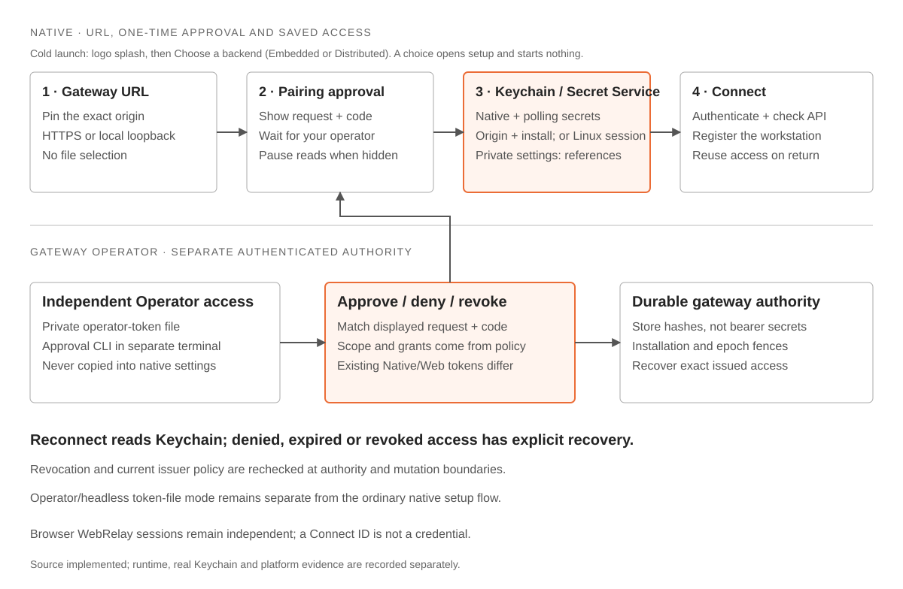

# Walk through the repository

[Repository map](../index.md) · [Wiki routes](index.md)

Follow these routes from setup to implementation.

## What this repository is

Fleetworks collects public-source intelligence and prepares cited Focus Briefs. The native macOS and Linux x86_64 Rune app starts an Embedded companion (explicit **Start Embedded Backend** over an unnamed Unix socket) or connects to an independently deployed authenticated Distributed Linux gateway with SurrealDB, private services and workers; Intel Web provides the browser desktop.

Start with the [README](../../README.md), [concepts](concepts/index.md), and [glossary](concepts/glossary.md). Follow the [code map](code/index.md) and [diagrams](../diagrams.md) for implementation.

## Run the client and backend

Install the pinned Rust 1.95.0 toolchain and host build prerequisites (Xcode Command Line Tools on macOS, or Linux desktop dependencies on x86_64) for native app packaging. Docker and Compose v2.20+ operate the separate Distributed backend. Start at the [quick start](../../README.md#quick-start), then follow [native connections](code/native-connections.md) and [direct deployment](../../deploy/README.md). The app never launches Distributed services or Intel Web; Embedded starts only when explicitly requested.

Use the same deployment env file, Compose files and project for startup, status, logs and stop. Keep backend data separate from the protected native container. Retired terminal instructions are preserved only as [historical evidence](../archive/cli-retirement.md).

## How a request moves

Clients call the gateway API, which routes retained operations to private services. Workers use Jobs-owned embedded delivery. Scheduling still uses SurrealDB during the [SQLite/RocksDB cutover](code/jobs-persistence.md). Retained API-key model calls use private execution. [Service boundaries](code/architecture.md#fleetworks-service-boundaries) · [Role configuration](code/fleetworks.md#run-the-network-api-and-workers)

## Product surfaces

| Surface | What it is | Read next |
| --- | --- | --- |
| Intel | Bulletin, Focus Briefs, claim analysis, and staged publication | [Usage](concepts/usage.md#intel) · [Brief chain](../diagrams/intel-brief-chain.html) · [Core](code/core.md#intel) |
| Atlas | Durable collection and six-domain admission | [Usage](concepts/usage.md#atlas) · [Classification](concepts/atlas-classification-and-related-articles.md) · [Taxonomy](concepts/strategic-domains-taxonomy.md) · [Pipeline](../diagrams/atlas-pipeline.html) |
| Brain | Sourced memory, associations, topology, and the seeded actor catalog | [Usage](concepts/usage.md#brain) · [Topology](concepts/topology-mapper.md) · [Actor catalog](code/actor-catalog.md) |
| Jobs and Logs | Durable work and operational events | [Usage](concepts/usage.md#jobs-and-logs) · [Lifecycle](../diagrams/jobs-lifecycle.html) |
| Tools and Model Assignments | Service cards, inline credential provisioning and supported shared role defaults | [Usage](concepts/usage.md#profile) · [Providers](concepts/providers.md) · [Model roles](../diagrams/model-roles.html) |

[Interfaces](code/interfaces.md) ties supported native, browser and service entry points to their verification.

## Persistence

Services share the explicitly configured SurrealDB endpoint. Direct Compose provisions the review database; deployment operators configure independent endpoints explicitly. Embedded storage contracts retain direct engine access.

[Storage map](code/storage.md) · [Schema authority](code/storage.md#schema-and-runtime-authority) · [Persistence diagram](../diagrams/persistence.html) · [Recall](code/storage.md#recall-and-source-lifecycle)

## Models, classification, and local text

[Providers](concepts/providers.md) explains route selection, pacing, and where credentials stay. [Request scheduling](../diagrams/model-request-scheduling.html) shows the shared tickets and cooldowns. [Decision contracts](code/jev-decision-gates.md) compile to Jev-native questions or schema-constrained prompts.

Atlas admission uses the [classifier](code/classifier.md): a pinned Rust-BERT worker for inference, and a separately managed Natural training run. [Local NLP](concepts/nlp-preprocessing.md) is Compromise running inside the service, with no Node process at request time. The [NLP figure](../diagrams/nlp-preprocessing.svg) is the data flow.

## Intel web

The browser app is React Native Web, served by Next from [apps/web-desktop](../../apps/web-desktop). It relays to the API on the same origin. Shared screens live in [packages/intel](../../packages/intel), tokens and primitives in [packages/ui](../../packages/ui), and the typed Query client in [packages/api-client](../../packages/api-client).

Start with the [web contract](code/intel-web.md), then the [UI rules](code/react-ui.md) and [browser checks](code/react-ui-testing.md). The [request figure](../diagrams/intel-web.html) shows the relay and readiness boundaries.

## Native client and historical terminals

The macOS and Linux x86_64 Rune app has six sidebar destinations (**Actor Maintenance**, **News Cycles**, **Brain Search**, **Tool Box**, **Model Assignments**, **Jobs & Logs**) plus **Workstation Status**, **Settings** (five tabs: General, Connection, Assistant, Appearance, Models), **Inbox** (notifications and Embedded QA), and **Setup Gateway**. Intel Web supplies topology and its list twin. Venture, the six terminal clients and the older Ratatui executable are retired. [Native verification](code/native-verification.md) · [Historical disposition](../archive/cli-retirement.md)

## Where the code lives

Use the [repository map](../index.md#directory-map) for the directory index.

| Path | Role |
| --- | --- |
| [apps/fleetworks-desktop](../../apps/fleetworks-desktop) | Native Rune macOS and Linux x86_64 control hub |
| [crates/fleetworks-contracts](../../crates/fleetworks-contracts) | Client-safe contracts and origin-pinned SDK |
| [crates/fleetworks-workstation](../../crates/fleetworks-workstation) | Protected workstation settings, installation identity, and keyring/session storage |
| [apps/web-desktop](../../apps/web-desktop) | Intel web server and relay |
| [packages](../../packages) | Shared React Native UI, Intel screens, and API client |
| [crates/argos-osint-core](../../crates/argos-osint-core) | Domain workflows and storage |
| [crates/argos-osint-api](../../crates/argos-osint-api) | Versioned HTTP contracts |
| [services/api-host](../../services/api-host) | Authenticated host and private roles (including Embedded `local-ipc`) |
| [services/search-index](../../services/search-index) | Private Tantivy actor search index service |
| [crates/fleetworks-jobs](../../crates/fleetworks-jobs) | SQLite operational storage and embedded RocksDB queue |
| [crates/fleetworks-broker](../../crates/fleetworks-broker) | Standalone RabbitMQ (`lapin`) transport crate |
| [deploy](../../deploy) | Compose files, images, and smoke scripts |
| [scripts](../../scripts) | Build, storage, release, and CI planning tools |
| [tools/atlas-bert](../../tools/atlas-bert) | Standalone Atlas Rust-BERT classifier worker |
| [tools/assistant-bert](../../tools/assistant-bert) | Standalone Embedded Inbox QA Rust-BERT worker |
| [.github/workflows](../../.github/workflows) | Hosted checks and releases |

The [core map](code/core.md) is the module index inside the domain crate.

## Change, check, and release

Read [contributing](code/contributing.md) and [conventions](code/conventions.md) before editing. [CI scopes](code/ci.md#fleetworksyml--scoped-branch-checks) select checks by changed paths. Affected Linux storage selects embedded compatibility; the four-platform diagnostic remains available by direct dispatch. [Versioning](code/versioning.md) defines the shared workspace version, commits, and releases. Agents follow [execution policy](code/agent-workflow.md).

## Docs, tags, and history

[Tags](tags.md) connect a concern across pages and source comments. [Wiki maintenance](maintenance.md) is how to add or refresh a page without creating a second explanation. Dated investigations stay in the [archive](../archive/index.md).
